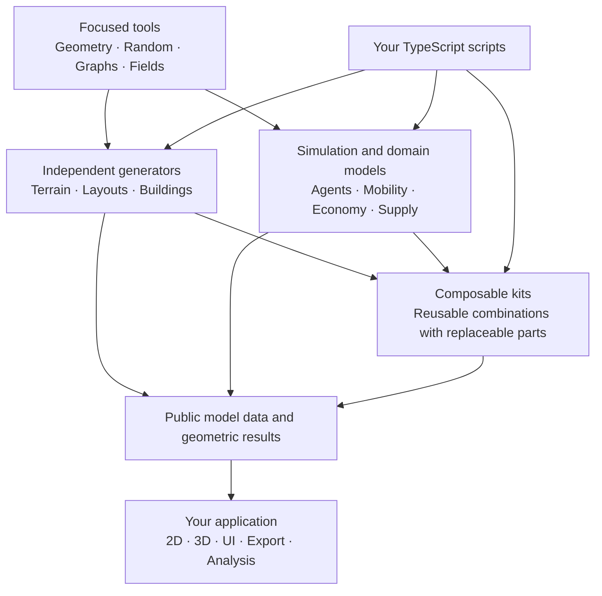

# City Library

City Library is an open, modular library for building simulations and games about future cities. Try a rule, watch what happens, change it and try again.

## A toolkit for experiments

Cities face difficult questions about climate, biodiversity, mobility and resources. Simulations and games let us explore alternatives and learn through play. Fun is just another name for learning.

Combine agents, space, networks and measurements in TypeScript. Use a graph on its own, add agents when needed, or pair a grid with a local rule. Each part should work independently and make its assumptions easy to inspect.

TypeScript brings these experiments to the web, with an ecosystem of useful game libraries.

NetLogo inspires the scripting approach: a short script should be enough to get an idea running. Bits UI and shadcn-svelte inspire the modular approach: small building blocks with useful defaults and room to make something your own.

Agent Loom provides the headless modeling core. Agent Lab adds browser controls and views; the same model also runs in a script. Applying its results to a real city still requires evidence.

The core and shared UI are usable, with 125 experiment entries toward a fixed selection of 200. The full specification and scientific model comparisons remain unfinished, and the package is not published. See [the work plan](PLAN.md) for progress and open checks.

## Run the Lab

From the repository root, use Bun 1.4.2 and start the Svelte work-in-progress runtime:

```sh
bun install --frozen-lockfile
CITY_LIBRARY_UI_RUNTIME=svelte bun run dev:ui:svelte
```

Open http://localhost:3101. Choose an experiment, set its initial values and press Setup. Advance one step at a time or use Run/Pause. Live controls call model actions; setup controls prepare the next initialization.

The runtime variable is required: the Vite command defaults to legacy rendering. For the older Bun host, run `bun run dev:ui` and open http://localhost:3100. See [Lab usage](ui/agent-lab/README.md) for ports, updates and migration limits.

## Write and explore

- [Write a model](docs/development/model-authoring.md): follow a real headless model and its UI binding.
- [Documentation](docs/README.md): find architecture, APIs, authoring rules and evidence.
- [Agent Loom reference](docs/agent-loom/README.md): target contracts and operation inventory; delivered coverage is tracked separately.
- [Work plan](PLAN.md): current priorities and acceptance gates.

## How the pieces fit



This is a composition map, not a required startup sequence. A graph needs no coordinates, an agent model needs no grid, and a building generator need not create residents. Broader building generation and city-domain models remain delivery goals.

## Development

`bun run check` runs TypeScript/Svelte checks, tests, public examples, the library build and a packed Bun/Node/TypeScript consumer. The consumer requires Node 26.8.2. `bun run build:ui:svelte` builds the Vite host; use `CITY_LIBRARY_UI_RUNTIME=svelte bun run build:ui:svelte` when building the Svelte runtime explicitly.

Keep model state under one owner, use public actions for changes and keep rendering outside the headless library. New capabilities start with asserted public examples. [Architecture](docs/ARCHITECTURE.md) and [UI design](docs/DESIGN.md) define the binding rules.
