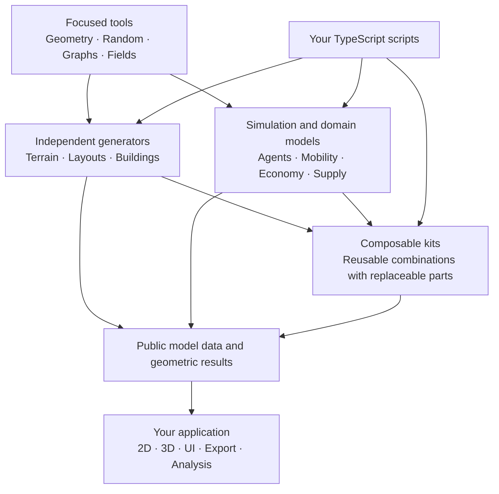

# City Library

City Library is an open, modular library for building simulations and games about future cities. Try a rule, watch what happens, change it and try again.

## A toolkit for studies

Cities face difficult questions about climate, biodiversity, mobility and resources. Simulations and games let us explore alternatives and learn through play. Fun is just another name for learning.

Combine agents, space, networks and measurements in TypeScript. Use a graph on its own, add agents when needed, or pair a grid with a local rule. Each part should work independently and make its assumptions easy to inspect.

TypeScript brings these studies to the web, with an ecosystem of useful game libraries.

A short script should be enough to get an idea running. Small, independent building blocks provide useful defaults and room to make something your own.

A headless core holds the model logic. Agent Lab adds browser controls and views; the same model also runs in a script. Applying its results to a real city still requires evidence.

The core and the shared UI are usable today, and the [models](models/README.md) range from adapted NetLogo classics to small original city models. The full specification and the scientific model comparisons are unfinished, and the package is not published. [What works today](docs/development/coverage.md) lists the available operations; [the work plan](PLAN.md) shows what comes next.

## Run the Lab

From the repository root, use Bun 1.4.2 and start Agent Lab:

```sh
bun install
bun run dev
```

Open http://localhost:3101. Choose a model, set its initial values and press Setup. Advance one step at a time or use Run/Pause. Live controls call model actions; setup controls prepare the next initialization.

See [Lab usage](ui/agent-lab/README.md) for configuration and explicit source reloads.

## Write and explore

- [Your first model](docs/first-model.md): build a small model, run it from a script and open it in Agent Lab.
- [Explore the models](models/README.md): every model by topic, with its sources and limits.
- [Concepts](docs/concepts.md): the few ideas behind a headless model and its UI.
- [Write a model](docs/development/model-authoring.md): follow a real headless model and its UI binding.
- [Documentation](docs/README.md): guides, references, contracts and evidence.
- [Work plan](PLAN.md): current priorities and acceptance gates.

## How the pieces fit



This is a composition map, not a required startup sequence. A graph needs no coordinates, an agent model needs no grid, and a building generator need not create residents. Broader building generation and city-domain models remain delivery goals.

## Repository structure

The repository groups files by responsibility. The tree below is the [accepted target structure](docs/evolution/structure.md). No files have moved yet: today's paths stay valid until the migration, and `library/` and `ui/` keep their current names until then.

```text
library-core/               Autonomous headless core modules; world-composition/ is the only aggregating folder
library-city/<subsystem>/   City systems such as economy or energy supply, each created with its first working slice
library-generative-design/  Separate generative 3D design track (later)
ui-web/                     Today's ui/: shared UI and the Agent Lab host, later also game UI components
ui-3d/                      Three.js presentation (later)
models/                     Flat model folders; each covers one small test case
tests/                      Behavior checks and public contract scripts
docs/                       Guides, contracts and development evidence
index.ts                    Public package entry
```

Library logic comes first, then the city library grows step by step, followed by game prototypes and 3D; generative design is a separate track. The [roadmap](docs/evolution/roadmap.md) records this sequence.

Today, library build tools live in `library/development/`, executable checks in `tests/` and migration evidence in `docs/development/`. Required configuration stays at the root.

The [naming conventions](docs/NAMING_CONVENTIONS.md#repository-structure) define placement rules; [architecture](docs/ARCHITECTURE.md#binding-domain-layout-and-extension-rules) defines domain boundaries. No additional package layer or nested `src/` folder is needed.

## Development

`bun run check` runs TypeScript/Svelte checks, tests, public examples, the library build and a packed Bun/Node/TypeScript consumer. The consumer requires Node 26.8.2. `bun run build:ui` builds the Vite host.

Keep model state under one owner, use public actions for changes and keep rendering outside the headless library. New capabilities start with asserted public examples. [Architecture](docs/ARCHITECTURE.md), [naming conventions](docs/NAMING_CONVENTIONS.md) and [UI design](docs/DESIGN.md) define the binding rules; the [contributor section](docs/README.md#contribute) lists the rest.

This repository does not currently include a root license file. Source-specific terms are recorded in the notices.
