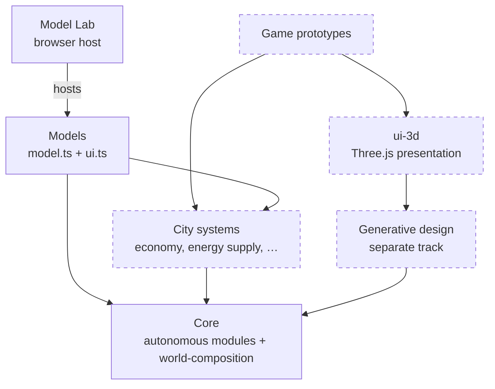

# City Library

City Library is an open, modular library for building simulations and games about future cities. Try a rule, watch what happens, change it and try again.

## A toolkit for studies

Cities face difficult questions about climate, biodiversity, mobility and resources. Simulations and games let us explore alternatives and learn through play. Fun is just another name for learning.

Combine agents, space, networks and measurements in TypeScript. Use a graph on its own, add agents when needed, or pair a grid with a local rule. Each part should work independently and make its assumptions easy to inspect.

TypeScript brings these studies to the web, with an ecosystem of useful game libraries.

A short script should be enough to get an idea running. Small, independent building blocks provide useful defaults and room to make something your own.

A headless core holds the model logic. Model Lab adds browser controls and views; the same model also runs in a script. Applying its results to a real city still requires evidence.

The core and the shared UI are usable today, and the [models](models/README.md) range from adapted NetLogo classics to small original city models. The full specification and the scientific model comparisons are unfinished, and the package is not published. [What works today](docs/development/coverage.md) lists the available operations; [the work plan](PLAN.md) shows what comes next.

## Run the Lab

From the repository root, use Bun 1.4.2 and start Model Lab:

```sh
bun install
bun run dev
```

Open http://localhost:3101 and choose a model. It loads and initializes with its default inputs. **Run**/**Pause** advances it, **Speed** sets how often the Lab steps, and live **Parameters** call model actions. Change setup values and press **Reload** to initialize again.

See [Lab usage](ui/model-lab/README.md) for configuration and for loading source updates (**Update Lab**).

## Write and explore

- [Your first model](docs/first-model.md): build a small model, run it from a script and open it in Model Lab.
- [Explore the models](models/README.md): every model by topic, with its sources and limits.
- [Concepts](docs/concepts.md): the few ideas behind a headless model and its UI.
- [Write a model](docs/development/model-authoring.md): follow a real headless model and its UI binding.
- [Documentation](docs/README.md): guides, references, contracts and evidence.
- [Work plan](PLAN.md): current priorities and acceptance gates.

## How the system works

The system grows in layers. Arrows mean "imports"; every dependency points down to the public core. Dashed boxes do not exist yet.



| Layer | Today | Target folder | May import | State |
| --- | --- | --- | --- | --- |
| Core | `library/` | `library-core/<module>/` | Only its own files; `world-composition/` alone aggregates modules | Usable |
| City systems | — | `library-city/<system>/` | Only `"city-library"`, never another city system | None delivered |
| Models | `models/<slug>/` | unchanged | Everything public | Usable; each covers one small test case |
| Model Lab | `ui/`, host in `ui/model-lab/` | `ui-web/` | Only public APIs | Usable |
| Game prototypes | — | later | Everything public | After a basic set of city systems |
| Generative design | — | `library-generative-design/` | Only `"city-library"` | Separate track, later |
| 3D presentation | — | `ui-3d/` | Public APIs, generative design descriptions, `three` | Later |

**How a model runs.** `model.ts` is headless: `create(inputs)` returns an instance that owns all model state and exposes actions such as `advance(stepCount?)`. `ui.ts` declares controls, monitors and views with `defineUI(model, …)`. The UI changes state only through those actions and reads detached observations through `read()`; changing an observation never changes the model. The same `model.ts` runs in a script, a test or Model Lab.

The core names no application: a graph needs no coordinates, an agent model needs no grid. City systems add domain vocabulary with simplified, game-like rules. [Concepts](docs/concepts.md) explains these ideas; [principles](docs/evolution/principles.md) and the [roadmap](docs/evolution/roadmap.md#phase-sequence) record the direction and its order: core logic first, then city systems, then game prototypes and 3D.

## Repository structure

The repository groups files by responsibility. The [accepted target structure](docs/evolution/structure.md) renames and splits folders later; no files have moved yet, so today's paths stay valid.

```text
library/            Headless core modules; build tools in library/development/  → library-core/
ui/                 Shared UI components; Model Lab in ui/model-lab/            → ui-web/
models/<slug>/      Flat model folders, model.ts + ui.ts each
tests/              Behavior checks and public contract scripts
docs/               Guides, contracts and development evidence
index.ts            Public package entry
```

Target-only folders (`library-city/`, `library-generative-design/`, `ui-3d/`) are created with their first working slice. The [naming conventions](docs/NAMING_CONVENTIONS.md#repository-structure) define placement rules; [architecture](docs/ARCHITECTURE.md#binding-domain-layout-and-extension-rules) defines domain boundaries; the [import rules](docs/evolution/structure.md#import-rules) define what each target folder may import.

## Development

`bun run check` runs TypeScript/Svelte checks, tests, public examples, the library build and a packed Bun/Node/TypeScript consumer. The consumer requires Node 26.8.2. `bun run build:ui` builds the Vite host.

New capabilities start with asserted public examples. [Architecture](docs/ARCHITECTURE.md), [naming conventions](docs/NAMING_CONVENTIONS.md) and [UI design](docs/DESIGN.md) define the binding rules; the [contributor section](docs/README.md#contribute) lists the rest.

This repository does not currently include a root license file. Source-specific terms are recorded in the notices.
