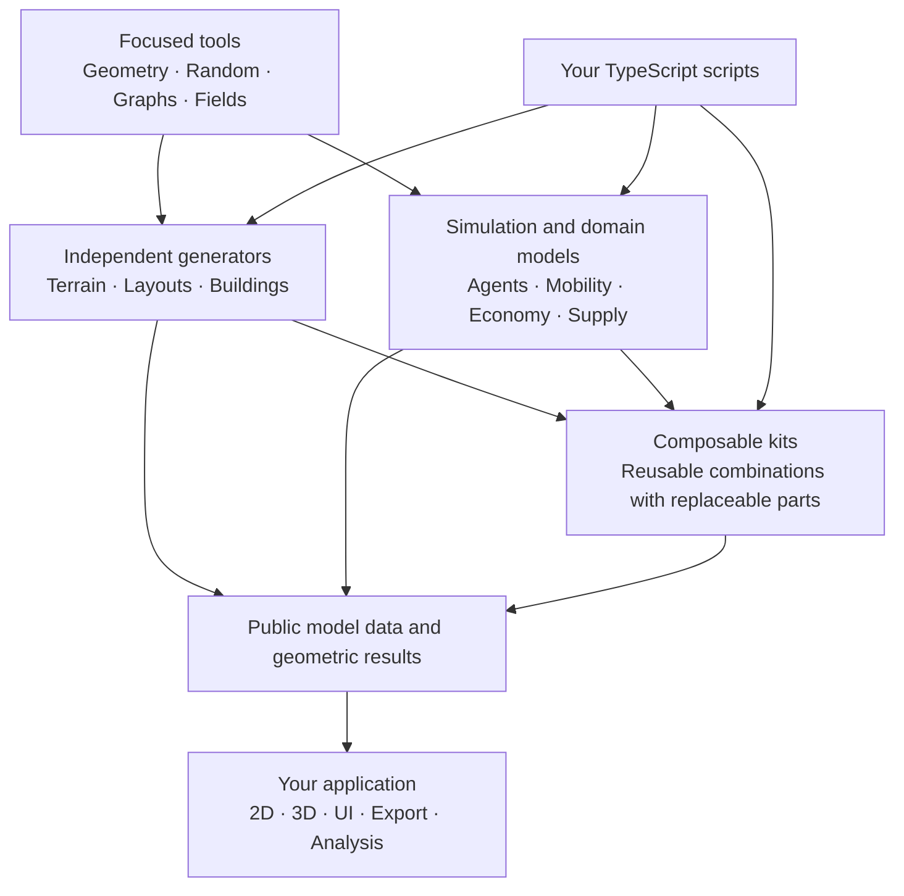

> **Work in progress.** City Library is being built. This repository currently contains a TypeScript project scaffold and design documentation, not a working city engine. The modules and API examples below describe the direction we are developing toward. They are not available exports, and there is no published package to install yet.

# City Library

A modular, TypeScript-first city engine for the web.

The goal is to make it easy to build your own city: generate its physical structure, give its inhabitants rules, connect its networks, and explore what happens over time. Start with one building, a network of households, or a small traffic model. Add the pieces your project needs as it grows.

City Library is intended to be a construction kit. Small tools handle focused tasks. Interchangeable modules turn those tools into building generators, terrain strategies, agent behaviors, or economic rules. Larger kits combine the same public operations into useful starting points. You should be able to use a ready-made neighborhood, replace its building generator, or write the whole composition yourself.

The engine owns logic, geometry, relationships, and model state. Your application owns how that state looks on screen.

## What we want to build

Cities bring together several kinds of problems: geometry, networks, movement, resource allocation, individual decisions, and change over time. One fixed city generator or one large simulation object cannot give every project the right answers.

Our approach is to make those capabilities independently useful, then define clear ways to connect them. A building generator should work without creating residents. A housing model should work with synthetic homes and jobs, without generating a single facade. A road network should support headless analysis before anyone adds a map.

The intended uses include procedural neighborhoods, interactive urban prototypes, agent-based experiments, and custom city-building tools. This is a toolkit for creating models, rather than one prescribed city simulation. A model's assumptions remain visible and replaceable; a traffic or energy template does not automatically become a calibrated scientific model.

The implementation target is TypeScript throughout the engine, with APIs suited to web applications and ordinary scripts. Bun is the current development environment. Browser compatibility, package boundaries, and performance will be verified as capabilities arrive; the scaffold alone does not establish those guarantees.

## The big picture



This is a composition map, not a mandatory startup sequence. You can stop at a generator result, use the simulation directly, or let a kit assemble several modules. An application can also change explicitly exposed model inputs; rendering does not own the simulation's state or clock.

## Clear modules, clear public entry points

Each library area should have a small, intentional public interface. Its internal algorithms can change without making every consumer follow the implementation file structure. Applications and kits use those public interfaces rather than reaching into private helpers.

Here is the proposed division of responsibilities. Names describe capability areas, not an implemented package export list.

| Area | Responsibility |
| --- | --- |
| Geometry and spatial tools | Points, polygons, volumes, bounds, transformations, and the operations concrete generators need. |
| Randomness | Explicit, reproducible random streams and useful sampling operations. |
| Grids and fields | Optional cells, neighborhoods, spatial values, and field calculations. |
| Graphs and networks | Nodes, edges, connectivity, routes, and clearly defined network algorithms. |
| Terrain | Landscape generation and the spatial queries a consumer actually needs. |
| Layouts and zoning | Streets, blocks, parcels, buildable envelopes, and declared development rules. |
| Buildings | Alternative generators for volumes, parts, floors, and explicitly described access points. |
| Simulation | World execution, ticks, agent lifecycle, identity, and optional spatial context. |
| City models | Focused mobility, household, allocation, economic, and infrastructure rules. |
| Kits | Convenient combinations built from the same public capabilities available to model authors. |
| Analysis and storage | Measurements and explicit saving/loading of supported model state or selected data. |

Not every area needs to become a separate npm package. We will start with focused modules and deliberate exports, then split distribution only when a real dependency or usage boundary justifies it. “Clear endpoints” means predictable library entry points and contracts here, not a required HTTP service.

## Small scripts first

A useful prototype should begin with a readable script. Define data, create objects, connect the pieces, write one step, and run it. Ordinary TypeScript supplies functions, conditions, loops, arrays, and your own modeling vocabulary.

The authoring direction follows the Agent Loom API design: simple defaults, direct typed properties, native collections, and explicit composition. More detailed usage should grow from the same objects instead of requiring a second framework.

**Design example only:** this excerpt illustrates that style using the proposed Agent Loom vocabulary. City Library does not implement these imports yet; it is not an installation or execution example.

```ts
import { Agent, World, run } from "agent-loom";

const person = Agent.add({ energy: 10 });
const world = World.add();
world.add(person);

function step() {
  if (person.energy > 0) {
    person.energy -= 1;
  }
}

run(world, step, 5);

console.log(person.energy, world.tick.value);
```

The model owns the meaning of `energy`. The library handles the relevant lifecycle and execution mechanics. There is no custom scripting language to learn, and no mandatory grid, renderer, or UI configuration for this example.

The evolving API design also keeps related operations together: the world owns its tick counter, while model data stays directly accessible. The intended result is code that reads like the rule being modeled. API publication and runtime verification are still ahead of us.

## With a grid, without a grid

A grid is useful when cells are part of the problem: land values, local resources, neighborhood rules, or a spatial field. It should be an explicit choice.

Other models need a graph, continuous positions, or no geometry at all. A social network can connect people without assigning them coordinates. A market can allocate homes from a list of capacities. A standalone house generator needs geometry, but no simulation clock.

World, grid, graph, and generated geometry therefore have distinct responsibilities. A world can coordinate a simulation without automatically allocating a field of patches. A graph can represent relationships without implying roads. Adding spatial information later must not create a competing identity for the same modeled object.

This flexibility needs precise contracts. Geometric proximity does not prove that a door connects to a sidewalk. A topological route does not necessarily supply a walkable path. Units, boundaries, direction, access, and routing costs must be explicit where the model depends on them.

## Logic and visualization stay separate

The engine determines what exists and what happens. An application determines how to display it.

Position, orientation, building geometry, network relationships, and physical quantities belong to model logic. Cameras, colors, symbols, labels, line widths, drawing commands, and widgets belong to the application. There is no built-in appearance system or mandatory UI metadata container in the intended core.

Model authors can still define any appropriate ordinary data. For example:

```ts
// Plain TypeScript model data; no library import required.
const resident = {
  name: "Anna",
  occupation: "carpenter",
  energy: 80,
};
```

A UI might display the name, group residents by occupation, or derive a color from energy. Those are application decisions. Even a user-defined property named `color` would be ordinary data to the engine, with no reserved rendering behavior.

The same model should be usable in a browser UI, an automated experiment, or a headless run. A renderer can be replaced without rewriting household rules. Rendering must not advance the model clock or consume the simulation's random sequence. External edits enter through explicitly exposed model inputs.

## Replace parts, keep the model understandable

We want several ways to generate a house, build a neighborhood, or allocate a resource. Alternatives should be interchangeable for a clearly defined task, while remaining free to expose their meaningful differences.

A courtyard generator and a stacked-volume generator may share a site contract. A rent-based housing policy and a needs-based policy may share allocation inputs. A terrain generator can be replaced while a layout consumes the same documented height query.

Shared names alone do not make modules compatible. A building's floor area does not establish its dwelling count. Door width and electrical capacity are different quantities. Different economic policies must agree on the objects and operations they share, including capacities, units, and allowed state changes.

Larger kits should hide repeated setup, not invent hidden capabilities. A commuting kit should use the same public agents, graphs, and model procedures that you can use yourself. It should accept replaceable policies and expose the same live objects for further work. Kits must not start private simulation clocks or keep duplicate household records.

## Generated descriptions and live objects

A generator result is a description: geometry, identifiers, and the declared information that its contract promises. It should be usable on its own.

A live simulation adds responsibilities such as occupancy, mutable demand, balances, agent membership, and time. Connecting a description to that simulation is an explicit operation. Households, routes, and policies then refer to canonical live objects rather than maintaining their own copies of the same building state.

This boundary matters when the city changes. Replacing a building must account for existing residents. Removing an entrance can invalidate a route. Reducing capacity needs an explicit policy, not a silent overwrite. We will specify these behaviors in bounded examples before presenting a general regeneration API as ready.

Storage follows the same preference for explicitness. The API direction is one storage area with simple save/load operations: save the data you pass, whether that is supported model state or selected measurements. Reloading measurements does not reconstruct a runnable model. Exact continuation requires the complete relevant state and model behavior; it will need its own verified contract.

## Documentation for humans and AI-assisted development

Readable documentation is part of the engine design. We want both a developer and an LLM to discover a capability, understand its boundaries, and create a useful variant without reverse-engineering the whole repository.

For each delivered public capability, the documentation should explain:

- The user task it solves and its smallest complete usage example.
- Public inputs, outputs, units, defaults, and relevant limits.
- State ownership, side effects, errors, and lifecycle behavior.
- Dependencies and the assumptions required for composition.
- How to replace or extend it through ordinary public operations.
- Tests and evidence distinguishing implemented behavior from proposals.

API references, tutorials, design decisions, and migration records serve different readers and should remain distinguishable. Stable terminology, focused Markdown documents, explicit TypeScript types, and executable examples will make the repository easier to navigate in limited context.

AI-assisted development still needs verification. A generated variant must meet the same contracts and tests as a handwritten one. We plan to use independent reviews to challenge assumptions and catch inconsistencies. Documentation should expose unknowns rather than encourage a model to fill them with invented APIs.

These are documentation goals. The current repository does not yet contain that complete reference or an implemented city capability catalog.

## Building from experiments, one capability at a time

This project grows out of procedural architecture and city-simulation experiments in [city_game](https://github.com/dweigend/city_game). That work provides candidate algorithms, test cases, research, and examples. It does not automatically define the new engine's structure.

Preparation has identified opportunities across spatial generation, simulation, and application boundaries. Each selected capability still needs a focused decision: reuse it, adapt it, use an existing external library, or implement a smaller operation. Similar-looking experiments may deserve separate implementations when their assumptions differ.

Our development approach is to freeze a small authoring use case, transfer only its required implementation, retain provenance, and verify it through public exports. Add a second real variant before generalizing the interface. Then compose capabilities into a larger example.

The near-term goal is an independently usable building generator, followed by another variant and a static neighborhood. Simulation and city models can develop through their own small headless examples before joining that neighborhood. Technical foundations should support these milestones without becoming an oversized framework of their own.

## Current repository and local setup

Today, this repository contains the Bun/TypeScript scaffold, this project overview, a [development plan](PLAN.md), and [working instructions for coding agents](AGENTS.md). The public entry file exports no city APIs. The package is marked private to prevent accidental npm publication; the GitHub repository itself is public.

To inspect and type-check the current scaffold, install Bun and run:

```sh
git clone https://github.com/dweigend/city-library.git
cd city-library
bun install
bun run typecheck
```

That command checks the current TypeScript project. It does not run a city simulation, build a browser application, or verify the proposed APIs shown above. There is no runtime test suite or published distribution yet.

If you are exploring the project, start with the concepts here and the current plan. If you are adding a capability, begin with the smallest useful script and a precise contract. Keep the pieces independently usable, make the model rules visible, and let real examples determine what the next abstraction should be.
