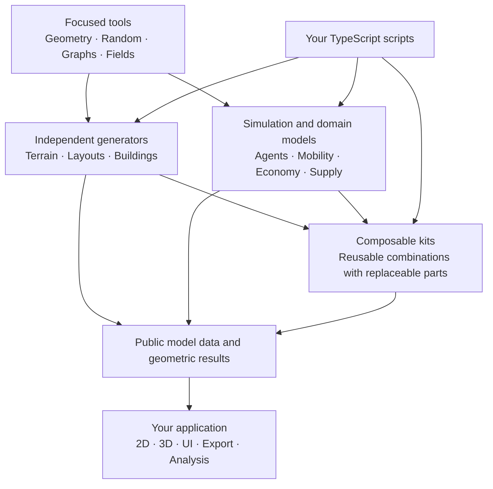

# City Library

A modular, TypeScript-first toolkit for procedural cities and agent-based models. Use focused geometry, graph and simulation capabilities independently, then compose the parts your model needs. Applications own visualization; the library owns domain logic and state.

> **Work in progress.** A1, bounded A2a and the A5a graph kernel are implemented. The active Lab refactor adds bounded spatial/Grid and measurement capabilities plus modular NetLogo reference experiments; broader APIs remain planned and acceptance is tracked separately. No package is published. See [A5a usage](docs/development/a5a-usage.md), [Agent Lab](ui/agent-lab/README.md) and [refactor evidence](docs/development/agent-lab-evidence.md) for scope and commands.

## Purpose

City Library aims to become a city engine for exploring sustainable cities of the future. The motivation is that many city builders reproduce familiar urban patterns rather than help explore how cities could be planned more sustainably. This project puts those future possibilities at the center: how urban layouts, transport, resource cycles and energy systems could work together under different planning choices.

The engine should make those concepts explicit and testable through simulation. Sustainability is a design question to investigate through stated assumptions and observable outcomes.

## Development approach

1. **Agent Loom first.** Build the agent modeling core as pure logic, without a UI. Establish independently usable and testable simulation behavior before adding presentation.
2. **Extend through focused libraries.** Add capabilities for city grids, traffic, resource cycles and energy systems. Develop each capability independently, then compose them into broader city simulations.
3. **Compose a headless city engine.** Keep simulation logic and UI clearly separated. The complete engine must work without a browser or renderer, so scripts, experiments and different interfaces can use the same models.

This is the development sequence; A1 establishes the first headless agent subset. The broader capabilities below remain planned.

## Documentation

- [Agent Loom specification](docs/agent-loom/README.md): the general modeling core and current development focus.
- [API inventory](docs/agent-loom/api-table.md): all 309 planned operation/type entries.
- [API reference](docs/agent-loom/api-reference.md): contracts and usage examples.
- [Architecture](docs/DESIGN.md): module boundaries, state ownership and extension rules.
- [Work plan](PLAN.md): delivery sequence and acceptance criteria.

## How the pieces fit

This is a composition map, not a required startup sequence. A building generator can work without residents, a graph without coordinates, and an agent model without a grid or renderer. Kits combine the same public operations available to model authors.

## Planned capabilities

| Area | Purpose |
| --- | --- |
| Simulation | Agents, worlds, lifecycle, time and execution |
| Spatial Structures | Geometry, grids, fields, neighborhoods and spatial queries |
| Graphs | Connections, routes, network generation and analysis |
| Generation | Terrain, streets, parcels and alternative building generators |
| City Models | Mobility, households, allocation, economy and supply |
| Data & Experiments | Validated inputs, statistics, experiments and storage |

Phase one implements the complete Agent Loom core incrementally, beginning with a small headless Agent/World model. Building generation and broader city models follow. Agent Loom is part of City Library, not a separate required engine.

## Modeling principles

- Write ordinary TypeScript with directly typed model properties and native collections.
- Keep each capability independently usable and compose through public APIs.
- Give each live value one owner; share canonical references across domains.
- Make randomness, execution order, units, defaults and failure behavior explicit.
- Keep rendering and host I/O outside the domain logic. UI edits use defined actions.
- Add replaceable variants through focused contracts while preserving existing behavior.

Generator results describe geometry and declared properties. Connecting them to residents, capacities or a live simulation is explicit. Saving measurements does not imply that a complete model can be resumed.
