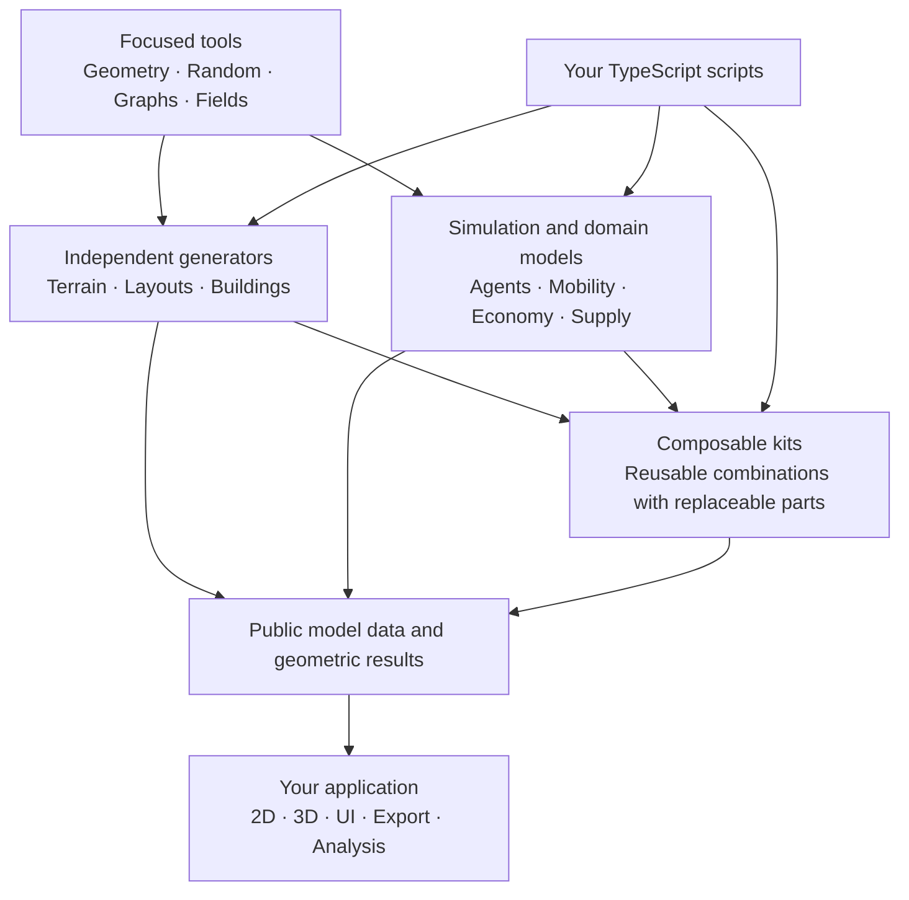

# City Library

A modular, TypeScript-first toolkit for procedural cities and agent-based models. Use focused geometry, graph and simulation capabilities independently, then compose the parts your model needs. Applications own visualization; the library owns domain logic and state.

> **Work in progress.** The repository currently contains a Bun/TypeScript scaffold, prepared source directories and an API specification. No city or agent APIs are implemented, and no package is published.

## Documentation

- [Agent Loom specification](docs/agent-loom/README.md): the general modeling core and current development focus.
- [API inventory](docs/agent-loom/api-table.md): all 309 planned operation/type entries.
- [API reference](docs/agent-loom/api-reference.md): contracts and usage examples.
- [Architecture](docs/DESIGN.md): module boundaries, state ownership and extension rules.
- [Work plan](PLAN.md): delivery sequence and acceptance criteria.

## How the pieces fit



This is a composition map, not a required startup sequence. A building generator can work without residents, a graph without coordinates, and an agent model without a grid or renderer. Kits combine the same public operations available to model authors.

## Planned capabilities

| Area | Purpose |
| --- | --- |
| Simulation | Agents, worlds, lifecycle, time and execution |
| Spatial Structures | Geometry, grids, fields, neighborhoods and spatial queries |
| Graphs | Connections, routes, network generation and analysis |
| Generation | Terrain, streets, parcels and alternative building generators |
| City Models | Mobility, households, allocation, economy and supply |
| Data & Experiments | Validated inputs, statistics, experiments and storage |

Phase one implements the complete Agent Loom core incrementally, beginning with a small headless Agent/World model. Building generation and broader city models follow. Agent Loom is part of City Library, not a separate required engine.

## Modeling principles

- Write ordinary TypeScript with directly typed model properties and native collections.
- Keep each capability independently usable and compose through public APIs.
- Give each live value one owner; share canonical references across domains.
- Make randomness, execution order, units, defaults and failure behavior explicit.
- Keep rendering and host I/O outside the domain logic. UI edits use defined actions.
- Add replaceable variants through focused contracts while preserving existing behavior.

Generator results describe geometry and declared properties. Connecting them to residents, capacities or a live simulation is explicit. Saving measurements does not imply that a complete model can be resumed.

## Local development

Install [Bun](https://bun.sh), then run:

```sh
git clone https://github.com/dweigend/city-library.git
cd city-library
bun install
bun run typecheck
```

`typecheck` checks the current scaffold. There is no runtime test suite, browser application or published distribution yet. The package is private to prevent accidental publication.

The project grows from [city_game](https://github.com/dweigend/city_game). Selected algorithms must meet City Library's contracts and public behavior checks before adoption.
