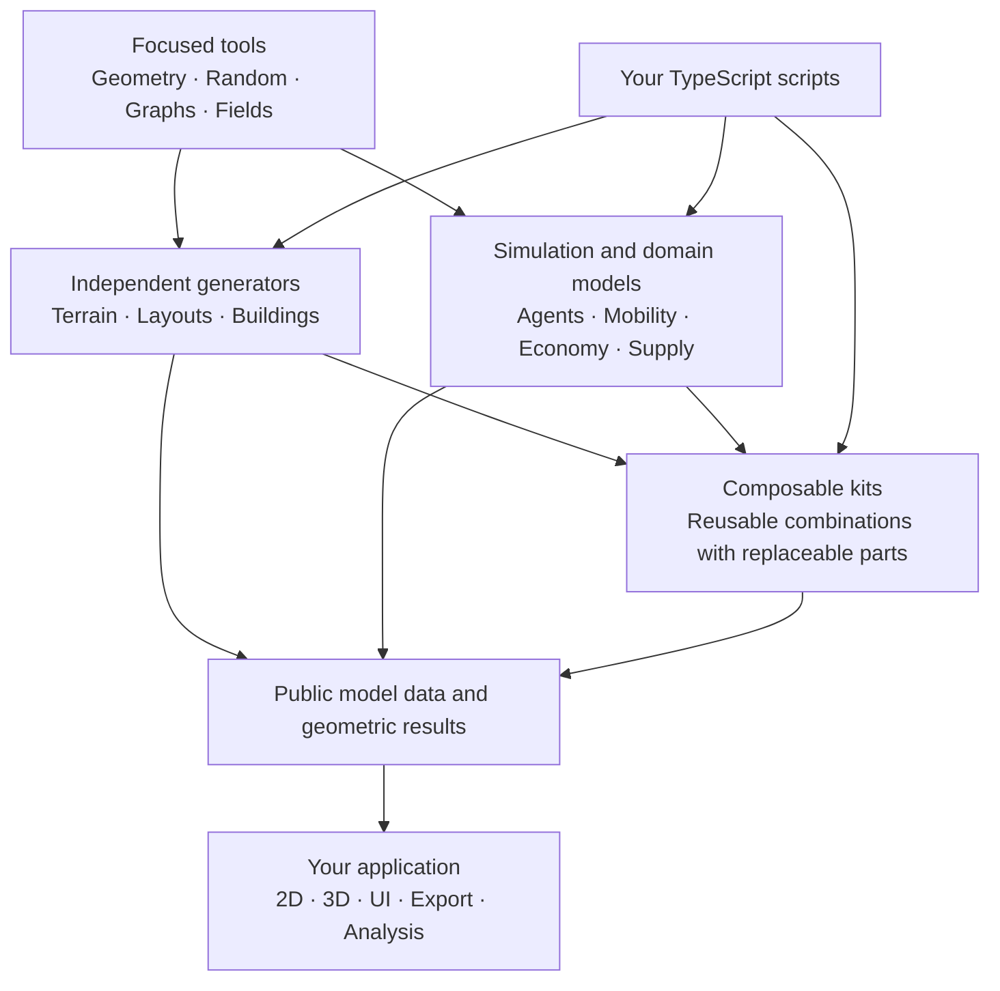

# City Library

A modular, TypeScript-first toolkit for procedural cities and agent-based models. Use focused geometry, graph and simulation capabilities independently, then compose the parts your model needs. Applications own visualization; the library owns domain logic and state.

> **Work in progress.** The headless library includes agents/worlds, reproducible random streams, spatial movement, grids/fields, graph operations, planar geometry and statistics. Agent Lab currently discovers 125 experiment entries toward a fixed 200-model NetLogo Web selection. Implementation, scientific comparison and independent acceptance remain separate milestones. The Svelte UI is an integrated work-in-progress runtime; Taxi Cabs migration and independent visual approval remain open. No package is published. See the [current plan](PLAN.md) and [consolidation evidence](docs/development/consolidation-report.md).

## Purpose

City Library aims to become a city engine for exploring sustainable cities of the future. The motivation is that many city builders reproduce familiar urban patterns rather than help explore how cities could be planned more sustainably. This project puts those future possibilities at the center: how urban layouts, transport, resource cycles and energy systems could work together under different planning choices.

The engine should make those concepts explicit and testable through simulation. Sustainability is a design question to investigate through stated assumptions and observable outcomes.

## Development approach

1. **Agent Loom first.** Build the agent modeling core as pure logic, without a UI. Establish independently usable and testable simulation behavior before adding presentation.
2. **Extend through focused libraries.** Add capabilities for city grids, traffic, resource cycles and energy systems. Develop each capability independently, then compose them into broader city simulations.
3. **Compose a headless city engine.** Keep simulation logic and UI clearly separated. The complete engine must work without a browser or renderer, so scripts, experiments and different interfaces can use the same models.

Agent Loom is implemented in bounded, publicly tested slices. Complete Agent Loom coverage, building generation and broader city models remain delivery goals.

## Documentation

- [Agent Loom specification](docs/agent-loom/README.md): the general modeling core and current development focus.
- [API inventory](docs/agent-loom/api-table.md): the 309 target operation/type entries; implementation coverage is tracked separately.
- [API reference](docs/agent-loom/api-reference.md): contracts and usage examples.
- [Architecture](docs/ARCHITECTURE.md): module boundaries, state ownership and extension rules.
- [UI design](docs/DESIGN.md): component, styling and UI verification rules.
- [Work plan](PLAN.md): delivery sequence and acceptance criteria.

## How the pieces fit

This is a composition map, not a required startup sequence. A building generator can work without residents, a graph without coordinates, and an agent model without a grid or renderer. Kits combine the same public operations available to model authors.

## Work areas

| Area | Purpose |
| --- | --- |
| Simulation | Agents, worlds, lifecycle, time and execution |
| Spatial Structures | Geometry, grids, fields, neighborhoods and spatial queries |
| Graphs | Connections, routes, network generation and analysis |
| Generation | Terrain, streets, parcels and alternative building generators |
| City Models | Mobility, households, allocation, economy and supply |
| Data & Experiments | Validated inputs, statistics, experiments and storage |

Phase one completes the Agent Loom core incrementally through public examples and verified implementation slices. Building generation and broader city models follow. Agent Loom is part of City Library, not a separate required engine.

## Development and verification

Use the repository-pinned Bun toolchain and install dependencies with `bun install --frozen-lockfile`.

- `bun run check`: TypeScript/Svelte checks, tests, public examples, library build and packed Bun/Node/TypeScript consumer.
- `bun run dev:ui`: existing Bun-hosted Agent Lab at http://localhost:3100.
- `bun run dev:ui:svelte`: separate Vite/Svelte development entry.
- `bun run build:ui:svelte`: Svelte production build.

The [consolidation checkpoint](docs/development/consolidation-report.md#executed-verification-and-limits) records 565 tests and 215 public scripts passing, followed by targeted typecheck, consumer and Svelte-build checks. These are recorded results, not a claim that every model or UI state has final acceptance. Browser evidence is scoped to the models and interactions actually exercised. The [model ledger](experiments/catalog/progress-summary.json) still needs reconciliation with the later integrated batches.

## Modeling principles

- Write ordinary TypeScript with directly typed model properties and native collections.
- Keep each capability independently usable and compose through public APIs.
- Give each live value one owner; share canonical references across domains.
- Make randomness, execution order, units, defaults and failure behavior explicit.
- Keep rendering and host I/O outside the domain logic. UI edits use defined actions.
- Add replaceable variants through focused contracts while preserving existing behavior.

Generator results describe geometry and declared properties. Connecting them to residents, capacities or a live simulation is explicit. Saving measurements does not imply that a complete model can be resumed.
