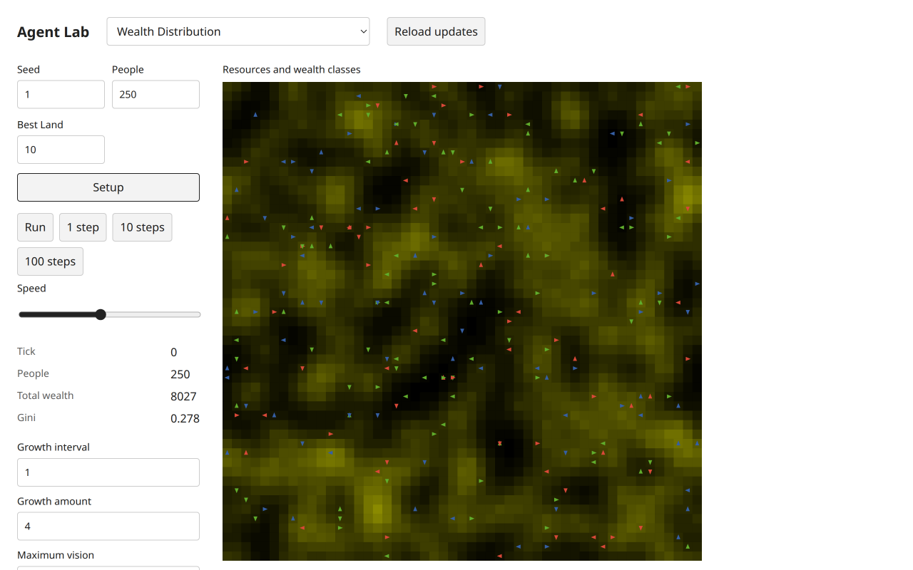
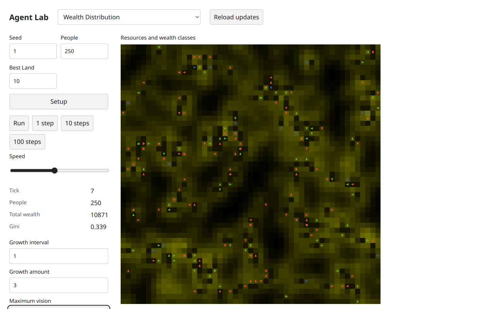
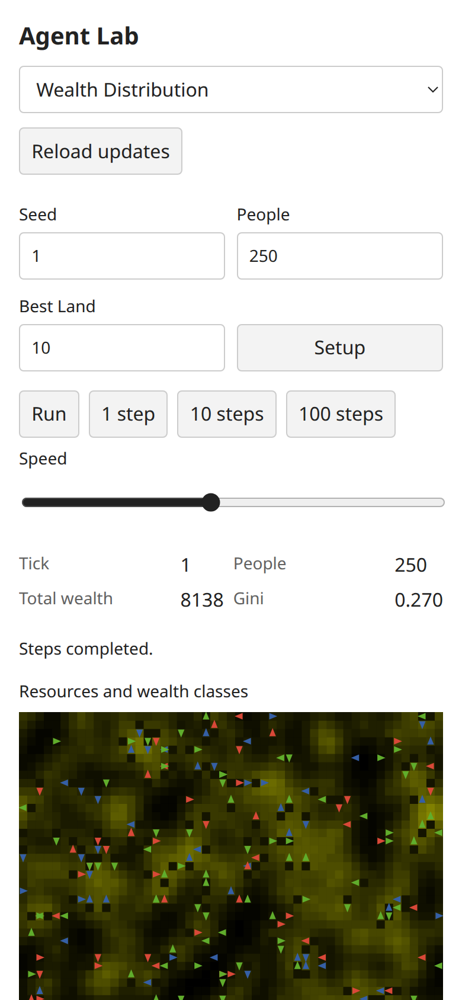
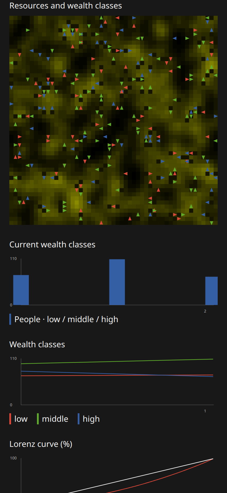
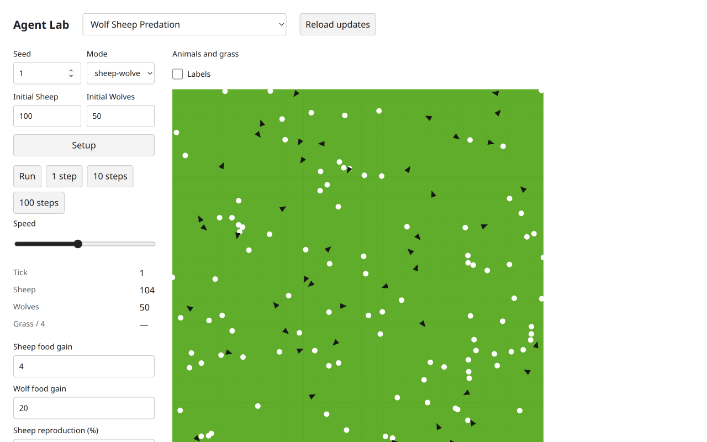
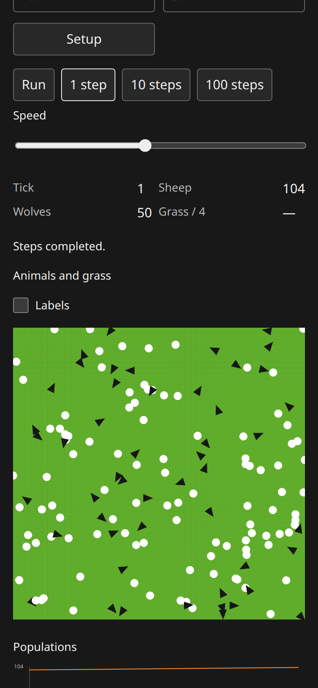
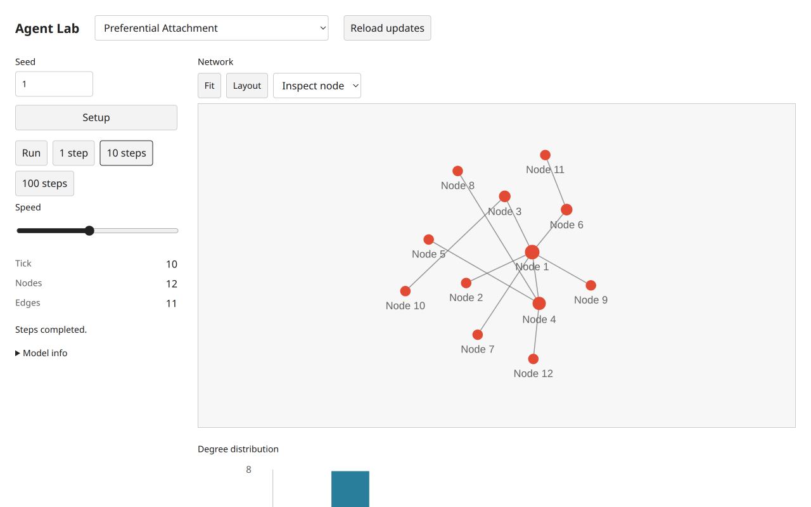

# Reference UI follow-up

This small shared-renderer correction responds to the two concrete findings in [the fresh original/target browser report](reference-refresh-browser.md). No public API, model equation, random stream, state authority, scientific parameter or frozen example changed. It adds no library capability requiring a new example phase. The coordinator applied frontend-design, then reviewed the completed change against the fetched Vercel guidelines (2026-11-06, SHA256 d246b026f4f29b5823a9cc857f9edf3d2507002e055e32040cadeaf3b38e0234).

`ui/views/chart.ts` now describes every finite x/y point for bar and scatter modes. Line charts retain their compact latest-sample summary, using the latest finite sample rather than an invalid point; this does not claim a full accessible time-history table. Empty finite series say “no samples”. `ui/compose.ts` mounts live controls after the monitor block, before status. Mobile CSS keeps the existing actions/monitors/status/view/live-controls ordering. No added visible chrome, palette, icon or layout token was necessary.

## Executed Chromium checks

Fresh owned T3 Chromium tab, target port3124, desktop1280×800 and mobile390×844 CSS, light/dark. Native Setup and step controls were used for Wealth, Wolf, Preferential Attachment and Voting. The original NetLogo runs, exact source hashes, full comparison/adaptations and before-fix screenshots remain in reference-refresh-browser.md; this follow-up reruns the changed target presentation, not a newly claimed original session. Current model/UI modules remain identical to that report; only shared chart/composer files change.

Wealth setup seed1: tick0,250people,8027wealth,Gini0.278, histogram70/99/81. One step: tick1,8138wealth,Gini0.270, histogram72/110/68. All three bins are present in the actual SVG accessible name. Native Run advanced to the observed tick6; Pause completed at tick7,wealth10871,Gini0.339 and bins133/93/24. An earlier rapid Run/Pause stayed at tick1 and is not claimed as progress evidence. Setup replayed tick0/8027. Changing live growth to3 produced `Rule updated.` at tick7 without advancing state. Keyboard Tab from growth amount focused maximum vision with a visible solid2px outline.

Wolf seed1, sheep-wolves mode, defaults: one step104sheep/50wolves/tick1. At scrollTop0, both Wolf and Wealth desktop monitors occupy y483–598, immediately below actions ending y463, and precede live controls starting y618. They are entirely inside the first800px viewport. Mobile snapshots retain monitors above views/live parameters, no horizontal overflow. Preferential ten steps gives12nodes/11edges, all six degree bins and four finite log-scatter points in accessible names; the network remains rendered. Voting one step gives11229blue/11572green, tick1, with monitors before live rules.

All seven retained screenshots were visually inspected. Canvas readback was used before final progress/theme captures; the initial Wealth setup raster also visibly rendered correctly. Lower mobile chart and Wolf captures are scrolled states, not full-page or top-of-page assertions. Diagnostics contain only readback performance warnings, no observed console errors or failed requests. The owned tab was closed and server3036 stopped. This is scoped DOM/browser accessibility verification, not a screen-reader certification or independent Argon approval.

| Evidence | Screenshot |
| --- | --- |
| Wealth setup, desktop light |  |
| Wealth tick7 after Run/Pause, desktop light |  |
| Wealth tick1, mobile light |  |
| Wealth tick1, mobile dark charts |  |
| Wolf tick1, desktop light |  |
| Wolf tick1, mobile dark, scrolled |  |
| Preferential tick10, desktop light |  |

[Readbacks](reference-ui-followup-evidence/readbacks.json) retain actual state, geometry and chart names. [Diagnostics](reference-ui-followup-evidence/diagnostics.json) retain observed requests/warnings. Typecheck passed all four configured projects. The subsequent full check is recorded in the final checkpoint below only after its process completes. No new model or independent-approval count arises from this UI repair.

## Final checkpoint

`bun run check` completed with exit0 after the two renderer edits:301tests/15936assertions,120public examples,four TypeScript projects,build and packed Bun/Node ESM/ambient-free TypeScript consumer. Source hashes and artifact SHA256/byte sizes are in [manifest.json](reference-ui-followup-evidence/manifest.json). The two earlier UI findings are remediated for the tested flows; no further finding was observed in this narrow change. Existing source adaptations, four Urban screenshot-capture anomalies and independent-review blockers remain. A lingering completed Tijuana preview child on3117 was identified by its own environment port and terminated during resource cleanup; it supplied no evidence for this follow-up.
