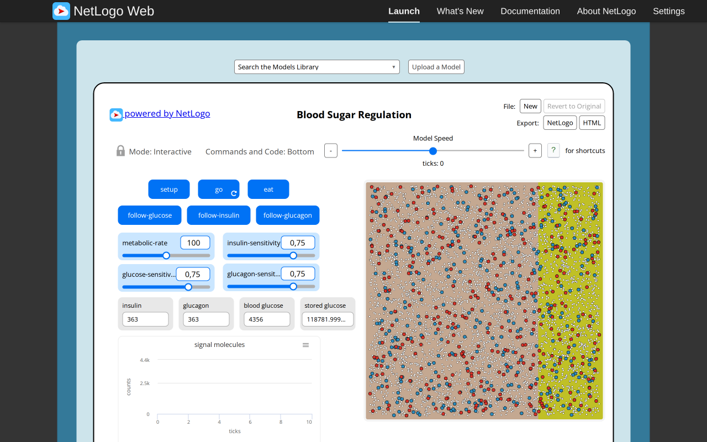
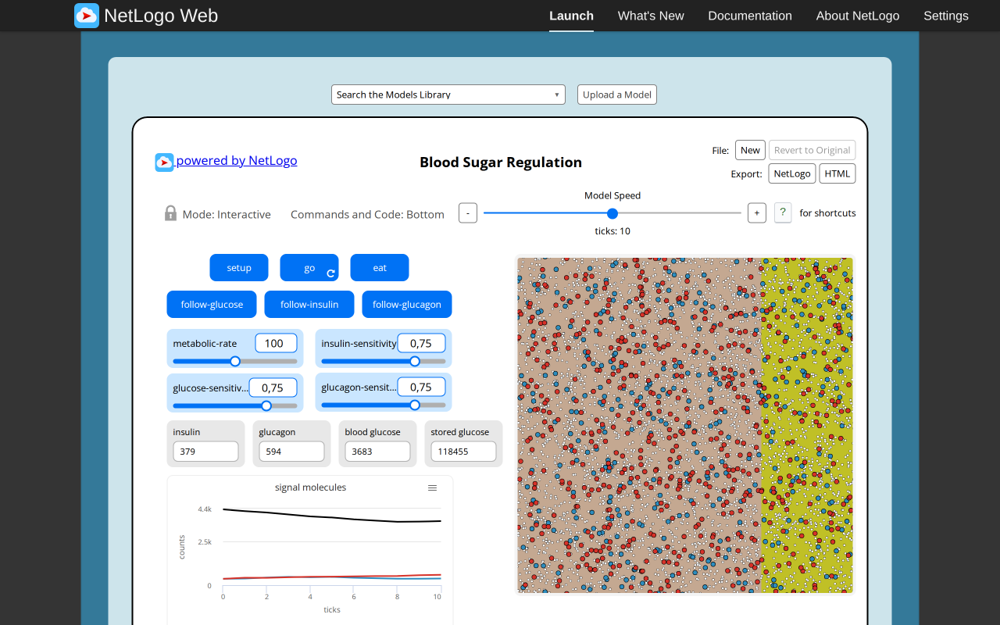
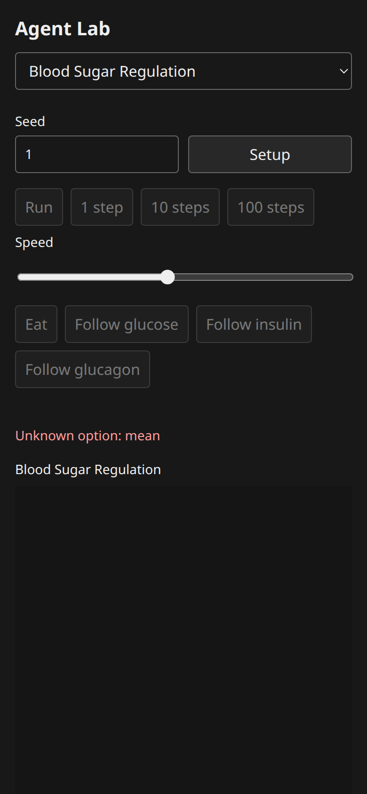

# Blood Sugar Regulation: B07 model report

Canonical selected path: `Sample Models/Biology/Blood Sugar Regulation`. Experiment: `experiments/blood-sugar-regulation`. Membership is unchanged from selection.json.

Original archive/source session SHA-256: `75efe0d13e248bbdd0850171f35e54271bb16ad78bdd3ecbe7e0afb8f3f5313f`. Exact served XML version `NetLogo 7.0.4`; running original engine `2.16.1 (90be9317)`. Pinned Galapagos `90be931773fcf499049247a8aaa1aecbe003654c`, with immutable inventory byte match. Full original code/widgets/Info/shapes/notices: [archive](../../experiments/blood-sugar-regulation/source.nlogox), [notices](../../experiments/blood-sugar-regulation/NOTICE.md).

Scientific framing and exactly three verified publications remain in the existing [research dossier](../research/netlogo-web/blood-sugar-regulation.md) and [metadata](../research/netlogo-web/blood-sugar-regulation.json); their access/verification limits apply. This port does not add or duplicate literature and is not scientific validation.

Public contract: [headless source](../../experiments/blood-sugar-regulation/model.ts), [thin UI binding](../../experiments/blood-sugar-regulation/ui.ts). `create(options)`, `advance(count)` and detached `read()` use canonical public state owners. Named source procedures/actions, parameter phases, topology, plots and terminal/tick meaning are specified in [the source audit](selected-biology-source-audit.md). Exact source widgets and procedure list are in [audit JSON](selected-biology-source-audit.json).

## Adaptations and source findings

The source-backed Poisson150 liver initialization and exponential(2/ln2) hormones require the parent public distribution phase. No private substitute is present. The original creates412 molecules from7000/17; two frozen assertions still say411/722 and await explicit user approval for412/724. Source organ rectangles are rendered from detached cell read models; follow actions select/highlight an identity instead of changing the camera. Until dependency arrival, all target-runtime and target-browser completion stays pending.

## Actual original browser

Configured defaults: `set metabolic-rate 100.0 set glucose-sensitivity 0.75 set insulin-sensitivity 0.75 set glucagon-sensitivity 0.75`; seed1 before Setup. Setup observation: `{"success": true, "value": [0, 4356, 363, 363, 123138, 0]}`. After10 go calls: `{"success": true, "value": [10, 3683, 379, 594, 122138, 0]}`. Reporter tuple expression is retained in browser-observations/sourceProbes and model-specific source contracts; values are actual native observations.

Actual Run/Pause and Setup-as-reset observations: `{"paused": {"success": true, "value": 3}, "stable": {"success": true, "value": 3}, "reset": {"success": true, "value": [0, 4356, 363, 363, 124039, 0]}, "errors": [], "canvasReadback": {"width": 858, "height": 858, "nonzero": 730921}}`. Successful equal paused/stable tick reporters establish bounded stable pause; Reset may randomize again without reseeding. Additional source actions/boundary/error probes are versioned by slug in [raw results](selected-biology-evidence/browser-observations.json).

## Target blocked

Actual target Setup fails with `Unknown option: mean` because base Random rejects the pending Poisson/exponential options. No target tick or initialized state is claimed. [Source-backed public dependency request](selected-biology-random-gap.md). The parent is preparing/finalizing this independent shared capability phase.

Target setup/progress/mobile/theme/interaction acceptance and final type/frozen script checks remain pending until that dependency arrives. The original baseline is functional; source-only evidence never establishes target completion.

## Verification and approval

Executed shell commands and exit codes are in [focused checks](selected-biology-evidence/focused-checks.json). Frozen01/02/04/05 and hashes pass; frozen03 and the Blood focused test fail on the missing dependency. Four TypeScript projects were invoked individually: core and UI examples pass; dev/UI and standalone model/frozen-script TypeScript reject only the two missing public distribution overloads. Build and actual packed Bun/Node ESM/ambient-free TypeScript consumer pass. Exact logs are versioned in the evidence directory. No parent full-integration checkpoint is relabeled as a B07 run.

Independent Argon/high review: **pending**, existing quota-blocked task8194e842, no retry/substitute. Native author findings and coordinator responses are not independent approval. No global model count, registration, selection, ledger or research status was changed here.
