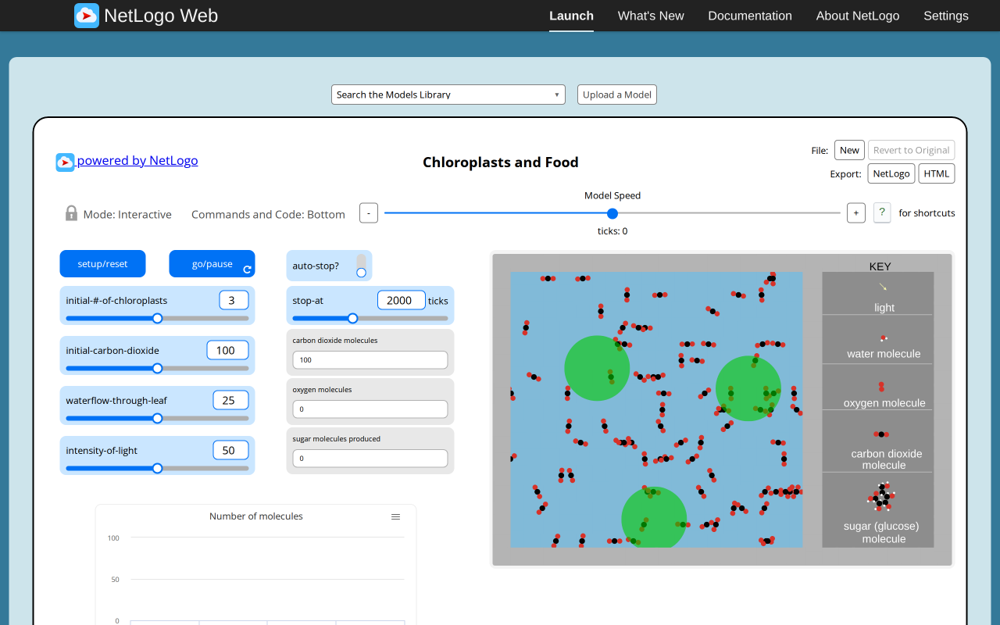
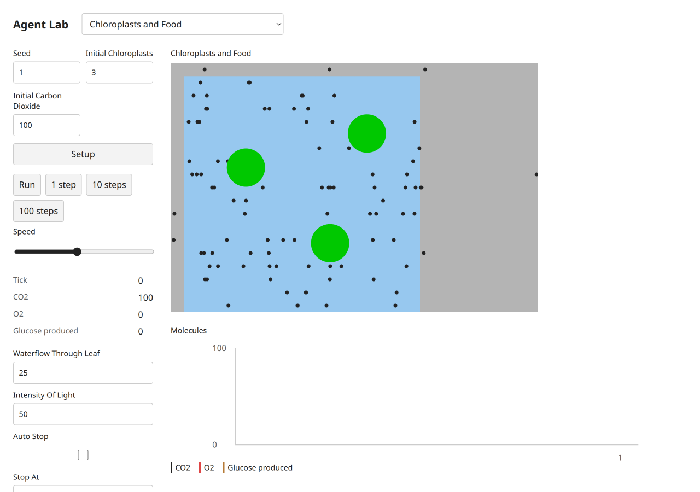
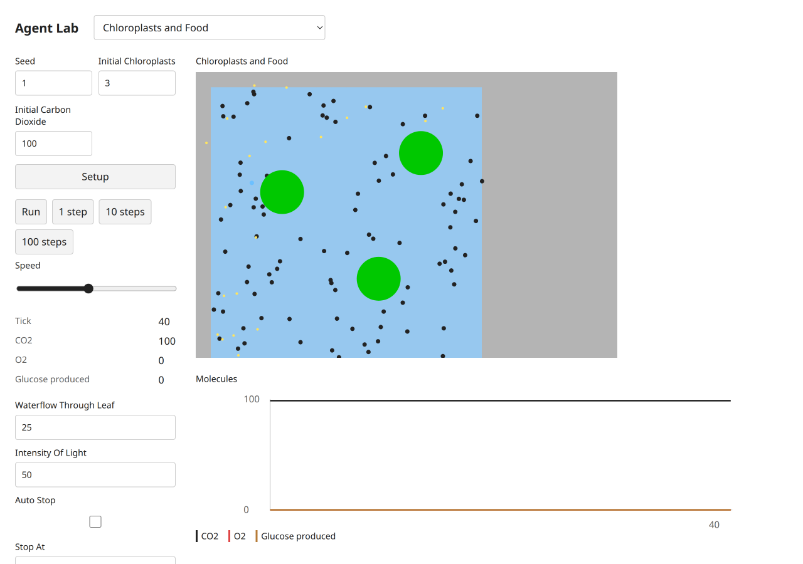
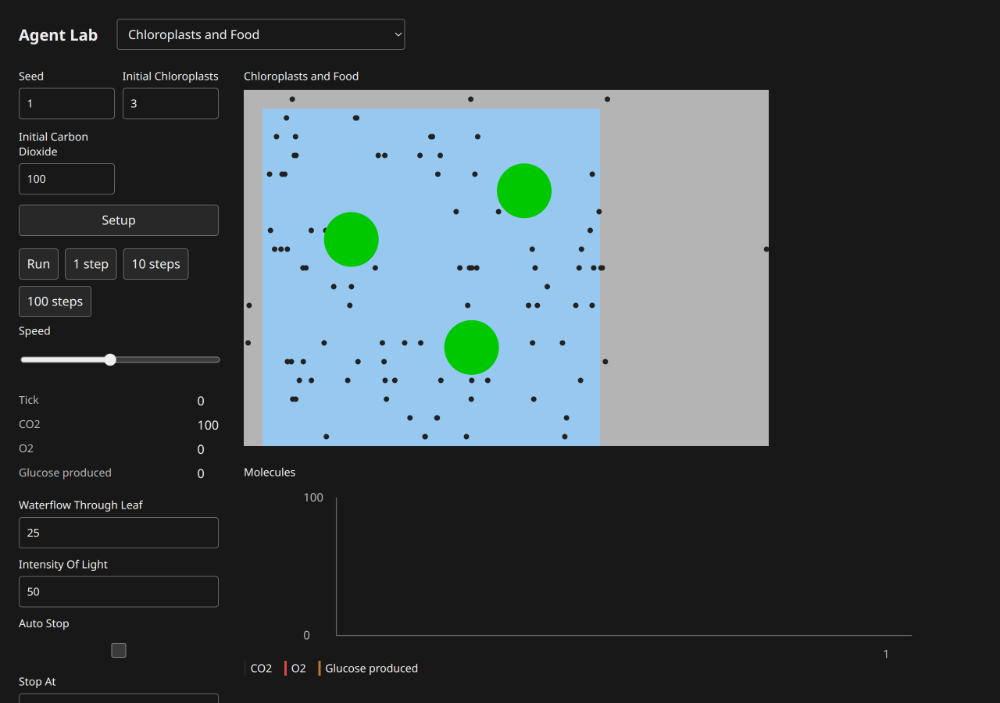
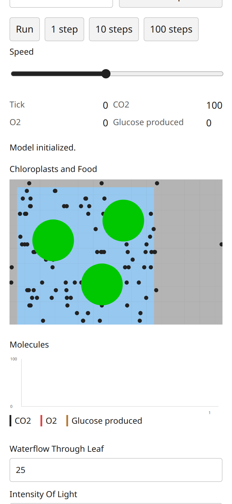
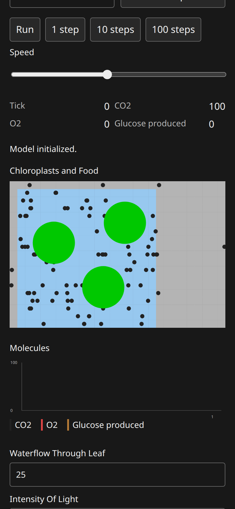

# Chloroplasts And Food: B07 model report

Canonical selected path: `Sample Models/Biology/Chloroplasts and Food`. Experiment: `experiments/chloroplasts-and-food`. Membership is unchanged from selection.json.

Original archive/source session SHA-256: `7c1ca18d90bd70a969ec8722fb056cafeea758c898a39efbaada099aa5e28f66`. Exact served XML version `NetLogo 7.0.4`; running original engine `2.16.1 (90be9317)`. Pinned Galapagos `90be931773fcf499049247a8aaa1aecbe003654c`, with immutable inventory byte match. Full original code/widgets/Info/shapes/notices: [archive](../../experiments/chloroplasts-and-food/source.nlogox), [notices](../../experiments/chloroplasts-and-food/NOTICE.md).

Scientific framing and exactly three verified publications remain in the existing [research dossier](../research/netlogo-web/chloroplasts-and-food.md) and [metadata](../research/netlogo-web/chloroplasts-and-food.json); their access/verification limits apply. This port does not add or duplicate literature and is not scientific validation.

Public contract: [headless source](../../experiments/chloroplasts-and-food/model.ts), [thin UI binding](../../experiments/chloroplasts-and-food/ui.ts). `create(options)`, `advance(count)` and detached `read()` use canonical public state owners. Named source procedures/actions, parameter phases, topology, plots and terminal/tick meaning are specified in [the source audit](selected-biology-source-audit.md). Exact source widgets and procedure list are in [audit JSON](selected-biology-source-audit.json).

## Adaptations and source findings

Coordinates translate source x by −4.5 into the centered library world. Shapes and legend stamps are replaced with colored particles and reporter labels. Chloroplast symbols have fixed CSS diameter; the 4-unit reaction geometry remains model-owned. Flow ties use canonical public Graph edges. Water enters at the nineteen source x=−9 fields. Initial CO2 can wrap from source coordinate bounds as in the original.

## Actual original browser

Configured defaults: `set waterflow-through-leaf 25.0 set intensity-of-light 50.0 set initial-#-of-chloroplasts 3.0 set initial-carbon-dioxide 100.0 set auto-stop? false set stop-at 2000.0`; seed1 before Setup. Setup observation: `{"success": true, "value": [0, 100, 0, 0, 3, 18, 0]}`. After40 go calls: `{"success": true, "value": [40, 100, 0, 3, 3, 18, 0]}`. Reporter tuple expression is retained in browser-observations/sourceProbes and model-specific source contracts; values are actual native observations.

Actual Run/Pause and Setup-as-reset observations: `{"paused": {"success": true, "value": 5}, "stable": {"success": true, "value": 5}, "reset": {"success": true, "value": [0, 100, 0, 0, 3, 18, 0]}, "errors": [], "canvasReadback": {"width": 1176, "height": 798, "nonzero": 937488}}`. Successful equal paused/stable tick reporters establish bounded stable pause; Reset may randomize again without reseeding. Additional source actions/boundary/error probes are versioned by slug in [raw results](selected-biology-evidence/browser-observations.json).

## Actual target browser

Setup monitors: `[["Tick", "0"], ["CO2", "100"], ["O2", "0"], ["Glucose produced", "0"]]`. After40 clicked single-step actions: `[["Tick", "40"], ["CO2", "100"], ["O2", "0"], ["Glucose produced", "0"]]`. Status: `Steps completed.`. Actual loaded build-version `1793968579671`. Loaded model chunk attribution: `[{"url": "http://localhost:3147/chunks/ui-ctd0my9f.js", "sha256": "f1eab69b12628d7f0ff3f878984c9f858f8e86d4f1c70a24db91010ed5e8fabc", "sourceMarker": "selected-biology-b07:chloroplasts-and-food:7c1ca18d90bd70a969ec8722fb056cafeea758c898a39efbaada099aa5e28f66"}]`. These screenshots belong to this actual final source/UI version; file hashes are recorded separately.

Run/Pause, stable pause and Setup-as-reset: `{"paused": ["42", "100", "0", "0"], "stable": ["42", "100", "0", "0"], "reset": ["0", "100", "0", "0"], "status": "Model initialized.", "buttons": [{"label": "Setup", "disabled": false}, {"label": "Run", "disabled": false}, {"label": "1 step", "disabled": false}, {"label": "10 steps", "disabled": false}, {"label": "100 steps", "disabled": false}], "liveNames": ["live-waterflowThroughLeaf", "live-intensityOfLight", "live-autoStop", "live-stopAt"]}`. Source-specific target actions/live controls/terminal probes are recorded under `targetProbes` in [raw observations](selected-biology-evidence/browser-observations.json).

Mobile dark measured geometry: `{"viewport": [390, 844], "scroll": [0, 248.5], "scrollWidth": 390, "theme": "dark", "canvas": {"x": 16, "y": 300.578125, "width": 358, "height": 242.921875}}`. Light/mobile and dark/desktop geometry are separately retained in raw results. All ordinary captures were visually inspected. Apparent blank bundled transport in Sunflower/Tumor/Membrane was reopened individually with view_image: files contain the actual particle/stems/membrane; no model renderer fix was warranted.

Console/runtime diagnostics: baseline source errors `[]`; target captured console entries `[[], []]`; paired target status states were success. Expected beta-zero/zero-radius probes are explicit errors, not passing runtime claims. Initial automation attempts used an unsupported manual redraw invocation and ran Go before Setup on three fresh originals; corrected captures/control checks replaced them. These harness errors are distinct from model failures.

Comparison conclusion: default topology/membership and observed source-specific mechanisms/reporters, plus bounded interactions, are supported by executed evidence. Different spatial patterns/masses are expected under the declared RNG/scheduling differences; no stochastic-distribution equivalence is established. UI palettes/shapes/scales and seam strokes are adapted as documented above. Full arbitrary-parameter/long-horizon equivalence is not claimed.

## Verification and approval

Executed shell commands and exit codes are in [focused checks](selected-biology-evidence/focused-checks.json). Frozen01/02/04/05 and hashes pass; frozen03 and the Blood focused test fail on the missing dependency. Four TypeScript projects were invoked individually: core and UI examples pass; dev/UI and standalone model/frozen-script TypeScript reject only the two missing public distribution overloads. Build and actual packed Bun/Node ESM/ambient-free TypeScript consumer pass. Exact logs are versioned in the evidence directory. No parent full-integration checkpoint is relabeled as a B07 run.

Independent Argon/high review: **pending**, existing quota-blocked task8194e842, no retry/substitute. Native author findings and coordinator responses are not independent approval. No global model count, registration, selection, ledger or research status was changed here.
