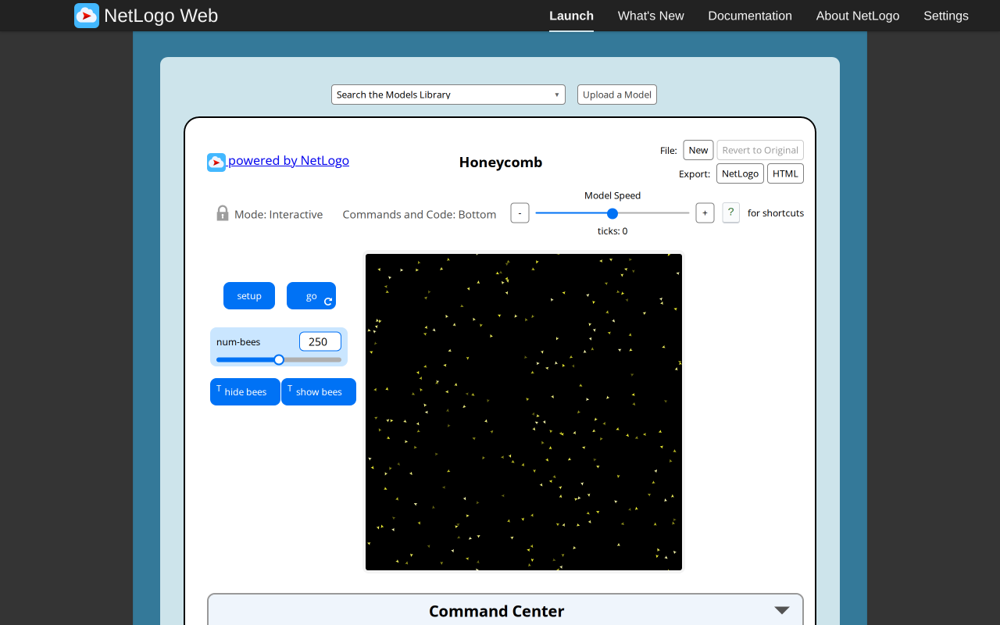
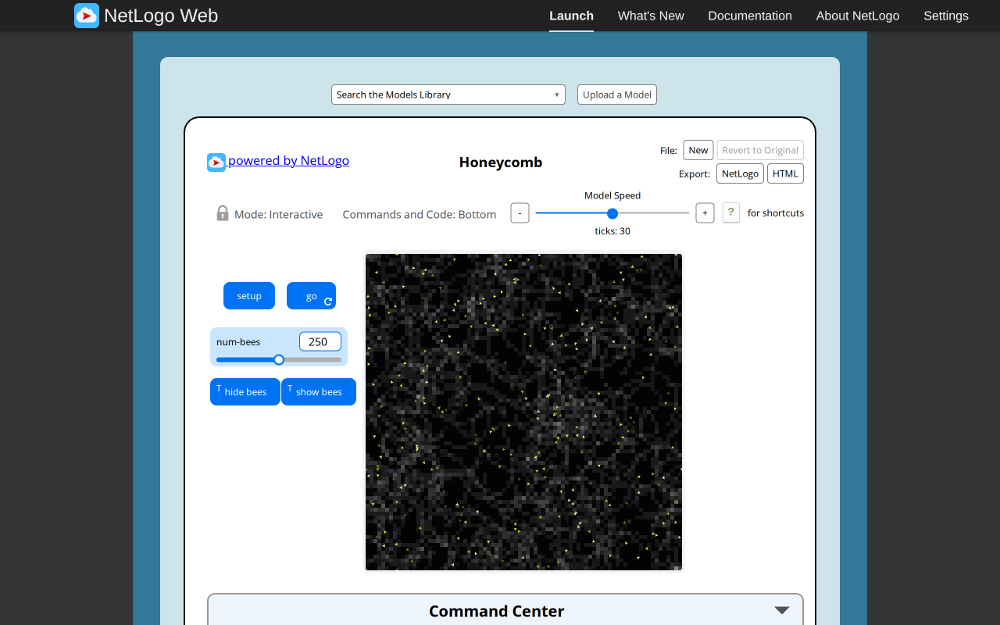
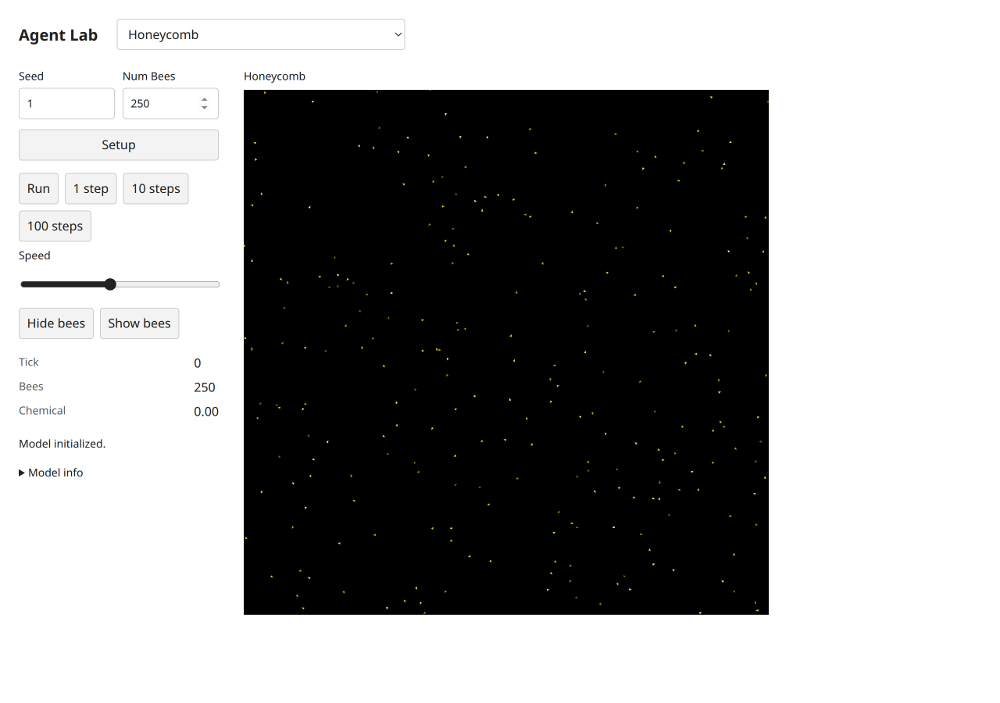
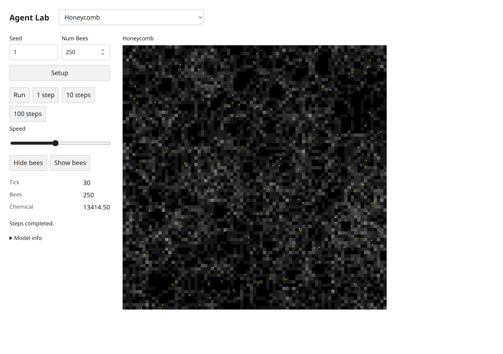
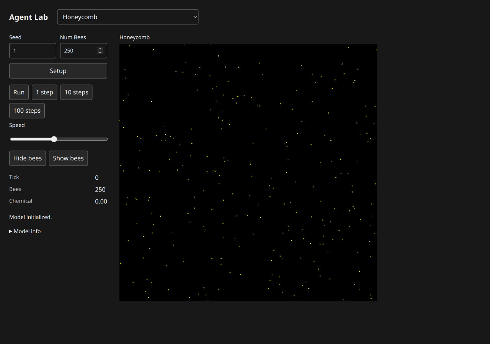
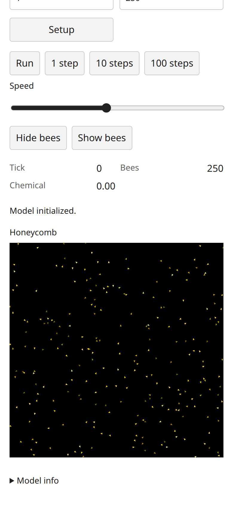
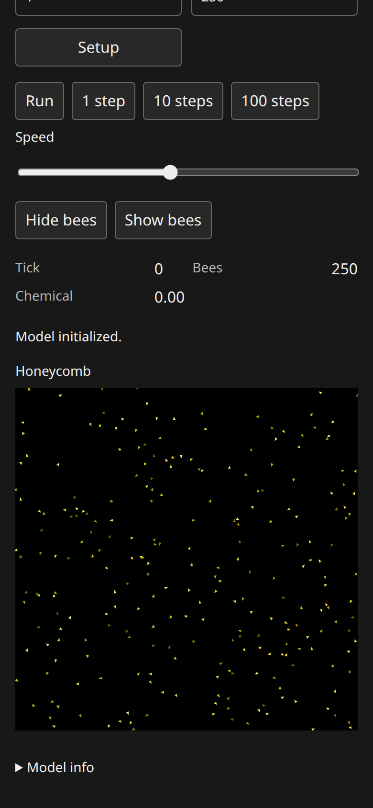

# Honeycomb: B07 model report

Canonical selected path: `Sample Models/Biology/Honeycomb`. Experiment: `experiments/honeycomb`. Membership is unchanged from selection.json.

Original archive/source session SHA-256: `812353ef075700900bccf35cc7587137a46fb6c9d3c8a17464790669a72124db`. Exact served XML version `NetLogo 7.0.4`; running original engine `2.16.1 (90be9317)`. Pinned Galapagos `90be931773fcf499049247a8aaa1aecbe003654c`, with immutable inventory byte match. Full original code/widgets/Info/shapes/notices: [archive](../../experiments/honeycomb/source.nlogox), [notices](../../experiments/honeycomb/NOTICE.md).

Scientific framing and exactly three verified publications remain in the existing [research dossier](../research/netlogo-web/honeycomb.md) and [metadata](../research/netlogo-web/honeycomb.json); their access/verification limits apply. This port does not add or duplicate literature and is not scientific validation.

Public contract: [headless source](../../experiments/honeycomb/model.ts), [thin UI binding](../../experiments/honeycomb/ui.ts). `create(options)`, `advance(count)` and detached `read()` use canonical public state owners. Named source procedures/actions, parameter phases, topology, plots and terminal/tick meaning are specified in [the source audit](selected-biology-source-audit.md). Exact source widgets and procedure list are in [audit JSON](selected-biology-source-audit.json).

## Adaptations and source findings

This is a separate source-specific implementation, not a Slime mode. The source chemical-dependent turn/forward equations and preincrement ten-tick diffusion/evaporation cadence are retained. Bees use compact triangles and a CSS gray ramp. Hide/show changes presentation-owned visibility state through defined model actions without changing time or chemical.

## Actual original browser

Configured defaults: `set num-bees 250.0`; seed1 before Setup. Setup observation: `{"success": true, "value": [0, 250, 0]}`. After30 go calls: `{"success": true, "value": [30, 250, 13414.500000000058]}`. Reporter tuple expression is retained in browser-observations/sourceProbes and model-specific source contracts; values are actual native observations.

Actual Run/Pause and Setup-as-reset observations: `{"paused": {"success": true, "value": 41}, "stable": {"success": true, "value": 41}, "reset": {"success": true, "value": [0, 250, 0]}, "errors": [], "canvasReadback": {"width": 810, "height": 810, "nonzero": 9230}}`. Successful equal paused/stable tick reporters establish bounded stable pause; Reset may randomize again without reseeding. Additional source actions/boundary/error probes are versioned by slug in [raw results](selected-biology-evidence/browser-observations.json).

## Actual target browser

Setup monitors: `[["Tick", "0"], ["Bees", "250"], ["Chemical", "0.00"]]`. After30 clicked single-step actions: `[["Tick", "30"], ["Bees", "250"], ["Chemical", "13414.50"]]`. Status: `Steps completed.`. Actual loaded build-version `1793969543383`. Loaded model chunk attribution: `[{"url": "http://localhost:3147/chunks/ui-x1y5e6kp.js", "sha256": "764ead0c4d09bce0fde2a330ab243f715417e99640a9ca63e12182005f690ae0", "sourceMarker": "selected-biology-b07:honeycomb:812353ef075700900bccf35cc7587137a46fb6c9d3c8a17464790669a72124db"}]`. These screenshots belong to this actual final source/UI version; file hashes are recorded separately.

Run/Pause, stable pause and Setup-as-reset: `{"paused": ["32", "250", "13023.05"], "stable": ["32", "250", "13023.05"], "reset": ["0", "250", "0.00"], "status": "Model initialized.", "buttons": [{"label": "Setup", "disabled": false}, {"label": "Run", "disabled": false}, {"label": "1 step", "disabled": false}, {"label": "10 steps", "disabled": false}, {"label": "100 steps", "disabled": false}, {"label": "Hide bees", "disabled": false}, {"label": "Show bees", "disabled": false}], "liveNames": []}`. Source-specific target actions/live controls/terminal probes are recorded under `targetProbes` in [raw observations](selected-biology-evidence/browser-observations.json).

Mobile dark measured geometry: `{"viewport": [390, 844], "scroll": [0, 167.5], "scrollWidth": 390, "theme": "dark", "canvas": {"x": 16, "y": 404.984375, "width": 358, "height": 358}}`. Light/mobile and dark/desktop geometry are separately retained in raw results. All ordinary captures were visually inspected. Apparent blank bundled transport in Sunflower/Tumor/Membrane was reopened individually with view_image: files contain the actual particle/stems/membrane; no model renderer fix was warranted.

Console/runtime diagnostics: baseline source errors `[]`; target captured console entries `[[], []]`; paired target status states were success. Expected beta-zero/zero-radius probes are explicit errors, not passing runtime claims. Initial automation attempts used an unsupported manual redraw invocation and ran Go before Setup on three fresh originals; corrected captures/control checks replaced them. These harness errors are distinct from model failures.

Comparison conclusion: default topology/membership and observed source-specific mechanisms/reporters, plus bounded interactions, are supported by executed evidence. Different spatial patterns/masses are expected under the declared RNG/scheduling differences; no stochastic-distribution equivalence is established. UI palettes/shapes/scales and seam strokes are adapted as documented above. Full arbitrary-parameter/long-horizon equivalence is not claimed.

## Verification and approval

Final executed shell commands and exit codes are in [final checks](selected-biology-evidence/final-checks.json). All four TypeScript projects and standalone ambient-free ten-model/frozen-five-script TypeScript pass. Focused biology+shared-distribution checks:26tests/286assertions pass; additional inherited uniform/normal regression:31tests/73assertions pass. All five public scripts now pass with the explicitly user-approved source-rounding correction in script03 (412/724). The superseded original freeze remains archived; the current five-script hash manifest passes. See [approval and new freeze](selected-biology-rounding-approval.md). Build and actual packed Bun/Node ESM/ambient-free TypeScript consumer pass locally after parent sync. Historical pre-sync failures remain separately versioned; no parent full-integration checkpoint is relabeled as a B07 run.

Independent Argon/high review: **pending**, existing quota-blocked task8194e842, no retry/substitute. Native author findings and coordinator responses are not independent approval. No global model count, registration, selection, ledger or research status was changed here. Parent-owned dependency sync commits19f98ba(source428750f) and6dfc324(sourceb3db9b4) are excluded from the owned handoff list.

Final shared-shell supplement: these captures retain their actual distribution-sync build. After parent status fix e1c4ae8, this model module was freshly imported in Chromium and its final source marker/chunk SHA recorded in [status-fix.json](selected-biology-evidence/status-fix.json). Affected completion/error flows and post-fix checks are documented in [the batch supplement](selected-biology-browser.md#final-shared-status-supplement).
