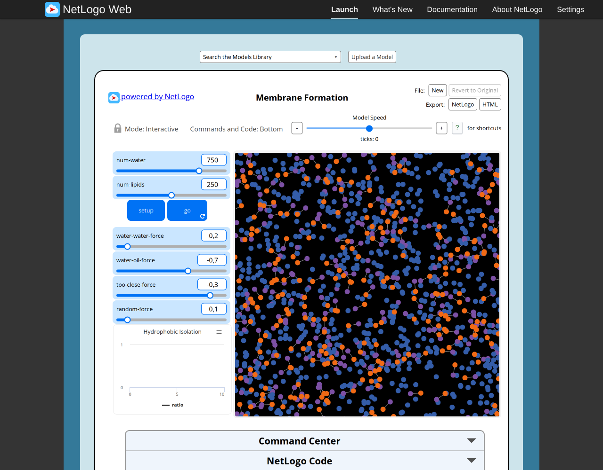
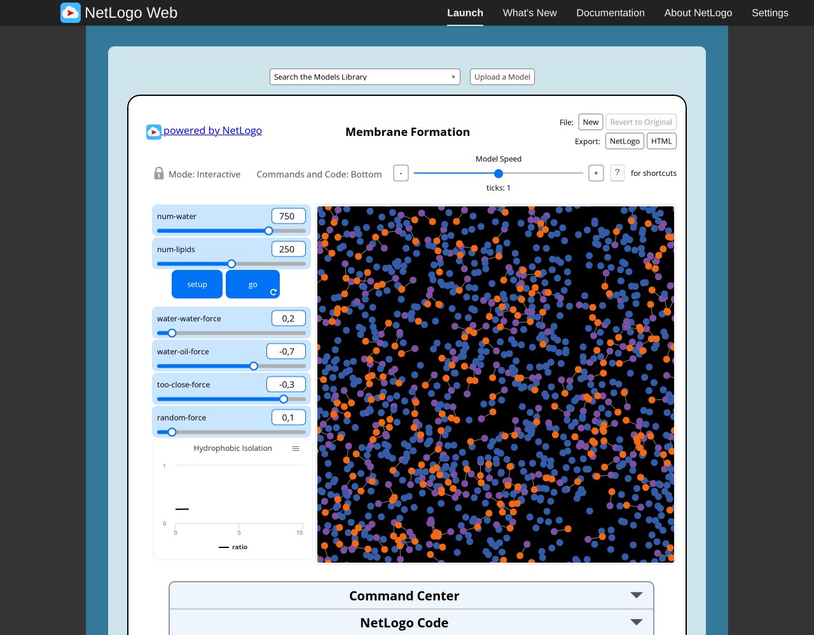
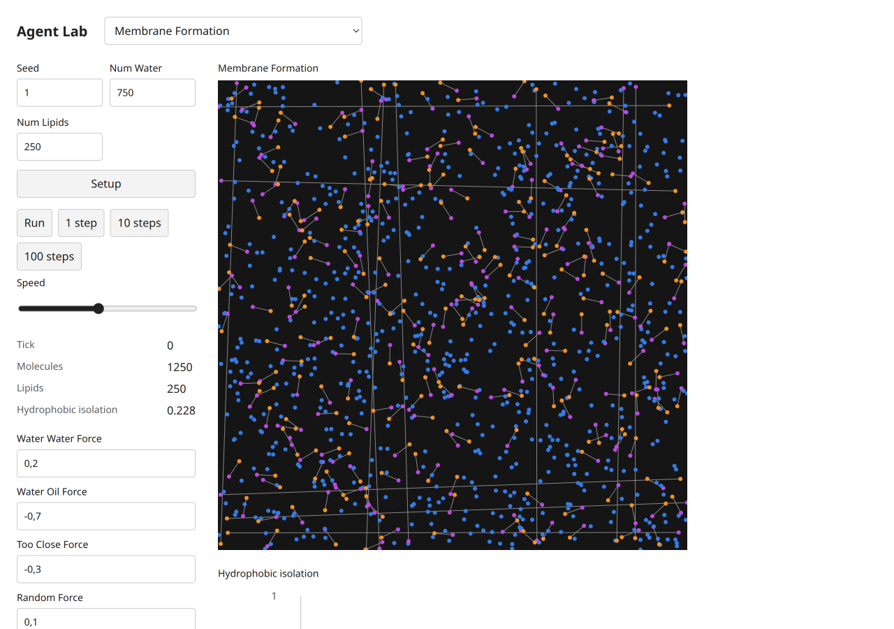
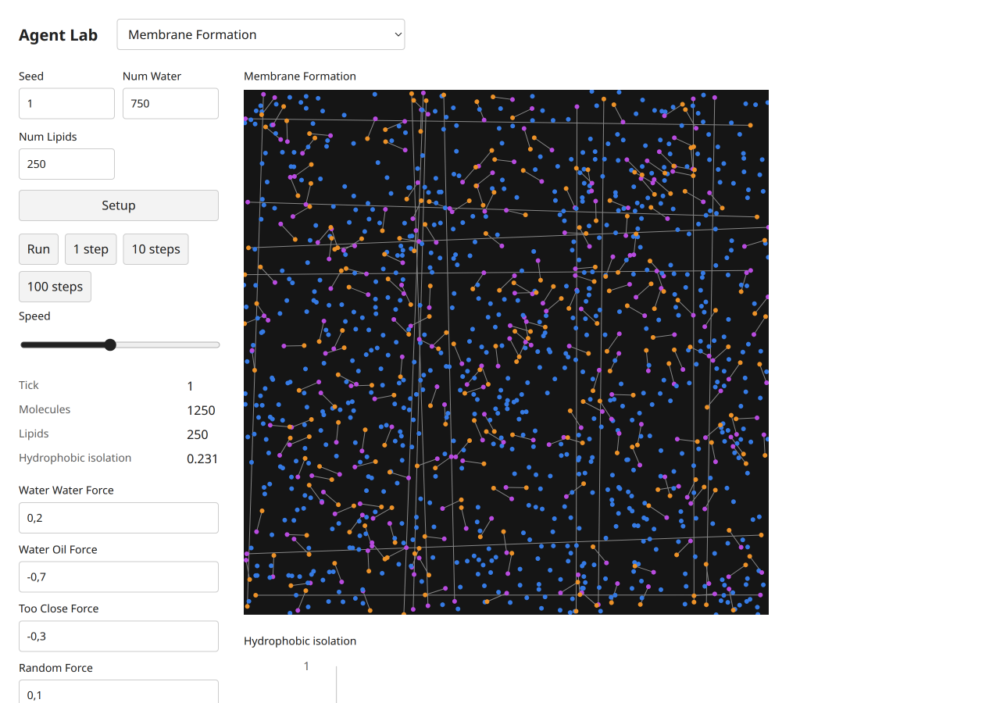
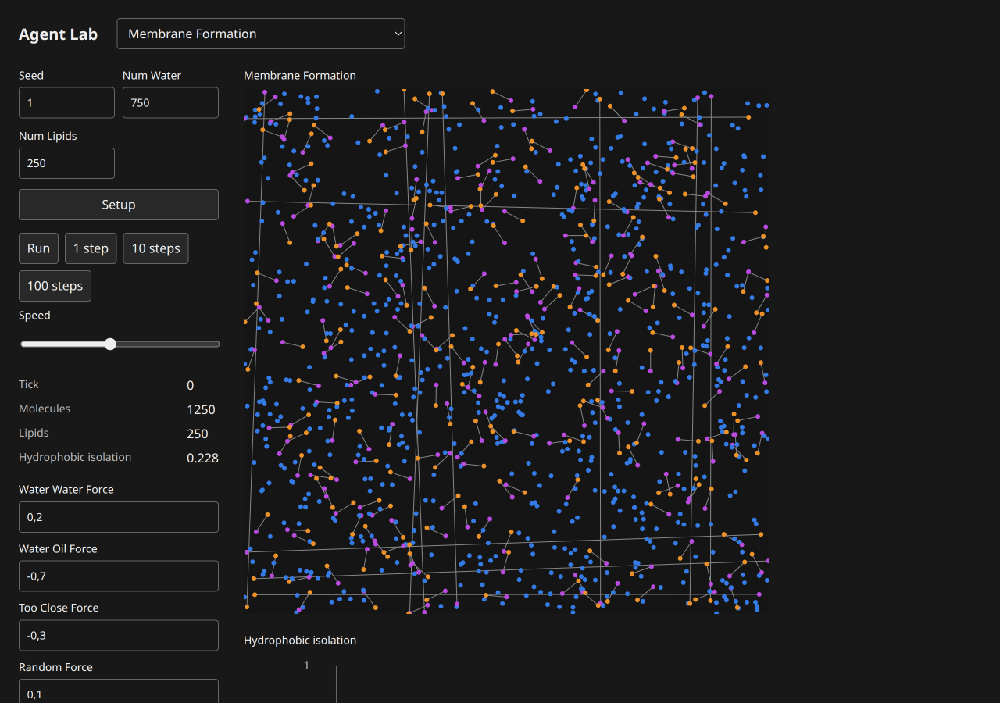
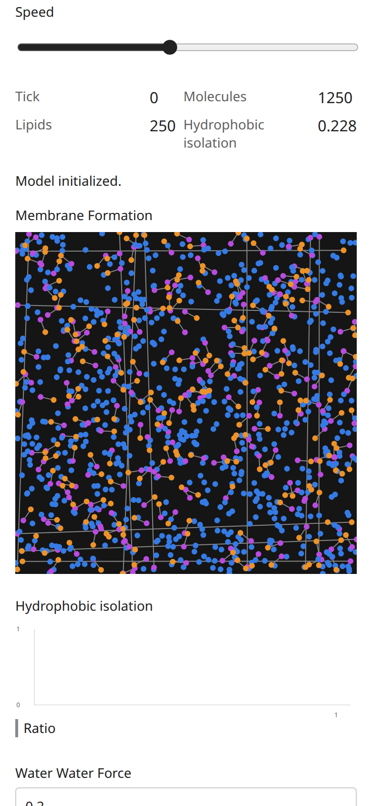
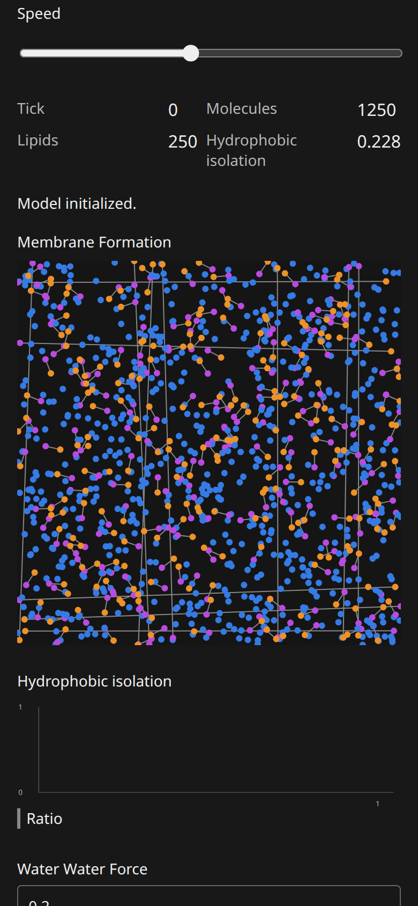

# Membrane Formation: B07 model report

Canonical selected path: `Sample Models/Biology/Membrane Formation`. Experiment: `experiments/membrane-formation`. Membership is unchanged from selection.json.

Original archive/source session SHA-256: `4f3a41013090830c53ee055eac6625b1d3fcba981df7ab8d67822af037f7733d`. Exact served XML version `NetLogo 7.0.4`; running original engine `2.16.1 (90be9317)`. Pinned Galapagos `90be931773fcf499049247a8aaa1aecbe003654c`, with immutable inventory byte match. Full original code/widgets/Info/shapes/notices: [archive](../../experiments/membrane-formation/source.nlogox), [notices](../../experiments/membrane-formation/NOTICE.md).

Scientific framing and exactly three verified publications remain in the existing [research dossier](../research/netlogo-web/membrane-formation.md) and [metadata](../research/netlogo-web/membrane-formation.json); their access/verification limits apply. This port does not add or duplicate literature and is not scientific validation.

Public contract: [headless source](../../experiments/membrane-formation/model.ts), [thin UI binding](../../experiments/membrane-formation/ui.ts). `create(options)`, `advance(count)` and detached `read()` use canonical public state owners. Named source procedures/actions, parameter phases, topology, plots and terminal/tick meaning are specified in [the source audit](selected-biology-source-audit.md). Exact source widgets and procedure list are in [audit JSON](selected-biology-source-audit.json).

## Adaptations and source findings

Canonical Graph edges connect canonical World oil/water Agents. Radius queries, facing, movement and distance use public Agent APIs. Source self-inclusive isolation denominator excludes the linked partner. Direct endpoint link strokes can span the torus seam; wrapped link drawing is a declared visual difference, not changed topology. Default1250-agent ticks take several seconds with current public radius queries; one default tick is paired, and a separate18-agent zero-force interaction probe completes10ticks. No private acceleration kernel is introduced.

## Actual original browser

Configured defaults: `set num-water 750.0 set num-lipids 250.0 set water-water-force 0.2 set water-oil-force -0.7 set too-close-force -0.3 set random-force 0.1`; seed1 before Setup. Setup observation: `{"success": true, "value": [0, 1000, 250, 250]}`. After1 go calls: `{"success": true, "value": [1, 1000, 250, 250]}`. Reporter tuple expression is retained in browser-observations/sourceProbes and model-specific source contracts; values are actual native observations.

Actual Run/Pause and Setup-as-reset observations: `{"paused": {"success": true, "value": 7}, "stable": {"success": true, "value": 7}, "reset": {"success": true, "value": [0, 1000, 250, 250]}, "errors": [], "canvasReadback": {"width": 1122, "height": 1122, "nonzero": 436850}}`. Successful equal paused/stable tick reporters establish bounded stable pause; Reset may randomize again without reseeding. Additional source actions/boundary/error probes are versioned by slug in [raw results](selected-biology-evidence/browser-observations.json).

## Actual target browser

Setup monitors: `[["Tick", "0"], ["Molecules", "1250"], ["Lipids", "250"], ["Hydrophobic isolation", "0.228"]]`. After1 clicked single-step actions: `[["Tick", "1"], ["Molecules", "1250"], ["Lipids", "250"], ["Hydrophobic isolation", "0.231"]]`. Status: `Steps completed.`. Actual loaded build-version `1793968579671`. Loaded model chunk attribution: `[{"url": "http://localhost:3147/chunks/ui-z6c9v837.js", "sha256": "3fe870ca21bcd8b1940272617b7dcbd7bf222c8e4a78011009f635ba06a7e15a", "sourceMarker": "selected-biology-b07:membrane-formation:4f3a41013090830c53ee055eac6625b1d3fcba981df7ab8d67822af037f7733d"}]`. These screenshots belong to this actual final source/UI version; file hashes are recorded separately.

Run/Pause, stable pause and Setup-as-reset: `{"paused": ["3", "1250", "250", "0.238"], "stable": ["3", "1250", "250", "0.238"], "reset": ["0", "1250", "250", "0.228"], "status": "Model initialized.", "buttons": [{"label": "Setup", "disabled": false}, {"label": "Run", "disabled": false}, {"label": "1 step", "disabled": false}, {"label": "10 steps", "disabled": false}, {"label": "100 steps", "disabled": false}], "liveNames": ["live-waterWaterForce", "live-waterOilForce", "live-tooCloseForce", "live-randomForce"]}`. Source-specific target actions/live controls/terminal probes are recorded under `targetProbes` in [raw observations](selected-biology-evidence/browser-observations.json).

Mobile dark measured geometry: `{"viewport": [390, 844], "scroll": [0, 322.5], "scrollWidth": 390, "theme": "dark", "canvas": {"x": 16, "y": 243.078125, "width": 358, "height": 358}}`. Light/mobile and dark/desktop geometry are separately retained in raw results. All ordinary captures were visually inspected. Apparent blank bundled transport in Sunflower/Tumor/Membrane was reopened individually with view_image: files contain the actual particle/stems/membrane; no model renderer fix was warranted.

Console/runtime diagnostics: baseline source errors `[]`; target captured console entries `[[], []]`; paired target status states were success. Expected beta-zero/zero-radius probes are explicit errors, not passing runtime claims. Initial automation attempts used an unsupported manual redraw invocation and ran Go before Setup on three fresh originals; corrected captures/control checks replaced them. These harness errors are distinct from model failures.

Comparison conclusion: default topology/membership and observed source-specific mechanisms/reporters, plus bounded interactions, are supported by executed evidence. Different spatial patterns/masses are expected under the declared RNG/scheduling differences; no stochastic-distribution equivalence is established. UI palettes/shapes/scales and seam strokes are adapted as documented above. Full arbitrary-parameter/long-horizon equivalence is not claimed.

## Verification and approval

Executed shell commands and exit codes are in [focused checks](selected-biology-evidence/focused-checks.json). Frozen01/02/04/05 and hashes pass; frozen03 and the Blood focused test fail on the missing dependency. Four TypeScript projects were invoked individually: core and UI examples pass; dev/UI and standalone model/frozen-script TypeScript reject only the two missing public distribution overloads. Build and actual packed Bun/Node ESM/ambient-free TypeScript consumer pass. Exact logs are versioned in the evidence directory. No parent full-integration checkpoint is relabeled as a B07 run.

Independent Argon/high review: **pending**, existing quota-blocked task8194e842, no retry/substitute. Native author findings and coordinator responses are not independent approval. No global model count, registration, selection, ledger or research status was changed here.
