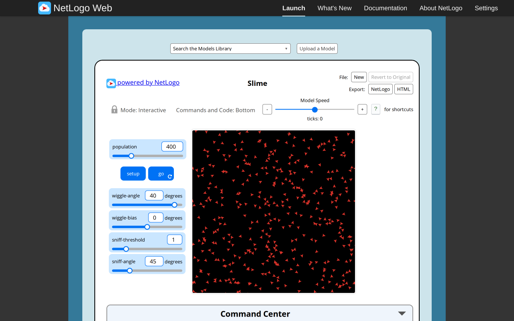
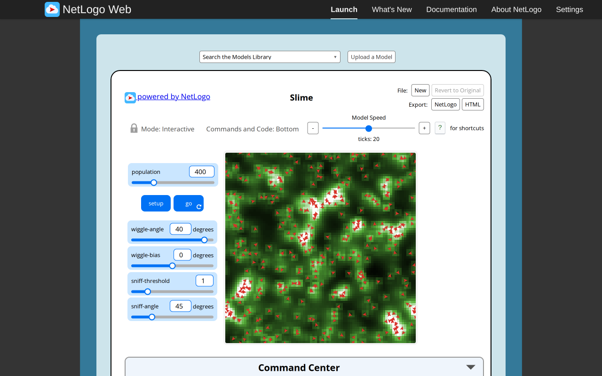
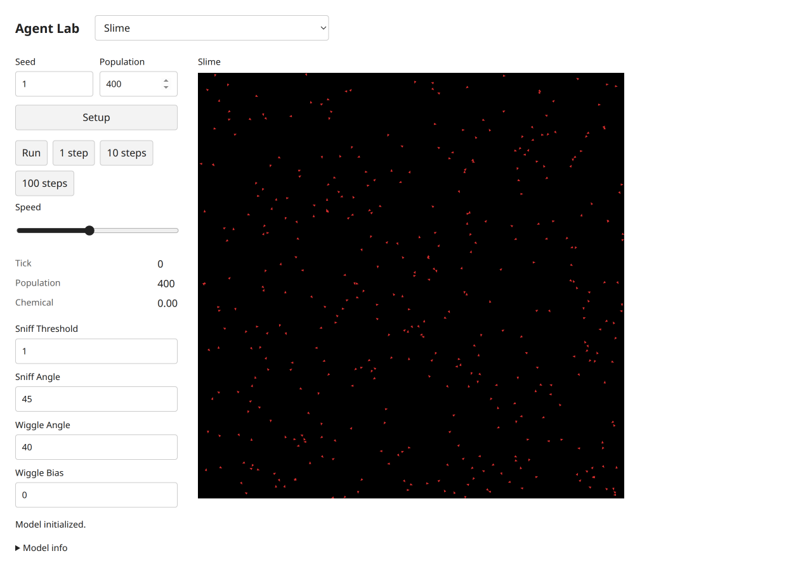
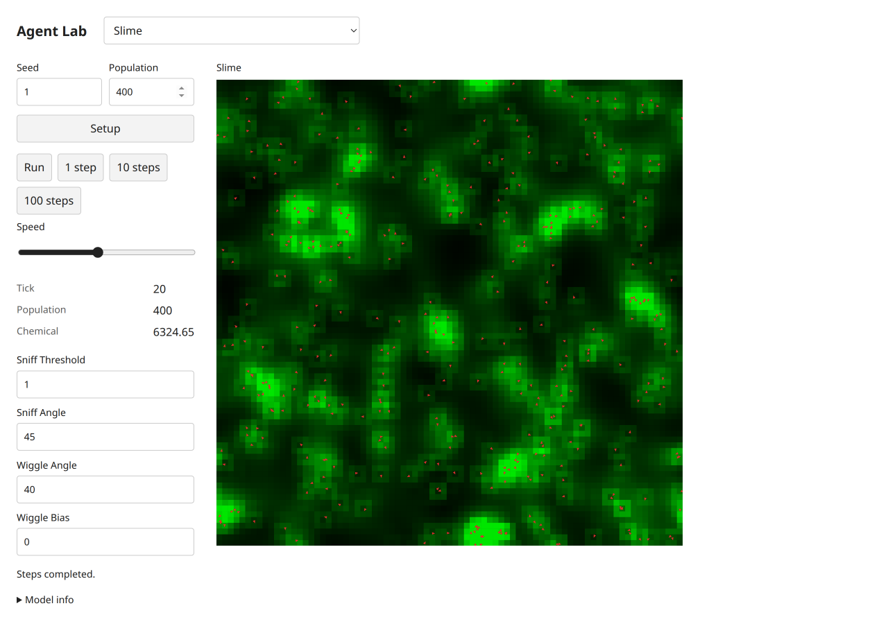
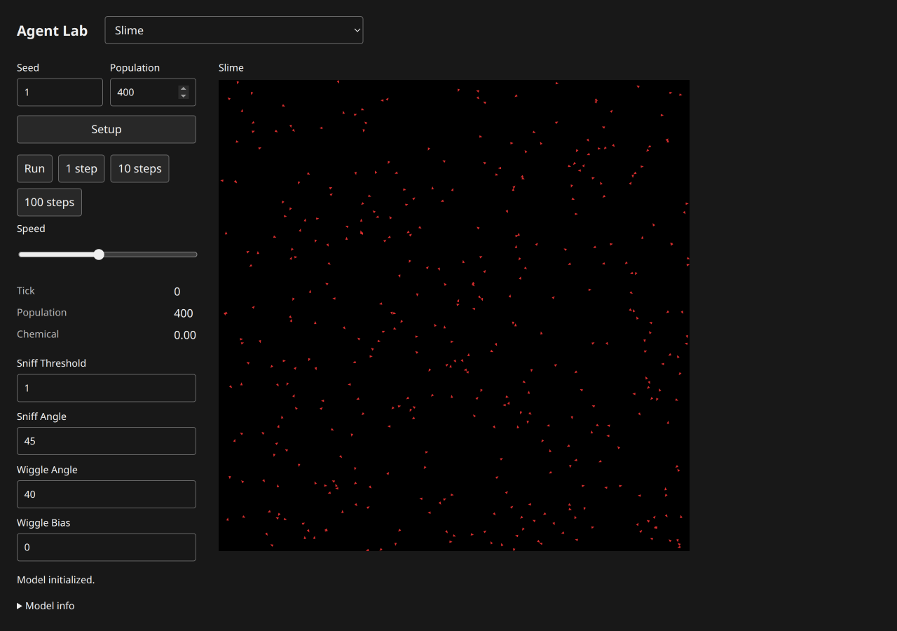
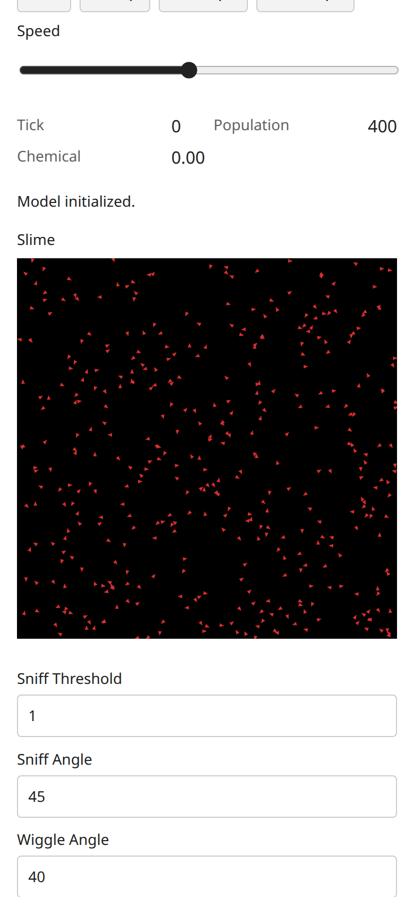
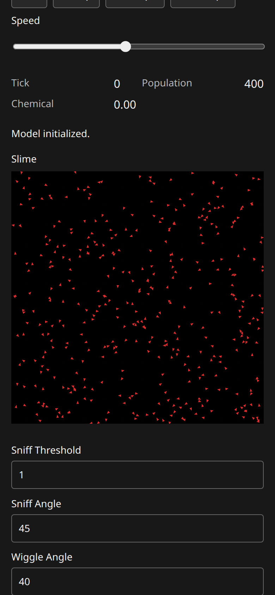

# Slime: B07 model report

Canonical selected path: `Sample Models/Biology/Slime`. Experiment: `experiments/slime`. Membership is unchanged from selection.json.

Original archive/source session SHA-256: `ede03dc05cc186a9607cb2ef1b11dfde4a1c05eb57edd19e2a577768c04644da`. Exact served XML version `NetLogo 7.0.4`; running original engine `2.16.1 (90be9317)`. Pinned Galapagos `90be931773fcf499049247a8aaa1aecbe003654c`, with immutable inventory byte match. Full original code/widgets/Info/shapes/notices: [archive](../../experiments/slime/source.nlogox), [notices](../../experiments/slime/NOTICE.md).

Scientific framing and exactly three verified publications remain in the existing [research dossier](../research/netlogo-web/slime.md) and [metadata](../research/netlogo-web/slime.json); their access/verification limits apply. This port does not add or duplicate literature and is not scientific validation.

Public contract: [headless source](../../experiments/slime/model.ts), [thin UI binding](../../experiments/slime/ui.ts). `create(options)`, `advance(count)` and detached `read()` use canonical public state owners. Named source procedures/actions, parameter phases, topology, plots and terminal/tick meaning are specified in [the source audit](selected-biology-source-audit.md). Exact source widgets and procedure list are in [audit JSON](selected-biology-source-audit.json).

## Adaptations and source findings

The source sniff tie chooses right, followed by two independent uniform wiggle draws and live bias. Cells use a continuous green CSS ramp rather than the NetLogo palette; turtle symbols use a compact triangle. Total chemical after20ticks is the same mass invariant in both executions; this does not imply matching spatial trajectories.

## Actual original browser

Configured defaults: `set population 400.0 set sniff-threshold 1.0 set sniff-angle 45.0 set wiggle-angle 40.0 set wiggle-bias 0.0`; seed1 before Setup. Setup observation: `{"success": true, "value": [0, 400, 0]}`. After20 go calls: `{"success": true, "value": [20, 400, 6324.648086947901]}`. Reporter tuple expression is retained in browser-observations/sourceProbes and model-specific source contracts; values are actual native observations.

Actual Run/Pause and Setup-as-reset observations: `{"paused": {"success": true, "value": 5}, "stable": {"success": true, "value": 5}, "reset": {"success": true, "value": [0, 400, 0]}, "errors": [], "canvasReadback": {"width": 810, "height": 810, "nonzero": 47350}}`. Successful equal paused/stable tick reporters establish bounded stable pause; Reset may randomize again without reseeding. Additional source actions/boundary/error probes are versioned by slug in [raw results](selected-biology-evidence/browser-observations.json).

## Actual target browser

Setup monitors: `[["Tick", "0"], ["Population", "400"], ["Chemical", "0.00"]]`. After20 clicked single-step actions: `[["Tick", "20"], ["Population", "400"], ["Chemical", "6324.65"]]`. Status: `Steps completed.`. Actual loaded build-version `1793969543383`. Loaded model chunk attribution: `[{"url": "http://localhost:3147/chunks/ui-3q794nay.js", "sha256": "ed70003addd931e7d0fd36a2ef7370ac5058a9d62dbbcd9836336f41363c6f38", "sourceMarker": "selected-biology-b07:slime:ede03dc05cc186a9607cb2ef1b11dfde4a1c05eb57edd19e2a577768c04644da"}]`. These screenshots belong to this actual final source/UI version; file hashes are recorded separately.

Run/Pause, stable pause and Setup-as-reset: `{"paused": ["22", "400", "6490.96"], "stable": ["22", "400", "6490.96"], "reset": ["0", "400", "0.00"], "status": "Model initialized.", "buttons": [{"label": "Setup", "disabled": false}, {"label": "Run", "disabled": false}, {"label": "1 step", "disabled": false}, {"label": "10 steps", "disabled": false}, {"label": "100 steps", "disabled": false}], "liveNames": ["live-sniffThreshold", "live-sniffAngle", "live-wiggleAngle", "live-wiggleBias"]}`. Source-specific target actions/live controls/terminal probes are recorded under `targetProbes` in [raw observations](selected-biology-evidence/browser-observations.json).

Mobile dark measured geometry: `{"viewport": [390, 844], "scroll": [0, 281.5], "scrollWidth": 390, "theme": "dark", "canvas": {"x": 16, "y": 242.984375, "width": 358, "height": 358}}`. Light/mobile and dark/desktop geometry are separately retained in raw results. All ordinary captures were visually inspected. Apparent blank bundled transport in Sunflower/Tumor/Membrane was reopened individually with view_image: files contain the actual particle/stems/membrane; no model renderer fix was warranted.

Console/runtime diagnostics: baseline source errors `[]`; target captured console entries `[[], []]`; paired target status states were success. Expected beta-zero/zero-radius probes are explicit errors, not passing runtime claims. Initial automation attempts used an unsupported manual redraw invocation and ran Go before Setup on three fresh originals; corrected captures/control checks replaced them. These harness errors are distinct from model failures.

Comparison conclusion: default topology/membership and observed source-specific mechanisms/reporters, plus bounded interactions, are supported by executed evidence. Different spatial patterns/masses are expected under the declared RNG/scheduling differences; no stochastic-distribution equivalence is established. UI palettes/shapes/scales and seam strokes are adapted as documented above. Full arbitrary-parameter/long-horizon equivalence is not claimed.

## Verification and approval

Final executed shell commands and exit codes are in [final checks](selected-biology-evidence/final-checks.json). All four TypeScript projects and standalone ambient-free ten-model/frozen-five-script TypeScript pass. Focused biology+shared-distribution checks:26tests/286assertions pass; additional inherited uniform/normal regression:31tests/73assertions pass. Frozen01/02/04/05 and all five original freeze hashes pass. Unchanged frozen03 now fails only its source-contradicted411 expectation (actual412); the proposed412/724 correction awaits explicit user approval. Build and actual packed Bun/Node ESM/ambient-free TypeScript consumer pass locally after parent sync. Historical pre-sync failures remain separately versioned; no parent full-integration checkpoint is relabeled as a B07 run.

Independent Argon/high review: **pending**, existing quota-blocked task8194e842, no retry/substitute. Native author findings and coordinator responses are not independent approval. No global model count, registration, selection, ledger or research status was changed here. Parent-owned dependency sync commits19f98ba(source428750f) and6dfc324(sourceb3db9b4) are excluded from the owned handoff list.

Final shared-shell supplement: these captures retain their actual distribution-sync build. After parent status fix e1c4ae8, this model module was freshly imported in Chromium and its final source marker/chunk SHA recorded in [status-fix.json](selected-biology-evidence/status-fix.json). Affected completion/error flows and post-fix checks are documented in [the batch supplement](selected-biology-browser.md#final-shared-status-supplement).
