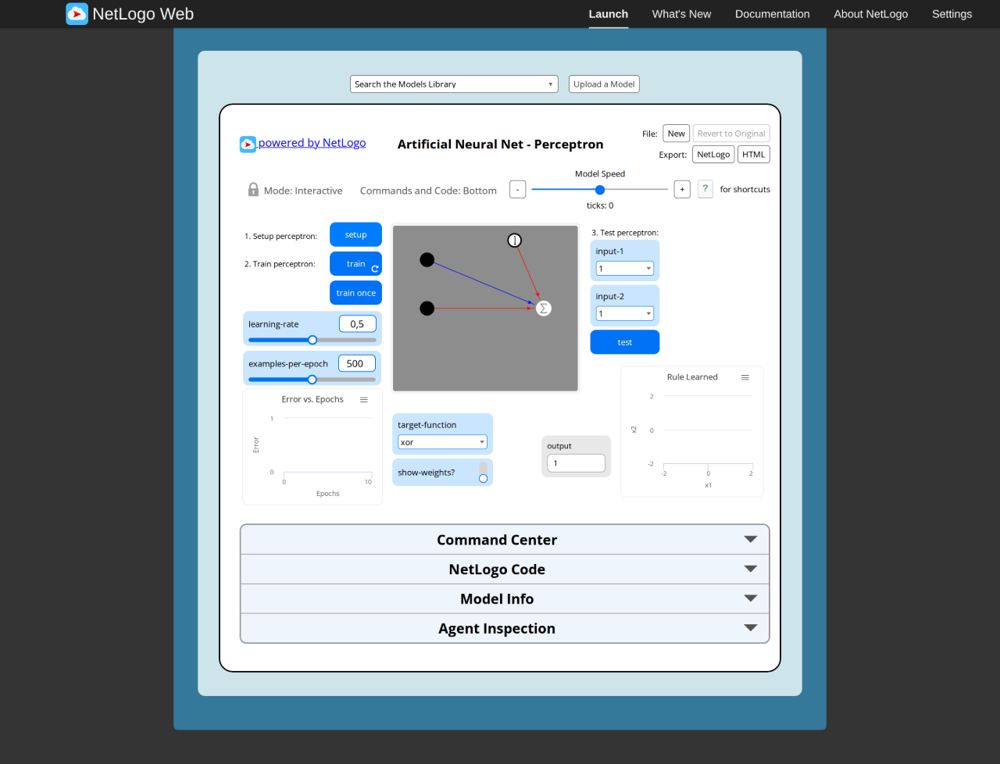
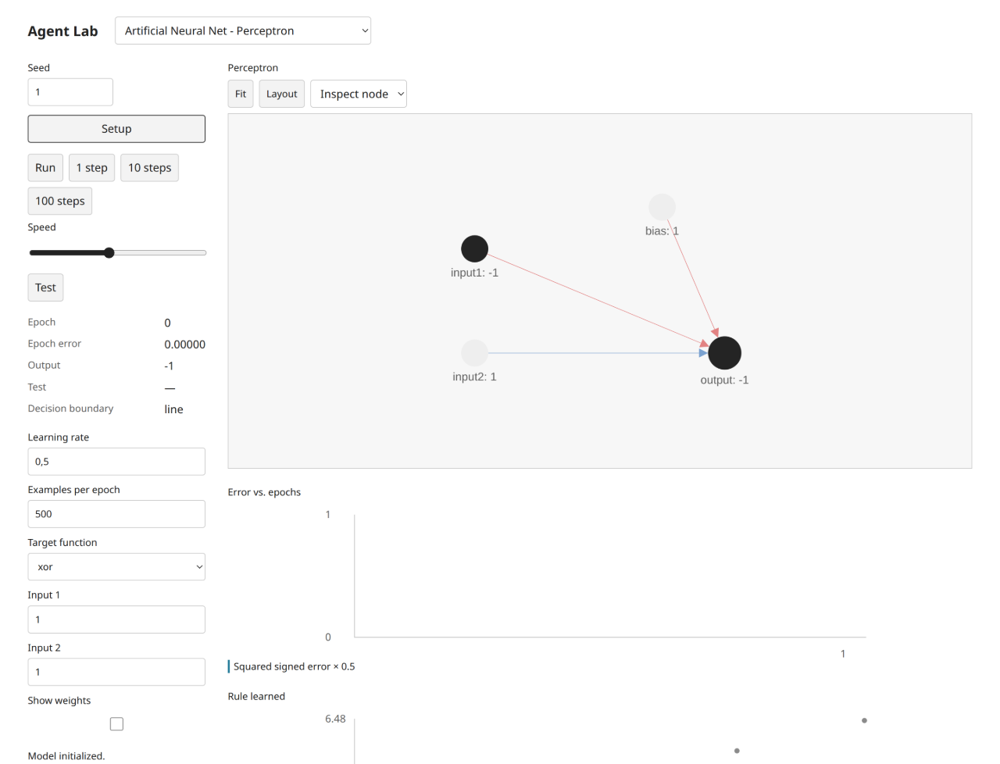
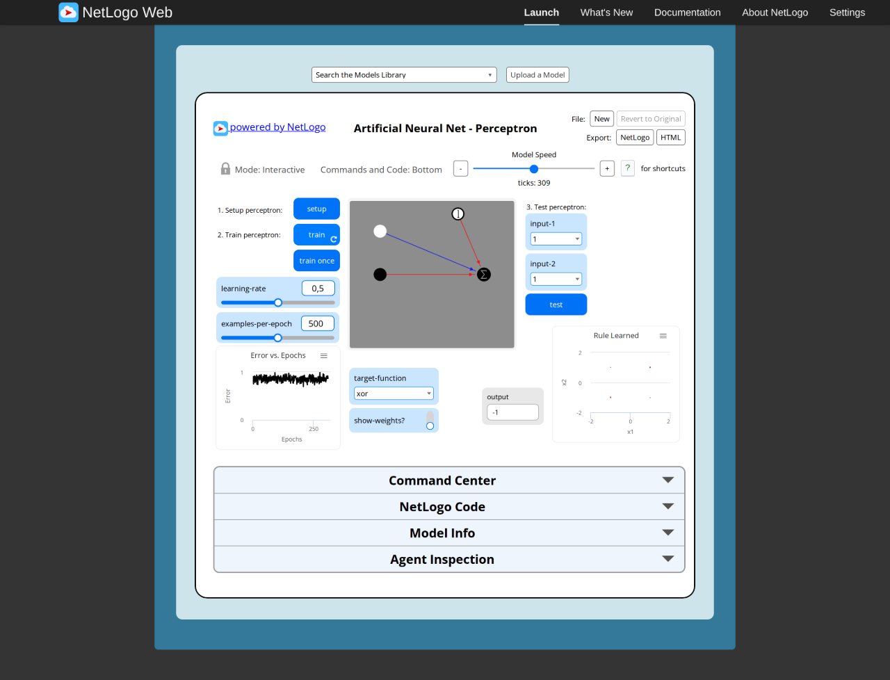
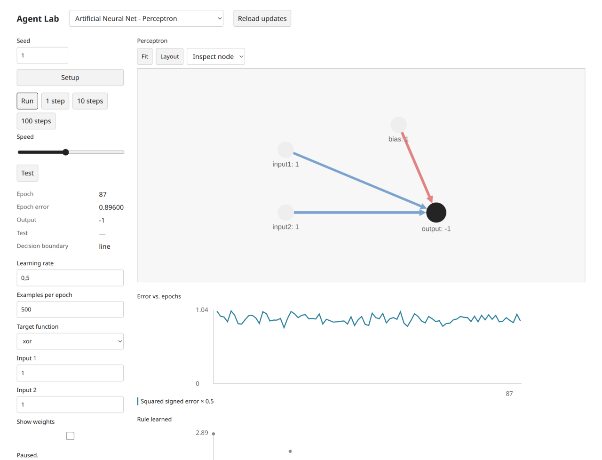

# Artificial Neural Net - Perceptron — executed B18 author acceptance

Selected identity: `Sample Models/Computer Science/Artificial Neural Net - Perceptron`. Mechanism: **Signed perceptron**. Source audit, implementation, headless verification and original/target browser comparison are evidenced here; independent approval remains **pending** (known quota-blocked Argon/high task8194e842, no retry/substitution). This is not final scientific or independent acceptance.

## Identity, versions and public composition

Exact [served source](https://www.netlogoweb.org/assets/modelslib/Sample%20Models/Computer%20Science/Artificial%20Neural%20Net%20-%20Perceptron.nlogox), archived as [source.nlogox](../../../experiments/artificial-neural-net-perceptron/source.nlogox), [attribution/license](../../../experiments/artificial-neural-net-perceptron/NOTICE.md): CC BY-NC-SA 3.0. Source SHA-256 `d9cd6c06309d80a0f6e0b48105912f23529c14ae63ee030152a7172cb60e13cb`; 54068bytes. Galapagos `90be931773fcf499049247a8aaa1aecbe003654c` matches served bytes; Desktop membership is not used as identity. All Procedures/Widgets/Info/notices were audited; [complete procedure/widget inventory](artificial-neural-net-perceptron-source.md) and [source contract](../selected-computing-contract.md) retain equations/defaults/topology/order/actions/reporters and source faults.

Target public headless entry: `experiments/artificial-neural-net-perceptron/model.ts`, `create(options?)`, `advance(count?)`, `read()` plus documented model actions. It composes real public City Library objects/functions; UI imports domain actions and detached snapshots. No transpiled NetLogo, substitute engine, new private generic library or shared core API was introduced.

- Model source SHA-256: `c55d49531ebd4359750a2ab188b01509c11bee9ce2249491d7075d45539c0460`.
- Thin UI SHA-256: `2c75e28fec567c1700a3c670290e3927c49771f0f7fd3b202b41aef4d040c917`.
- Actual browser-loaded model chunk: `http://localhost:3188/chunks/ui-5286x9xw.js`, SHA-256 `fa911e36ffaff7c0ae3efa33deb154106bf26977504f6555c1c0fb610ad58e53`, 10227bytes, compiled source marker `experiments/artificial-neural-net-perceptron/model.ts` checked.

Reference XML declares NetLogo7.0.4; hosted Web engine2.16.1(90be9317) was read from native netlogo-version/modelConfig.version in the final K-Means session. Browser Chromium156.0.0.0; target Bun1.4.2/TypeScript7.0.2/Node26.8.2. [Environment](evidence/environment.json) records the observation basis and exact two-file parent5bc6b16 renderer hashes. Reference RNG is not equated to target Mulberry32 seed1. Content-addressed model-chunk URLs were read back and SHA-256 checked; app.js is a mutable dev-server entry and its refetched hash is supplemental, not a source identity assertion.

## Native setup and measured progress

Native controls at Setup (complete widget code/ranges/defaults in audit):

| Measurement | Observed value |
| --- | --- |
| input-1 | `1` |
| input-2 | `1` |
| learning-rate | `0.5` |
| examples-per-epoch | `500` |
| target-function | `"xor"` |
| show-weights? | `false` |

Original setup tick0 and progressed tick309:

| Measurement | Observed value |
| --- | --- |
| epoch-error | `0.868` |
| [activation] of perceptron | `-1` |
| [weight] of links | `[0.04755215051267747,-0.014002193593794843,0.002103660240097227]` |

Target setup and pending/live inputs:

| Measurement | Observed value |
| --- | --- |
| seed | `"1"` |
|  | `"5"` |
| live-learningRate | `"0.5"` |
| live-examplesPerEpoch | `"500"` |
| live-targetFunction | `"xor"` |
| live-input1 | `"1"` |
| live-input2 | `"1"` |
| live-showWeights | `false` |

Target progressed monitor values:

| Measurement | Observed value |
| --- | --- |
| Epoch | `"87"` |
| Epoch error | `"0.89600"` |
| Output | `"-1"` |
| Test | `"—"` |
| Decision boundary | `"line"` |

Canonical directed Graph edges own all three weights; the strict zero sign threshold and learningRate×(target−output)×input update are public headless equations. Epoch error is half the mean squared SIGNED error (0..2), not an error fraction. The default XOR remains nonseparable: original epoch309 error0.868 and target epoch87 error0.896 are observed examples of persistent error, not matching stochastic samples. Both original and target Test controls executed without a training tick.

## Executed controls and boundary checks

Original performed actions: setup, train once, train pause, test, setup reset. Setup after the run reset tick to0. [Original raw readbacks](evidence/artificial-neural-net-perceptron-original.json) pin settings, source SHA, actual ticks, reporters and code errors. [Supplementary original parameter/actions](evidence/original-parameter-actions.json) retain additional native switch/chooser/limit/reset tests; PageRank method switch is in its primary record. K-Means additionally has [single native go](evidence/k-means-single-command.json). Models without a native single-step button use Command Center go (Robby/Factory/Annealing) or their native split assignment/update actions plus single go (K-Means); no nonexistent native Reset/Step button is claimed. Source Setup is the reset operation.

Target performed actions: Setup, 1 step, Run, Pause, Show weights on, Test, Setup resets model. [Target raw readbacks](evidence/artificial-neural-net-perceptron-target.json) retain Setup, single step, progressed state, live actions and Setup-reset values, all four viewport/theme combinations, actual chunk digests and diagnostics. Completion disables target step/play controls for K-Means and PSO; other models retain their audited terminal rules. Atomic invalid inputs, no-tick actions, observation purity, deterministic target replay and source scientific equations are exercised by the frozen scripts and focused tests, not inferred from screenshots.

Every original and target was run in the real shared T3 Chromium browser. The coordinator inspected actual setup/progress images and readback; target desktop1440×1100 and mobile390×844 CSS pixels were inspected in light/dark. PNG dimensions may be downsampled desktop1280wide or device-scale mobile780wide; viewport metadata is authoritative. Canvas getImageData before capture is the documented raster workaround; theme changes settle across two animation frames. Two partial dark rasters (Dining/Factory) were replaced by explicit seed1 replays and forced1441→1440resize; their recapture JSONs preserve the corrected basis. No source-only browser approval or cross-RNG trajectory identity is claimed.

## Paired screenshot evidence

| State | NetLogo Web original | City Library target |
| --- | --- | --- |
| Setup |  |  |
| Progress |  |  |

Target [desktop dark](evidence/artificial-neural-net-perceptron-target-desktop-dark.png), [mobile light](evidence/artificial-neural-net-perceptron-target-mobile-light.png), [mobile dark](evidence/artificial-neural-net-perceptron-target-mobile-dark.png). Those later captures may include explicitly recorded live actions/reset-centroid/trial scenarios, rather than pretending to be the same scientific tick as the paired default-progress frame. Full finite bar/scatter pair labels and model/canonical state readbacks were inspected; charts are not statistical validation.

## Adaptations, diagnostics and remaining approval

Target zero second-input weight reports a vertical or degenerate decision boundary instead of the native plot division-by-zero failure. The shared scatter shows the five boundary support points and signed truth points rather than a continuous mixed line/scatter plot. Show weights exposes a table because the shared Graph view has no edge-label field. Logical role IDs differ from native who numbers; node colors/positions and directed weight signs retain their functional meaning. History is bounded1001samples.

Recorded original codeRuntimeErrors/codeCompilerErrors are empty in these default runs. No target application error or failed request was observed; some Chromium captures logged the expected Canvas2D willReadFrequently performance warning after getImageData. The retained target diagnostics include the tab's cumulative console entries and should not be mistaken for per-model unique errors. All target stages reported no horizontal document overflow. Source-derived potential errors and deliberately injected headless failures are distinguished from executed browser failures above.

[Final slice checks](evidence/final-slice-checks.log): all four TypeScript projects,35focused tests/6679assertions, all five frozen examples and their unchanged SHA-256 checks passed after final fixes. [Full author check](evidence/author-checks.log) passed336tests/22613assertions,120registered existing scripts,build and packed consumer before the late native-control/UI-only fixes; the final affected checks were repeated. Parent owns global registration and the newer integrated-core regression. No unexecuted new-package/lint check is claimed.

Scientific framing and exactly three verified publications are reused from the existing [research dossier](../../research/netlogo-web/artificial-neural-net-perceptron.md), with its original access/metadata limitations. No duplicate literature task or new scientific validation was performed. Required independent Argon/high approval remains pending; author fixes and coordinator boundary decisions are not independent approval.
