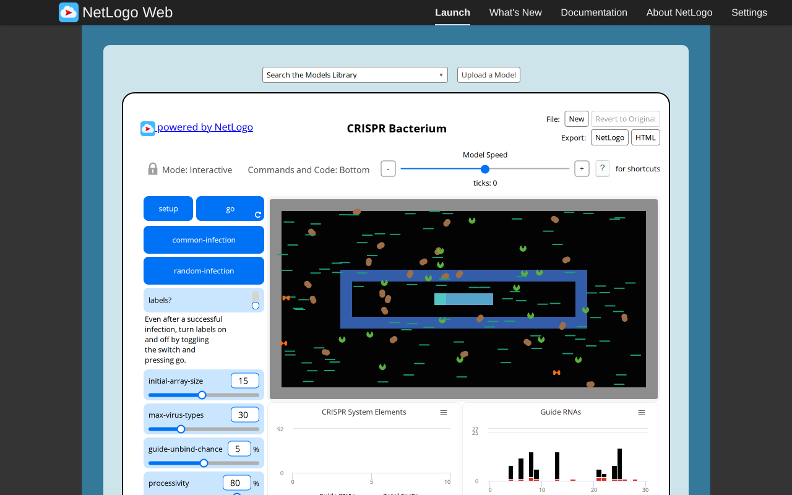
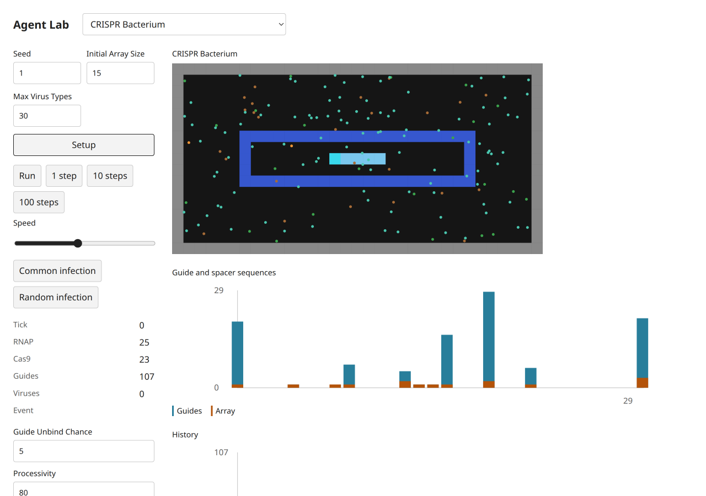
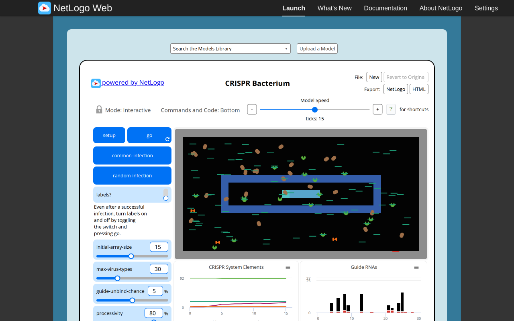
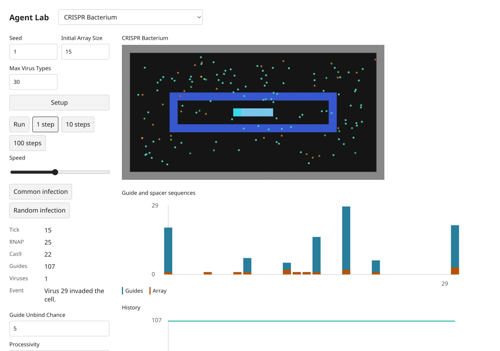

# CRISPR Bacterium — B09 acceptance evidence

Exact selected catalog identity: `Sample Models/Biology/CRISPR/CRISPR Bacterium`. Experiment: `crispr-bacterium`. [Complete source and notices](../../experiments/crispr-bacterium/NOTICE.md); [archived XML](../../experiments/crispr-bacterium/source.nlogox). Galapagos `90be931773fcf499049247a8aaa1aecbe003654c`; served/inventory/actual loaded-session UTF-8 XML SHA-256 `e87977797048bf809aa58a41d6dc746c59d6d5e0ba94957db2996815725f4813` all agree. [Full widgets/procedures/license audit](selected-disease-gene-source-audit.json). [Existing three-publication dossier](../research/netlogo-web/crispr-bacterium.md), with its existing access and scientific limitations; no duplicate literature work.

The natural setup generates25 RNAP plus stochastic Cas/guide products. Common infection and random infection are genuine source actions; both are clicked in the target and labels are toggled before a step. Bound molecular complexes use canonical Graph links and explicit co-located molecule movement; there is no general private tie engine. Native genome-bound-virus preflight stops at tick0, and the target preserves the same preflight rule. Empty common-infection prefixes remain source errors. Source shapes are simplified; the array, guide sequence histogram, products and event reporter remain observable.

## Executed original and target

Original: actual T3 server Chromium,1280×800 CSS, source random-seed123 before captured setup, source defaults except the stated Disease infectionChance0. Target: actual T3 server Chromium,1280×900 desktop and390×844 mobile CSS, seed1, Mulberry public Random. Screenshot device scale is recorded by decoded PNG dimensions (mobile780×1688). Source MT and target Mulberry streams, presentation-related draws and source agentset activation differ. No cross-seed trajectory, distributional, empirical, scientific or medical validation is claimed. These are educational toys, not health guidance.

Original progress reporters, read from the actual session:

| Reporter | Observed value |
| --- | --- |
| `ticks` | `15` |
| `count RNAPs` | `25` |
| `count cas9s` | `18` |
| `count guide-RNAs` | `91` |
| `count viruses` | `1` |
| `infected?` | `false` |
| `array` | `[13, 25, 8, 6, 4, 24, 21, 9, 22, 22, 16, 8, 28, 21, 26]` |

Target progress monitors, read after actual button actions:

```text
Tick
15
RNAP
25
Cas9
22
Guides
107
Viruses
1
Event
Virus 29 invaded the cell.
```

[Original raw session, source hash, settings and Run/Pause/reset checks](selected-disease-gene-evidence/crispr-bacterium-original.json); [target raw controls, canvas, chart text alternatives and original build attribution](selected-disease-gene-evidence/crispr-bacterium-target.json). Source Setup and Run/Pause were executed; go-once is additionally executed when native (Repressilator). Target Setup,1/10-step buttons,Run/Pause and Setup reset were clicked. Target domain scenarios and invalid steps/read purity are separately asserted through the actual final immutable modules in [final browser mechanisms](selected-disease-gene-evidence/final-browser-mechanisms.json). Source errors are retained as scenario-specific evidence, never a reason to omit this model.

## Paired ordinary captures

Original setup:



Target setup:



Original progression:



Target progression:



[Desktop dark](selected-disease-gene-evidence/crispr-bacterium-target-desktop-dark.png), [mobile light](selected-disease-gene-evidence/crispr-bacterium-target-mobile-light.png), [mobile dark](selected-disease-gene-evidence/crispr-bacterium-target-mobile-dark.png). These theme captures follow reset at tick0 and intentionally retain initial state. Each PNG was inspected individually. All ordinary PNGs existed before any pixel analysis. Decoded RGB/RGBA statistics and ten equal light/dark canvas PNG ROIs are retained; no renderer repair is claimed.

## Final code and checks

Final build version `1793972578482`, immutable model/UI chunk `./chunks/ui-cvnk32yd.js`, SHA-256 `abc914448abeec2f4b823a97ed50047179fc205023d4d37baa1262f5e5cb3317`. Source marker `selected-disease-gene-b09:crispr-bacterium:e87977797048bf809aa58a41d6dc746c59d6d5e0ba94957db2996815725f4813`. Shared chunk `/chunks/app-sb7h8whr.js`, SHA-256 `1f8f6827af1ab753a43b29435d40f5ae716071103930bc3de67ad53ede358d05`. [All ten final immutable imports, hashes and actual three-step executions](selected-disease-gene-evidence/final-bundles.json). The initial captures retain build1793972277740; the five number-format-only changes are documented by separately named formatted screenshots/JSON and final hashes, never by relabeling old captures.

Executed batch checks:24 focused tests/538 assertions; four TypeScript projects; standalone TypeScript covering all five scripts; build; actual packed Bun/Node ESM/ambient-free TypeScript consumer. Frozen scripts01–04 run unchanged;05 fails with the preserved source-ln0 contradiction. All five frozen hashes remain intact. [Batch checks and limits](selected-disease-gene-browser.md). Independent Argon approval remains quota-pending8194e842; coordinator evidence is not independent approval. Root alone decides registration,combined checks and global counts.
