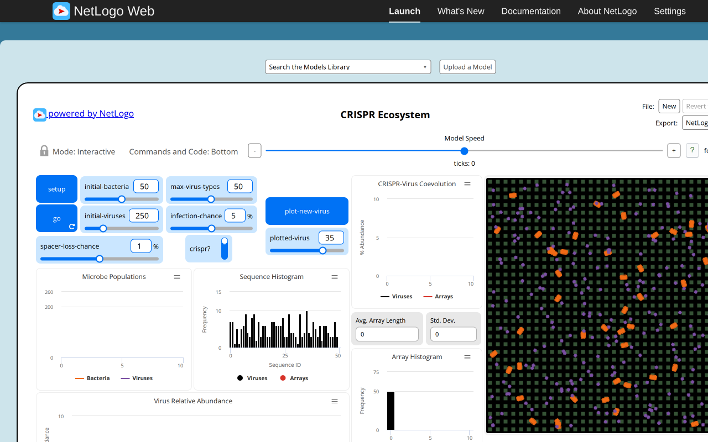
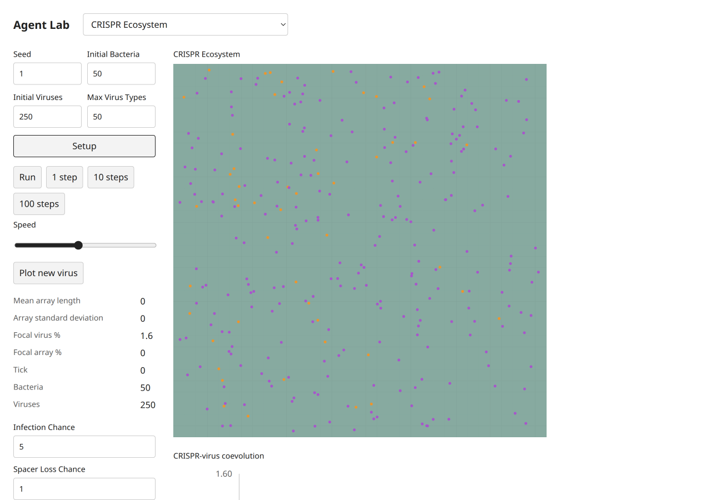
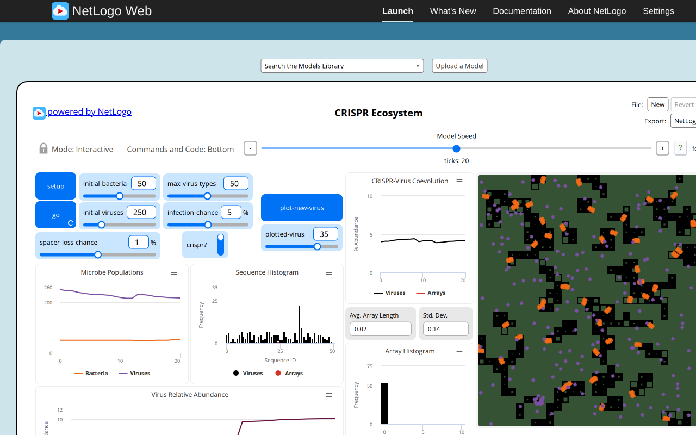
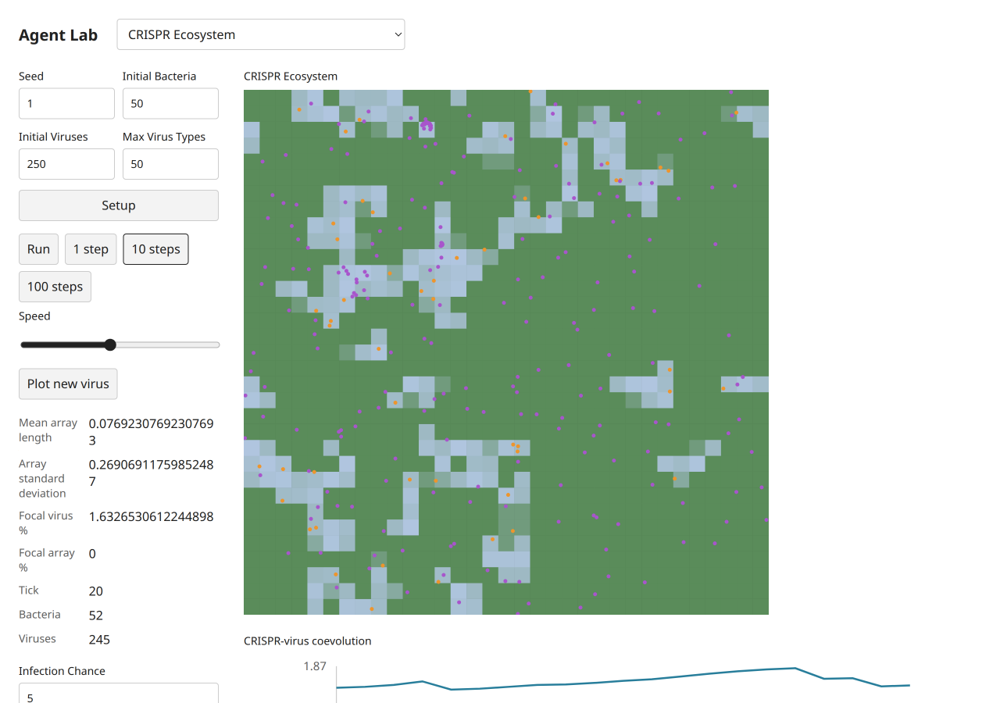

# CRISPR Ecosystem — B09 acceptance evidence

Exact selected catalog identity: `Sample Models/Biology/CRISPR/CRISPR Ecosystem`. Experiment: `crispr-ecosystem`. [Complete source and notices](../../experiments/crispr-ecosystem/NOTICE.md); [archived XML](../../experiments/crispr-ecosystem/source.nlogox). Galapagos `90be931773fcf499049247a8aaa1aecbe003654c`; served/inventory/actual loaded-session UTF-8 XML SHA-256 `9414dea313e5f6f7c4496014ef1638d42d020ce84220e4c0a00ea8b1bf1bdec9` all agree. [Full widgets/procedures/license audit](selected-disease-gene-source-audit.json). [Existing three-publication dossier](../research/netlogo-web/crispr-ecosystem.md), with its existing access and scientific limitations; no duplicate literature work.

Both setups contain50 bacteria,250 viruses and food50 per field. Progressed food/populations differ with seeded streams, not with replacement equations. Extinction with initialViruses0 stops before tick0 in both systems. Native 8/83/9 versus30/55/15 spacer outcomes,20-virus replication and food countdowns remain explicit procedures. Plot new virus changes the cached focal sequence and clears only the coevolution plot; the target button is clicked and other histories remain. Relative abundance, sequence and array histograms are preserved. Food occupancy is shown with a continuous cell palette rather than separate decorative food turtles.

## Executed original and target

Original: actual T3 server Chromium,1280×800 CSS, source random-seed123 before captured setup, source defaults except the stated Disease infectionChance0. Target: actual T3 server Chromium,1280×900 desktop and390×844 mobile CSS, seed1, Mulberry public Random. Screenshot device scale is recorded by decoded PNG dimensions (mobile780×1688). Source MT and target Mulberry streams, presentation-related draws and source agentset activation differ. No cross-seed trajectory, distributional, empirical, scientific or medical validation is claimed. These are educational toys, not health guidance.

Original progress reporters, read from the actual session:

| Reporter | Observed value |
| --- | --- |
| `ticks` | `20` |
| `count bacteria` | `54` |
| `count viruses` | `217` |
| `sum [food-energy] of patches` | `88615` |
| `length virus-history` | `50` |

Target progress monitors, read after actual button actions:

```text
Mean array length
0.07692307692307693
Array standard deviation
0.26906911759852487
Focal virus %
1.6326530612244898
Focal array %
0
Tick
20
Bacteria
52
Viruses
245
```

[Original raw session, source hash, settings and Run/Pause/reset checks](selected-disease-gene-evidence/crispr-ecosystem-original.json); [target raw controls, canvas, chart text alternatives and original build attribution](selected-disease-gene-evidence/crispr-ecosystem-target.json). Source Setup and Run/Pause were executed; go-once is additionally executed when native (Repressilator). Target Setup,1/10-step buttons,Run/Pause and Setup reset were clicked. Target domain scenarios and invalid steps/read purity are separately asserted through the actual final immutable modules in [final browser mechanisms](selected-disease-gene-evidence/final-browser-mechanisms.json). Source errors are retained as scenario-specific evidence, never a reason to omit this model.

## Paired ordinary captures

Original setup:



Target setup:



Original progression:



Target progression:



[Desktop dark](selected-disease-gene-evidence/crispr-ecosystem-target-desktop-dark.png), [mobile light](selected-disease-gene-evidence/crispr-ecosystem-target-mobile-light.png), [mobile dark](selected-disease-gene-evidence/crispr-ecosystem-target-mobile-dark.png). These theme captures follow reset at tick0 and intentionally retain initial state. Each PNG was inspected individually. All ordinary PNGs existed before any pixel analysis. Decoded RGB/RGBA statistics and ten equal light/dark canvas PNG ROIs are retained; no renderer repair is claimed.

## Final code and checks

Final build version `1793972578482`, immutable model/UI chunk `./chunks/ui-2qvbxj3y.js`, SHA-256 `7bafa7cf93e3014adabae55f60b53b8a9abda123d0e4afb13105edad4d77b8e9`. Source marker `selected-disease-gene-b09:crispr-ecosystem:9414dea313e5f6f7c4496014ef1638d42d020ce84220e4c0a00ea8b1bf1bdec9`. Shared chunk `/chunks/app-sb7h8whr.js`, SHA-256 `1f8f6827af1ab753a43b29435d40f5ae716071103930bc3de67ad53ede358d05`. [All ten final immutable imports, hashes and actual three-step executions](selected-disease-gene-evidence/final-bundles.json). The initial captures retain build1793972277740; the five number-format-only changes are documented by separately named formatted screenshots/JSON and final hashes, never by relabeling old captures.

Executed batch checks:24 focused tests/538 assertions; four TypeScript projects; standalone TypeScript covering all five scripts; build; actual packed Bun/Node ESM/ambient-free TypeScript consumer. All five public scripts pass after the [explicitly approved two-line05 amendment](selected-disease-gene-freeze-amendment.md);01–04 remain unchanged. The original05 failure/hash remains historical evidence. [Batch checks and limits](selected-disease-gene-browser.md). Independent Argon approval remains quota-pending8194e842; coordinator evidence is not independent approval. Root alone decides registration,combined checks and global counts.

Final numeric display follow-up: [desktop light](selected-disease-gene-evidence/crispr-ecosystem-formatted-desktop-light.png), [mobile light](selected-disease-gene-evidence/crispr-ecosystem-formatted-mobile-light.png), [mobile dark](selected-disease-gene-evidence/crispr-ecosystem-formatted-mobile-dark.png); [raw formatted observations](selected-disease-gene-evidence/crispr-ecosystem-formatted.json). Only monitor display rounds to three fraction digits; model and chart values remain full precision.
