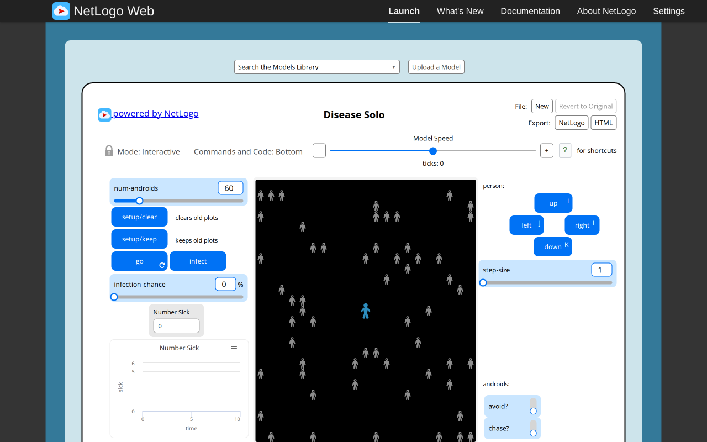
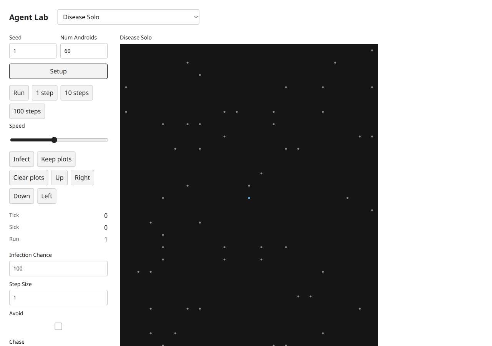
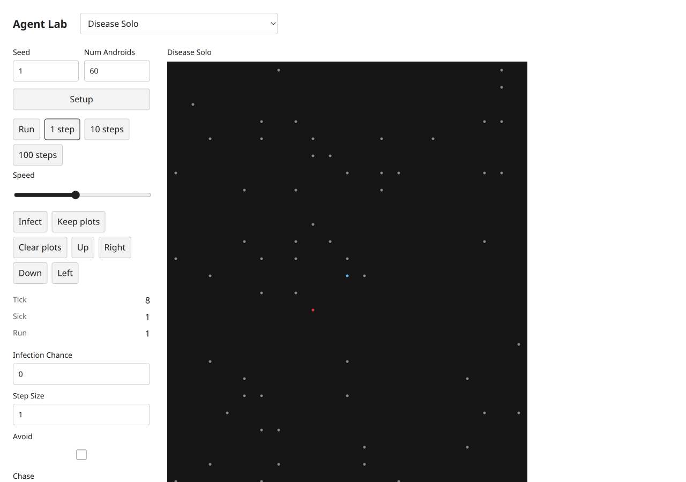

# Disease Solo — B09 acceptance evidence

Exact selected catalog identity: `Sample Models/Biology/Disease Solo`. Experiment: `disease-solo`. [Complete source and notices](../../experiments/disease-solo/NOTICE.md); [archived XML](../../experiments/disease-solo/source.nlogox). Galapagos `90be931773fcf499049247a8aaa1aecbe003654c`; served/inventory/actual loaded-session UTF-8 XML SHA-256 `f3d15df285ed35bcba2a6b3a718acf63de1589c8be099b44c2b6f1743b701a97` all agree. [Full widgets/procedures/license audit](selected-disease-gene-source-audit.json). [Existing three-publication dossier](../research/netlogo-web/disease-solo.md), with its existing access and scientific limitations; no duplicate literature work.

Native and target progression both reach tick8 with exactly one infected host when infectionChance=0. The original setup image already has chance0; target setup shows its default100 before the live field is changed to0. Cardinal movement and Keep plots are clicked in the target, returning tick0/run2. The source cached counter and fifty completed tail steps are retained; native forced-all-infected probe stops at tick51/delay51. Hard-edge forward uses unit substeps and never invents wrapping.

## Executed original and target

Original: actual T3 server Chromium,1280×800 CSS, source random-seed123 before captured setup, source defaults except the stated Disease infectionChance0. Target: actual T3 server Chromium,1280×900 desktop and390×844 mobile CSS, seed1, Mulberry public Random. Screenshot device scale is recorded by decoded PNG dimensions (mobile780×1688). Source MT and target Mulberry streams, presentation-related draws and source agentset activation differ. No cross-seed trajectory, distributional, empirical, scientific or medical validation is claimed. These are educational toys, not health guidance.

Original progress reporters, read from the actual session:

| Reporter | Observed value |
| --- | --- |
| `ticks` | `8` |
| `count turtles` | `61` |
| `num-sick` | `1` |
| `run-number` | `1` |

Target progress monitors, read after actual button actions:

```text
Tick
8
Sick
1
Run
1
```

[Original raw session, source hash, settings and Run/Pause/reset checks](selected-disease-gene-evidence/disease-solo-original.json); [target raw controls, canvas, chart text alternatives and original build attribution](selected-disease-gene-evidence/disease-solo-target.json). Source Setup and Run/Pause were executed; go-once is additionally executed when native (Repressilator). Target Setup,1/10-step buttons,Run/Pause and Setup reset were clicked. Target domain scenarios and invalid steps/read purity are separately asserted through the actual final immutable modules in [final browser mechanisms](selected-disease-gene-evidence/final-browser-mechanisms.json). Source errors are retained as scenario-specific evidence, never a reason to omit this model.

## Paired ordinary captures

Original setup:



Target setup:



Original progression:


Target progression:



[Desktop dark](selected-disease-gene-evidence/disease-solo-target-desktop-dark.png), [mobile light](selected-disease-gene-evidence/disease-solo-target-mobile-light.png), [mobile dark](selected-disease-gene-evidence/disease-solo-target-mobile-dark.png). These theme captures follow reset at tick0 and intentionally retain initial state. Each PNG was inspected individually. All ordinary PNGs existed before any pixel analysis. Decoded RGB/RGBA statistics and ten equal light/dark canvas PNG ROIs are retained; no renderer repair is claimed.

## Final code and checks

Final build version `1793972578482`, immutable model/UI chunk `./chunks/ui-8krk2bjr.js`, SHA-256 `47dcc0b4e2cd32c2ac334a5a957664bce837abc56b007002832c205650f8bb7b`. Source marker `selected-disease-gene-b09:disease-solo:f3d15df285ed35bcba2a6b3a718acf63de1589c8be099b44c2b6f1743b701a97`. Shared chunk `/chunks/app-sb7h8whr.js`, SHA-256 `1f8f6827af1ab753a43b29435d40f5ae716071103930bc3de67ad53ede358d05`. [All ten final immutable imports, hashes and actual three-step executions](selected-disease-gene-evidence/final-bundles.json). The initial captures retain build1793972277740; the five number-format-only changes are documented by separately named formatted screenshots/JSON and final hashes, never by relabeling old captures.

Executed batch checks:24 focused tests/538 assertions; four TypeScript projects; standalone TypeScript covering all five scripts; build; actual packed Bun/Node ESM/ambient-free TypeScript consumer. All five public scripts pass after the [explicitly approved two-line05 amendment](selected-disease-gene-freeze-amendment.md);01–04 remain unchanged. The original05 failure/hash remains historical evidence. [Batch checks and limits](selected-disease-gene-browser.md). Independent Argon approval remains quota-pending8194e842; coordinator evidence is not independent approval. Root alone decides registration,combined checks and global counts.
