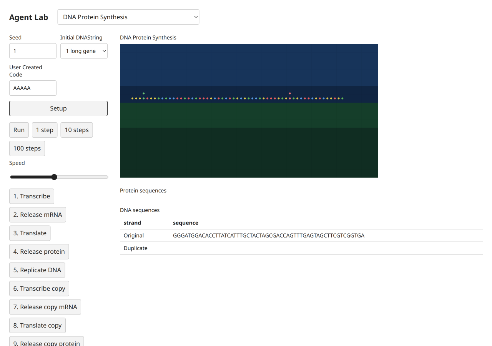
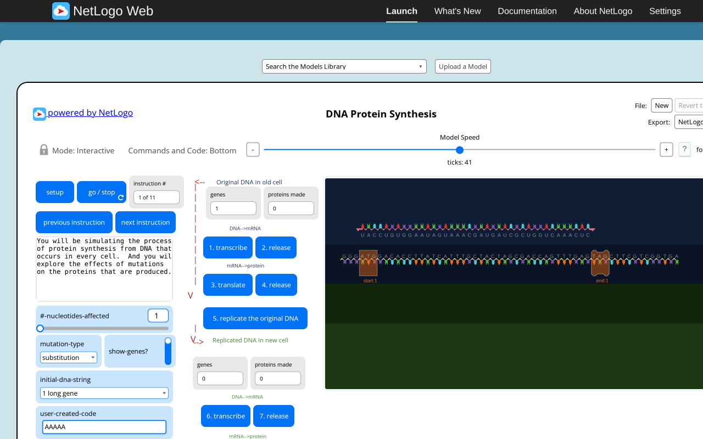
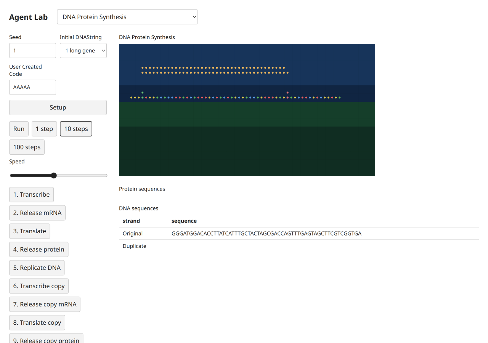

# DNA Protein Synthesis — B09 acceptance evidence

Exact selected catalog identity: `Curricular Models/BEAGLE Evolution/DNA Protein Synthesis`. Experiment: `dna-protein-synthesis`. [Complete source and notices](../../experiments/dna-protein-synthesis/NOTICE.md); [archived XML](../../experiments/dna-protein-synthesis/source.nlogox). Galapagos `90be931773fcf499049247a8aaa1aecbe003654c`; served/inventory/actual loaded-session UTF-8 XML SHA-256 `189eda6e21a0408e290f1afb5781ddae936f819ed8917788a683dcaf7d661301` all agree. [Full widgets/procedures/license audit](selected-disease-gene-source-audit.json). [Existing three-publication dossier](../research/netlogo-web/dna-protein-synthesis.md), with its existing access and scientific limitations; no duplicate literature work.

The source and target default long-gene sequence each transcribe/release mRNA by tick41. A separate actual short-gene workflow in both systems reaches tick43, gene codeATGTGG and protein-Met-Trp. Target buttons then replicate the DNA, show protein output and advance instructions. All preset/user normalization, nested starts, stop-codon exclusion, complement/codon convention and mutation modes are modeled. Canonical molecular links move source-specific chains; hidden molecules stay in state but are filtered by the UI. Original shapes/tags are replaced by colored molecules and sequence tables; mobile sequence tables scroll horizontally inside their own figure. Instruction copy is condensed and the host screenshot-export action is represented by retained acceptance PNGs rather than a model procedure.

## Executed original and target

Original: actual T3 server Chromium,1280×800 CSS, source random-seed123 before captured setup, source defaults except the stated Disease infectionChance0. Target: actual T3 server Chromium,1280×900 desktop and390×844 mobile CSS, seed1, Mulberry public Random. Screenshot device scale is recorded by decoded PNG dimensions (mobile780×1688). Source MT and target Mulberry streams, presentation-related draws and source agentset activation differ. No cross-seed trajectory, distributional, empirical, scientific or medical validation is claimed. These are educational toys, not health guidance.

Original progress reporters, read from the actual session:

| Reporter | Observed value |
| --- | --- |
| `ticks` | `41` |
| `original-dna-string` | `"GGGATGGACACCTTATCATTTGCTACTAGCGACCAGTTTGAGTAGCTTCGTCGGTGA"` |
| `original-strand-gene-counter` | `1` |
| `original-display-mrna-counter` | `1` |
| `count mRNAs with [released?]` | `1` |
| `count proteins` | `0` |

Target progress monitors, read after actual button actions:

```text
Tick
41
Original genes
1
Copied genes
0
Proteins
0
Instruction
1
Message
Explore protein synthesis from DNA and effects of mutations.
```

[Original raw session, source hash, settings and Run/Pause/reset checks](selected-disease-gene-evidence/dna-protein-synthesis-original.json); [target raw controls, canvas, chart text alternatives and original build attribution](selected-disease-gene-evidence/dna-protein-synthesis-target.json). Source Setup and Run/Pause were executed; go-once is additionally executed when native (Repressilator). Target Setup,1/10-step buttons,Run/Pause and Setup reset were clicked. Target domain scenarios and invalid steps/read purity are separately asserted through the actual final immutable modules in [final browser mechanisms](selected-disease-gene-evidence/final-browser-mechanisms.json). Source errors are retained as scenario-specific evidence, never a reason to omit this model.

## Paired ordinary captures

Original setup:


Target setup:



Original progression:



Target progression:



[Desktop dark](selected-disease-gene-evidence/dna-protein-synthesis-target-desktop-dark.png), [mobile light](selected-disease-gene-evidence/dna-protein-synthesis-target-mobile-light.png), [mobile dark](selected-disease-gene-evidence/dna-protein-synthesis-target-mobile-dark.png). These theme captures follow reset at tick0 and intentionally retain initial state. Each PNG was inspected individually. All ordinary PNGs existed before any pixel analysis. Decoded RGB/RGBA statistics and ten equal light/dark canvas PNG ROIs are retained; no renderer repair is claimed.

## Final code and checks

Final build version `1793972578482`, immutable model/UI chunk `./chunks/ui-xjvqad4y.js`, SHA-256 `c6b1baa38994b796cc6060f5f0b4e8e8b7a552e01c3f598385221b4c49729990`. Source marker `selected-disease-gene-b09:dna-protein-synthesis:189eda6e21a0408e290f1afb5781ddae936f819ed8917788a683dcaf7d661301`. Shared chunk `/chunks/app-sb7h8whr.js`, SHA-256 `1f8f6827af1ab753a43b29435d40f5ae716071103930bc3de67ad53ede358d05`. [All ten final immutable imports, hashes and actual three-step executions](selected-disease-gene-evidence/final-bundles.json). The initial captures retain build1793972277740; the five number-format-only changes are documented by separately named formatted screenshots/JSON and final hashes, never by relabeling old captures.

Executed batch checks:24 focused tests/538 assertions; four TypeScript projects; standalone TypeScript covering all five scripts; build; actual packed Bun/Node ESM/ambient-free TypeScript consumer. Frozen scripts01–04 run unchanged;05 fails with the preserved source-ln0 contradiction. All five frozen hashes remain intact. [Batch checks and limits](selected-disease-gene-browser.md). Independent Argon approval remains quota-pending8194e842; coordinator evidence is not independent approval. Root alone decides registration,combined checks and global counts.
