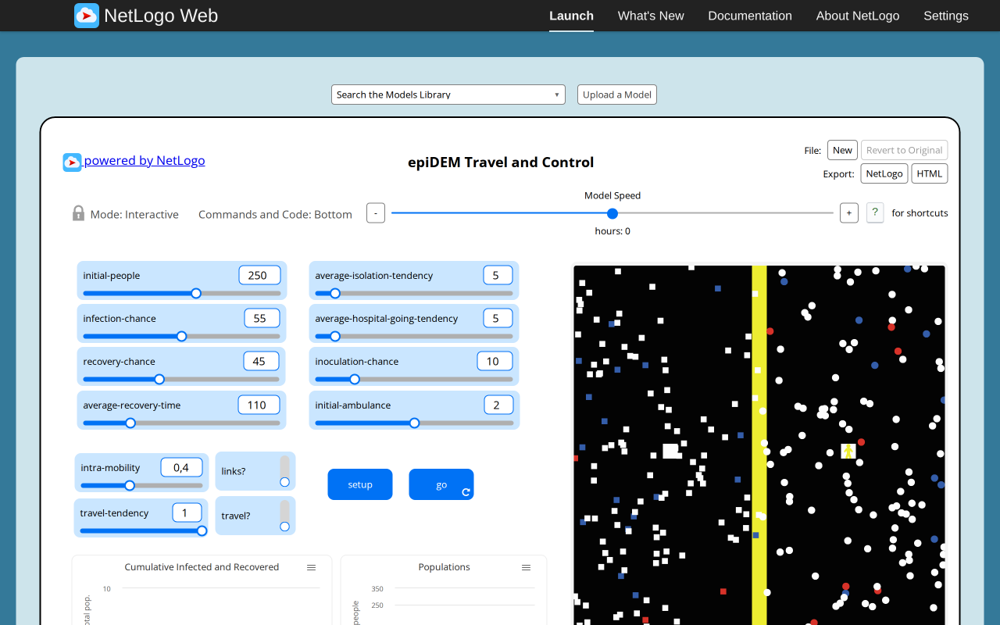
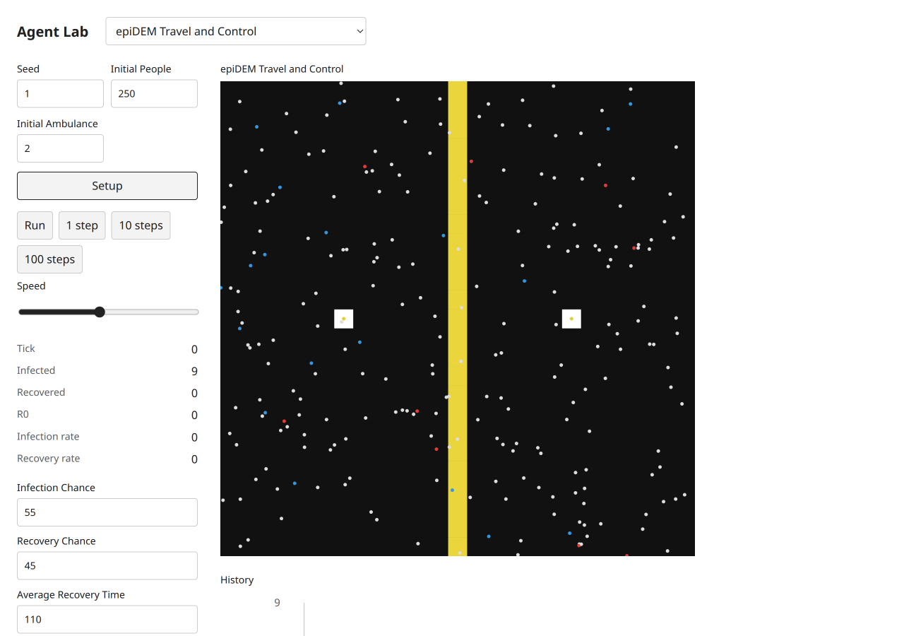
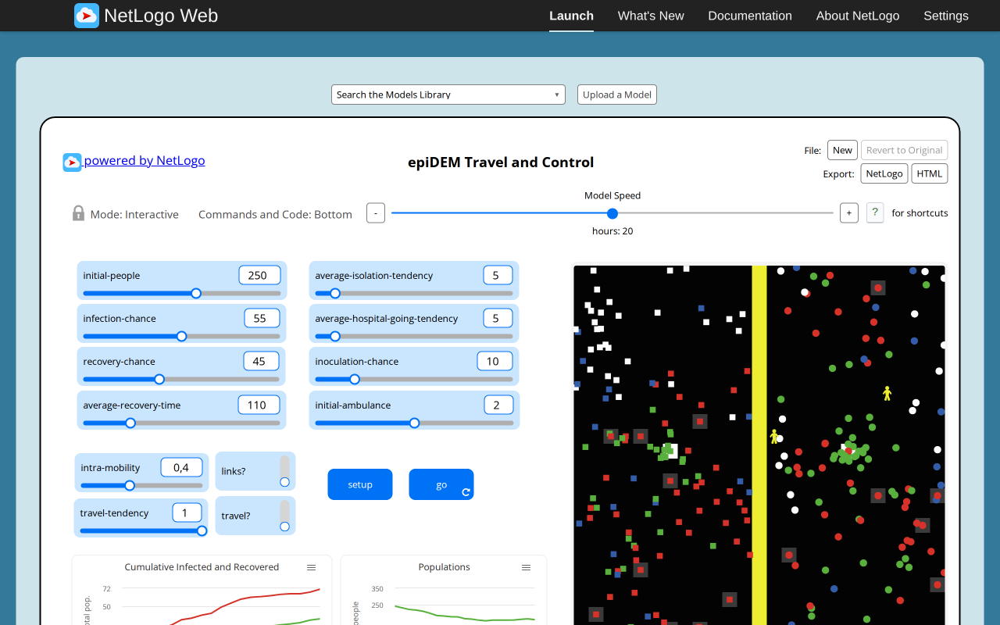
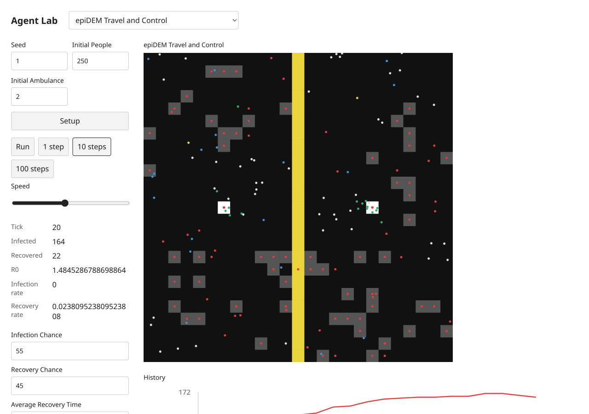

# epiDEM Travel and Control — B09 acceptance evidence

Exact selected catalog identity: `Curricular Models/epiDEM/epiDEM Travel and Control`. Experiment: `epidem-travel-and-control`. [Complete source and notices](../../experiments/epidem-travel-and-control/NOTICE.md); [archived XML](../../experiments/epidem-travel-and-control/source.nlogox). Galapagos `90be931773fcf499049247a8aaa1aecbe003654c`; served/inventory/actual loaded-session UTF-8 XML SHA-256 `7bde08421020920d17631b85cbef80c945a6a97857040a079c8aacbc3a35ac07` all agree. [Full widgets/procedures/license audit](selected-disease-gene-source-audit.json). [Existing three-publication dossier](../research/netlogo-web/epidem-travel-and-control.md), with its existing access and scientific limitations; no duplicate literature work.

The hard-boundary two-continent world includes252 agents at default settings (250 people plus two ambulances). Target visible hospitals/isolation patches appear by tick20. Optional persistent neighbor contacts are canonical Graph edges; travel retains the source original continent even after mirrored-x movement. Recovery, hospitalization and inoculation remain source-specific. The frozen100%-inoculation scenario triggers native ln(0) before tick1. Target actual UI also reports the source error with data-state=error at tick0 while retaining partial host mutations and canvas. Script05 remains unchanged and its phase gate is open pending explicit agreement. Native multi-panel plots are combined into history plus rate/R0 monitors.

## Executed original and target

Original: actual T3 server Chromium,1280×800 CSS, source random-seed123 before captured setup, source defaults except the stated Disease infectionChance0. Target: actual T3 server Chromium,1280×900 desktop and390×844 mobile CSS, seed1, Mulberry public Random. Screenshot device scale is recorded by decoded PNG dimensions (mobile780×1688). Source MT and target Mulberry streams, presentation-related draws and source agentset activation differ. No cross-seed trajectory, distributional, empirical, scientific or medical validation is claimed. These are educational toys, not health guidance.

Original progress reporters, read from the actual session:

| Reporter | Observed value |
| --- | --- |
| `ticks` | `20` |
| `count turtles` | `252` |
| `count turtles with [infected?]` | `92` |
| `count turtles with [inoculated?]` | `29` |
| `count turtles with [hospitalized?]` | `2` |
| `r0` | `1.2652831868990935` |

Target progress monitors, read after actual button actions:

```text
Tick
20
Infected
164
Recovered
22
R0
1.4845286788698864
Infection rate
0
Recovery rate
0.023809523809523808
```

[Original raw session, source hash, settings and Run/Pause/reset checks](selected-disease-gene-evidence/epidem-travel-and-control-original.json); [target raw controls, canvas, chart text alternatives and original build attribution](selected-disease-gene-evidence/epidem-travel-and-control-target.json). Source Setup and Run/Pause were executed; go-once is additionally executed when native (Repressilator). Target Setup,1/10-step buttons,Run/Pause and Setup reset were clicked. Target domain scenarios and invalid steps/read purity are separately asserted through the actual final immutable modules in [final browser mechanisms](selected-disease-gene-evidence/final-browser-mechanisms.json). Source errors are retained as scenario-specific evidence, never a reason to omit this model.

## Paired ordinary captures

Original setup:



Target setup:



Original progression:



Target progression:



[Desktop dark](selected-disease-gene-evidence/epidem-travel-and-control-target-desktop-dark.png), [mobile light](selected-disease-gene-evidence/epidem-travel-and-control-target-mobile-light.png), [mobile dark](selected-disease-gene-evidence/epidem-travel-and-control-target-mobile-dark.png). These theme captures follow reset at tick0 and intentionally retain initial state. Each PNG was inspected individually. All ordinary PNGs existed before any pixel analysis. Decoded RGB/RGBA statistics and ten equal light/dark canvas PNG ROIs are retained; no renderer repair is claimed.

## Final code and checks

Final build version `1793972578482`, immutable model/UI chunk `./chunks/ui-pt9ffxzs.js`, SHA-256 `0875fd421d658f092d55b8f363daab2ba92af9d9554d379705ce8c6fa06c4f79`. Source marker `selected-disease-gene-b09:epidem-travel-and-control:7bde08421020920d17631b85cbef80c945a6a97857040a079c8aacbc3a35ac07`. Shared chunk `/chunks/app-sb7h8whr.js`, SHA-256 `1f8f6827af1ab753a43b29435d40f5ae716071103930bc3de67ad53ede358d05`. [All ten final immutable imports, hashes and actual three-step executions](selected-disease-gene-evidence/final-bundles.json). The initial captures retain build1793972277740; the five number-format-only changes are documented by separately named formatted screenshots/JSON and final hashes, never by relabeling old captures.

Executed batch checks:24 focused tests/538 assertions; four TypeScript projects; standalone TypeScript covering all five scripts; build; actual packed Bun/Node ESM/ambient-free TypeScript consumer. Frozen scripts01–04 run unchanged;05 fails with the preserved source-ln0 contradiction. All five frozen hashes remain intact. [Batch checks and limits](selected-disease-gene-browser.md). Independent Argon approval remains quota-pending8194e842; coordinator evidence is not independent approval. Root alone decides registration,combined checks and global counts.

Final numeric display follow-up: [desktop light](selected-disease-gene-evidence/epidem-travel-and-control-formatted-desktop-light.png), [mobile light](selected-disease-gene-evidence/epidem-travel-and-control-formatted-mobile-light.png), [mobile dark](selected-disease-gene-evidence/epidem-travel-and-control-formatted-mobile-dark.png); [raw formatted observations](selected-disease-gene-evidence/epidem-travel-and-control-formatted.json). Only monitor display rounds to three fraction digits; model and chart values remain full precision.
