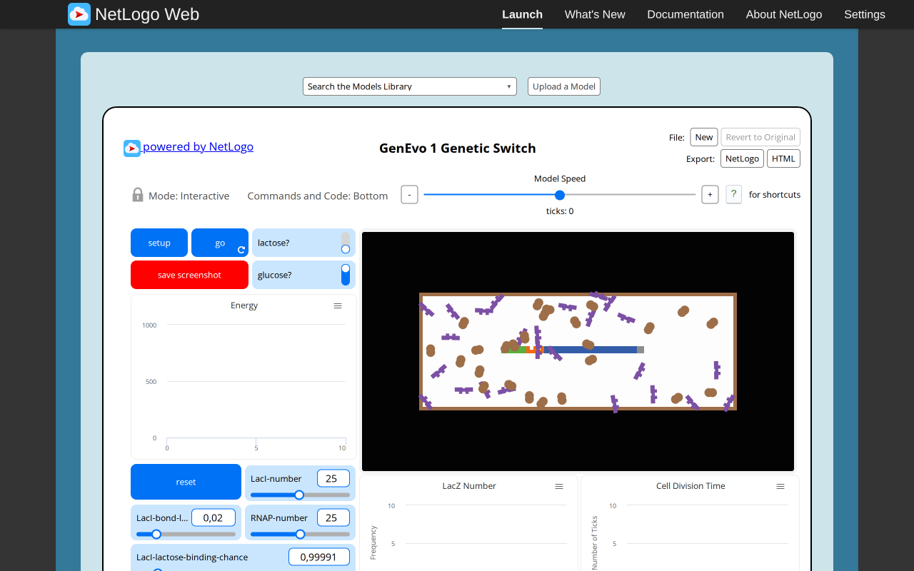
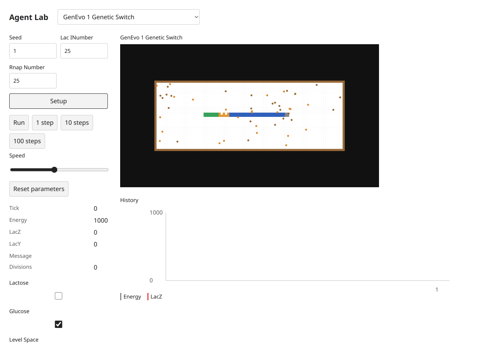
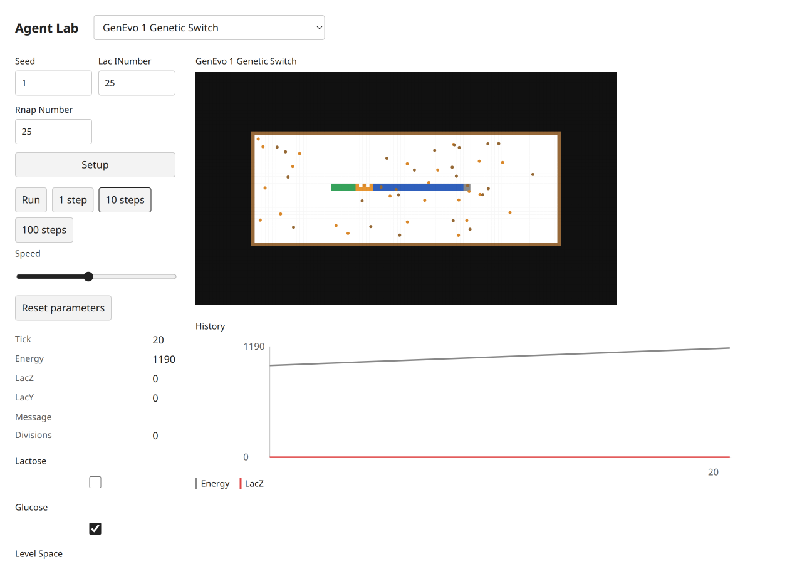

# GenEvo 1 Genetic Switch — B09 acceptance evidence

Exact selected catalog identity: `Curricular Models/GenEvo/GenEvo 1 Genetic Switch`. Experiment: `genevo-1-genetic-switch`. [Complete source and notices](../../experiments/genevo-1-genetic-switch/NOTICE.md); [archived XML](../../experiments/genevo-1-genetic-switch/source.nlogox). Galapagos `90be931773fcf499049247a8aaa1aecbe003654c`; served/inventory/actual loaded-session UTF-8 XML SHA-256 `6f46710d78daad311551c2ee934317d98ef52ad92779b8312ba66dcd4c7d330e` all agree. [Full widgets/procedures/license audit](selected-disease-gene-source-audit.json). [Existing three-publication dossier](../research/netlogo-web/genevo-1-genetic-switch.md), with its existing access and scientific limitations; no duplicate literature work.

Both captured setups start at energy1000 and the default20-step scenario reaches1190. With glucose disabled, the actual target checkbox yields995 after ten steps. Reset parameters is clicked without resetting biological state. Native150-step probe observes one division, last division time116 and energy1316.96; the earlier110-step capture intentionally observed zero divisions and is not relabeled. Native energy0/glucose-off stops before tick at energy-0.5 with a browser confirm; target retains an explicit stopped message. Daughter-cell animation is omitted without adding biological time. LevelSpace handoff procedures remain callable headlessly; standalone external multi-model orchestration is outside this UI.

## Executed original and target

Original: actual T3 server Chromium,1280×800 CSS, source random-seed123 before captured setup, source defaults except the stated Disease infectionChance0. Target: actual T3 server Chromium,1280×900 desktop and390×844 mobile CSS, seed1, Mulberry public Random. Screenshot device scale is recorded by decoded PNG dimensions (mobile780×1688). Source MT and target Mulberry streams, presentation-related draws and source agentset activation differ. No cross-seed trajectory, distributional, empirical, scientific or medical validation is claimed. These are educational toys, not health guidance.

Original progress reporters, read from the actual session:

| Reporter | Observed value |
| --- | --- |
| `ticks` | `20` |
| `energy` | `1190` |
| `count LacIs` | `25` |
| `count RNAPs` | `25` |
| `count LacZs` | `0` |
| `division-number` | `0` |

Target progress monitors, read after actual button actions:

```text
Tick
20
Energy
1190
LacZ
0
LacY
0
Message
Divisions
0
```

[Original raw session, source hash, settings and Run/Pause/reset checks](selected-disease-gene-evidence/genevo-1-genetic-switch-original.json); [target raw controls, canvas, chart text alternatives and original build attribution](selected-disease-gene-evidence/genevo-1-genetic-switch-target.json). Source Setup and Run/Pause were executed; go-once is additionally executed when native (Repressilator). Target Setup,1/10-step buttons,Run/Pause and Setup reset were clicked. Target domain scenarios and invalid steps/read purity are separately asserted through the actual final immutable modules in [final browser mechanisms](selected-disease-gene-evidence/final-browser-mechanisms.json). Source errors are retained as scenario-specific evidence, never a reason to omit this model.

## Paired ordinary captures

Original setup:



Target setup:



Original progression:


Target progression:



[Desktop dark](selected-disease-gene-evidence/genevo-1-genetic-switch-target-desktop-dark.png), [mobile light](selected-disease-gene-evidence/genevo-1-genetic-switch-target-mobile-light.png), [mobile dark](selected-disease-gene-evidence/genevo-1-genetic-switch-target-mobile-dark.png). These theme captures follow reset at tick0 and intentionally retain initial state. Each PNG was inspected individually. All ordinary PNGs existed before any pixel analysis. Decoded RGB/RGBA statistics and ten equal light/dark canvas PNG ROIs are retained; no renderer repair is claimed.

## Final code and checks

Final build version `1793972578482`, immutable model/UI chunk `./chunks/ui-re5xfdkt.js`, SHA-256 `bf4a5bbd22b72fa1afa4e2bdfa6ea128985de2b2ebf6fd6bf61e68f601199265`. Source marker `selected-disease-gene-b09:genevo-1-genetic-switch:6f46710d78daad311551c2ee934317d98ef52ad92779b8312ba66dcd4c7d330e`. Shared chunk `/chunks/app-sb7h8whr.js`, SHA-256 `1f8f6827af1ab753a43b29435d40f5ae716071103930bc3de67ad53ede358d05`. [All ten final immutable imports, hashes and actual three-step executions](selected-disease-gene-evidence/final-bundles.json). The initial captures retain build1793972277740; the five number-format-only changes are documented by separately named formatted screenshots/JSON and final hashes, never by relabeling old captures.

Executed batch checks:24 focused tests/538 assertions; four TypeScript projects; standalone TypeScript covering all five scripts; build; actual packed Bun/Node ESM/ambient-free TypeScript consumer. Frozen scripts01–04 run unchanged;05 fails with the preserved source-ln0 contradiction. All five frozen hashes remain intact. [Batch checks and limits](selected-disease-gene-browser.md). Independent Argon approval remains quota-pending8194e842; coordinator evidence is not independent approval. Root alone decides registration,combined checks and global counts.
