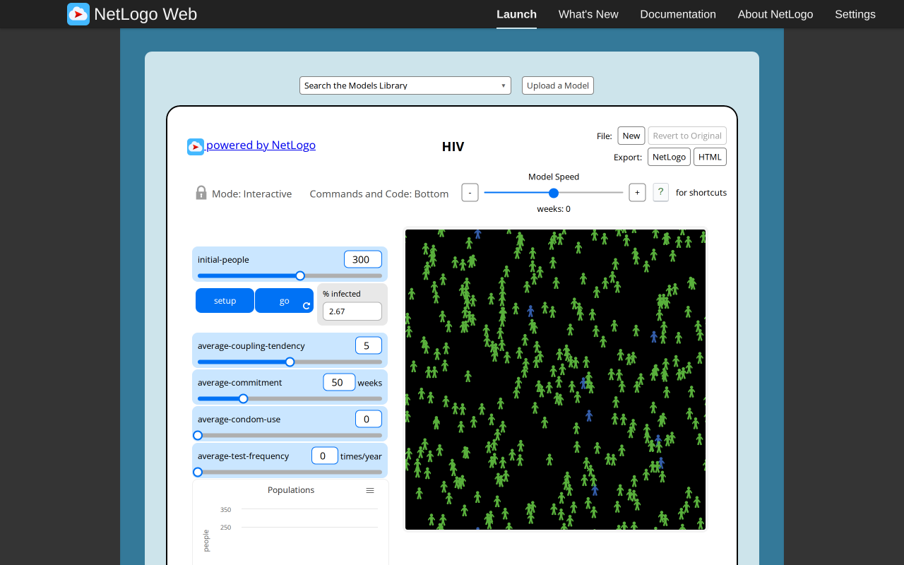
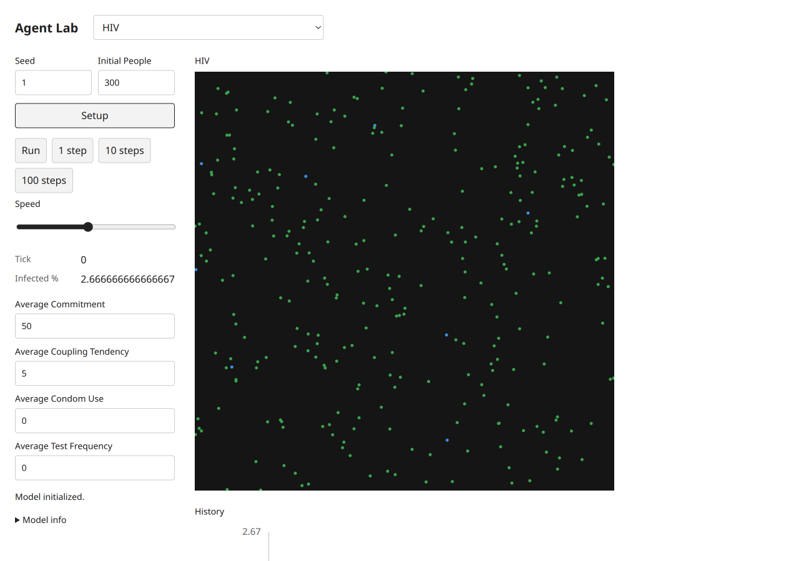
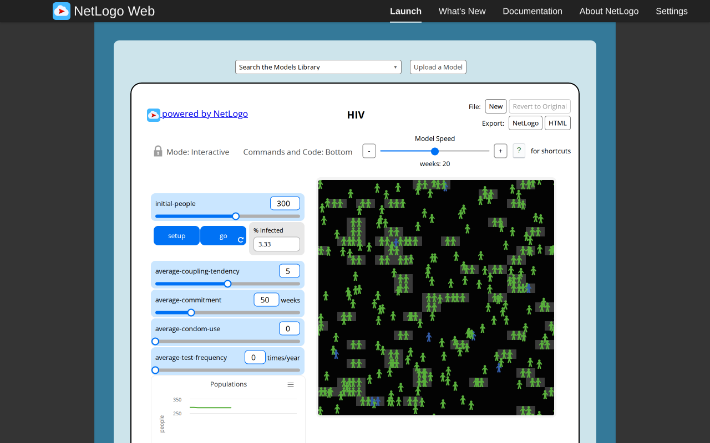
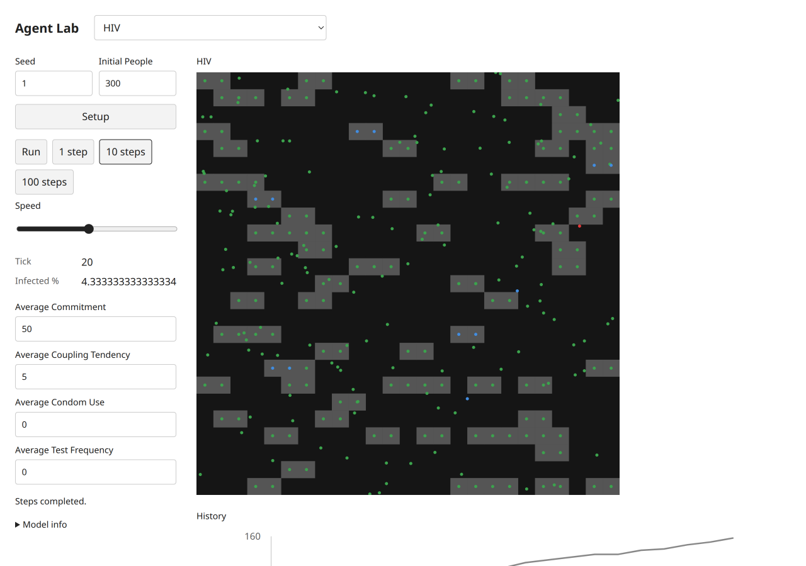

# HIV — B09 acceptance evidence

Exact selected catalog identity: `Sample Models/Biology/HIV`. Experiment: `hiv`. [Complete source and notices](../../experiments/hiv/NOTICE.md); [archived XML](../../experiments/hiv/source.nlogox). Galapagos `90be931773fcf499049247a8aaa1aecbe003654c`; served/inventory/actual loaded-session UTF-8 XML SHA-256 `ed3e832a9fadd101ff65eb20a313ee0941496db02d6d3cf15371568745f997d5` all agree. [Full widgets/procedures/license audit](selected-disease-gene-source-audit.json). [Existing three-publication dossier](../research/netlogo-web/hiv.md), with its existing access and scientific limitations; no duplicate literature work.

Both setups have 300 hosts and eight infected hosts (2.666…%), because who<7.5 includes who7. Pairing and uncoupling use canonical partners; initial and changed traits use forty uniform draws rather than a substituted normal distribution. Actual target coupling at tick20 appears as gray occupied patches. Zero-coupling headless/browser scenarios retain two infected hosts among80. Native all-known preflight stops at tick0. Target charts explicitly label infected/known percentages and coupled counts; source population plots use host counts. This presentation scaling is declared rather than a trajectory comparison.

## Executed original and target

Original: actual T3 server Chromium,1280×800 CSS, source random-seed123 before captured setup, source defaults except the stated Disease infectionChance0. Target: actual T3 server Chromium,1280×900 desktop and390×844 mobile CSS, seed1, Mulberry public Random. Screenshot device scale is recorded by decoded PNG dimensions (mobile780×1688). Source MT and target Mulberry streams, presentation-related draws and source agentset activation differ. No cross-seed trajectory, distributional, empirical, scientific or medical validation is claimed. These are educational toys, not health guidance.

Original progress reporters, read from the actual session:

| Reporter | Observed value |
| --- | --- |
| `ticks` | `20` |
| `count turtles` | `300` |
| `%infected` | `3.3333333333333335` |
| `count turtles with [known?]` | `0` |
| `count turtles with [coupled?]` | `136` |

Target progress monitors, read after actual button actions:

```text
Tick
20
Infected %
4.333333333333334
```

[Original raw session, source hash, settings and Run/Pause/reset checks](selected-disease-gene-evidence/hiv-original.json); [target raw controls, canvas, chart text alternatives and original build attribution](selected-disease-gene-evidence/hiv-target.json). Source Setup and Run/Pause were executed; go-once is additionally executed when native (Repressilator). Target Setup,1/10-step buttons,Run/Pause and Setup reset were clicked. Target domain scenarios and invalid steps/read purity are separately asserted through the actual final immutable modules in [final browser mechanisms](selected-disease-gene-evidence/final-browser-mechanisms.json). Source errors are retained as scenario-specific evidence, never a reason to omit this model.

## Paired ordinary captures

Original setup:



Target setup:



Original progression:



Target progression:



[Desktop dark](selected-disease-gene-evidence/hiv-target-desktop-dark.png), [mobile light](selected-disease-gene-evidence/hiv-target-mobile-light.png), [mobile dark](selected-disease-gene-evidence/hiv-target-mobile-dark.png). These theme captures follow reset at tick0 and intentionally retain initial state. Each PNG was inspected individually. All ordinary PNGs existed before any pixel analysis. Decoded RGB/RGBA statistics and ten equal light/dark canvas PNG ROIs are retained; no renderer repair is claimed.

## Final code and checks

Final build version `1793972578482`, immutable model/UI chunk `./chunks/ui-s97z7mmb.js`, SHA-256 `c8a3f06aa7e3828256f4acf060faa8fcd8e7afaaee1a4a040941178cd363826e`. Source marker `selected-disease-gene-b09:hiv:ed3e832a9fadd101ff65eb20a313ee0941496db02d6d3cf15371568745f997d5`. Shared chunk `/chunks/app-sb7h8whr.js`, SHA-256 `1f8f6827af1ab753a43b29435d40f5ae716071103930bc3de67ad53ede358d05`. [All ten final immutable imports, hashes and actual three-step executions](selected-disease-gene-evidence/final-bundles.json). The initial captures retain build1793972277740; the five number-format-only changes are documented by separately named formatted screenshots/JSON and final hashes, never by relabeling old captures.

Executed batch checks:24 focused tests/538 assertions; four TypeScript projects; standalone TypeScript covering all five scripts; build; actual packed Bun/Node ESM/ambient-free TypeScript consumer. All five public scripts pass after the [explicitly approved two-line05 amendment](selected-disease-gene-freeze-amendment.md);01–04 remain unchanged. The original05 failure/hash remains historical evidence. [Batch checks and limits](selected-disease-gene-browser.md). Independent Argon approval remains quota-pending8194e842; coordinator evidence is not independent approval. Root alone decides registration,combined checks and global counts.

Final numeric display follow-up: [desktop light](selected-disease-gene-evidence/hiv-formatted-desktop-light.png), [mobile light](selected-disease-gene-evidence/hiv-formatted-mobile-light.png), [mobile dark](selected-disease-gene-evidence/hiv-formatted-mobile-dark.png); [raw formatted observations](selected-disease-gene-evidence/hiv-formatted.json). Only monitor display rounds to three fraction digits; model and chart values remain full precision.
