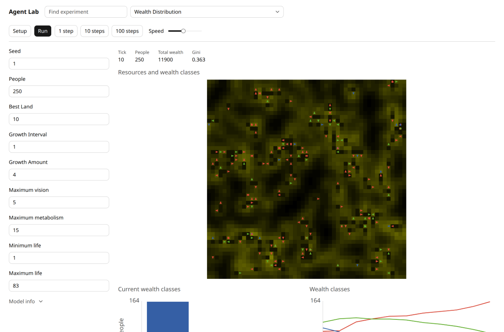
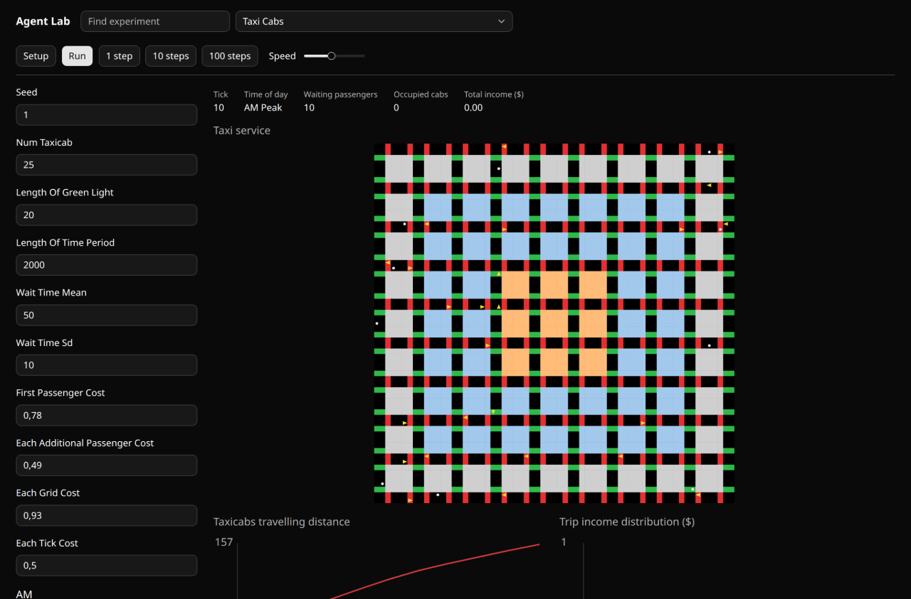
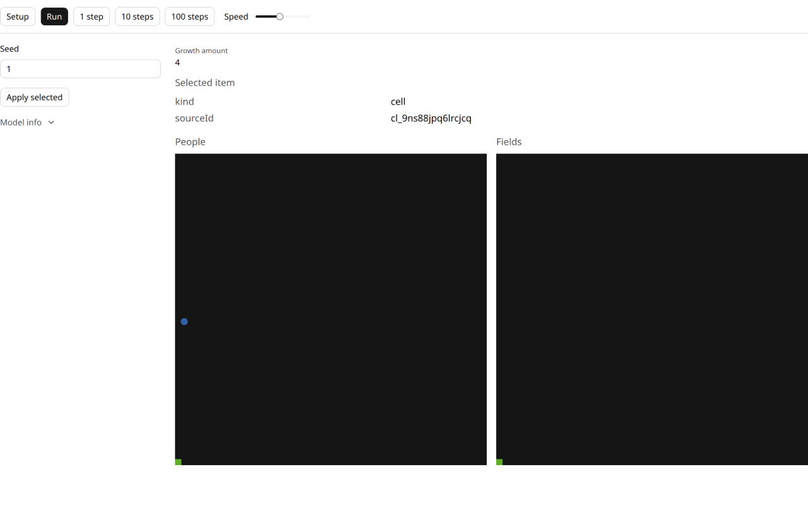

# Syntax and catalog refactor — 7 November 2026

The UI files now express observations and display formatting more directly. Public observation types replace nested type expressions; numeric monitors keep numbers until the display formatter runs. The catalog's simulation rules and state owners are unchanged. Everything is delivered through the integration branch; nothing was merged into main.

## What changed

The five asserted public examples were frozen in `2dacc27` before runtime work. Commit `aa58643` adds the public types and checks; `1f48e05` refactors 101 experiment UI files. Ninety nested observation expressions across 87 files now use `Observation<typeof model>`. Formatting was separated in 49 files, with 70 new source formatter declarations, including generated monitor records, and two existing numeric formatters simplified.

A longer projection used to need:

```ts
type UIObservation = ReturnType<ReturnType<typeof model.create>["read"]>;
```

It now uses the same detached observation through a public type:

```ts
import type { Observation } from "../../ui/index.ts";
import { model } from "./model.ts";

type UIObservation = Observation<typeof model>;

function grainColor(grain: number): string {
  const channel = Math.round((grain / 50) * 255);
  return `rgb(${channel},${channel},0)`;
}
```

[The real Wealth UI](../../experiments/wealth-distribution/ui.ts) uses this type for its named projections and preserves its complete agent projection, colors, inspector and charts. `Observation<Instance>` is also supported; both UI entrypoints export the same alias without introducing a runtime wrapper.

## Formatter design

A numeric monitor now reads:

```ts
{
  label: "Gini",
  value: state => state.gini,
  format: (value: number) => value.toFixed(3),
}
```

The explicit `number` annotation removes the old `typeof` branch. TypeScript rejects a string-only formatter paired with a numeric getter and a numeric-only formatter paired with a real number-or-text getter. Optional and extracted formatters are checked too. A genuine union still needs narrowing, for example an unavailable metric that returns `"—"`.

This is checked correlation, not automatic scalar inference of an unannotated formatter. Independent strict-compiler experiments did not establish a general solution for heterogeneous, context-sensitive monitor arrays. Fixed-length tuple overloads would impose an arbitrary monitor count; a builder would add another ordinary authoring form. We kept the flat object syntax and the small explicit scalar annotation. Existing guarded, unannotated formatters retain their `string | number` context.

For an extracted record:

```ts
import type { Monitor, Observation } from "../../ui/index.ts";
import { model } from "./model.ts";

const gini = {
  label: "Gini",
  value: state => state.gini,
  format: value => value.toFixed(3),
} satisfies Monitor<Observation<typeof model>, number>;
```

The broad compatibility `UISpec` still supports its former formatter signature. A scalar-specific spec can retain its own annotations and be passed directly to `defineUI`. Internally, one host-only type boundary erases the getter/formatter pair; hosts continue to feed each formatter its own getter result. Scientific state is never copied into a second owner.

The independent type reviewer also documented a limit: deliberately widening the third generic argument using a bivariant method signature can erase correlation. Private `RuntimeSpec` use has the same limitation. Ordinary inferred public calls reject the mismatch. The [source review](syntax-refactor-evidence/source-review.md) records this explicitly; no universal TypeScript soundness claim is made.

## Selection design

Selection remains `string | null`, so existing inspectors and actions keep working. Within a mounted entry, an ID identifies one semantic entity consistently across views. If two source kinds overlap, the UI supplies a presentation namespace:

```ts
const personId = `agent:${person.id}`;
const fieldId = `cell:${field.id}`;
```

Two views of the same field reuse its `cell:` ID. An inspector resolves the full projected ID against the current observation; an action does nothing when the target has disappeared. Model IDs are not rewritten. There is no global registry, allocator or structured selection object to maintain.

[The collision example](../../examples/ui-authoring-next/03-namespaced-selection.ts) wraps the actual Wealth observation to expose an equal source ID for a sampled person and field. It checks distinct inspection/actions, shared field selection across views, stale selection after a real step and cleared selection after setup. It does not claim that the original Wealth model has an ID collision, or that the host can infer semantic equivalence between arbitrary projections.

## Executable scripts

The new phase is registered in the normal example runner and TypeScript checks. Run its complete public checks with:

```sh
bun examples/ui-authoring-next/01-typed-monitor-formatters.ts
bun examples/ui-authoring-next/02-readable-observation-projections.ts
bun examples/ui-authoring-next/03-namespaced-selection.ts
bun examples/ui-authoring-next/04-formatter-errors-and-recovery.ts
bun examples/ui-authoring-next/05-independent-mounts-and-legacy.ts
bun x tsc -p examples/ui-authoring-next/tsconfig.json
sha256sum -c examples/ui-authoring-next/SHA256SUMS
```

A minimal headless script, with imports relative to `examples/ui-authoring-next/`, still needs no UI host:

```ts
import { strict as assert } from "node:assert";
import { model } from "../../experiments/wealth-distribution/model.ts";

const simulation = model.create({ seed: 3, people: 2 });
const before = simulation.read();
simulation.advance(10);
assert.equal(simulation.read().tick, 10);
assert.equal(typeof simulation.read().gini, "number");
assert.equal(before.tick, 0); // Earlier detached observations stay unchanged.
```

Bun script success does not execute the exported browser checks. Those were separately run in actual Chromium through both public adapters.

## Verification and code quality

| Evidence | Result and scope |
| --- | --- |
| Complete local check on syntax source `1f48e05` | 584 tests, 150791 expectations, 68 test files; all 229 public scripts, TypeScript/Svelte checking, build and actual packed Bun/Node/ambient-free TypeScript consumers passed |
| Svelte production build | Passed; existing chunk-size warnings remain |
| Same-observation display audit | 101 changed UI files, 303 real observations at setup / 1 / 10 steps, 1353 identical old/new monitor displays |
| Color/projection audit | All applicable views matched on nine real observations across Wealth, Three Doors and Language Change; the JSON's `comparisons: 30` counter counts monitors, not projection comparisons |
| Independent browser matrix | 40/40 flows: five frozen examples × two hosts × two sizes × two themes; no captured page/rejection/console errors or horizontal overflow |
| Catalog browser smoke | 125 successful setups, 124 enabled one-step actions, no captured errors; Tijuana correctly retains its staged setup precondition |
| Production flows | Wealth setup, ten steps, live edit, run/pause and seed restart; Taxi setup, ten steps, monitor text and five demand groups |
| Independent reviews | Argon design review with four pre-freeze fixes; Astra-high runtime/type approval; separate catalog source approval; actual inspection of twelve fixture screenshots |

The old and new projection callbacks were compared on the same unchanged real model observations. The audit captures declarations instead of mounting them; it is explicit source-audit instrumentation, not a mock simulation or substitute for the browser matrix. Its two reproducible runners and JSON outputs live in [the evidence directory](syntax-refactor-evidence/). Run the audit scripts from the repository root with Bun.

No `model.ts`, core source or earlier frozen example was changed. Scientific rounding and histories remain in the models. The UI migration preserves percentage scaling, missing-value reasons and the removal of trailing zeroes where `Number(toFixed(...))` previously did so. Table and network-label formatting was retained. Meaningful literal tuples remain; Wealth's unnecessary shape assertion was replaced by an explicit typed agent projection.

A GitHub Library check on `1f48e05` exposed an existing Sunflower scenario reaching 5.47 seconds against Bun's default five-second timeout. Commit `944773a` gives that one complete scenario twenty seconds without changing its steps or assertions. The affected file then passed ten tests / 74 expectations. The full post-timeout run on `944773a` also passed: 584 tests / 150791 expectations, all 229 public scripts, typechecks, build and packed consumers. [checks.json](syntax-refactor-evidence/checks.json) records both checkpoints; these local passes must not be confused with a final remote check.

The first unstyled legacy harness emitted native ResizeObserver notifications. Loading the actual legacy production stylesheet removed them; the independent styled matrix has no such errors. One apparent dark-theme disappearance was also checked against real pixel counts and rejected. Neither observation was hidden by changing expectations or ignoring captured errors.

## Screenshots

The screenshots show actual browser states, not generated UI mockups. The fixture reviewer opened all twelve images. Desktop CSS viewports were 1366×900; T3 saved 1280×843 PNGs. Narrow CSS viewports were 390×844 and saved 780×1688 PNGs at device pixel ratio two. Viewport and saved-image size are deliberately reported separately.



Wealth at tick 10: 250 people, total wealth 11900, displayed Gini 0.363. The seed-19 restart and playback/pause path is captured separately at tick 4 in [narrow dark](syntax-refactor-evidence/wealth-after-restart-narrow-dark.png).





[All fixture screenshots, actual sizes and independent visual findings](syntax-refactor-evidence/browser-matrix/review.md) are retained with the raw browser matrix. The collision fixture intentionally samples very little geometry so that entity identity and action routing can be tested without a second simulation.

## What remains before main

This phase improves authoring for an open city-experiment system: the script can state the question, observe a metric and expose a deliberate intervention without carrying host plumbing. It does not prove a sustainability outcome. The existing fixed 200-model scope, scientific acceptance, catalog-ledger reconciliation, broader long-model readability and the public domain-procedure interpretation remain separate work. The integration PR remains a draft and main requires explicit authorization.
