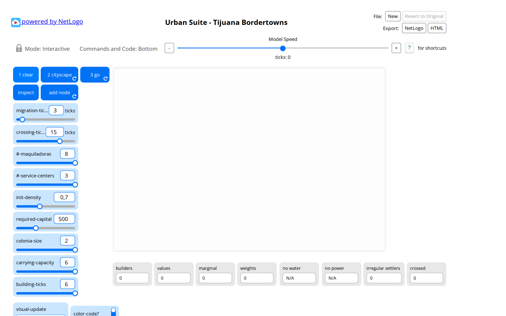
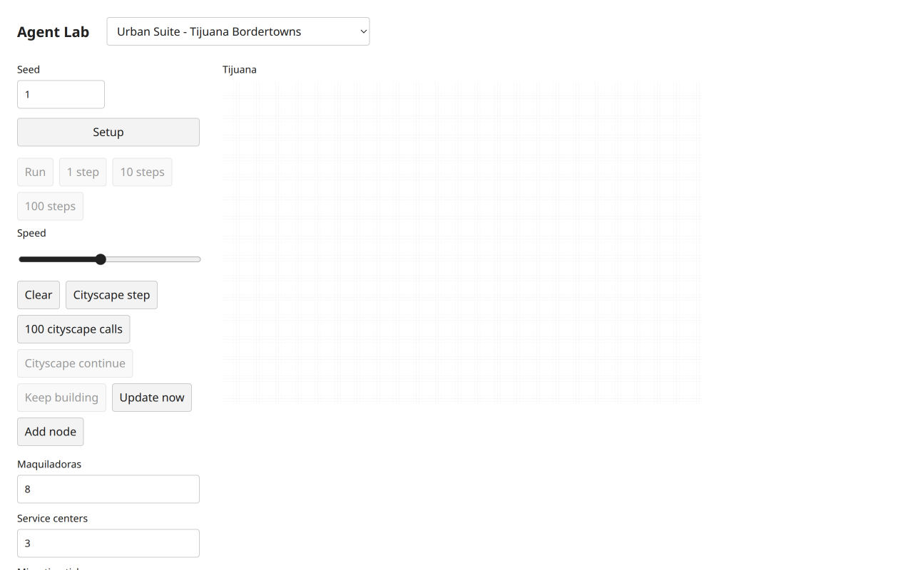
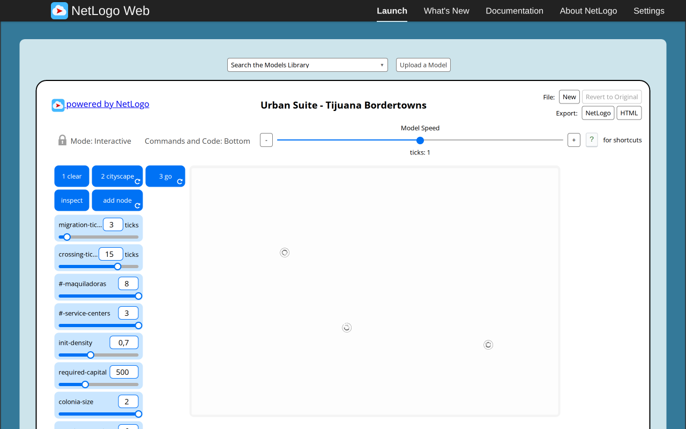
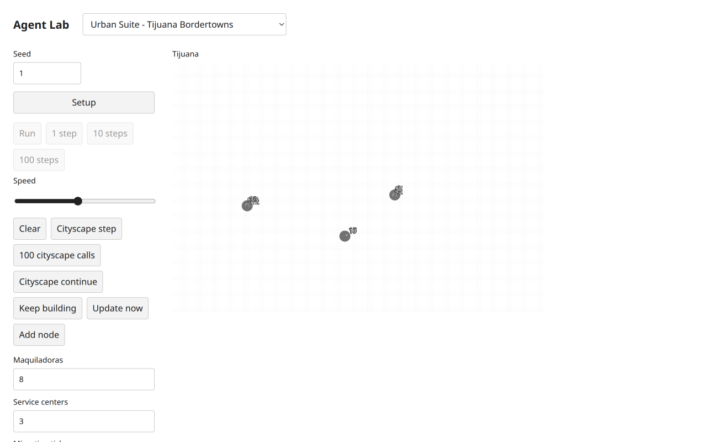
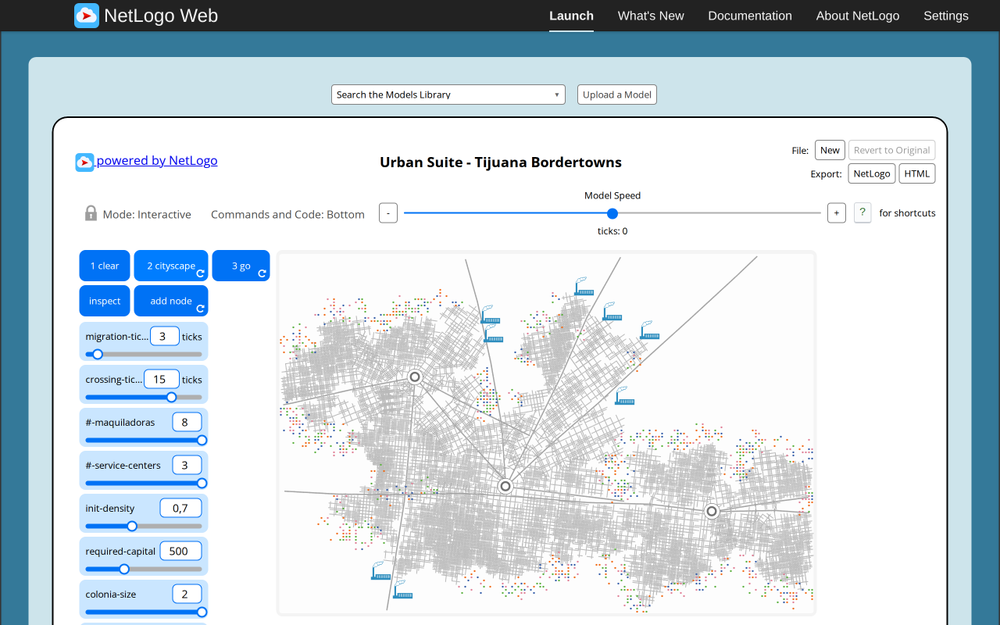
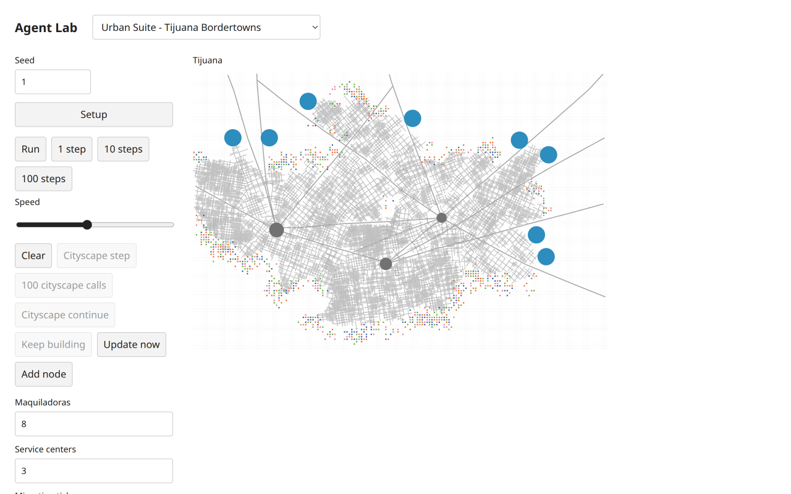
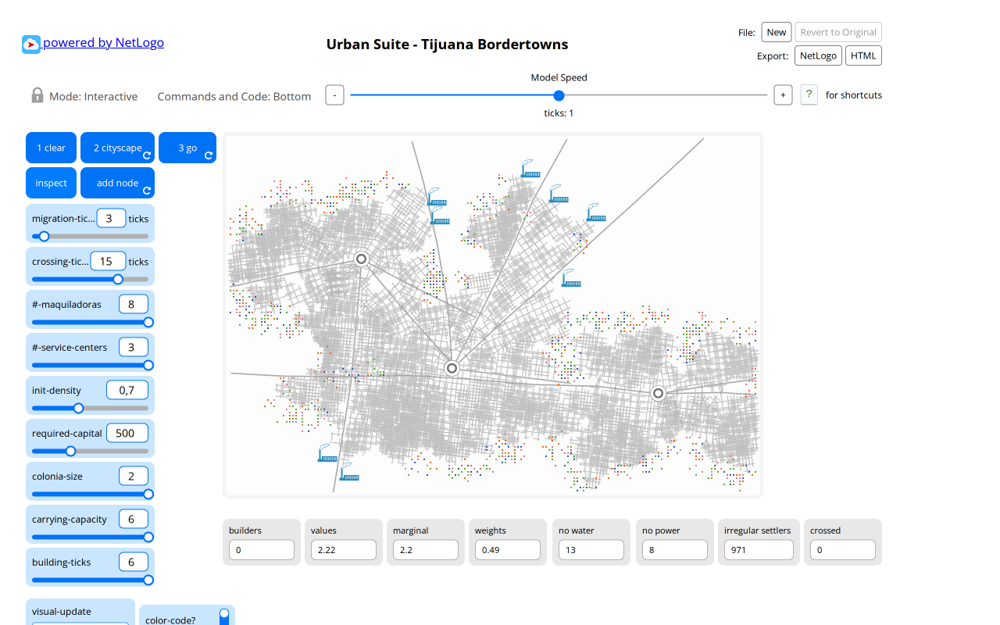
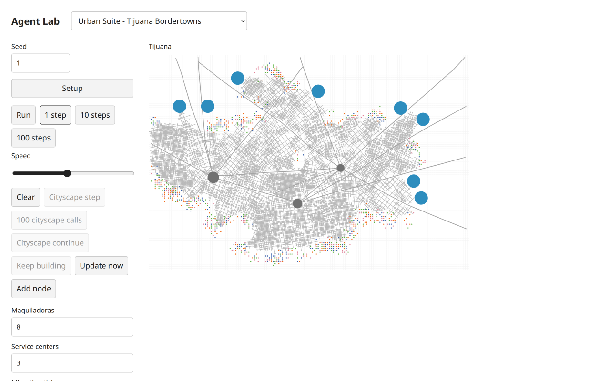

# Full Tijuana delivery: source boundaries, implementation and final visual pairs

The resumed contract task was completed and its result awaited. Five substantive public scripts and helper were frozen at62d9816 before scoped implementation. They require real natural CITYSCAPE completion and GO,plus deterministic economics/migration/regularization/display/node/error cases; a CLEAR-only substitute is not accepted. Additional original Chromium probes resolved default headings,coincident FACE,raw fractional shortage-before-truncation,negative patch radii,hard motion,typed utility errors and retained preincrements. The concrete source,not convenience JavaScript behavior,owns these decisions.

The delegated full headless model and12 focused tests were integrated atff33525. Root's source inspection then replaced one private row-major address with public Grid.fieldAt at5eb6372; canonical order,source equations and RNG were preserved. The runtime agent reran all five unchanged scientific contracts,including the fixed five-seed3000-call envelope and complete seed1 chunk replay,plus12 tests/88 assertions,four TypeScript projects and six hashes. No public API or expected result was weakened. Root independently ran the12 tests and the complete integration pipeline. An editorial type narrowing required after registering the future-model scripts is recorded separately in selected-tijuana-contract.md; the initial registered check failed and was corrected before a passing full run.

Model SHA2560c1f8231532d2ed18c09202ed198efad99804bee5d00bbd6e0f2ba7858144862 belongs to the final public-lookup code. The coordinator's [initial-runtime default-seed measurements](tijuana-headless-evidence/natural-seeds-initial-runtime.json) retain their actualff33525 attribution: seeds1..5 completed in336/333/279/340/308calls,with845/875/660/1050/850migrants and8/8/8/8/7jobs. Source duplicate-job cleanup permits seven; no fabricated job-count invariant was imposed. These are target realizations,not a native stream match or distribution validation. After the lookup correction,the final browser again completed seed1 naturally at336calls/845migrants/eightjobs/42470segments,then GO1 at842migrants/tick1. Source native seed1 completed at351calls/990migrants/eightjobs,then GO1 at971. No scenario/ready flag was injected for these natural results.

[Full source/target browser report](tijuana-target-browser.md) separates prior detailed controls from the corrected-runtime repetition. It includes actual original CLEAR/CITYSCAPE/GO/INSPECT and target Setup,incremental/batched/repeating CITYSCAPE,automatic repeat stop,GO step/run/pause,Clear cleanup,all source controls/six display modes,Update now,Add node,pointer/keyboard inspection and desktop/mobile light/dark. Source/runtime/settings/hashes and concrete adaptations are retained. All34 initial artifact/UI/report hashes passed before root's label-only correction; capture JSON retains original runtime hashes. Required independent Argon approval remains quota-blocked; source research is [a separate dossier](../research/netlogo-web/urban-suite-tijuana-bordertowns.md).

Root changed one misleading monitor label from Completed calls to Recorded calls because history is bounded. No value,action or source equation changed. Root then freshly reloaded the final model/UI at3116 and executed native Setup and Cityscape step: clear0/noAgents/noStrokes/GOdisabled,then tick1/threeServices/14Builders/14Strokes/RecordedCalls1. [Exact observations](tijuana-integration-evidence/observations.json). Both had no horizontal overflow; diagnostics contained only the expected canvas-readback performance warning and no JavaScript/runtime/network failure. The owned tab/server were closed. Earlier UI screenshots remain attributed to their prior UI hash; the final label correction is not silently relabelled as re-execution of every control path.

| State | Actual original NetLogo | Final City Library observation |
| --- | --- | --- |
| Clear / initialization |  |  |
| First cityscape call |  |  |
| Completed cityscape |  |  |
| GO1 |  |  |

Public shared segments render every retained road stroke over cells and beneath Agents; [independent renderer execution evidence](spatial-segment-browser-report.md) verifies actual pixel layering,zero width,defaults,resize,themes and keyboard selection. This is coordinator UI evidence,not independent technical approval. Source-shape artwork,CSS glyph/pen sizing,held-node polling versus events,deterministic inspection,clear/display RNG schedules and target Mulberry/activation differences are explicit. No pixel or cross-RNG trajectory identity is claimed.

The full integrated check before the final one-line lookup/label corrections passed301 tests/15936 assertions,120 public scripts,four typechecks,build and packed Bun/Node ESM/ambient-free consumer. Focused final-code tests/examples/typechecks passed after the corrections; the subsequent full final-code run is recorded in the next checkpoint rather than fabricated here. This delivers a complete model/UI pair with retained functional baseline evidence. It does not increase reviewed/final-accepted status or finish all200 models.
