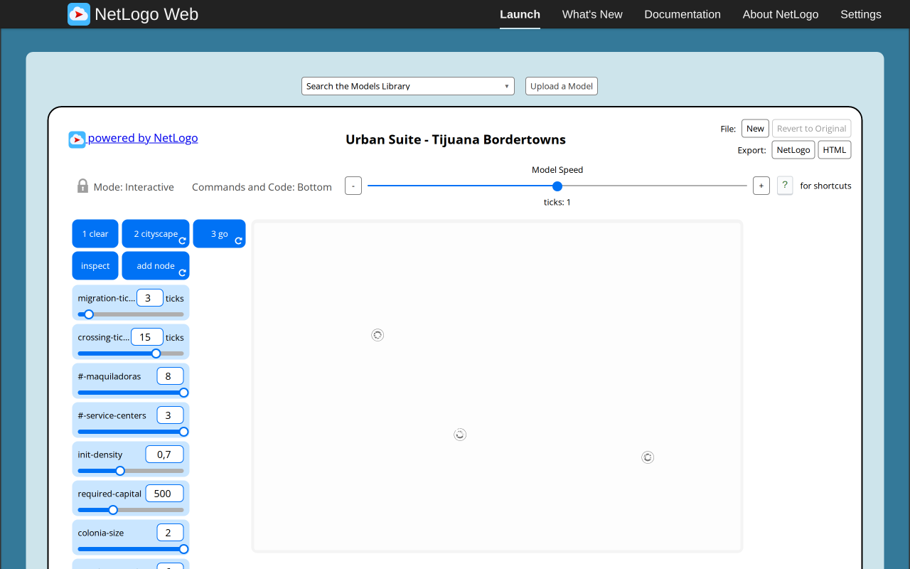
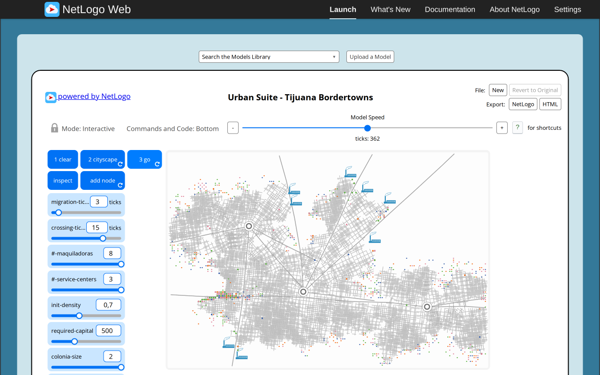
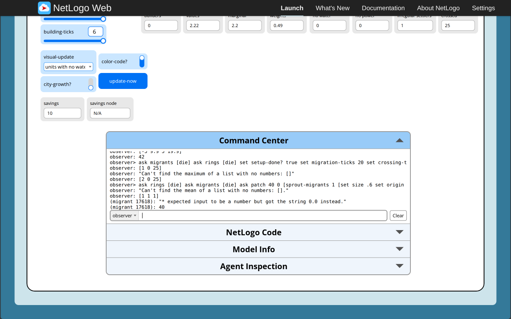

# Tijuana Bordertowns: executed original-browser baseline and primitive boundaries

Executed 2026-11-06 in the configured T3 Chromium preview at 1280×800. This report covers the **original NetLogo model**, not a target implementation, paired target acceptance, scientific validation or independent approval. All deliberate state changes used native controls or the native Command Center; page evaluation only read state, hashes, loaded primitive functions and diagnostics. No engine implementation was copied into the repository.

[Official launcher](https://www.netlogoweb.org/launch#https://www.netlogoweb.org/assets/modelslib/Curricular%20Models/Urban%20Suite/Urban%20Suite%20-%20Tijuana%20Bordertowns.nlogox). The actually loaded `session.nlogoSource.nlogo` hashes to `8cada3e3638c93704f5eefbba4e9aa3840c991e2d5ab711ea759c4b31aedcfb2`, matching the unchanged experiment/research archive and pinned Galapagos catalog revision `90be931773fcf499049247a8aaa1aecbe003654c`. The model identifies NetLogo 7.0.4. Copyright 2007 Uri Wilensky, CC BY-NC-SA 3.0; full credits remain in the experiment NOTICE. The engine version was not independently mapped to a Git revision.

[Machine-readable observations, exact commands and captured outputs](tijuana-reference-evidence/observations.json) and [PNG hashes](tijuana-reference-evidence/SHA256SUMS.json) are retained. Diagnostic fixtures below are explicitly separate from natural generation. Native seed 1 is an original-engine replay setting, not a claim that a target Mulberry seed 1 follows the same trajectory.

## Natural CLEAR → CITYSCAPE → GO

Widget defaults were retained: 8 maquiladoras, 3 service centers, migration 3, crossing 15, building period 6, initial density .7, colonia size 2, required capital 500, carrying capacity 6, visual update off, color code on and city growth off.

1. Native CLEAR produced tick 0 and no turtles. Calling `go` through the Command Center opened the expected not-completed dialog and left tick 0.
2. Explicit `random-seed 1 setup` produced tick 1, three service centers and eleven first-order builders. The snapshot is the first generated state, not an invented completed setup.
3. Native CITYSCAPE Run reached the sampled tick 154 with eight employment centers, 202 migrants and 197 size-.65 seeds. Pausing settled at actual tick **160**, with 226 migrants and 191 seeds. Resuming the same native button completed naturally: `setup-done? = true`, `third-phase = "stop"`, tick reset to **0**, three services, eight jobs and **990 migrants**, with no .65 seeds or road builders. The button stopped itself. Values were 2.2187878787878805 and weights .4896796536796542.
4. One explicit native `go` reached tick 1 and 971 migrants. Boundary cleanup removed nineteen extreme-row/column migrants. Native GO Run/Pause subsequently reached actual tick **362**, 1051 migrants and crossed 24, without a model runtime error.
5. A second native CLEAR and seeded bounded Command Center replay called the same unmodified `setup` procedure at most 500 times. It completed on **call 351**, from prior tick 350 to reset tick 0, with 990 migrants and eight jobs. No diagnostic population or ready flag was injected in this replay. This is a measured original-engine completion, not a universal termination guarantee or a target budget chosen after implementation.

| First cityscape call | Completed cityscape |
| --- | --- |
|  |  |

| Interrupted and paused | GO progress |
| --- | --- |
|  |  |

The source draws road pen history on a white view. A target needs a declared representation of that drawing; coloring land alone is not visual equivalence. Natural completion and the one-seed diagnostic below confirm that nested helper STOP does not abort the enclosing setup before its later expansion/economics/final-reset branches. A separate native CITYSCAPE request in an already completed diagnostic state opened the already-completed dialog, stopped and retained tick 0.

## Native primitive results that change the transfer contract

| Native operation | Executed observation |
| --- | --- |
| `round` on −2.5,−1.5,−.5,.5,1.5,2.5 | −2,−1,0,1,2,3; halves go toward positive infinity. |
| `precision x 2` on −1.005,−.005,.005,1.005,2.675 | −1,0,.01,1,2.68. Preserve binary-number effects; `toFixed` is not established equivalent. |
| `n-of` on counts 0,.1,.9,1.1,1.9,2.5 | 0,0,0,1,1,2: positive fractions truncate. Both −1 and −.1 fail before truncation. Request 20000 from 19665 patches fails, rather than saturating. |
| `sprout-nodes` on −1.9,−.9,−.5,−.1,0,.1,.5,1.1,1.5 | Added 0,0,0,0,0,1,1,2,2 respectively. Positive creation counts use the loop's ceiling behavior; negative counts silently create none. This differs from n-of. |
| `set size -1` | Succeeds and reads back −1; no error before a later source clamp. |
| `ticks mod 0` | Division by zero. |
| Empty `mean []` / `max []` | Runtime errors, not zero or infinities. |
| Actual industrial `water = "0.0"` used with `+` / `*` | Numeric type errors; no implicit conversion or string concatenation. A literal-string arithmetic probe was rejected at compilation; the recorded corrected runtime probe uses the actual typed patch field. |
| `ask nobody` / `ask patch-set nobody` | First errors; second safely executes an empty ask. |
| New second→third breed, then later third ask | A source-shaped native hatch fixture gave energies [6,1]: the new third agent participated in the later ask; its same-ask hatched child did not recursively participate. |
| Equal `scale-color` bounds | `(gray,5,5,5)`→0, `(red,5,5,5)`→10, `(gray,−5,5,5)`→0, `(gray,6,5,5)`→9.9999. No division error. This supplemental shared-palette probe was requested by the coordinator. |

### Negative patch radii: preserve the actual optimization boundary

At native patch (0,0), radii [0,.1,.9,1,−1,2,−2] returned counts [1,1,1,5,5,13,9]. Radius −2 and −3 each returned exactly the center and its eight Moore neighbors. Radius −1.1 returned the center and four face neighbors. This is neither a negative-radius error nor a full disk of absolute radius.

Read-only inspection of the loaded `engine/core/topology/inradiusorcone` explains the result: signed radii ≤2 enter the local candidate path; a negative radius does not trigger its wider expansion condition. Candidates therefore remain self plus Moore neighbors, followed by the squared-distance test against radius squared. A source-compatible negative **patch-set** radius can be expressed with canonical self/Moore Fields and public distance; it must not silently become an unrestricted absolute-radius search. Turtle-set candidate pruning is a different path and was not exhaustively probed here.

The fetched engine bytes at `https://www.netlogoweb.org/tortoise-engine.min.js` have SHA-256 `09f685d38681a850d9c79783d6b5c23c887d7d773c0117562fac56a64b63e1a2`; the inspected module slice has SHA-256 `07cc9ec50cf5121c92ac97fd51d6ebf642eb4d912370a9a8d231ed3c51caac0e`. Hashes/behavioral descriptions are retained, not engine source code. The exact module export function fingerprint is also recorded in observations.

### Hard motion uses failed attempts rather than target clipping

The hard world has centers x=−85…85 and y=−57…57. Native `setxy 85.5 0` errors without changing position; `setxy -85.5 0` succeeds. At (85,0) heading east, patch-ahead .5 is nobody; at (−85,0) heading west it is patch (−85,0).

From (84,0) east, **jump 2 silently stays at 84** and **fd 2 partially reaches 85**, with no runtime error. From (−84,0) west, fd2 reaches −85. From (0,56) north, fd2 reaches y57; from (0,−56) south, jump2 stays at −56. The forward primitive attempts unit segments and can preserve earlier successful segments; a failed jump is a no-op. Do not substitute core clipping or fabricate a motion exception. Only the tested distances/axes are claimed, not exhaustive floating-angle equivalence.

## Domain actions and delayed errors

Native colonias display fixture: fields initially colonia0 except center−5. `update-display` changed the zero to9.9, retained−5 and produced colors19.9/5, without a tick. In no-water mode an unmatched water2 field retained its prior color42. These are source actions; pure target read must not perform them.

Native ADD NODE was exercised after a declared field/global fixture: weights .6, marginal-value1, carrying-capacity2, land0 and occupied"no". An ordinary automated canvas click was too brief and created no node. Activating the actual button and dragging the canvas center onto itself while pressed created **one node at (0,0)**. After deactivation, land at x=0,1,2,3 along y0 was [.6,.525,.44999999999999996,0], with tick0 unchanged. Updated cells had water2/electricity3/transport1. The native UPDATE NOW button was also clicked. The fixture controls and land replacement are diagnostics, not a naturally generated source scenario.

The final-seed economics fixture used tick25, one service at(0,0), one job at(3,4), and one size-.65 migrant at(6,8), land2 and utilities(2,3,1). All lots were marked blocked to prevent new expansion. One native `setup` call produced reset tick0/ready/"stop", one migrant, max-cost42.53333333333333, recorded expenses42.53, native seed1 income47.41, and center colonia−.5. Thus the final seed, economics and reset execute within the same setup call; max-cost retains the unrounded cost and the source later rounds expenses.

Three deliberate failure fixtures established retained-state behavior:

- A single migrant crossed on GO tick1 (crossed24→25 in that retained scene), leaving none. The next GO advanced to tick2 **before** failing at empty max; crossed remained25.
- One ring at origin with a single migrant at(40,0) reached GO tick1 and then failed at its empty local migrant mean. One ring and one migrant remained; global population nonempty does not prevent this later failure.
- Moving that migrant onto an actual factory and calling get-costs failed at transport multiplied by string"0.0". Previously recorded living expenses40 remained. This diagnostic teleport is not evidence of ordinary residential occupancy at factories.

Native CLEAR changed the complete exported RNG hash from `5535b7ef92757ae4ac09738b835a3be904d0c9625d6bb35338bbee70b986a194` to `7f345d8ae2e8db1f1b4a251cddde39d4c6a9ff79042e32dcface2400bc1dcc76`, while resetting tick/population to0. CLEAR does not request a reseed, but its patch ask consumes randomness. A target no-draw CLEAR is an explicit schedule adaptation. No source/target RNG identity is claimed.

## Checks and limits

Actual loaded-model hashing, a separately fetched engine hash, native lifecycle replay, exact recorded primitive fixtures, source equations and all five targeted screenshots were checked. The initial first-tick image showed the Command Center viewport; before handoff it was replaced from a fresh owned original tab using the identical CLEAR/random-seed1/setup sequence. That fresh actual source hash and tick1/3services/11builders were rechecked. Snapshot diagnostics exposed no JavaScript console errors or failed network entries; deliberate model/compiler errors are reported above, not hidden as successful runs. The GO user-message initially held automation in a modal; accepting the reported native dialog restored automation. No alternate browser or sandbox modification was used. Both owned source tabs were closed; other workers' tabs were preserved.

The exact first job-creation iteration was not isolated (jobs were sampled at154); natural road stall variants, rare normal-tail trajectories, every slider combination, original inspect selections and general turtle negative-radius behavior were not exhaustively tested. These remain distinct from the concrete boundaries executed here. Target UI, appropriate mobile/theme checks, all final paired screenshots and independent Argon review remain separate pending gates. No runtime tests, typecheck, build, literature research, Git mutation or target acceptance was performed by this browser-only task.

## Resumed contract probe: coincident FACE

After server restart, the coordinator opened a fresh original Chromium tab and rechecked the actual loaded source SHA as8cada3e3638c93704f5eefbba4e9aa3840c991e2d5ab711ea759c4b31aedcfb2. Native CLEAR and Command Center created one migrant and one third builder at(0,0), set the builder heading123, then executed the source-shaped `face min-one-of migrants [distance myself]`. The native output was `[123]`: facing a coincident target retains heading and raises no error. A target model composes a zero-distance no-op with public orientation for noncoincident points, without changing the core contract.

[Exact command, agents, loaded-source and engine hashes](tijuana-reference-evidence/coincident-face.json),[native command screenshot](tijuana-reference-evidence/native-coincident-face.png),[additional artifact hashes](tijuana-reference-evidence/coincident-face-SHA256SUMS). This is one new diagnostic screenshot, additional to the earlier five. No model source was edited, target runtime executed or independent approval obtained. The owned tab was closed. This resolves the contract writer's explicit coincident-face question; it is not an exhaustive orientation study.

The coordinator also verified fresh birth headings in a second fresh native session, loaded source hash unchanged. With explicit native seed1, eight `create-third-order-builders` births had headings by who0..7 of[29,124,36,290,216,64,251,270]. Eight subsequent `sprout-migrants` births at patch(0,0) had headings by who8..15 of[61,197,134,169,43,228,251,136]. Both fresh birth forms therefore supply random integer headings in this observation, rather than fixed zero. This matters when a coincident FACE preserves that initial heading. The target uses explicit public uniform integer0..359 draws for scientific default headings and declares omitted irrelevant default-color draws separately; it does not claim native stream identity. [Exact command and birth records](tijuana-reference-evidence/default-birth-headings.json),[native output screenshot](tijuana-reference-evidence/native-default-birth-headings.png),[hashes](tijuana-reference-evidence/default-birth-headings-SHA256SUMS). The tab was closed. This adds a seventh targeted source screenshot in total; the earlier five and coincident-face image remain unchanged.
