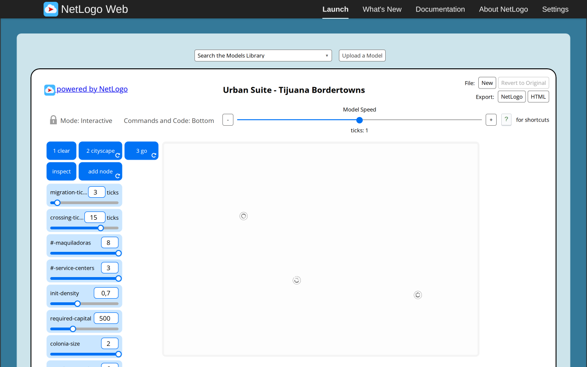
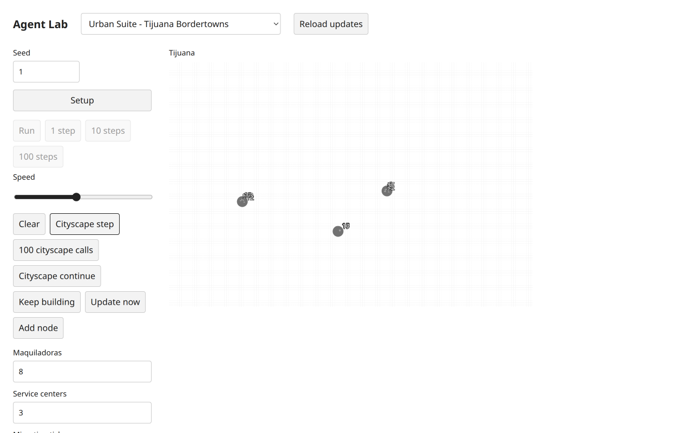
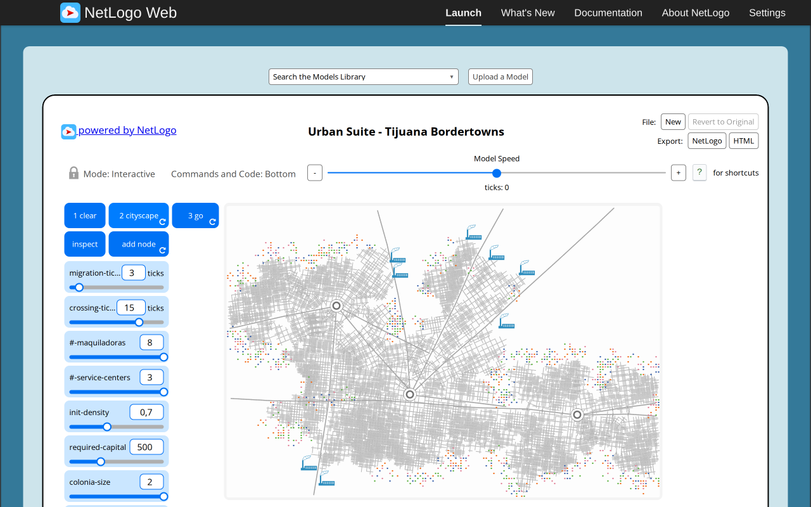
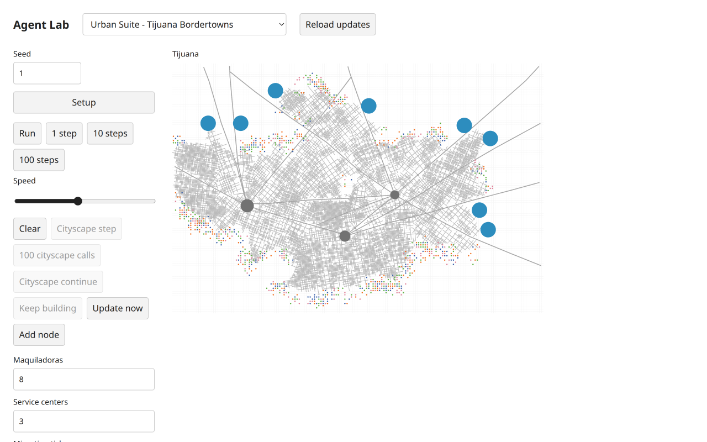
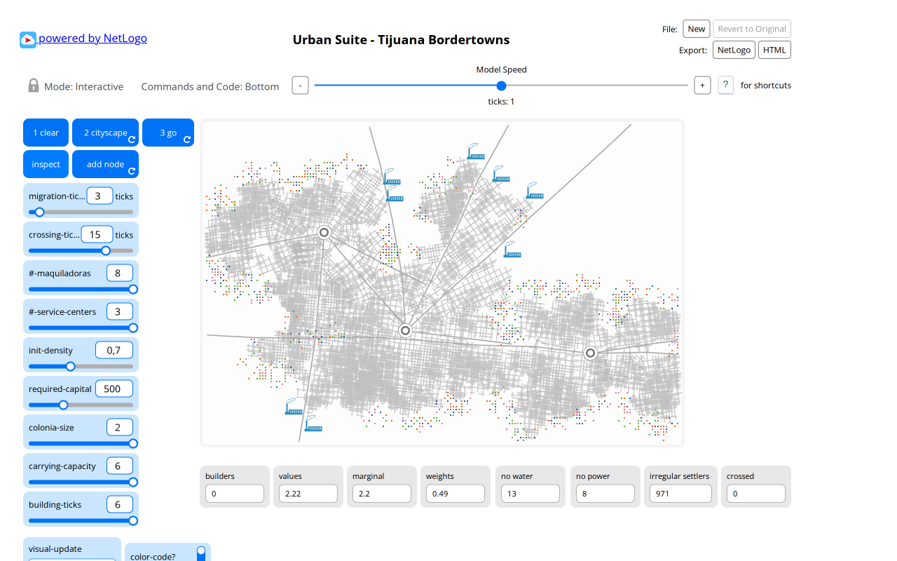

# Tijuana Bordertowns: target UI and executed browser comparison

Executed 6 November 2026 in the configured T3 Chromium preview. This is functional source/target evidence, not a pixel clone, matched random trajectory, empirical validation or independent transfer approval. The UI uses the public headless model, `defineUI`, the existing host controls/inspector and the shared spatial renderer. It introduces no custom canvas, scientific state, generator, clock, scenario editor or simulation equations.

The [frozen public contract](selected-tijuana-contract.md), [original-browser baseline](tijuana-reference-browser.md) and [shared segment browser proof](spatial-segment-browser-report.md) remain separate authorities. Copyright, licensing and full source credits remain in the experiment NOTICE. No literature research was repeated.

## Runtime attribution and reproduction

The initial complete control/appearance run used model SHA256 `f1b2c5ad1f9486560c66187b11f298cd062251764630fa0dd7949b3b03ac9cbe` and UI SHA256 `6d4dbcf58ec50978fcd90bfbe491e03f01c64a97fb4bc4a8581d9733c2b33241`. All images named below without a `final-` prefix belong to that runtime. A subsequent coordinator correction replaces a private row-major radius lookup with public `grid.fieldAt`, preserving canonical candidates, order and equations; corrected-runtime repetition is recorded separately below. Prior images are not relabelled with a newer model hash.

Run `CITY_LIBRARY_UI_PORT=3117 bun run dev:ui`, open `/?experiment=urban-suite-tijuana-bordertowns`, retain the source defaults and seed1, then click Setup. Click Cityscape step, use the 100-call button three times and Keep building for the remaining natural calls. Setup constructs a fresh seeded model; Clear calls the public `clear()` on the existing model, retains its canonical Fields and continuation, and does not reseed. Source CLEAR itself consumes native ask randomness; the target's no-draw CLEAR is an explicit schedule adaptation.

[Stage snapshots and resource URL hashes](tijuana-target-evidence/observations.json), [executed actions, supplementary native output and diagnostics](tijuana-target-evidence/supplement.json), and artifact SHA256SUMS retain the concrete evidence. Content-hashed loaded UI/shared chunks were fetched and fingerprinted from their actual URLs. The mutable development `/app.js` and `/styles.css` hashes identify bytes fetched during the check; they are not a promise that an auto-rebuilding development server retained its original entry response indefinitely.

### Corrected-runtime repetition

After the coordinator's commit `5eb6372`, the owned3117 server was stopped and started freshly, and the target page reloaded. The actual model SHA256 was `0c1f8231532d2ed18c09202ed198efad99804bee5d00bbd6e0f2ba7858144862`; UI source remained unchanged. A second full native-control Setup → first CITYSCAPE → three batches100 → Keep building → automatic ready0 → GO1 reproduced the observed sequence: first14 builders/14 segments; call101 had39,944 segments; call201 had305 migrants/135 seeds/eight jobs; call301 had705 migrants/35 seeds; call336 completed with845 migrants, no builders/seeds, three services/eight jobs and42,470 segments. The repeating toggle stopped and GO enabled. GO1 then gave842 migrants, tick1/epoch1, max-cost57.59 and unchanged42,470 segments. There was no failure/warning in the model observation.

[Exact corrected-runtime observations and loaded resource hashes](tijuana-target-evidence/final-runtime.json) are separate from the earlier interaction run. The corrected content-hashed UI/model chunk `ui-3fbtx67x.js` SHA256 is `1a11609b3cbd0acfcac74e8e4fb7636b832bc74ff12df79f2812aaca3741d898`; shared `app-dtjetwf1.js` SHA256 is `a34338acdae471f9ca32a49c0e4be08be3ae9f31ee42e433cf19beca0f969747`. Fresh [ready desktop](tijuana-target-evidence/final-ready-desktop-light.png), [GO1 desktop light](tijuana-target-evidence/final-go1-desktop-light.png), [desktop dark](tijuana-target-evidence/final-go1-desktop-dark.png), [mobile light](tijuana-target-evidence/final-go1-mobile-light.png) and [mobile dark](tijuana-target-evidence/final-go1-mobile-dark.png) were visually inspected. All four GO1 views retained identical tick/counts/traces, visible roads and no horizontal overflow. The detailed control/inspector/edit/Clear proofs below remain attributed to the earlier runtime; they were not silently claimed to be re-executed after this narrow lookup correction.

## Executed natural lifecycle

Both sides retained 8 maquiladoras, 3 services, migration3, crossing15, building6, density.7, colonia2, capital500, capacity6, display off, color code on and city growth off. Native seed1 and target Mulberry seed1 intentionally have different schedules. Source fresh headings, omitted overwritten default-color draws, legacy-shuffled activation, native-vs-target CLEAR/display draws and native engine scheduling are disclosed in the model contract. Counts below are observations, not a trajectory equality assertion.

| Context | Original NetLogo browser | Target initial browser runtime |
| --- | --- | --- |
| CLEAR / initialized | Tick0, no turtles, white view, unavailable savings/percent denominators | Setup: tick0/epoch0, all counts/segments/calls0; explicit N/A reasons; GO disabled |
| First CITYSCAPE call | Tick1, 3 services, 11 first builders, from the retained baseline | Tick1, 3 services, 14 first builders, 14 pen segments, GO disabled |
| Interrupted progress | Baseline paused160: 226 migrants, 191 seed migrants | Call201: 3 services, 8 jobs, 305 migrants, 135 seeds, 42,470 pen segments |
| Natural completion | Baseline bounded replay351 calls: ready, tick0, 990 migrants, 8 jobs; fresh native forever run here again reached990/ready0 | Call336: ready, tick0/epoch1, 845 migrants, no seeds/builders, 8 jobs, 42,470 segments; repeat stopped itself, GO enabled |
| First GO | Fresh native GO: tick1, 971 migrants, crossed0 | Tick1: 842 migrants, crossed0, 42,470 segments |
| GO Run/Pause | Earlier baseline sampled362: 1051 migrants, crossed24 | Actual paused64: 854 migrants, crossed4, 400 completed calls, no failure |

Native completed values/weights were 2.2187878787878805/.4896796536796542; target ready displays2.13/.458. The earlier baseline measured source351 calls; this supplementary forever run sampled its completed state rather than independently counting every source call. Target completed-call history was exposed through the existing monitor and read as336. No completion flag, population or fixture was injected.

| First source cityscape | First target cityscape |
| --- | --- |
|  |  |

| Source ready | Target ready |
| --- | --- |
|  |  |

| Fresh original GO1 | Target GO1 |
| --- | --- |
|  |  |

## Source controls and target interactions

The nine source numeric controls, both switches and all six chooser options are live and use `setRules`; seed is the only setup-only field. Browser edits changed each numeric control within its exact bounds and restored it; building.5, density.6 and colonia1.75 were exercised without integer coercion. Both switches were toggled twice. Tick64, population854 and call400 stayed unchanged. The [supplement](tijuana-target-evidence/supplement.json) records exact edits.

| Source action/context | Executed target presentation |
| --- | --- |
| CLEAR | Removed all Agents, source caches, history and traces, left tick0 and unavailable reporters. Existing instance retained; later first call had16 builders, whereas fresh seeded Setup reproduced14. |
| CITYSCAPE first call/progress | Separate public `advanceCityscape` actions; GO Run/steps disabled before readiness. The batch action executes actual calls, never fabricates a completed city. |
| CITYSCAPE forever/stop | Keep building repeats one call per100ms after the first cityscape step. It stopped automatically at ready0; a later run was manually stopped at actual107, restarted, then Clear disabled/unpressed the repeat at0. A later observation stayed0. |
| GO step/forever/stop | Existing 1-step and Run/Pause call `advance`; naturally completed CITYSCAPE enables them. No UI-owned tick or completion flag. |
| UPDATE NOW / six modes | Each chooser option was selected and Update now clicked at tick64. Elevation, land gradient, colonias, water and power maps were rendered, then off restored white land with persistent roads. Rule selection alone retained prior pixels; explicit domain display update changed them. |
| ADD NODE | Existing drawing toggle calls public `addNode` on begin/move; native pointer click at(0,0) created one node and updated inspected utilities2/3/1/land.45814229249011684; Enter created a second node, still tick64. No extra road was invented. |
| INSPECT | Pointer selects a detached Field/Agent; Home selected service birth0 at(17,-3), heading294. Target uses deterministic canvas/keyboard selection rather than native random three-panel selection. It exposes source cached occupied/ctr/colonia and typed utility strings without recomputation. |
| Reset/replay | Host Setup rebuilt seed1 and again produced14 first builders/14 segments on call1, epoch0. This is intentionally distinct from source Clear and from resetting display colors. |

All source scientific reporter subsets remain in the headless read. UI formats source monitor precision and shows `N/A (empty-subset)` or `N/A (zero-denominator)` when unavailable. It presents actual phase, counts, global source caches, last failure and warnings. The tested natural browser run had no model failure/warning; deliberate delayed errors are verified by the separate public scripts, not a fabricated browser fixture or success claim. A retained failure would use the host status plus public failure monitor.

The fresh native original was opened separately, native Clear executed, Command Center `random-seed 1` entered, native CITYSCAPE allowed to stop naturally, `go` entered once and the actual Inspect button clicked. It opened **two migrant inspectors and one patch inspector**: patch(63,-39), migrant16545 and migrant16686. Exact fields/output are in the supplement. [Native CLEAR](tijuana-target-evidence/native-clear.png) and [native inspector panels](tijuana-target-evidence/native-inspect-panels.png) supplement the earlier eight source screenshots. The actually loaded source again hashed to `8cada3e3638c93704f5eefbba4e9aa3840c991e2d5ab711ea759c4b31aedcfb2`; fetched engine bytes again hashed to `09f685d38681a850d9c79783d6b5c23c887d7d773c0117562fac56a64b63e1a2`. Page evaluation only read source state/diagnostics/hashes; native actions/Command Center performed source writes. An initial iframe selector and hidden checkbox selector did not reach the intended controls; direct embedded-page navigation and the visible native label resolved those automation attempts.

## Presentation adaptation and visual QA

Every Field color and pen color uses public `netLogoColor`. Ordered detached world-coordinate traces map directly to `SpatialData.segments`; source widths are CSS pixels as declared in the shared presentation contract, not a physical distance conversion. Cells draw first, all stored segments next, Agents/selection/labels last. Visible roads remain after road builders die. No stroke is truncated, generated from UI positions or dropped to cap history.

Symbols adapt source sizes to four CSS pixels per source size, with the existing renderer's two-buffer-pixel minimum; negative sizes are presented at that minimum without changing source data. Source default glyphs become triangles, other shapes become circles. Industrial factory/eyeball/loop artwork and ring outlines therefore are not native icon replicas. Source size/shape/color values remain available in the inspector. The native held-button ADD NODE polling becomes one placement per delivered begin/move event, with Enter/Space as keyboard alternatives; it does not reproduce native polling cadence.

The same target observation was checked at1280×800 and390×844 CSS pixels, DPR2, light/dark. Desktop canvas1344×904 buffer and mobile716×482 retained roads, colors and interventions, with no horizontal overflow. Clear snapshots were also taken in all four combinations. Source-white world colors stay white in dark chrome. Existing cell antialiasing leaves faint grid seams, and fixed CSS glyph sizing appears proportionally larger on mobile; this is a functional presentation adaptation, not pixel equivalence. No new widget types, styles, decorative elements or icons were introduced outside the existing toolkit.

| Initial empty light/dark | Populated light/dark |
| --- | --- |
| [Desktop light](tijuana-target-evidence/cleared-desktop-light.png), [desktop dark](tijuana-target-evidence/cleared-desktop-dark.png) | [Desktop light](tijuana-target-evidence/interventions-complete-desktop-light.png), [desktop dark](tijuana-target-evidence/interventions-desktop-dark.png) |
| [Mobile light](tijuana-target-evidence/cleared-mobile-light.png), [mobile dark](tijuana-target-evidence/cleared-mobile-dark.png) | [Mobile light](tijuana-target-evidence/interventions-mobile-light.png), [mobile dark](tijuana-target-evidence/interventions-mobile-dark.png) |

The six mode PNGs are named `mode-*.png` in the evidence directory. Images were actually inspected at desktop/mobile and in both themes. Canvas `getImageData` readback preceded final snapshots to flush the known Chromium capture anomaly; readback is QA instrumentation, not product rendering. This produced two Chrome performance warnings in the initial run and one more after the corrected-runtime reload, recommending `willReadFrequently`; no JavaScript errors or failed target/source requests were recorded. The canvas was focusable; actual Home/Enter selection/drawing and inspector output were exercised. No new modal/overlay exists to dismiss. This is bounded keyboard/visual QA, not accessibility certification or exhaustive long-label/performance testing.

`frontend-design` and `web-design-guidelines` were applied; current rules were fetched on6November2026, SHA256 `d246b026f4f29b5823a9cc857f9edf3d2507002e055e32040cadeaf3b38e0234`. The affected source has no domain mutations except defined actions and no additional framework. Existing host behavior was reused.

## Executed shell checks and limits

`bun run typecheck` passed all four configured projects three times, including after the final model correction. All five frozen selected-Tijuana scripts executed successfully on the initial runtime, including the natural five-seed/3000-call/replay envelope. The four diagnostic scripts and all five shared-segment scripts were executed again on the corrected runtime; final natural/replay script checking is coordinator/runtime-task evidence, separate from this task's corrected browser replay. The six-file Tijuana manifest and five shared-segment hashes passed again after the correction. `git diff --check` and explicit new-file whitespace checks passed. The owned dev server bundled the actual discovered catalog, including this entry. Parent full tests/build/package-consumer and independent Argon approval are separate gates; this report makes no independent-approval claim.

Only this experiment UI, this report and its evidence directory were written by this task. The coordinator owns integration, final Git state and ledger acceptance. Source/model/core/shared UI/contracts/examples/tests/configuration were preserved by this task. No commit was made.
