# Urban Suite Awareness and Recycling: paired functional browser comparison

Executed 2026-11-05. The scoped source-browser agent exercised both original NetLogo models; its [original-browser report](urban-reference-browser.md) and [exact observations/Command Center fixture commands](urban-reference-evidence/observations.json) are retained separately. The scoped target-browser agent executed the target sessions in this report through the configured **T3 Chromium preview**, port3110. It did not repeat the original sessions or literature research. Target runtime: headless commit`b05174e`, shared UI and adapters`7e4d6db`; browser work continued through documentation checkpoint`2e089a4`. Desktop 1280×800 and target mobile 390×844 CSS pixels, light/dark; screenshots may have device-pixel ratio2.

Both original browser-loaded XML hashes were calculated by the source agent from `session.nlogoSource.nlogo` UTF-8 bytes, not merely trusted from a downloaded file. They match NetLogo7.0.4 and pinned Galapagos revision`90be931773fcf499049247a8aaa1aecbe003654c`. All complete notices remain archived: Felsen and Wilensky(2007), copyright2007 Uri Wilensky, CC BY-NC-SA3.0. Exact canonical paths, license and procedure rules are in the [source contracts](selected-urban-contracts.md). The [Awareness](../research/netlogo-web/urban-suite-awareness.md) and [Recycling](../research/netlogo-web/urban-suite-recycling.md) dossiers supply scientific framing and three publications each; they are not evidence of empirical validation or these browser runs.

The original sessions used unspecified native random seeds; target uses explicit Mulberry seed1. These reports compare functional rules, settings, invariants and effects. Identical tick horizons help inspection but do not establish cross-engine seed or trajectory equality. No stochastic equivalence study was executed. The [target observation ledger](urban-target-evidence/observations.json) retains native actions' actual resulting ticks, monitor/input/inspector readings and diagnostic limits. [Target PNG hashes](urban-target-evidence/SHA256SUMS.json) and [reference PNG hashes](urban-reference-evidence/SHA256SUMS.json) make the paired images auditable.

## Awareness

Canonical identity: `Curricular Models/Urban Suite/Urban Suite - Awareness`; loaded source 48015 bytes, SHA-256`abfd1ff77cf243256865be372f1800349650d70a8c0e4381ed8ad8168e3ebd89`. Both setups used60people,20centers,non-usage limit100 and the fixed37×38 wrapping world. All60 people begin unaware; awareness and center non-usage means begin0.

| Actual browser state | Original NetLogo | Target |
| --- | --- | --- |
| Default Setup | tick0;60unaware,20centers;means0 | tick0;60unaware,20centers;means0 |
| Progress at112 |59unaware,1aware,0well-informed,0activists;mean awareness0.25;20centers,mean age29.9 |59unaware,1aware,0well-informed,0activists;mean awareness0.183(displayed);20centers,mean age26.700 |
| Run/Pause | native go/pause supplied the retained112 sample | after112,Run/Pause stopped at116:57unaware/3aware,mean0.417,20centers |
| Live non-usage limit0 | next retained go/pause sample121 had0centers | ten further steps reached126 with0centers,60unaware;mean non-usage shown“—” |
| Place centers while paused | native held click/drag painted source patch(18,19) at121 without tick change | native canvas click and Home/Enter painted two centers at126 without tick change |
| Empty people and centers | Setup then native go reached8;means displayed N/A;no runtime error | Setup then10steps reached10;all counts0;means“—”;stepping remains active |

| Paired stage | Original | Target |
| --- | --- | --- |
| Setup |  | 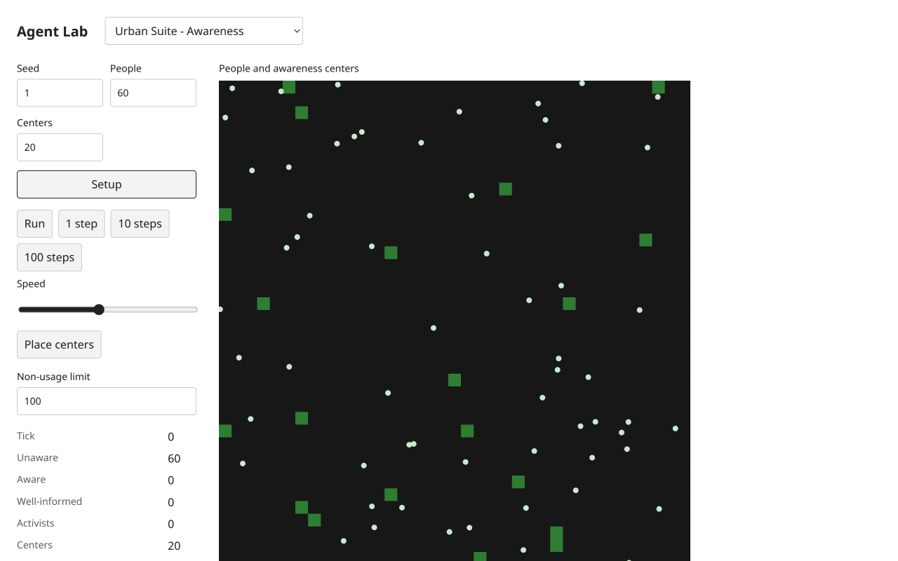 |
| Tick112 | 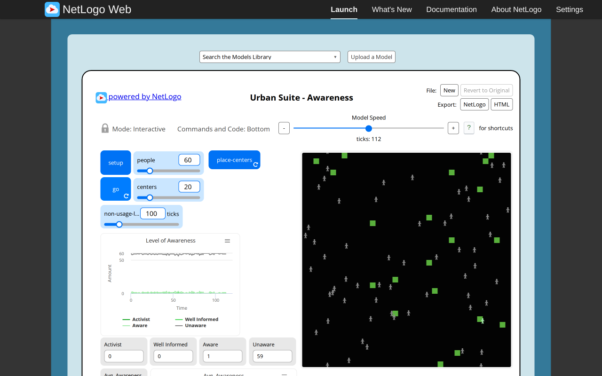 | 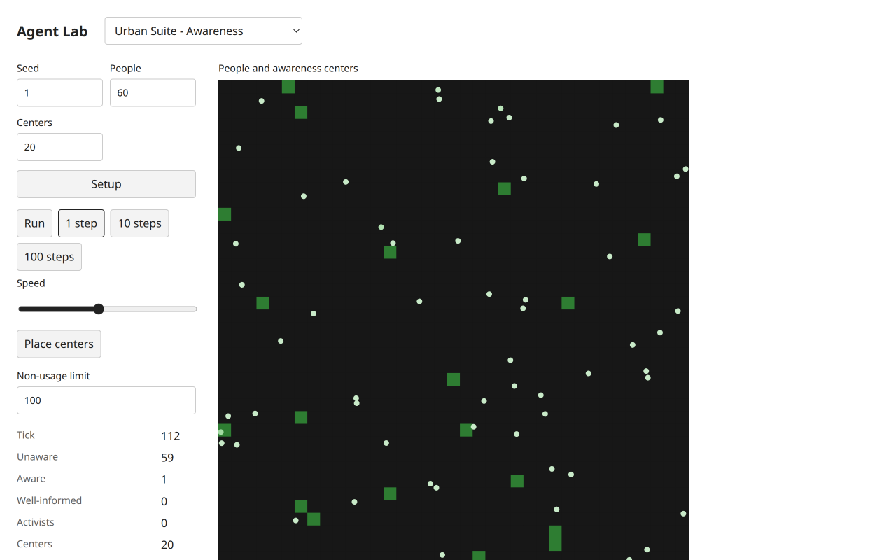 |

Target progress was reached with native1step,100steps,10steps,1step, totaling112. A fresh default instance replayed112 and reproduced the same target monitor readings, independent of globally different object IDs. The four-category population chart, awareness mean and additional center-count history were visually inspected at112. All category counts sum60; the chart is counts, not percentages. Empty means remain null headlessly and render“—”; this is a defined representation choice, **not** a claim that the original crashes. The executed original instead showed N/A and continued.

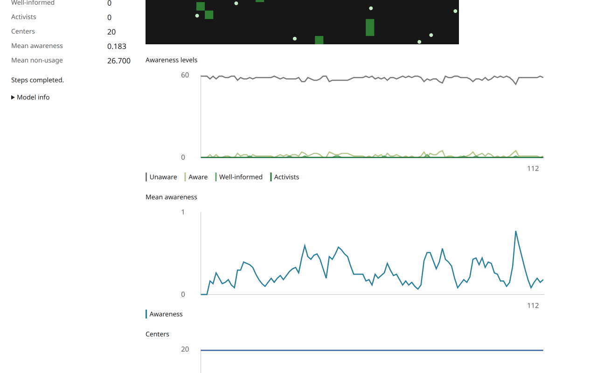

Awareness's source positions0..36 and0..37 translate by(−18,−18.5). Thus original contact fixture(18,18)→(18,19) corresponds to target(0,−0.5)→(0,0.5). Native target keyboard painting selected the first centered patch(−18,−18.5), reported original center/nonUsage0 and advanced no tick. Per-cell half-integer y centers are retained, rather than rounded away by a private model grid.

Functional source/headless contract: all people move before location effects; black land subtracts1 before peer messages; sender membership is snapshotted; recipients are selected afresh for each sender and cease receiving at awareness10; clamp follows contact; activists create centers; empty centers age and expire only when age exceeds the live limit. Painting retains existing age. The source agent's native Command Center contact fixture[11,11,10] produced[10,10,10] after one go, and its native brush changed a blue age7 patch to green while retaining age7. The matching **public headless** fixtures are asserted in frozen example01 and focused tests. These exact target fixtures were not injected into the target browser, and are not mislabeled as browser execution.

Target native controls also verified the host lifecycle: Setup restored tick0/20centers, cleared Place centers pressed state and restored touch-action auto. With mode off, clicking the world inspected a person and left20centers. Switching to Recycling while Place centers was active, then returning, produced a new uninitialized Awareness session with no pressed mode; Setup again started with mode off. At mobile390×844, native click and keyboard painting, first-cell inspector and both themes were checked at tick10; two extra painted centers gave22, with unchanged tick. No horizontal document overflow. Inspector/chart/theme interactions do not run go; headless tests separately assert read/rule/fixture RNG behavior. The target brush pauses Run on drawing intent through the existing host policy; this differs from the original independent forever painting control and is an explicit interaction adaptation. Pointer-held Setup/disposal and touch-drag cancellation were not directly exercised in this report; complete native clicks, keyboard painting, active-mode reset and model replacement were.

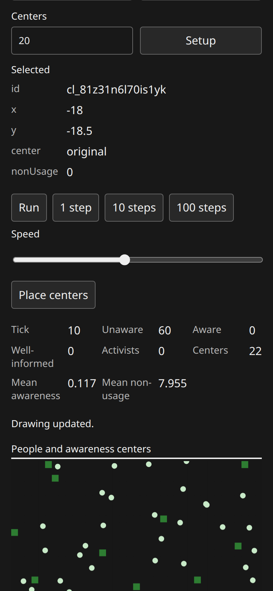
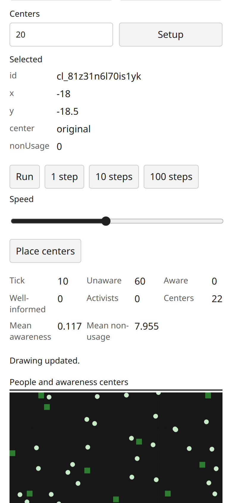

Presentation adaptations: source turtle/person glyphs and discrete greens are replaced by shared circular people with a continuous awareness shade, green original/blue created center cells and numeric inspection. All classifications and means come from headless observations. The source-aware plot/report values and center-placement function are preserved; no pixel clone is claimed.

## Recycling

Canonical identity: `Curricular Models/Urban Suite/Urban Suite - Recycling`; loaded source 50251 bytes, SHA-256`bcc3570d06d548b468a9ea5bc73ba4fd66960d982c19d9e6eb22953c71bda11e`. Both setups used25recyclers,25wastefuls,max energy50,waste cost0.5,regeneration25,seekingfalse,show-energytrue; fixed35×35 wrapping world. All1225fields begin new, and every person's energy is25.

| Actual browser state | Original NetLogo | Target |
| --- | --- | --- |
| Setup |25+25people;all land new;energy25;labels still empty despite show-energytrue |25+25people;new100%;energy25;labels visible immediately |
| First step | sampled recyclers energy26 and labels26 | selected first recycler energy26 at(−16,1),tick1;new97.96%,waste2.04% |
| Tick102 |25+25people;new68.2448979592%,recycled4.3265306122%,waste27.4285714286%;energy range22.5..49 |25+25people;displayed new65.63%,recycled9.06%,waste25.31%;selected recycler energy42 |
| Seeking live | native settingtrue then one go reached104,50people | settingtrue then one step reached104,25+25people;selected energy43 |
| Paused cap10/cost2/regen0 edits at104 | maximum energy remained49 before go;next go105 maximum10 | selected energy remained43 before step;next step105 selected energy10;25+25people |
| Run/Pause with edited rules | native go/pause already exercised for default progress | Run/Pause reached109;25+25people;selected energy8 |
| Reset defaults | tick0,50people | restored50/0.5/25,false/true then Setup:tick0,25+25people,new100%,energy25 |

Target default progress used native1step,100steps,1step, totaling102. A fresh default instance replayed102 and produced the same target percentages and selected recycler energy42. Original and target land fractions differ; the runs do not share a topology-free deterministic state or RNG stream. Both conserve the number of fields, separate the two population kinds and expose land-use percentages. The target plot has overlapping flat population curves at25, correctly indicated by the two legend entries; overlap is not a missing population series.

| Paired stage | Original | Target |
| --- | --- | --- |
| Setup | 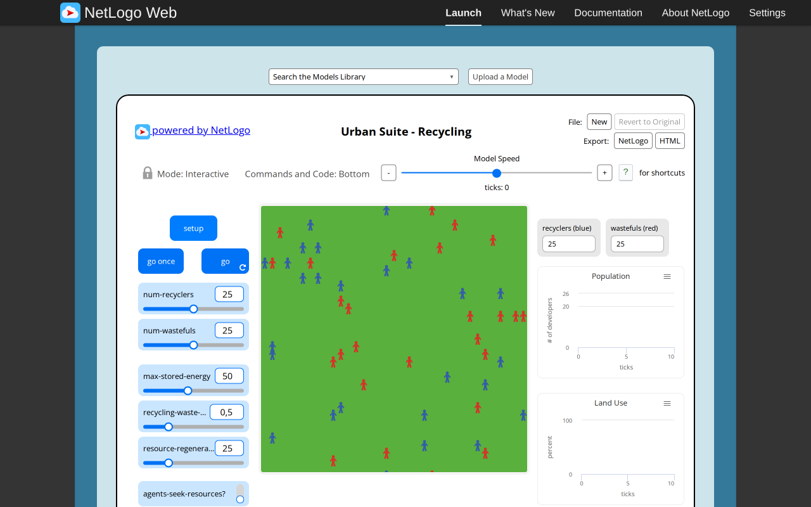 | 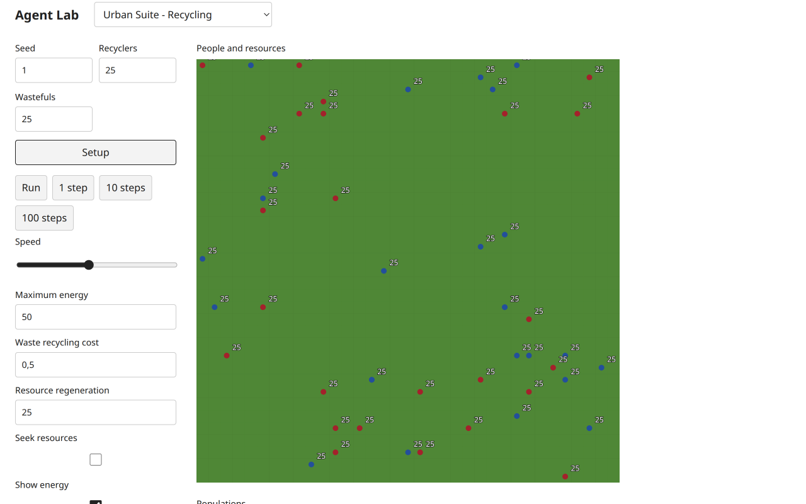 |
| Tick102 | 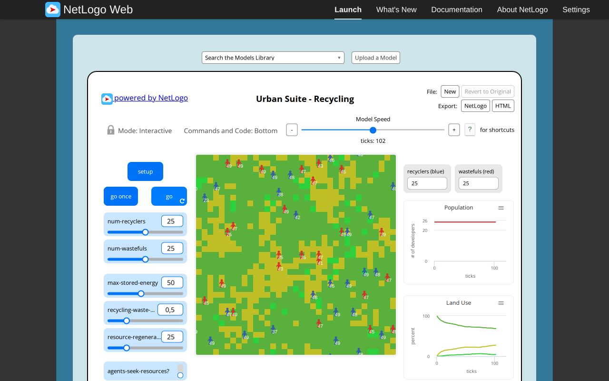 | 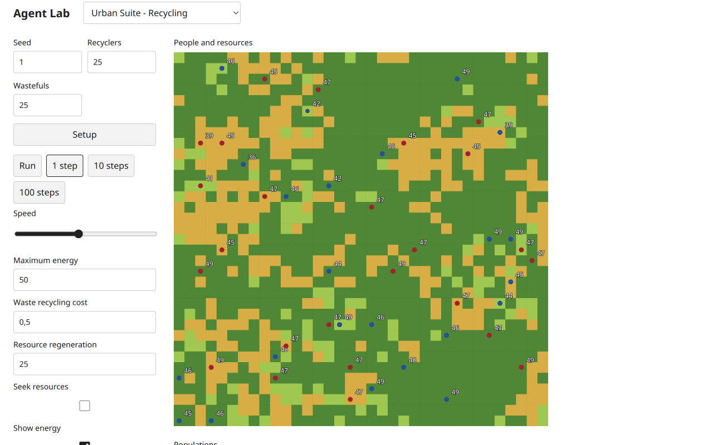 |

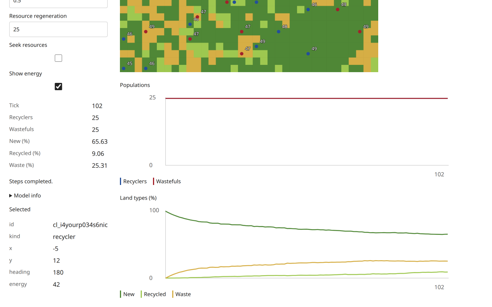

The source/headless phase contract processes each recycler's starting patch before all wastefuls; movement/seeking follows processing, then energy is capped and death occurs only below0. Integer regeneration is preserved: slider25 means3% per recycled field and0.6% per waste field, not25%/5%. Source conditionals and source phase order are the functional baseline. The reference agent ran native Command Center fixtures showing shared-patch order (wasteful survives at2), energy0 survival, seeking(1,0) without immediate destination harvest, and continued ticks after removing all people. Matching exact **headless public** fixtures are frozen in examples03/05 and tested; they were not injected into this target browser. The default/browser observations do not establish regeneration probabilities statistically.

Target native Show energy was switched off at102 without tick or count changes; labels disappeared immediately. The original applies its show-energy projection on the following go, and setup leaves labels empty. **Immediate setup/live label refresh is an intentional target presentation improvement**, while stored energies and all ecological rules remain headless. Shared Labels checkbox is hidden for this controlled model, avoiding a contradictory second visibility switch. Labels were restored with defaults; both mobile themes and keyboard-selected first recycler at energy25 were inspected at390×844 without horizontal overflow. The original source UI was tested on desktop; this report does not claim source responsive redesign.

An invalid native target setup count−1 was rejected by browser validation (“Value must be greater than or equal to0”); tick109,25+25people and current land percentages were preserved. Correcting the input to25 and restoring live defaults allowed Setup to succeed. Native cap,cost,regeneration,seeking and label controls were read back after change, with rule effects distinguished from immediate view changes. Target glyphs are circular blue recyclers/red wastefuls and shared energy text on resource-colored fields, replacing the original person shapes. These are declared appearance changes, not substitute resource rules.

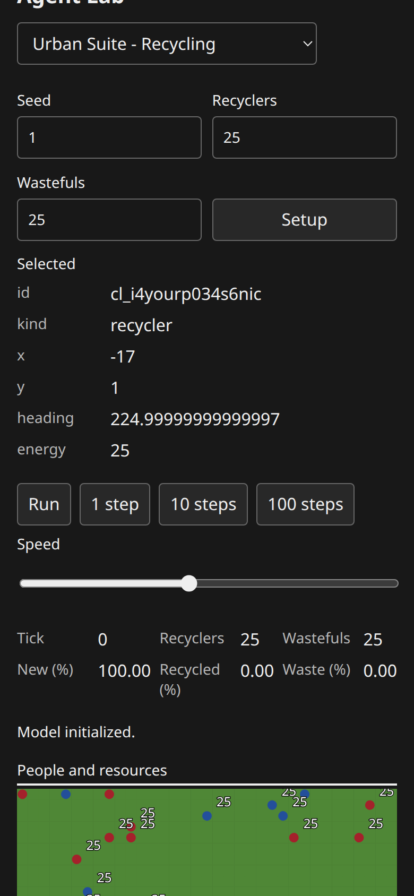
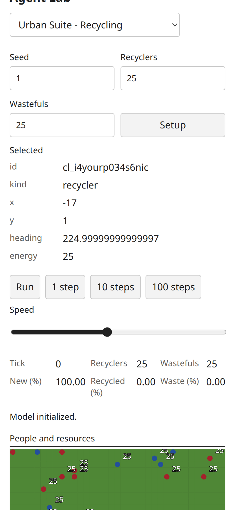

## Diagnostics, checks and remaining gates

All ten retained target PNGs were visually inspected. Source and target browser diagnostics recorded no application console/runtime errors or failed network requests. The original report records one corrected read-only ticker-expression error; this target session had no failed automation expression. The target agent closed its own tab and did not touch source/coordinator tabs. No browser sandbox settings, dependencies, model runtime, UI implementation, Git or ledger files were changed by this evidence follow-up.

Executed during this follow-up: targeted Urban behavior tests (12 passed, 79 assertions); frozen five-example SHA verification; JSON parsing; all ten target image paths/hashes checked. The earlier implementation task ran the full integrated check158tests/3947assertions,60 then-configured examples,types/build/consumer and independently ran the five Urban public scripts. The coordinator subsequently registered those five scripts (65total); this report does not claim that earlier run already exercised the later runner configuration. The coordinator subsequently executed the integrated full check successfully:158tests/3947assertions,65 public examples,all types/build/packed-consumer checks; the run is also recorded in the paired Pollution report.

`frontend-design` and current fetched `web-design-guidelines` informed shared UI implementation and visual QA: existing native controls, visible keyboard focus, compact responsive layout, numeric inspection and both themes. These scoped checks are not exhaustive accessibility certification. The Antigravity independent technical review remains blocked by quota, as [recorded separately](connectivity-transfer-review-blocker.md). Browser evidence, source/headless agreement and scientific dossiers do not supply that independent approval. Neither model is claimed fully reviewed by this report.
