# Positive Feedback and Path Dependence: paired browser comparison

The scoped target-browser agent executed this report on 2026-11-06 in real T3 Chromium, using the integrated application on port3110. Headless implementation: `ae9d234`; numeric palette, adapters and monitor wrapping: `d23f5e0`, following frozen contracts `ee77056` and `533210c`. Desktop was1280×800 CSS pixels; target mobile was390×844, in light and dark modes. PNGs may have device-pixel ratio2. The target agent read the complete original-browser report and its observations; it **did not repeat the original sessions**. Those separate, executed original runs remain attributed to the scoped reference-browser agent in [the original report](urban-feedback-reference-browser.md) and [exact source observations/commands](urban-feedback-reference-evidence/observations.json).

Both selected originals identify NetLogo7.0.4 and match pinned Galapagos revision `90be931773fcf499049247a8aaa1aecbe003654c`. The reference agent hashed each actually loaded iframe `session.nlogoSource.nlogo`, rather than trusting a download alone. Complete source/Info notices remain archived. Copyright2007 Uri Wilensky, CC BY-NC-SA3.0. See the [binding source and public contracts](selected-urban-feedback-contracts.md), [Positive Feedback provenance](../../experiments/urban-suite-positive-feedback/NOTICE.md) and [Path Dependence provenance](../../experiments/urban-suite-path-dependence/NOTICE.md).

Original default runs used unspecified native random seeds; targets used explicit Mulberry seed1. Equal sampled tick horizons aid inspection, but do not establish shared initial fields, seed identity or trajectory equality. Source equations/order, invariants, exact explicit fixtures and parameter/interaction effects are compared. No ensemble study, empirical validation or scientific distributional equivalence is claimed. Scientific context and the requested three publications per model remain in the [Positive Feedback dossier](../research/netlogo-web/urban-suite-positive-feedback.md) and [Path Dependence dossier](../research/netlogo-web/urban-suite-path-dependence.md).

## Positive Feedback

Canonical selected identity: `Curricular Models/Urban Suite/Urban Suite - Positive Feedback`. Actually loaded original source:42733bytes, SHA-256 `ed8e7de693797f0ebe625d742032dbf95614e0a31c88b41eed83db3a47ff42b6`. Defaults in both:21×21 wrapping field, alpha1.1, Moore off. Target setup seed1.

| Executed state | Original NetLogo | Target |
| --- | --- | --- |
| Setup |441 cells; max0.9992779938076678,total225.640051346456 |441 cells; displayed max0.998487,total213.032,tick0 |
| Progress at tick22 | max1,total52.49551297255636 | displayed max1.00000,total46.7673 |
| Run/Pause after22 | native go/pause supplied the retained22 sample | paused at25,max1,total36.7376 |
| Live alpha0 and Moore on | corresponding original controls and explicit zero-power fixture executed | edits left tick25/total36.7376 unchanged; next1step reached26,max1,total441 |
| Setup with those edited rules | source Setup initializes a fresh random field, without max normalization | tick0,max0.998487,total213.032,alpha0/Mooretrue retained |
| Change alpha1 with Moore still on, one step | source corner-impulse fixture verifies averaging then normalization | tick1,max1,total276.144 from the fresh target field |

Target tick22 used native1step,10steps,10steps,1step. Both setup maxima below1 corroborate **unnormalized initialization**. Each successful go stages powers of the old activity, with optional nine-cell averaging, commits all staged values, then divides by one global maximum. It does not normalize by total or perform in-place neighbor updates. Alpha0 yielding441 unit values and the changed Moore result were reached through native target controls, not internal mutation. Setup restored the same seed1 field while retaining live rules; the session was finally restored to alpha1.1/Moorefalse and Setup.

| Stage | Original | Target |
| --- | --- | --- |
| Setup | 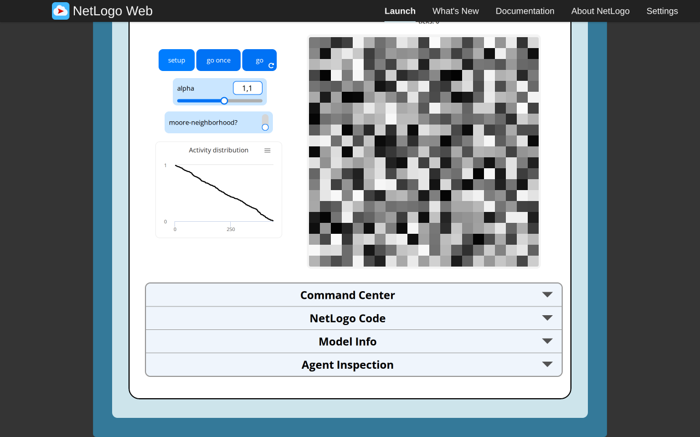 | 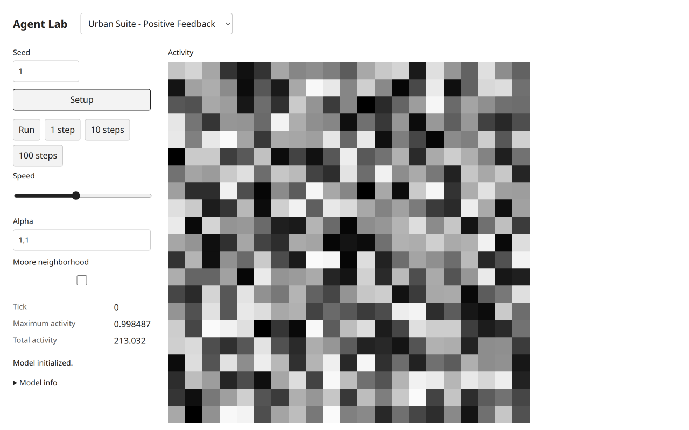 |
| Tick22 | 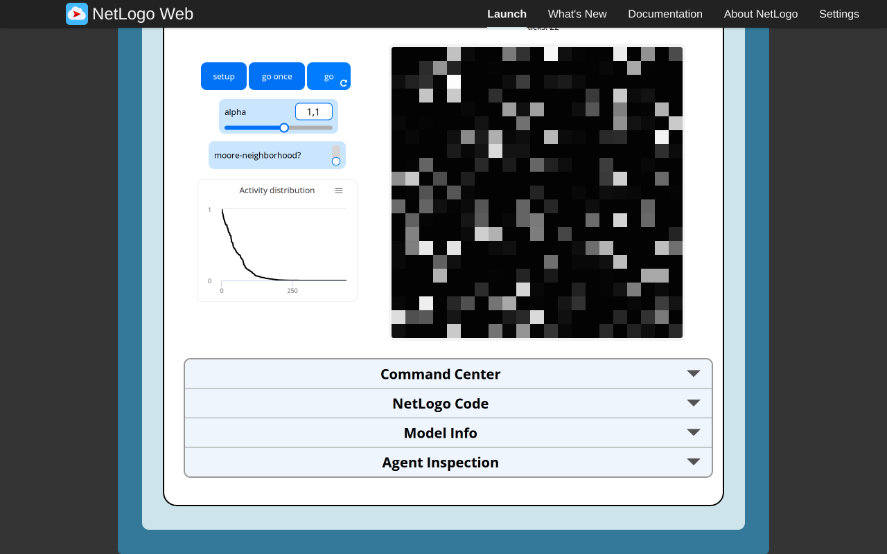 | 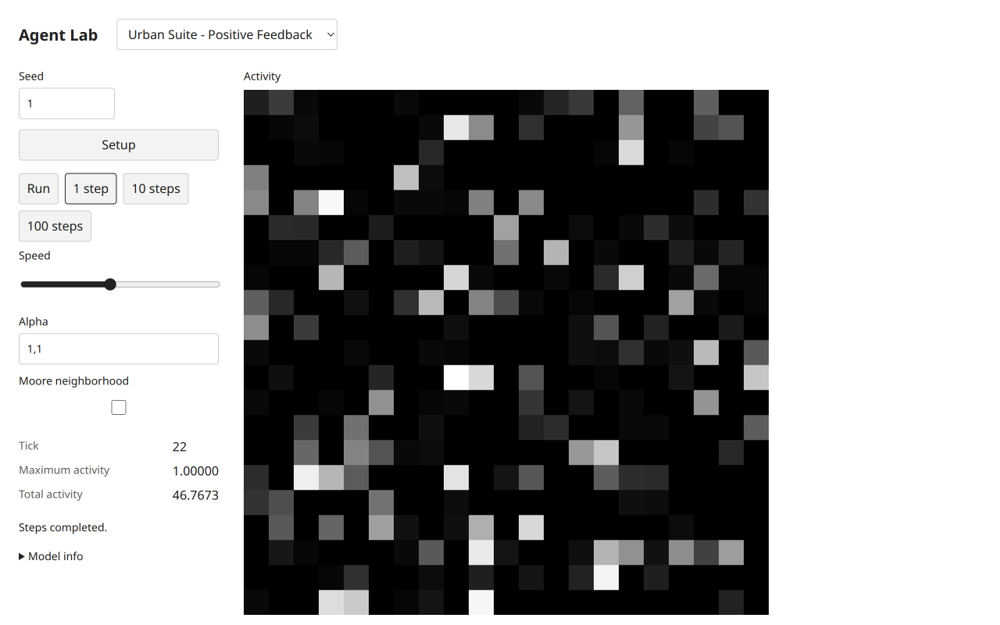 |

The current distribution is plotted as441 **descending ranked activity values**, not a histogram or history. Target rank coordinates are0..440; the original sets its plot range0..441. Shared automatic axis fitting is a presentation difference. Total/max monitors are additional target diagnostics with abstract activity units, not population or conserved mass.

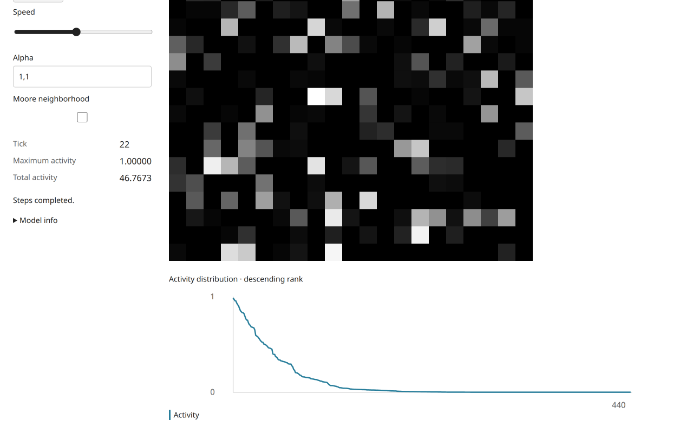

The separately executed original Command Center fixtures established0^0=1, the exact squared powers0.0625/0.25/1, and a corner impulse spreading to nine unit cells after Moore averaging/global normalization. The frozen **headless public examples** assert the corresponding target fixtures. An all-zero source field at positive alpha commits/stages zeros and raises Division by zero before tick. The target permits an all-zero fixture at alpha0, rejects that fixture under positive alpha, and throws a normalization error if a subsequent live alpha change makes the zero field invalid. These are explicit fixture/error semantics, not a repaired scientific equation. Target deterministic fixtures were **not injected into this target browser**, and the source error screenshot is not presented as a target error execution.

The original's irrelevant ask shuffles differ from target deterministic equation evaluation; no equal RNG consumption is claimed. The shared numeric-color renderer uses observed official RGB bins for9.9×activity, instead of an invented palette. Cell selection via click then Home exposed target cell(−10,−10),activity1 at tick26. At390×844, light/dark controls, inspector and activity surface were visually inspected without horizontal overflow. Long monitor words wrap rather than overlap. This is emulated responsive QA, not physical-device certification or source responsive parity.

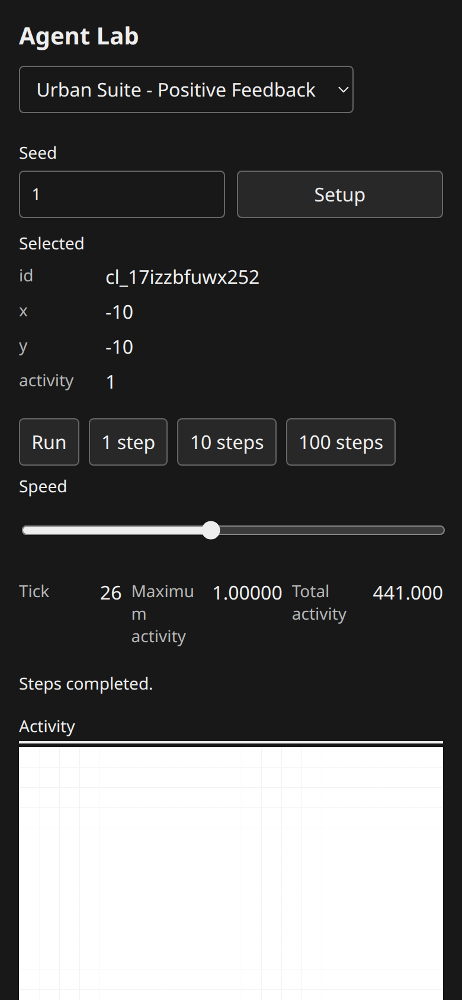
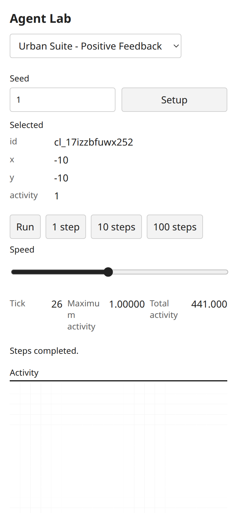

## Path Dependence

Canonical selected identity: `Curricular Models/Urban Suite/Urban Suite - Path Dependence`. Actually loaded original source:45207bytes, SHA-256 `1b5216c6077d80c441626f1cdb9c108a73adca17a17be4020adeb96e2e67e931`. Both defaults:11×11 torus, initial firms200, distribute off, region radius0, increasing returns0.5, attempts1, birth off. Target seed1.

| Executed state | Original NetLogo | Target |
| --- | --- | --- |
| Setup |200 searching firms; largest regional population5,101 occupied cells,tick0 |200 searching firms; largest region5,maximum same-cell occupancy5,tick0 |
| Tick32 progress |200 firms,100 settled,largest region25 |200 firms,108 settled,92 searching,largest region27,maximum occupancy27 |
| Disturb | tick32 retained,settled0 | tick32 retained,settled0/searching200 |
| Live radius2,returns0.75,attempts3,birthtrue | fresh original run reached9 with209 firms,200 settled,largest region38 | edits at32 left existing counts/cached largest27 unchanged; next step33 had201 firms,171 settled,largest region34,maximum occupancy6 |
| Run/Pause with edited rules | original native go/pause exercised | actual pause at63:231 firms,178 settled,53 searching,largest region87,maximum occupancy22 |
| Distribute on/request200,defaults restored |121 firms,largest region1,tick0 |121 searching firms,largest region/maximum occupancy1,tick0 |
| Distribute on/request100 |0 firms,source confirm message; qualities still initialized |0 firms,tick0,exact warning shown inline; no horizontal overflow |

The tick32 target horizon used1step,three10step clicks and1step. Different settled counts/locations are independent stochastic realizations, not parity failures inferred from unequal seeds. One target birth per successful step is observable:200→201 at33, then231 at63. The actual Run/Pause horizon63 is recorded without pretending it was a fixed short batch.

| Stage | Original | Target |
| --- | --- | --- |
| Setup | 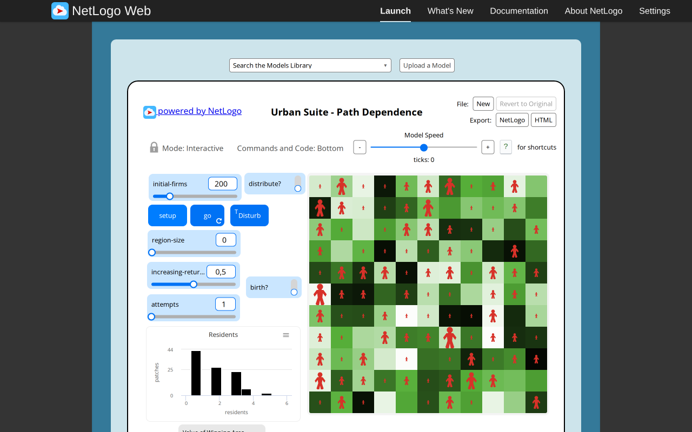 | 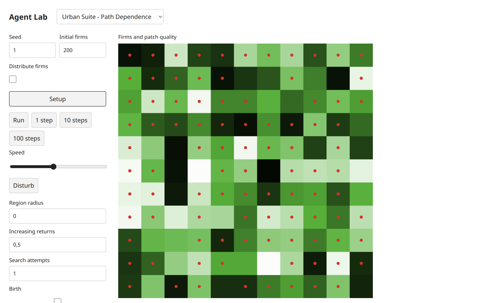 |
| Tick32 | 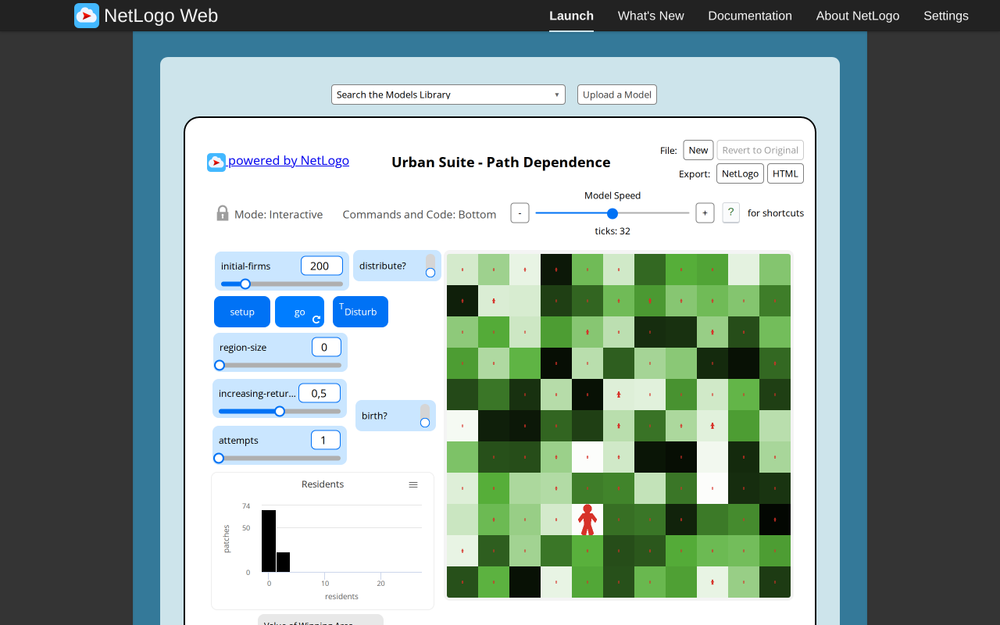 |  |

The Residents histogram measures **occupied patches by same-cell occupant count**, excluding empty patches. It uses ten bins over0..1+maximum occupancy. It does not histogram settled firms or regional totals. The screenshot includes the current tick32 reporters and distribution. Largest regional population can differ from maximum cell occupancy when radius is positive, as the target33/63 readings demonstrate.

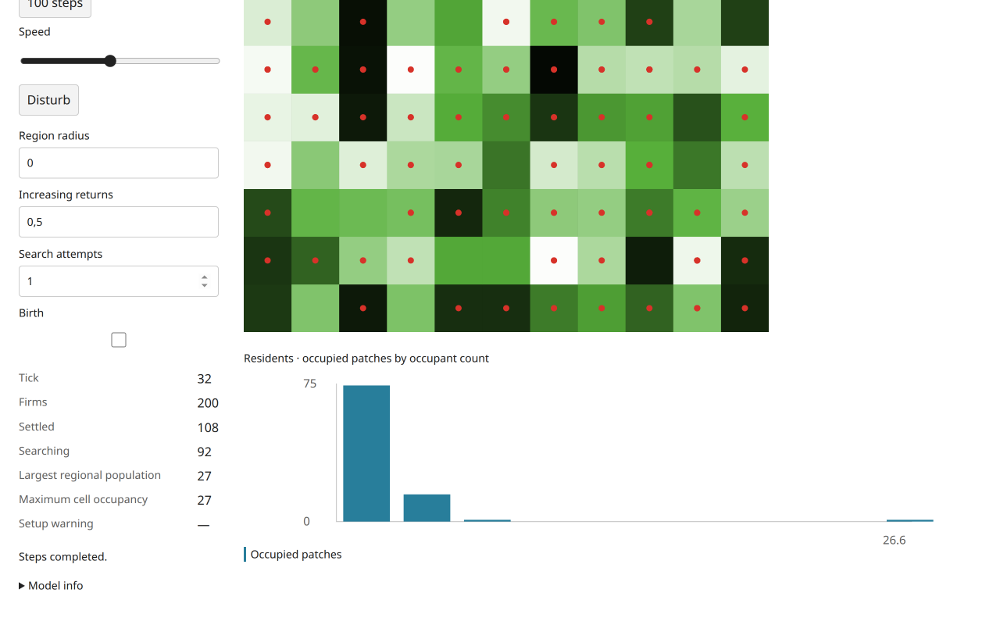

The preserved source mechanism includes searching firms and self in regional population, caches largest population before search, recomputes local population at current positions and continues **all** search attempts even after settlement. The reference agent's explicit quality1/single-firm/attempts3/seed9 fixture moved three cells and settled; frozen target headless fixtures/tests assert the mechanism without claiming cross-engine displacement identity. No target-browser deterministic fixture was injected here. Disturb calls the public headless action, with no scientific tick. Live edits do not retroactively move firms or refresh cached source size/max phases.

### Setup warnings, errors and recovery

The original inverted distribute comparison remains functional baseline:200 requests fill121 patches, whereas100 requests produce no firms and a native confirm saying “Can't distribute, fewer patches than people.” Target retains that exact message as visible inline data instead of a blocking browser dialog. It does not silently create the requested population or repair the condition. The shared monitor wrapping fix was rechecked at390×844 with this actual long warning, without horizontal overflow; normal numeric monitors and selected-firm inspector also remain readable.

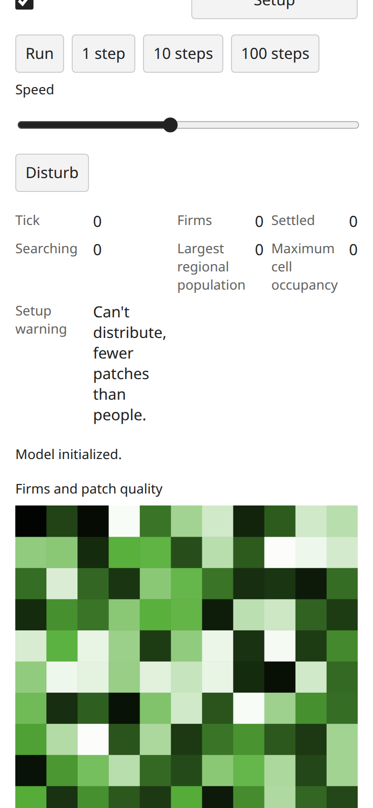

For a separate target session, initial firms0/distributefalse/birthtrue followed by1step showed **“Cannot birth a firm without an existing parent.”** at unchanged tick0/firms0. Clicking Run produced the same visible error, stopped its toggle and left tick0 after650ms; it did not silently retry or create a founder. This corresponds to the original ASK/NOBODY error, whose exported source state/RNG were observed unchanged by the reference agent. Target error wording/status presentation differs; the explicit error boundary remains. Setting birthfalse and stepping then succeeded at tick1 with0 firms, demonstrating that the empty population itself is not a terminal rule. Frozen headless assertions additionally check unchanged RNG/history on the missing-parent error; the browser directly verifies the visible state/time/error and recovery, not hidden RNG.

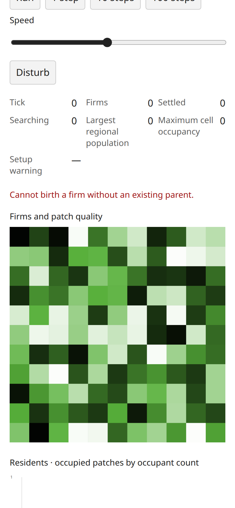

An invalid native initial-firms value−1 followed by Setup produced browser validation “Value must be greater than or equal to0” and preserved the current tick63/231 firms/178 settled/53 searching. After correcting the input and restoring live defaults, Setup recreated tick0/200 searching firms/largest region5. Mobile light/dark inspector selection after the edited-rule run exposed a real firm at(4,4),heading270,movedIntrue, without time changes or horizontal overflow.

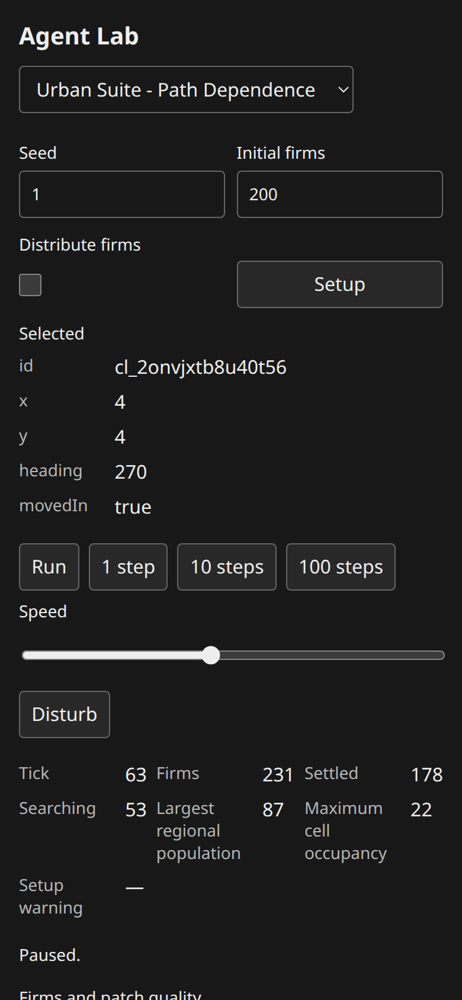
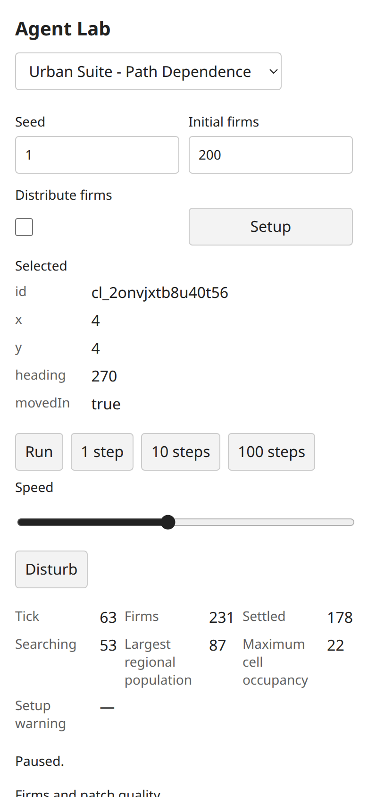

Presentation differences are explicit: source relative-size person glyphs become fixed-size red circles; patch quality retains its source numeric color mapping through the shared observed palette. Multiple co-located firms overlap visually, while exact cell occupancies, regional maxima, individual selection and the histogram expose canonical counts. UI does not recompute regional populations or pretend fixed glyphs encode the source size ratios. Headless reads return all winning-occupancy ties without consuming source-style random monitor tie draws. No pixel-clone or equal monitor-RNG behavior is claimed.

## Diagnostics, validation and remaining gates

All twelve retained target PNGs were visually inspected. Both target sessions reported no JavaScript console errors or failed network requests. The expected missing-parent failure was caught and presented in target status text; it is not omitted because the JavaScript console stayed clean. This follow-up had no failed automation expressions. Both final models were restored to defaults/Setup; the agent-owned target tab was closed. Original errors and automation corrections remain recorded in the separately attributed source report.

The implementation worker already executed the integrated check:174 tests/8261 assertions,75 public examples,all four TypeScript configurations,build and packed Bun/Node ESM/ambient-free TypeScript consumers passed. This browser-only follow-up did not rerun that full check or alter runtime/configuration. It validates report JSON, image hashes/paths and numeric invariants locally. [Machine-readable target observations](urban-feedback-target-evidence/observations.json), [target image hashes](urban-feedback-target-evidence/SHA256SUMS.json), [original hashes/images](urban-feedback-reference-evidence/SHA256SUMS.json) retain the execution basis.

`frontend-design` and fetched `web-design-guidelines` informed the shared implementation and visual QA. Scope includes native controls, visible focus, inspector state, responsive long text and supported themes; it is not exhaustive accessibility certification. Each model now has substantive original/target browser evidence, but **independent Argon technical approval remains pending** under the [quota blocker](connectivity-transfer-review-blocker.md). Research completion, screenshot comparison and local passing checks do not replace that review or imply completion of the selected200.
