# Four Urban landscape models: paired browser evidence

Executed 2026-11-06 in configured T3 Chromium 156.0.0.0 on Linux. This report covers the **target** UI implementation and its comparison with the independently executed [four-original browser baseline](urban-remaining-four-reference-browser.md). Original source execution is attributed to that report, not repeated or substituted with target calls. Sources are NetLogo7.0.4 at Galapagos `90be931773fcf499049247a8aaa1aecbe003654c`; actual loaded source/archive hashes were checked in the original report. Target model/UI/source hashes, exact visible defaults, observations and diagnostics are retained in [observations.json](urban-landscape-target-evidence/observations.json). The four sources retain their individual notices and scientific dossiers. No scientific empirical validation or independent Argon approval is claimed.

Target ran at localhost3113 using a fresh `CITY_LIBRARY_UI_PORT=3113 bun run dev:ui` process, with1280×800 desktop and390×844 mobile CSS viewports, light and dark appearance. Each target received native Setup,1 step, batch steps, Run→Pause, live control changes and Setup reset. Setup reconstructs the target instance from configured inputs/seed, rather than continuing its RNG. Read-only evaluation inspected rendered monitors, chart accessibility labels, sizing and canvas pixels; model changes used visible controls. Each model's Model info disclosure was opened/closed and its attribution/source link inspected. Canvas click/ArrowRight inspection was exercised on Structure1, Sprawl and Economic; it selected actual IDs/fields/agents. No injected target-private runtime or source transpiler was used.

The final screenshots use the shorter final adapter labels. They show default seed1 and11 completed ticks, except Structure2 at101. Earlier longer Run/Pause observations below use the same domain runtime and controls; their former verbose monitor labels were subsequently shortened without changing equations or state. Cross-engine random trajectories and equal stochastic distributions are **not** inferred from one run. Native random asks and target Mulberry/activation schedules differ explicitly. Canonical coordinates translate source0…129 to target−64.5…64.5 for both Structure models. Other models retain source centers. None has a scientific successful terminal rule; paused/stable states remain advanceable.

## Structure from Randomness1

Pinned source SHA256 `8a5573912ba6d29d9101b9d1fbfbbc7cf5629ad0f799d370cfb39cb9cae1944e`.

Original setup used16900cells/noiseoff, total−338/maxabs1; original progress52 conserved total approximately−338/maxabs.18153589. Target defaults are16900cells/seed1/noiseoff, total−118/maxabs1. Final target11 retained total−118 and maxabs.522664. The separate native target Run/Pause reached126,total−118/maxabs.145190. Thus both executed engines exhibit smoothing and conservation; different patterns/totals are explained by independent initialization and RNG. Source/target procedures use staged `(self+sum four faces)/5`; scientific state is not normalized. Relative grayscale uses the public `netLogoColor` and headless numeric color, with ranked values shown as a descending rank curve rather than a histogram.

The target live noise checkbox at126 changed the next step127 to total−136/maxabs1.14412. Setup with noise still enabled reset tick0; the next step1 had total−136/maxabs2. Canvas/keyboard inspection exposed a selected cell's coordinates,activity and numeric color. Original toroidal impulse and zero-recolor error are documented in the baseline. The corresponding target boundary was checked headless in the runtime slice: a naturally reached zero field commits activity but fails recolor before tick; an all-zero target fixture request is atomically forbidden. That exceptional fixture was **not invoked through the browser UI**, which has no scientific fixture editor. No successful zero-field behavior is claimed.

| State | Executed original | Executed target |
| --- | --- | --- |
| Setup | 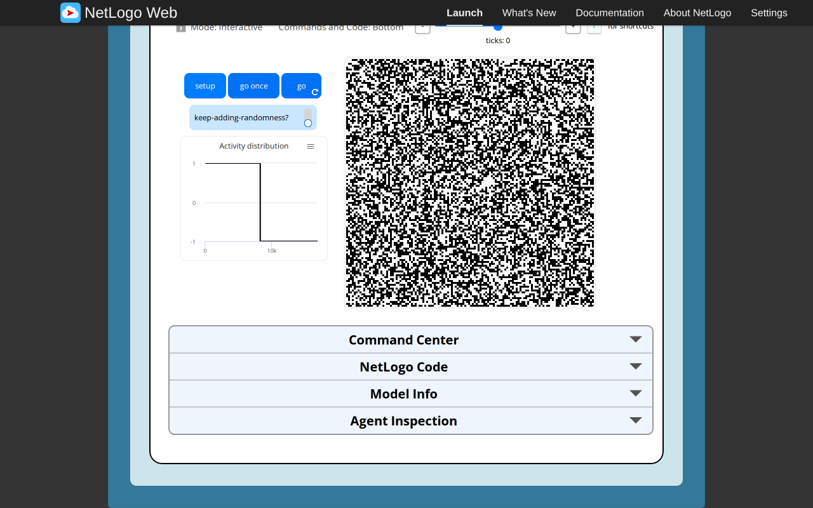 | 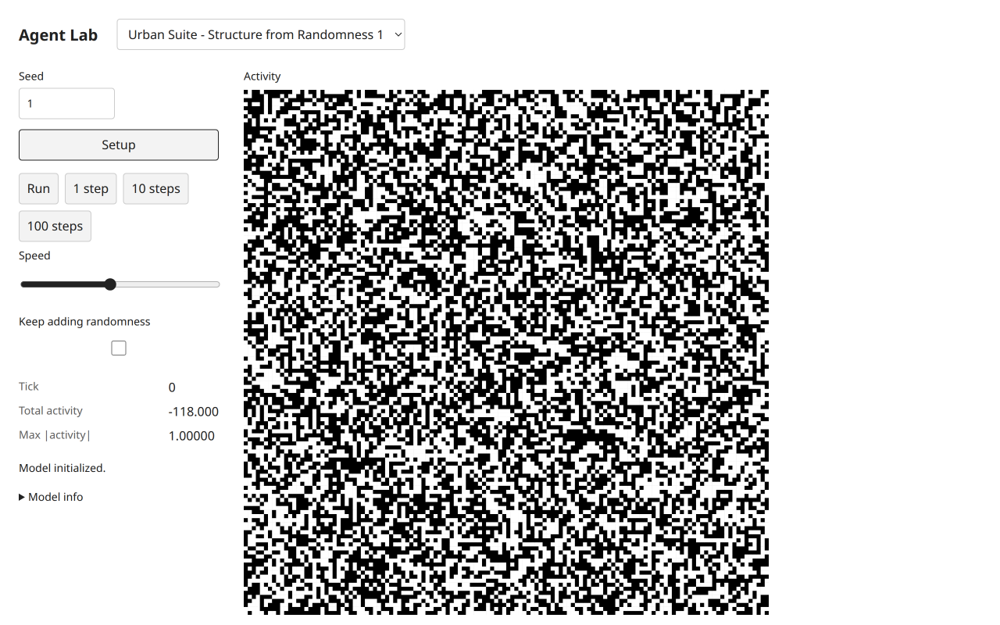 |
| Progress | 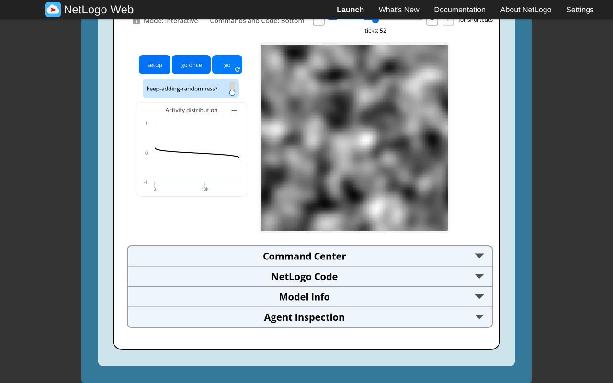 | 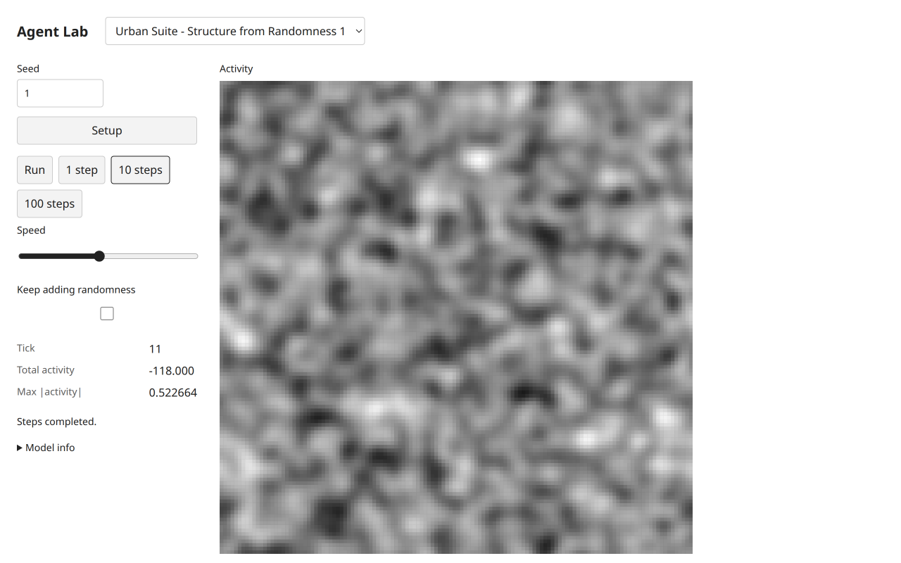 |

[Mobile light](urban-landscape-target-evidence/s1-mobile-light.png),[mobile dark](urban-landscape-target-evidence/s1-mobile-dark.png),[desktop dark](urban-landscape-target-evidence/s1-desktop-dark.png).

## Structure from Randomness2

Pinned source SHA256 `9a83bc7a5ff539f3a02fe8a20c5d8cb5d3366bb72993519db5a0a31f51be0839`.

Original defaults were16900cells/threshold4.5:setup mean.02,max1,current-above0,white0; original83 had current-above0 but white39. Target setup mean.00698225,max1,current-above0,activated0; target101 had current-above7,activated78,mean−.0592899,max5.06973. Target chart accessibility output gave max5.069726330195334 and mean×10−.5928994082840233. This distinguishes the source plot's scaled mean from its unscaled mean monitor.

The target Run/Pause reached285,current-above3/activated345,mean−.0623669,max4.99167. Changing threshold4.5→0 at285 changed the current count to8208 while activated remained345 and tick stayed285. Setup at threshold0 returned tick0,current8509,activated0:initial positives are not painted. One step at0 activated8170; raising threshold10 and stepping again produced tick2,current0,activated8170. This matches the source's persistent whitening and live predicate distinction; it is not a redraw of current threshold membership. Original strict ties and injected potential replacement are separately retained in the baseline; target fixtures/invariants have headless coverage. Target plots retain an explicit setup sample and update same-tick reports after controls, so UI history sampling differs from native automatic plot timing and is not asserted curve-identical.

| State | Executed original | Executed target |
| --- | --- | --- |
| Setup |  | 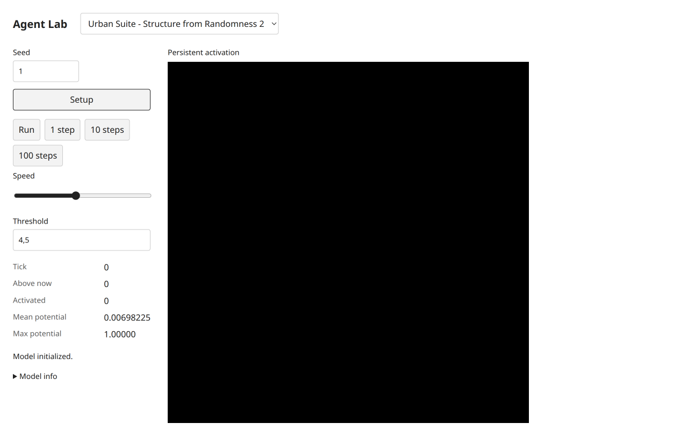 |
| Progress | 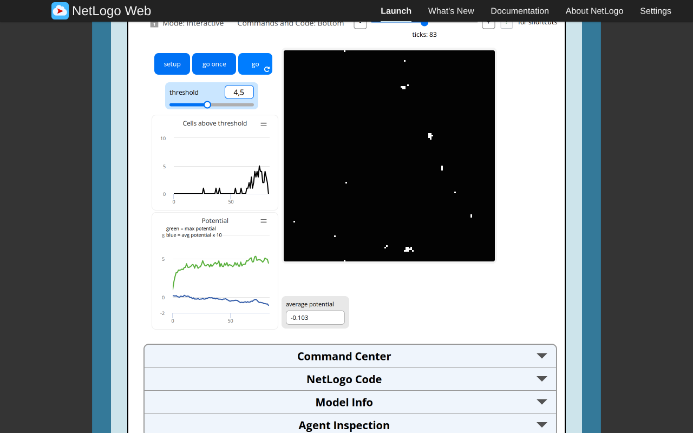 | 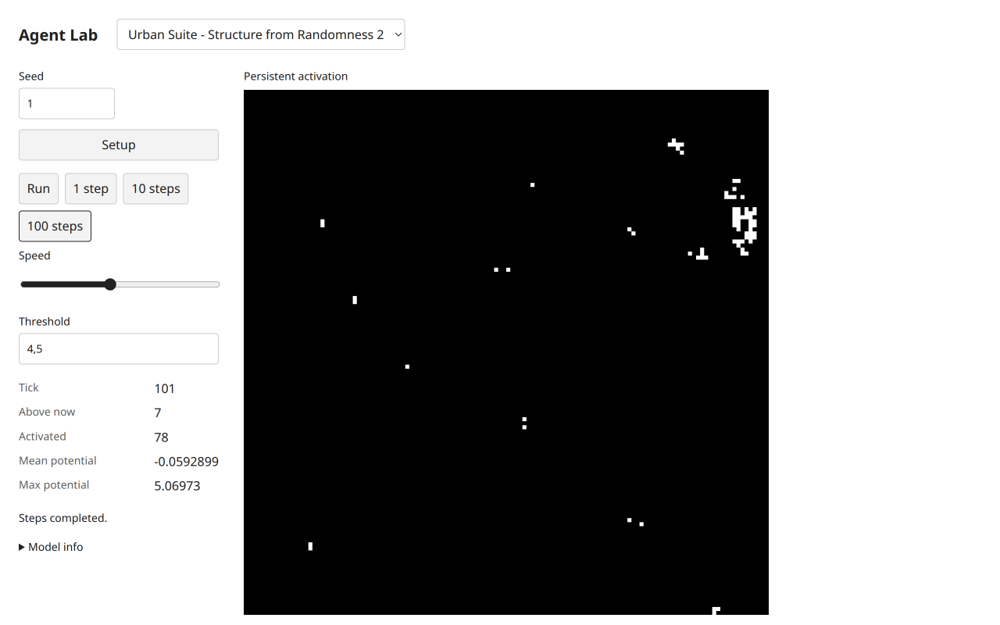 |

[Mobile light](urban-landscape-target-evidence/s2-mobile-light.png),[mobile dark](urban-landscape-target-evidence/s2-mobile-dark.png),[desktop dark](urban-landscape-target-evidence/s2-desktop-dark.png).

## Sprawl Effect

Pinned source SHA256 `47a13701ed91c04aad70f39ad79d41709d01e27b5143328fe319f369e9ef0d3b`.

Both defaults:smoothness15,maxAttraction15,population200,searchAngle84,patience60,wait15;35²torus,200seekers/0houses,buildThreshold7. Original setup total8686 and progress21 had149houses/51seekers. Target seed1 setup total8466; final11 had192houses/8seekers,total8513.69. The longer target Run/Pause reached313,153houses/47seekers,total8616.28. These are separate stochastic realizations and horizons, not evidence of trajectory or distribution equivalence.

All four live controls were edited at313:maxAttraction0,angle90,patience0,wait5. The cached threshold stayed7 and counts/tick stayed fixed. Setup smoothing1/population1 then reset to tick0,one seeker,total0,threshold0. One step produced one house,total.05; click/keyboard inspection showed the same agent at(0,0),patience0,stayCounter4. This verifies same-tick participation in the later house phase and cache refresh at Setup. Source original fractional integer-random and directional tie fixtures remain separately documented; target uses the public integer draw plus the explicit zero branch, public geometry probes and canonical agents. New house glyphs are fixed white circles and seekers red triangles in the shared renderer, replacing NetLogo house shapes without changing domain state. Setup-only smoothing/population remain visibly labeled; live parameters affect their source read sites.

| State | Executed original | Executed target |
| --- | --- | --- |
| Setup | 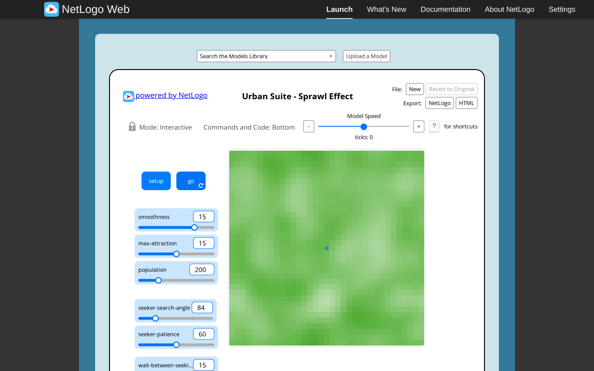 | 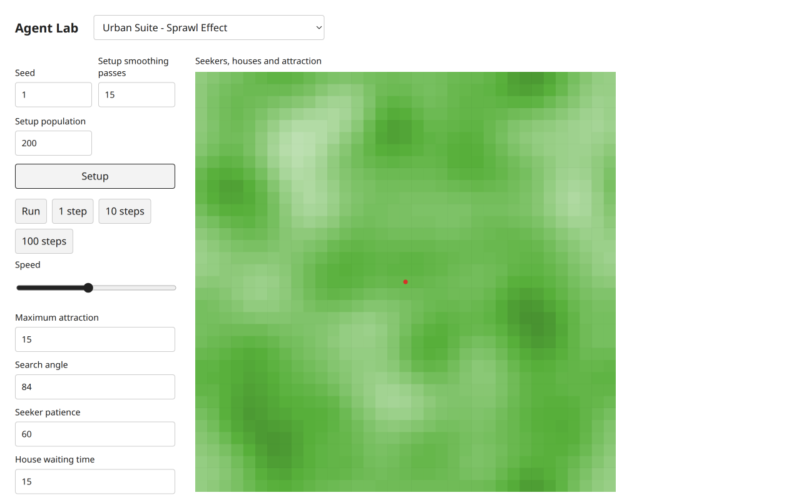 |
| Progress |  |  |

[Mobile light](urban-landscape-target-evidence/sprawl-mobile-light.png),[mobile dark](urban-landscape-target-evidence/sprawl-mobile-dark.png),[desktop dark](urban-landscape-target-evidence/sprawl-desktop-dark.png).

## Economic Disparity

Pinned source SHA256 `2ac2e2cf4385c7431daa57b81bc8280c62b40e305cd3acb4208df92a9783e940`.

Both defaults:locationTests15,residentsPerJob100,births5/5,priorities0/0,maxJobs10,deathRate4,89²hard world,qualityview,5rich/5poor/1job,counter0. Target seed1 initial medians3.73676/3.58924. Original14 reached27rich/27poor/2jobs,counter30; final target11 reached24/24/2,counter0,medians10.975334750883977/10.169900722761108. The longer target Run/Pause reached314,327/327/9,counter60,medians6.4031242374328485/9.433981132056603. Different sample placement, RNG and horizons are explicit.

All five view actions—Price,Distance,Poor utility,Rich utility,Quality—were clicked at314. Pressed state/view label changed correctly; tick,populations,counter and travel medians stayed fixed. Source utility/view cache timing belongs to the headless actions; no equations are calculated by adapters. Source and target chart **median actual nearest-job distances**, despite the original Info saying average; the cached sdDistance+0.01 is not travel distance. Empty-class medians display unavailable rather than fabricated zero; no empty-class browser run was claimed.

LocationTests0→Setup→one step reached tick1,10rich/10poor/1job,counter10. Population creation continued, agreeing with native helper STOP scope; detailed cumulative land impacts are covered by native fixtures/headless tests, not inferred solely from these counts. All eight live parameters were then edited to tests15,residentsPerJob10,poor/rich births1/2,priorities−.5/+.5,maxJobs5,deathRate0. Setup plus four single-step clicks produced13rich/9poor/2jobs,counter0—the same deterministic counts as the recorded native setting test—with target medians6.70820/4.63001. Canvas/ArrowRight inspection exposed an actual rich agent and utility. An attempted deathRate16 edit left monitors/tick unchanged; no custom inline error appeared in the inspected status, so no inline-error acceptance is claimed. The valid0 value was restored.

| State | Executed original | Executed target |
| --- | --- | --- |
| Setup |  | 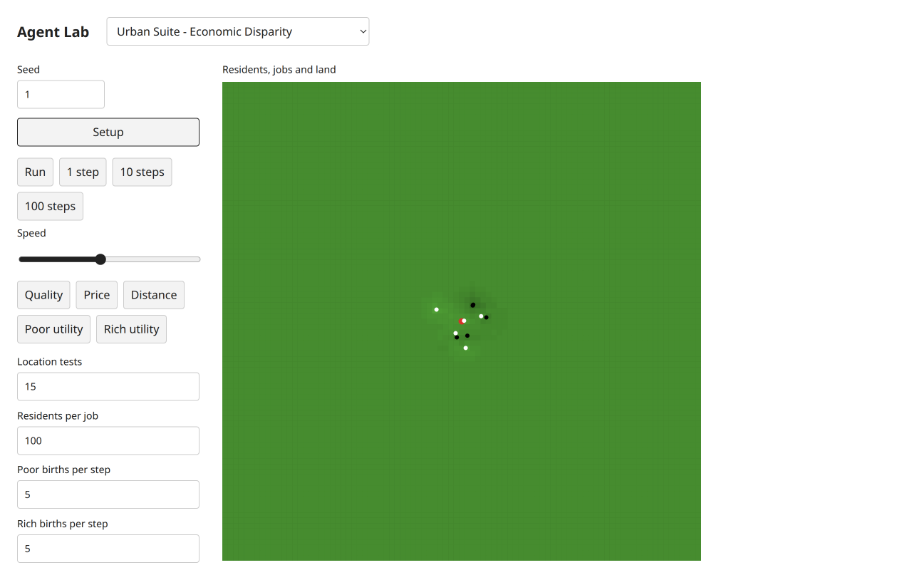 |
| Progress | 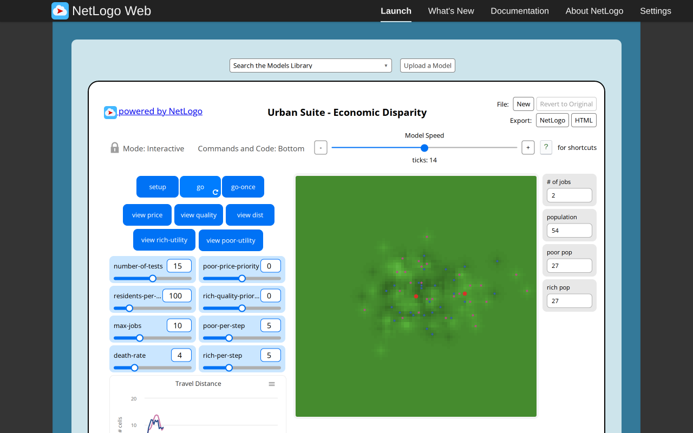 | 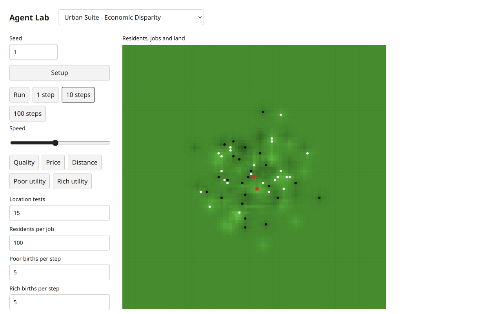 |

[Mobile light](urban-landscape-target-evidence/economic-mobile-light.png),[mobile dark](urban-landscape-target-evidence/economic-mobile-dark.png),[desktop dark](urban-landscape-target-evidence/economic-desktop-dark.png).

## Design QA, diagnostics and limits

`frontend-design` and subsequent `web-design-guidelines` were applied. Latest Vercel rules were fetched from the official raw GitHub command.md on2026-11-06. The four adapters reuse existing labeled native controls, disclosures, buttons, focusable canvas, shared plots and numerical palette. They introduce no private widgets, model logic, domain state, icons or dependencies. TypeScript projections format public reports only. Desktop/mobile light/dark screenshots were visually inspected.390px checks returned no document horizontal overflow. Charts and controls remain within their containers; source attribution remains accessible through Model info. Long monitor labels were shortened. The coordinator then changed the shared <=480px monitor layout from three pairs to two; all four mobile light/dark checks and screenshots were repeated against that CSS. Source and shared UI hashes are retained in observations.json.

Two observations remain distinct from model correctness:

- **Monitor layout corrected by coordinator:** the earlier three-pair layout broke labels such as Counter and Rich median. Coordinator-owned shared CSS now uses two pairs below480px while retaining the inspector layout. Final four-model light/dark views show readable labels and no horizontal overflow. The longer negative Structure2 mean may wrap across two lines at the5rem value cap; its exact chart output remains separately available. This is an explicit narrow-screen limit, not a claim of comprehensive accessibility certification.
- **Immediate resize raster anomaly:** initial screenshots taken immediately after theme changes or desktop-dark→mobile resize showed missing activity raster/activation marks/agent glyphs while scientific monitors stayed intact. Seven exact anomalous PNGs remain:three `*-immediate-resize-anomaly.png` files and four `*-immediate-theme-anomaly.png` files. Two animation frames alone did not repair one capture; subsequent Step/resize did. Later controlled same-state theme and size changes preserved Economic tick12 canvas red407/white2208/black2169pixels. The cause is unresolved; a persistent state-loss defect was not established. Final desktop-dark/mobile screenshots follow read-only canvas `getImageData` readback after appearance/viewport changes, and show complete rasters/marks/glyphs. This readback changes no scientific state; it may flush a pending compositor capture. The coordinator independently verified identical complete Structure1 tick10 canvasRGBA SHA256 `854af5b7fa7fda0a026a89daf181bb0ad1e8bc2e0417de84b1410ffa69714946` before and after dark appearance. No shared canvas patch was made, and no scientific state-loss defect was established. Do not silently treat the anomalous images as successful evidence or claim the shared renderer was fixed.

Initial localhost3112 failed with404 for stale hashed app/ui chunks during concurrent integration. No model runtime ran successfully there. A fresh3113process built all30entries and recovered. The preview console retained four historical3112resource404entries; no new JavaScript console errors or failed3113requests appeared during actual four-target runs. No target model runtime errors occurred in the normal/control paths. The zero-field runtime error belongs to the separately executed original fixture and headless target test, not these browser clicks.

Executed by this UI follow-up: four-project `bun run typecheck` passed before and after label changes; final PNG/source/model/UI SHA256 manifests validated; whitespace check passed. Headless tests,full build and packed consumer were not rerun by this UI-only worker; coordinator integration checks are separate. Scientific research status is unchanged. Required independent Argon approval remains quota-blocked, so this report is implementation/browser evidence and author QA, **not final independent acceptance**.27targetPNGs are retained:20normal setup/progress/theme/mobile views and7explicit anomalies. Two successively owned tabs were used for initial and post-fix checks;all source/user/coordinator tabs were untouched. Both owned tabs and worker-owned3113server were closed afterward. No Git mutations were performed by this worker.
