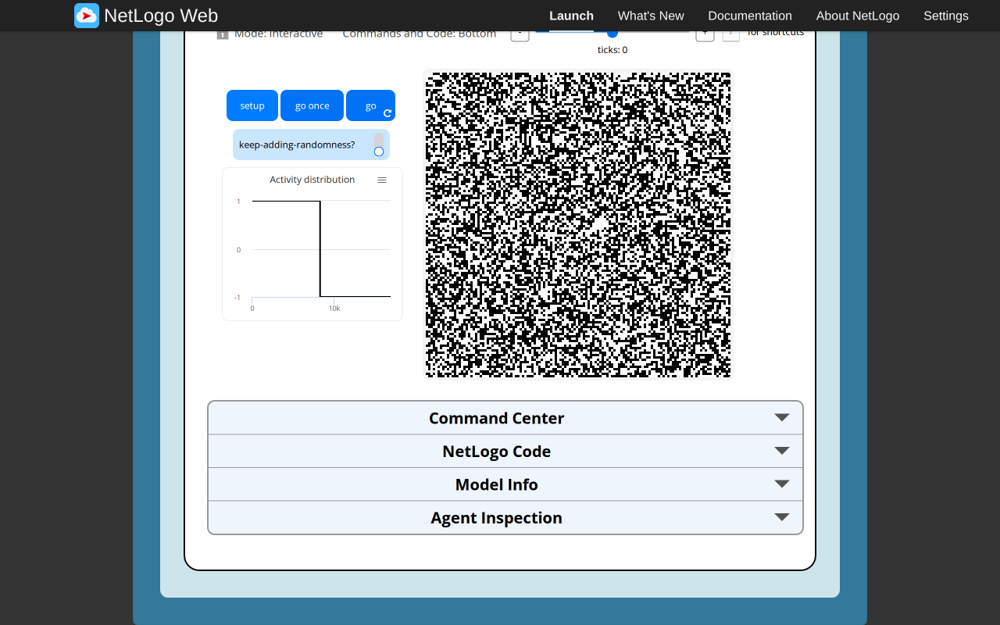
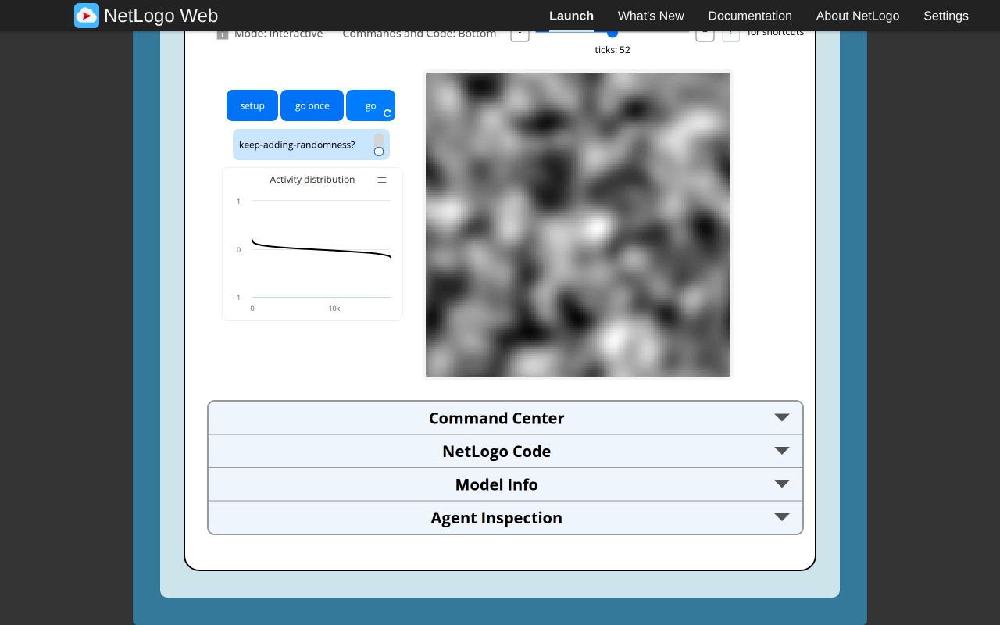
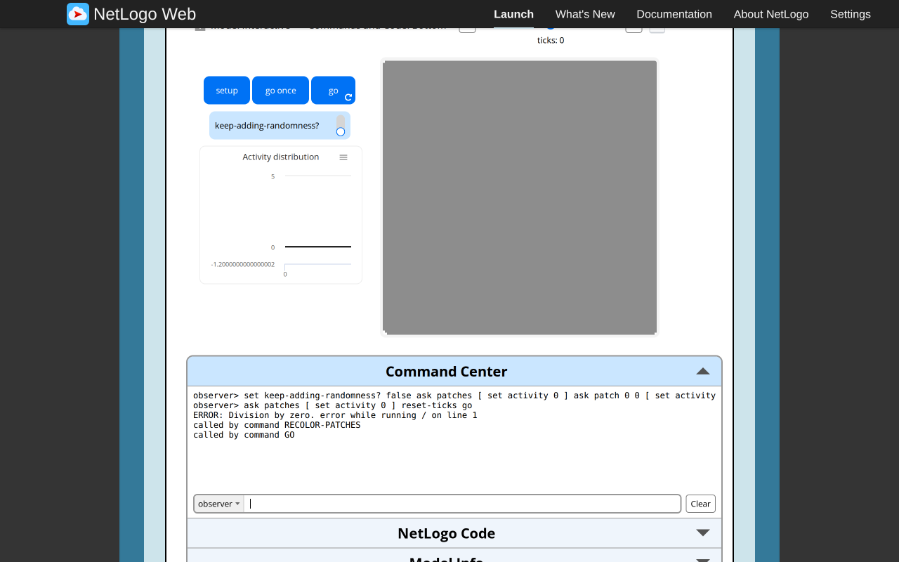
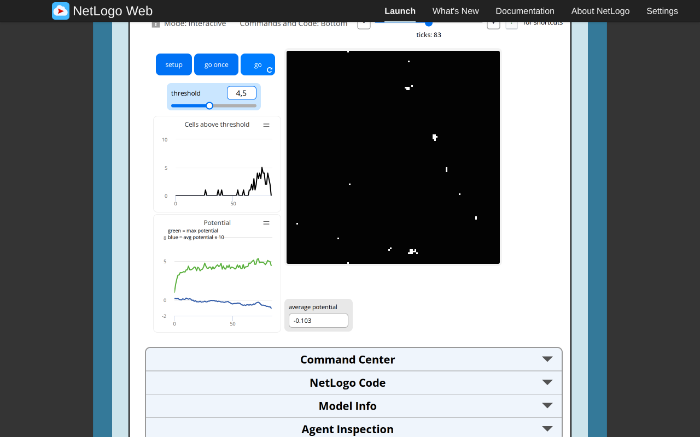
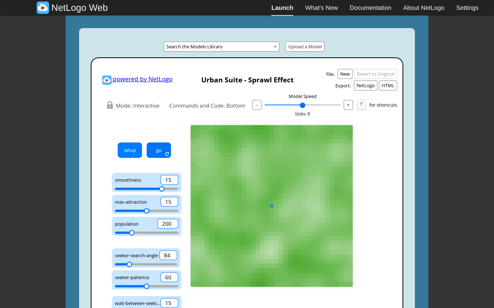
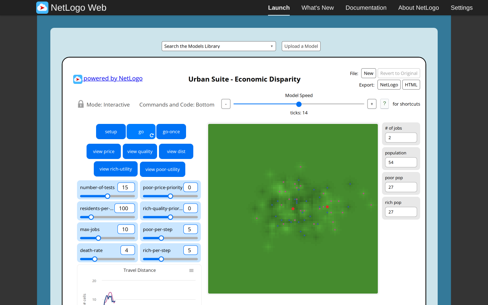

# Remaining four Urban Suite models: executed original-browser baselines

Executed2026-11-06 in the configured T3 Chromium preview,1280×800 CSS pixels. Scope is **original NetLogo only** for the four canonical selected paths below. Target runtime, paired target screenshots, target mobile/theme checks and independent technical approval remain separate coordinator gates. Tijuana was not opened. No literature research, Git/ledger mutation or runtime/UI change was performed.

All four identify NetLogo7.0.4 and match pinned Galapagos revision `90be931773fcf499049247a8aaa1aecbe003654c`. For each actual loaded iframe, `session.nlogoSource.nlogo` was UTF-8 hashed with crypto.subtle and matched the unchanged archive. Complete citations/notices remain under each experiment folder:Structure1/2 cite Wilensky2007;Sprawl/Economic cite Felsen and Wilensky2007;Copyright2007 Uri Wilensky,CC BY-NC-SA3.0. Read [source contracts](selected-urban-remaining-contracts.md) for full source/API context. Native seed was unspecified for normal runs;only the declared Sprawl directional fixture used random-seed1. No cross-engine seed/trajectory or scientific statistical-equivalence claim is made.

| Canonical suffix under `Curricular Models/Urban Suite/Urban Suite - ` | Loaded bytes | Actual source SHA-256 |
| --- | ---: | --- |
| Structure from Randomness 1 |40383|8a5573912ba6d29d9101b9d1fbfbbc7cf5629ad0f799d370cfb39cb9cae1944e|
| Structure from Randomness 2 |42440|9a83bc7a5ff539f3a02fe8a20c5d8cb5d3366bb72993519db5a0a31f51be0839|
| Sprawl Effect |48581|47a13701ed91c04aad70f39ad79d41709d01e27b5143328fe319f369e9ef0d3b|
| Economic Disparity |63762|2ac2e2cf4385c7431daa57b81bc8280c62b40e305cd3acb4208df92a9783e940|

The literal canonical names contain spaces before their final1/2; identities and launcher paths are retained exactly in the selected catalog. Scientific dossiers already exist;this task did not repeat their research.

## Structure from Randomness1

[Official launcher](https://www.netlogoweb.org/launch#https://www.netlogoweb.org/assets/modelslib/Curricular%20Models/Urban%20Suite/Urban%20Suite%20-%20Structure%20from%20Randomness%201.nlogox). Native Setup uses130² toroidal cells,initial activities±1 and noiseoff. Observed setup total−338,max-absolute1. Native go once then go/pause reached actual **tick52**,total−337.9999999999987,max-absolute0.18153589126705744. The retained horizon is52,not the lower sampling target used by automation. Total conservation is within floating rounding;grayscale rescaling is presentation,not normalization of scientific values. The Activity distribution plot ranks current activities descending.

| Setup | Progress, tick52 |
| --- | --- |
|  |  |

Switching native keep-adding-randomness on and clicking go once reached53,total−481.9999999999986,max-absolute1.1781625312652941. The total changed by approximately−144,consistent with the signed per-cell additions in this realization;no distributional validation is claimed.

Explicit **native Command Center fixtures**,separate from normal setup:

- Noiseoff,all activities0 except source corner(0,0)=5,reset-ticks/go:tick1,total5,exactly five activity1 cells at(0,0),(1,0),(129,0),(0,1),(0,129). This verifies staged self-plus-four-faces averaging and toroidal wrap.
- All activities0,reset-ticks/go:activities committed0,total0,but recoloring raised **Division by zero**,reported through `/`→RECOLOR-PATCHES→GO in the native Command Center. Tick remained0. The source has no silent zero-scale guard;earlier phase effects are not rolled back. Prior colors need not represent a successful new recolor after this failure.

Source random ask order may consume RNG even when averaging/noiseoff requires no scientific draw;this report does not claim unchanged source RNG for those display/activation asks. A target omission of order-independent shuffles must remain explicit.

## Structure from Randomness2

[Official launcher](https://www.netlogoweb.org/launch#https://www.netlogoweb.org/assets/modelslib/Curricular%20Models/Urban%20Suite/Urban%20Suite%20-%20Structure%20from%20Randomness%202.nlogox). Native Setup uses130² toroidal cells,threshold4.5,initial potentials±1,and all-black display. Observed tick0:total338,mean0.02,max1,current-above0,white0. Native go once then go/pause reached **tick83**:total−1737.9999999999905,mean−0.10284023668638997,max4.427691399526066,current-above0,**white39**. White is persistent activation history,not a redraw of the current threshold predicate.

| Setup | Progress, tick83 |
| --- | --- |
|  |  |

Actual Highcharts last points at83 were current-above0,max-potential4.427691399526066 and avg-potential×10=−1.028402366863901. The raw/monitor mean is approximately−0.10284023668638997. The two quantities differ by the intentional factor10. Original widget update code also explicitly plots the current predicate count and mean×10.

Native live threshold0 while paused at83 immediately changed the queried current-above count to7935 while **white stayed39**,without a tick. Native Setup with threshold0 produced8457current-above cells but white0:setup does not activate initial positives. Explicit Command Center fixtures then showed:

- Constant potential5/threshold5:strict count0,mean5,mean×10=50;the read-only show output was `[0 5 50]`.
- Constant potential12/threshold10,reset-ticks/go:tick1,current-above16900,white16900.
- Replace potential with0,go:tick2,current-above0,max1,white**still16900**.

Potential replacement in these injected states does not erase activation history. Native threshold4.5 and Setup were restored afterward,tick0/white0.

## Sprawl Effect

[Official launcher](https://www.netlogoweb.org/launch#https://www.netlogoweb.org/assets/modelslib/Curricular%20Models/Urban%20Suite/Urban%20Suite%20-%20Sprawl%20Effect.nlogox). Native defaults:smoothness15,max-attraction15,search-angle84,population200,patience60,wait15;35² torus. Setup tick0:200seekers,cached build-threshold7,total attraction8685.999999999995,origin attraction6.769957631296986. Native go/pause reached **tick21**:149houses/51seekers,total8732.151469534785,origin3.479999999999996. Agent positions/headings and shared cell values were read from canonical source state.

| Setup | Progress, tick21 |
| --- | --- |
|  |  |

Changing native max-attraction15→0 while paused21 left cached build-threshold7. Native Setup at0 succeeded:200seekers,all attraction0,build-threshold0. One declared Command Center `go` then produced tick1,200houses,each stay-counter14,origin attraction0. New houses participate in the same tick's sequential house phase;the<= cap test and later reset explain alternating increments/resets when many houses share a zero-cap cell.

### Actual integer-random binding

Native read-only show queries observed random0→five zeros,random0.1→only0,random1.1→0/1,random2.1→0/1/2,random−2.1→−2/−1/0. Direct read-only inspection of the loaded random primitive confirms:nonnegative fractional bound is ceiled;negative bound is floored;rounded0 returns0 without invoking the RNG;other bounds call a signed bounded integer draw. No engine implementation is copied into this evidence.

Five random0 calls left exported RNG SHA unchanged `cb8c5f4ee79925ef79d18b80337611a3f454e4e0793902493f4779e6acc5d4f2`. Five random0.1 calls also returned only0 but **changed** RNG SHA `79f369b00cf53089c443394511afcc2b43964da0c6cd8c0630886da5a5ff7f41`→`df4dbfd4f82b38d468a0651e80ca5a7ca3076fa1b27f76aa9977af12ed183cf1`. Thus attraction0 and a positive attraction below1 differ in random consumption despite returning the same integer0.

### Phase/counter/direction fixtures

All were explicit Command Center states,not normal source sliders;exact commands are retained:

- Zero attraction,build-threshold7,max15,wait5,single patience0 seeker:one go→house at the same position,stay4,field attraction0.05. New house acts immediately.
- Single patience1 seeker at(0,0),heading0:one go→seeker at(0,0.5),patience0,destination increment0.01. Next go→**same who201** house at(0,0.5),stay4,total0.060000000000000005. Building happens next go after patience reaches0.
- Set that house stay1,go→same identity becomes seeker,patience1,position unchanged,total0.11000000000000001. It does not enter the earlier seeker phase again that tick.
- Ahead attraction0,right/left3,search-angle90,patience1,random-seed1:one go turned **left19degrees**,heading341,position(−0.16278407722857877,0.47275928779965826),patience0. Equal superior right/left follows the left branch;it does not directly face a selected field or turn a fixed90degrees.

Additional native controls were set to smoothness1,max15,angle90,population1,patience0,wait5;Setup plus one Command Center go produced one house at tick1. Finally native defaults were restored and Setup returned200seekers/tick0 with go off.

## Economic Disparity

[Official launcher](https://www.netlogoweb.org/launch#https://www.netlogoweb.org/assets/modelslib/Curricular%20Models/Urban%20Suite/Urban%20Suite%20-%20Economic%20Disparity.nlogox). Native defaults:number-of-tests15,residents-per-job100,poor/rich-per-step5/5,priorities0/0,max-jobs10,death-rate4;89² hard world. Setup tick0 had1job,5rich/5poor,counter0,quality view,price/quality range31.32386826718243..49.156730108400964. Setup residents already modify the initially uniform40 field. Origin sd-dist cache was0.

Native go-once then go/pause reached **tick14**:2jobs,27rich/27poor,counter30,price/quality range28.736756725731485..53.76768959815023,origin sd-dist0.01. That cache gains the0.01offset after job topology refresh;it is not the exact physical travel distance.

| Setup | Progress, tick14 |
| --- | --- |
|  |  |

Travel Distance plot widgets explicitly execute **median** nearest actual job distances for each class,contrary to Info's average wording. A native Command Center median query in the colocated fixture below returned `[0 0]`;it did not read sd-dist or substitute a mean.

### Empty candidate STOP, counters and job cap

Native number-of-tests0,Setup/go-once reached tick1,counter10. All10newborns stayed at(0,0),utility0. The observer and population creation continued;STOP did not abort the whole go.

To resolve caller continuation exactly,a declared Command Center fixture removed residents,set every price/quality40 and counter0 while retaining the job,with tests0 and poor/rich rates5/5. Native go-once reached tick2,5poor/5rich,counter10,origin price=quality**38.914033536687384**. Therefore STOP exits evaluate-*,but the caller's cumulative decrease/raise shell procedures still execute at the unmoved newborn origin. A target early return that skips these impacts would change the baseline.

Another fixture created five jobs with source who31..35,set max-jobs5,counter100,residents-per-job100 and birth rates0. Native go-once reached tick3,counter**100**,jobs4 with who32..35,origin cache10.01. Strict counter comparison is `>`,not`>=`;the cap check removes **one oldest** job at`>=max`,even without a new job. Then max20/counter101 and native go-once reached4,counter0,jobs5,including new who36 at(−40,21),utility0. With tests0 the spawned job remained at its spawn point;empty evaluation did not cancel its creation or the cache refresh/counter reset.

### Views and live controls

Every native view button was exercised:price,distance,rich-utility,poor-utility,quality. Tick stayed0,and SHA-256 of every field's `[price,quality,sd-dist]` triple remained `8cbccb925756557a29d5fa247bfb0cccecb5b7cc22f5cf6b91803d4df98fb086`. Utility-view globals were refreshed (for this run:poor min/max0.03461386316570532/0.24519660084428835,rich0.6417929462050902/407.83599632159996);view mode/colors and these report caches change,but scientific land quantities do not. No assertion of unchanged source RNG is made for random color asks.

An additional native-parameter run used poor/rich rates1/2,priorities−0.5/+0.5,residents-per-job10,max-jobs5,death0,tests15. Four go-once clicks produced tick4,9poor/13rich,2jobs,counter0,origin cache0.01. These are recorded setting effects,not a stochastic trajectory-equivalence study.

## Artifacts, diagnostics and remaining work

[Machine-readable observations and exact fixture commands](urban-remaining-four-reference-evidence/observations.json),[PNG SHA-256 manifest](urban-remaining-four-reference-evidence/SHA256SUMS.json). Nine targeted PNGs were retained and visually inspected:eight normal setup/progress views plus the actual Structure1 error. Browser diagnostics showed no JavaScript console errors or failed network requests in these sessions. The injected Structure1 zero-field division is an explicit **model runtime error** in native Command Center output,not a hidden automation failure. No browser fallback or sandbox change was needed.

Read-only page evaluation inspected state,plots and primitive bindings;all intentional model mutations used native controls or explicitly recorded native Command Center fixtures. No target methods/internal implementation were substituted. Numeric fixture assertions,JSON parsing,all four actual loaded-source/archive hashes and all image/hash files were checked locally. No runtime tests,typecheck/build or independent review were executed by this browser-only task.

One owned tab was reused for these four originals,previous instances unloaded on navigation;the final Sprawl instance was reset to defaults/tick0 and the owned tab closed. No other agent/user tab was manipulated. Every model still requires its own target implementation,paired comparison,appropriate target mobile/themes and independent approval. The zero-candidate branch was exercised deterministically with tests0;this is not an exhaustive crowded-world sampling study or a scientific validation claim.
