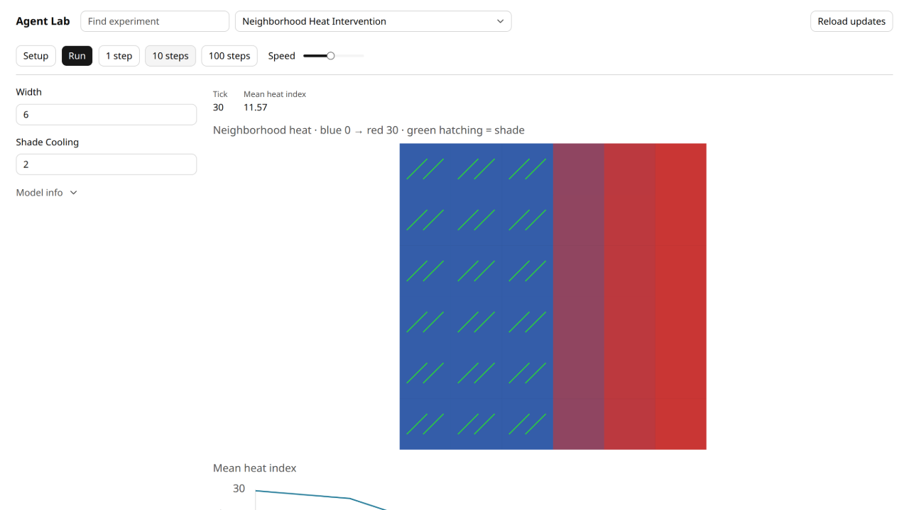
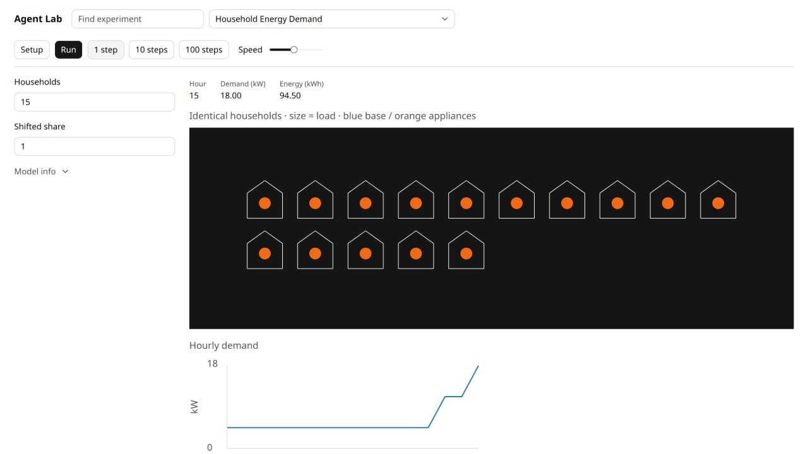
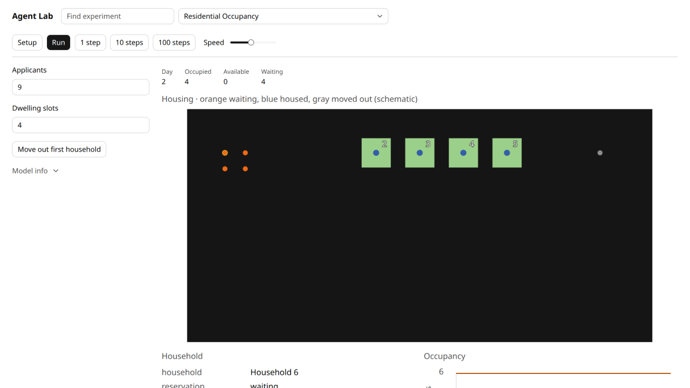
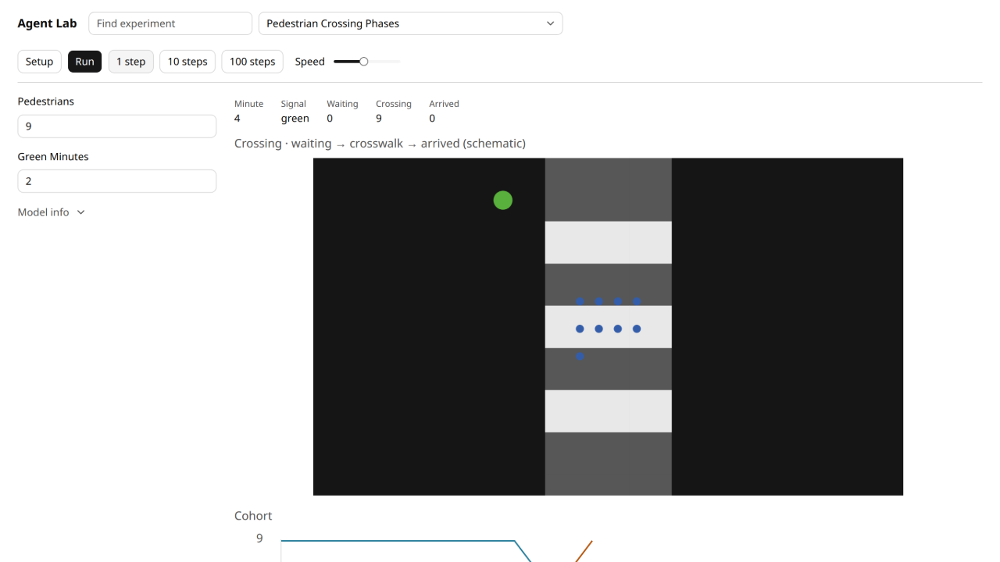
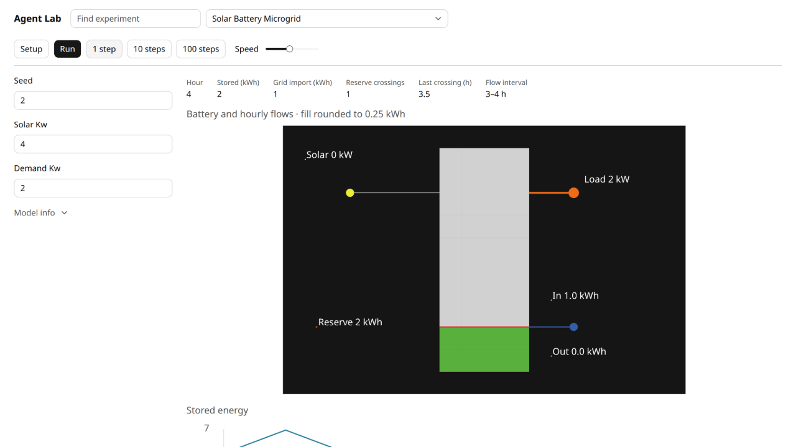
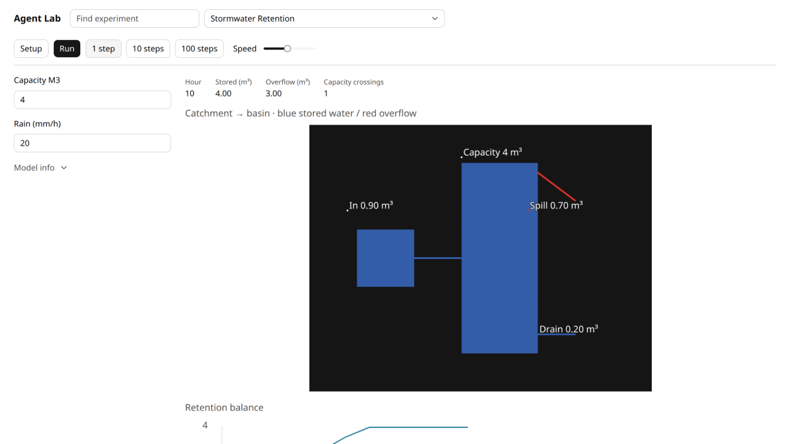
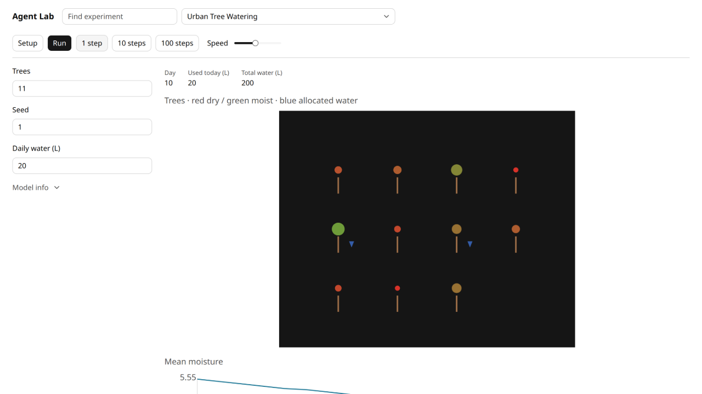
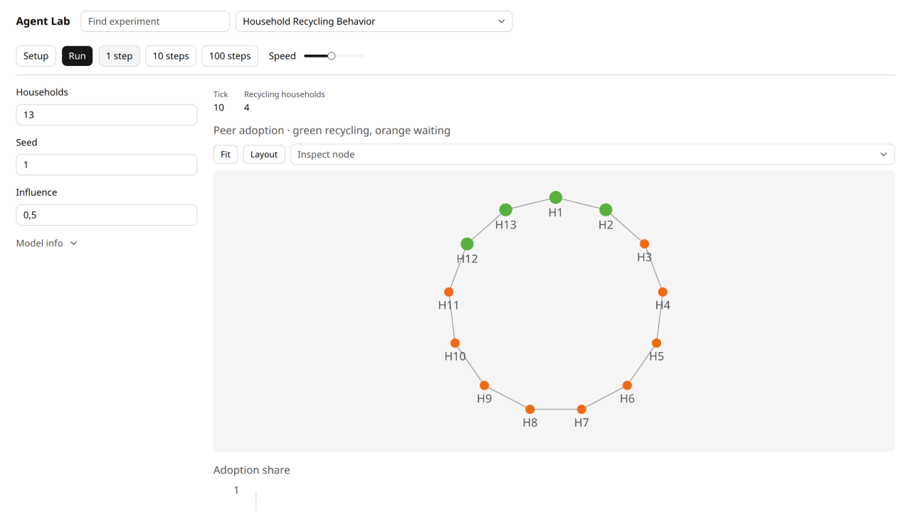
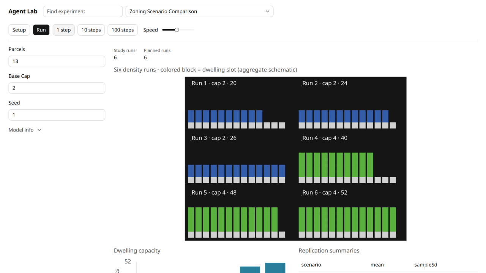
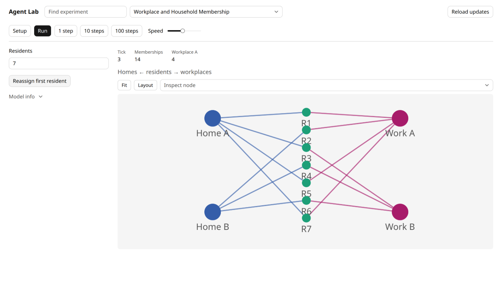

# Ten visible city mechanisms

Each corrected example now begins with a model view. Tables and time-series charts support that view; they do not substitute for it. These are the existing spatial/network primitives used by Fire, Traffic2Lanes and PreferentialAttachment, with public scientific palette mappings and readable ordinary projections. No reference model, shared component, host or CSS was changed.

All ten model trajectories retain every original observation key and ID exactly against `4427227` at steps 0/1/3/10/30/130. New coordinates are actual Grid coordinates or clearly described view-only schematics; no random presentation positions become domain state. Complete typecheck, 43 focused tests / 403 assertions, 14 frozen public scripts and the explicit Svelte build pass. The browser pass and independent image review approved42final states. The [fresh Gemini high visual-transfer review](https://github.com/dweigend/city-library/blob/23693e90e199512faf68a04c9a2198b9eb50463b/docs/mesa-expansion/visual-gemini-final-review.md) explicitly approved baseline `4758c35` for the corrected requirement.

Below are exact excerpts from the current ui.ts files and actual final desktop-light screenshots. Full desktop/narrow light/dark originals, hashes and extra mechanism states are in [the 42-image manifest](visual-evidence/manifest.json). [Browser interactions](visual-browser-verification.md), [independent images](https://github.com/dweigend/city-library/blob/23693e90e199512faf68a04c9a2198b9eb50463b/docs/mesa-expansion/visual-image-review.md), [behavior preservation](visual-behavior-verification.md) and the three refactor reports retain their separate scopes.

## Neighborhood heat

Actual Grid fields, fixed0–30 heat-index colors and separate shade hatching.

[model.ts](https://github.com/dweigend/city-library/blob/23693e90e199512faf68a04c9a2198b9eb50463b/experiments/neighborhood-heat-intervention/model.ts) · [ui.ts](https://github.com/dweigend/city-library/blob/23693e90e199512faf68a04c9a2198b9eb50463b/experiments/neighborhood-heat-intervention/ui.ts)

Excerpt:

```ts
export function heatMap(state: Observation<typeof model>): SpatialData {
  return {
    width: state.width,
    height: state.height,
    cells: state.fields.map(field => ({ id: field.id, x: field.x, y: field.y,
      color: heatColor(field.heatIndex) })),
    // Hatching depicts the existing shade property; it is neither a resident nor new domain geometry.
    segments: state.fields.filter(field => field.shaded).flatMap(field => [-0.16, 0.16].map(offset => ({
      from: { x: field.x - 0.2 + offset, y: field.y - 0.2 },
```



[Narrow dark](visual-evidence/neighborhood-heat-intervention-narrow-dark.png)

## Household energy

Identical household outlines show current base/appliance load through size and color.

[model.ts](https://github.com/dweigend/city-library/blob/23693e90e199512faf68a04c9a2198b9eb50463b/experiments/household-energy-demand/model.ts) · [ui.ts](https://github.com/dweigend/city-library/blob/23693e90e199512faf68a04c9a2198b9eb50463b/experiments/household-energy-demand/ui.ts)

Excerpt:

```ts
function householdsData(state: State): SpatialData {
  // A display arrangement of identical aggregate loads, not physical house locations.
  const columns = Math.min(10, state.parameters.households);
  const rows = Math.ceil(state.parameters.households / columns);
  const loadFraction = (state.householdDemandKw - state.householdBaseKw) / (state.householdPeakKw - state.householdBaseKw);
  const homes = Array.from({ length: state.parameters.households }, (_, index) => ({
    id: `household:${index}`, x: index % columns - (columns - 1) / 2,
    y: (rows - 1) / 2 - Math.floor(index / columns),
    color: netLogoColor(loadFraction > 0 ? 25 : 105), size: 7 + 13 * loadFraction,
```



[Narrow dark](visual-evidence/household-energy-demand-narrow-dark.png)

## Residential occupancy

Resource-owned grants occupy dwelling slots; waiters and moved-out households remain distinct.

[model.ts](https://github.com/dweigend/city-library/blob/23693e90e199512faf68a04c9a2198b9eb50463b/experiments/residential-occupancy/model.ts) · [ui.ts](https://github.com/dweigend/city-library/blob/23693e90e199512faf68a04c9a2198b9eb50463b/experiments/residential-occupancy/ui.ts)

Excerpt:

```ts
export function housingData(state: HousingObservation): SpatialData {
  const rows = Math.ceil(Math.max(state.parameters.slots, state.households.length) / 5);
  const height = Math.max(8, rows * 1.5 + 2);
  const slotPosition = (index: number) => ({ x: -1.5 + (index % 5) * 1.5, y: height / 2 - 1.5 - Math.floor(index / 5) * 1.5 });
  const cells = Array.from({ length: state.parameters.slots }, (_, index) => ({
    id: `view:slot:${index}`, ...slotPosition(index), color: netLogoColor(index < state.occupied ? 57 : 8),
  }));
  const statusCounts = { waiting: 0, granted: 0, released: 0, cancelled: 0 };
  const agents = state.households.map((household, index) => {
```



[Narrow dark](visual-evidence/residential-occupancy-narrow-dark.png)

## Pedestrian crossing

Road, signal and cohort positions expose waiting, crossing and arrived stages.

[model.ts](https://github.com/dweigend/city-library/blob/23693e90e199512faf68a04c9a2198b9eb50463b/experiments/pedestrian-crossing-phases/model.ts) · [ui.ts](https://github.com/dweigend/city-library/blob/23693e90e199512faf68a04c9a2198b9eb50463b/experiments/pedestrian-crossing-phases/ui.ts)

Excerpt:

```ts
export function crossingData(state: CrossingObservation): SpatialData {
  const height = Math.max(8, Math.ceil(state.people.length / 4) * 0.65 + 3);
  const cells = [];
  for (let y = -Math.floor(height / 2); y <= Math.floor(height / 2); y += 1) {
    for (const x of [-1, 0, 1]) cells.push({ id: `view:road:${x}:${y}`, x, y, color: netLogoColor(3) });
  }
  for (const x of [-1, 0, 1]) for (const y of [-2, 0, 2])
    cells.push({ id: `view:stripe:${x}:${y}`, x, y, color: netLogoColor(9) });
  const centers = { waiting: -4.5, crossing: 0, arrived: 4.5 };
```



[Narrow dark](visual-evidence/pedestrian-crossing-phases-narrow-dark.png)

## Solar battery

Rounded energy blocks, reserve line and explicitly labelled completed-interval flows.

[model.ts](https://github.com/dweigend/city-library/blob/23693e90e199512faf68a04c9a2198b9eb50463b/experiments/solar-battery-microgrid/model.ts) · [ui.ts](https://github.com/dweigend/city-library/blob/23693e90e199512faf68a04c9a2198b9eb50463b/experiments/solar-battery-microgrid/ui.ts)

Excerpt:

```ts
function microgridData(state: State): SpatialData {
  // Fixed diagram coordinates express connections and a storage gauge, not geography.
  const reserveY = -5 + state.reserveKwh;
  return {
    width: 18, height: 12, showLabels: true,
    cells: Array.from({ length: 40 }, (_, index) => ({
      id: `battery-block:${index}`, x: index % 4 - 1.5, y: Math.floor(index / 4) - 4.5,
      color: netLogoColor(index < Math.round(state.energyKwh / state.capacityKwh * 40) ? 55 : 8),
    })),
```



[Narrow dark](visual-evidence/solar-battery-microgrid-narrow-dark.png)

## Stormwater retention

Real catchment Grid feeds a schematic volume gauge, drain and red overflow.

[model.ts](https://github.com/dweigend/city-library/blob/23693e90e199512faf68a04c9a2198b9eb50463b/experiments/stormwater-retention/model.ts) · [ui.ts](https://github.com/dweigend/city-library/blob/23693e90e199512faf68a04c9a2198b9eb50463b/experiments/stormwater-retention/ui.ts)

Excerpt:

```ts
function retentionData(state: State): SpatialData {
  const storedBlocks = Math.round(state.storedM3 / state.parameters.capacityM3 * 40);
  // The true catchment grid is offset beside a normalized volume gauge; basin dimensions are schematic.
  return {
    width: 18, height: 14, showLabels: true,
    cells: [
      ...state.catchment.fields.map(field => ({ id: field.id, x: field.x - 5, y: field.y,
        color: netLogoColor(state.parameters.rainMmPerHour > 0 ? 105 : 8) })),
      ...Array.from({ length: 40 }, (_, index) => ({ id: `basin-block:${index}`,
```



[Narrow dark](visual-evidence/stormwater-retention-narrow-dark.png)

## Tree watering

Tree crown size and fixed-domain color show moisture; blue marks show actual water allocation.

[model.ts](https://github.com/dweigend/city-library/blob/23693e90e199512faf68a04c9a2198b9eb50463b/experiments/urban-tree-watering/model.ts) · [ui.ts](https://github.com/dweigend/city-library/blob/23693e90e199512faf68a04c9a2198b9eb50463b/experiments/urban-tree-watering/ui.ts)

Excerpt:

```ts
export function treesData(state: State): SpatialData {
  // Planting rows are a stable display layout; the model has no geographic tree positions.
  const columns = Math.ceil(Math.sqrt(state.trees.length));
  const rows = Math.ceil(state.trees.length / columns);
  const trees = state.trees.map((tree, index) => ({ ...tree,
    x: (index % columns - (columns - 1) / 2) * 2,
    y: ((rows - 1) / 2 - Math.floor(index / columns)) * 2,
  }));
  return {
```



[Narrow dark](visual-evidence/urban-tree-watering-narrow-dark.png)

## Recycling

Actual ring edges and fixed view-only positions show green adoption spreading among orange households.

[model.ts](https://github.com/dweigend/city-library/blob/23693e90e199512faf68a04c9a2198b9eb50463b/experiments/household-recycling-behavior/model.ts) · [ui.ts](https://github.com/dweigend/city-library/blob/23693e90e199512faf68a04c9a2198b9eb50463b/experiments/household-recycling-behavior/ui.ts)

Excerpt:

```ts
export function recyclingNodes(state: Observation<typeof model>): readonly NetworkNode[] {
  return state.nodes.map((node, index) => {
    const angle = 2 * Math.PI * index / state.nodes.length - Math.PI / 2;
    return { id: node.id, label: `H${index + 1}`, color: netLogoColor(node.recycling ? 55 : 25), size: node.recycling ? 18 : 13,
      position: { x: Math.cos(angle) * 150, y: Math.sin(angle) * 150 } };
  });
}
```



[Narrow dark](visual-evidence/household-recycling-behavior-narrow-dark.png)

## Zoning scenarios

Actual planned capacities and completed outcomes form aggregate dwelling-slot panels.

[model.ts](https://github.com/dweigend/city-library/blob/23693e90e199512faf68a04c9a2198b9eb50463b/experiments/zoning-scenario-comparison/model.ts) · [ui.ts](https://github.com/dweigend/city-library/blob/23693e90e199512faf68a04c9a2198b9eb50463b/experiments/zoning-scenario-comparison/ui.ts)

Excerpt:

```ts
export function zoningData(state: ZoningObservation): SpatialData {
  const panelWidth = state.parameters.parcels * 1.25 + 2;
  const captionInset = 1.5;
  const panelHeight = Math.max(...state.runPlan.map(run => run.cap)) + 5;
  const width = panelWidth * 2;
  const height = panelHeight * 3;
  const cells = [];
  const agents = [];
  const firstScenario = state.runPlan[0]?.scenarioId;
```



[Narrow dark](visual-evidence/zoning-scenario-comparison-narrow-dark.png)

## Household/workplace membership

Actual membership edges join explicit home, resident and workplace columns.

[model.ts](https://github.com/dweigend/city-library/blob/23693e90e199512faf68a04c9a2198b9eb50463b/experiments/workplace-household-membership/model.ts) · [ui.ts](https://github.com/dweigend/city-library/blob/23693e90e199512faf68a04c9a2198b9eb50463b/experiments/workplace-household-membership/ui.ts)

Excerpt:

```ts
export function membershipNodes(state: Observation<typeof model>): readonly NetworkNode[] {
  return state.nodes.map(node => {
    const residentIndex = state.people.findIndex(person => person.id === node.id);
    if (residentIndex >= 0) return { id: node.id, label: `R${residentIndex + 1}`, color: netLogoColor(75), size: 16,
      position: { x: 0, y: (residentIndex - (state.people.length - 1) / 2) * 32 } };
    const household = node.kind === "household";
    const first = node.id.endsWith("-a");
    return { id: node.id, label: `${household ? "Home" : "Work"} ${first ? "A" : "B"}`,
      color: netLogoColor(household ? 105 : 125), size: 30,
```



[Narrow dark](visual-evidence/workplace-household-membership-narrow-dark.png)

## Verification limits

The images and ordinary Chrome flows demonstrate the corrected visual teaching mechanisms. They are not a claim of scientific forecasting, complete accessibility, all browser-engine support, full NetLogo compatibility or general continuation. The existing Vite chunk-size advisory remains. Prior table-first image reports are historical evidence, superseded for this visual requirement by the new 42-image review.
