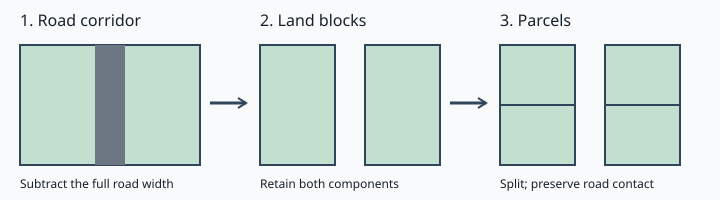
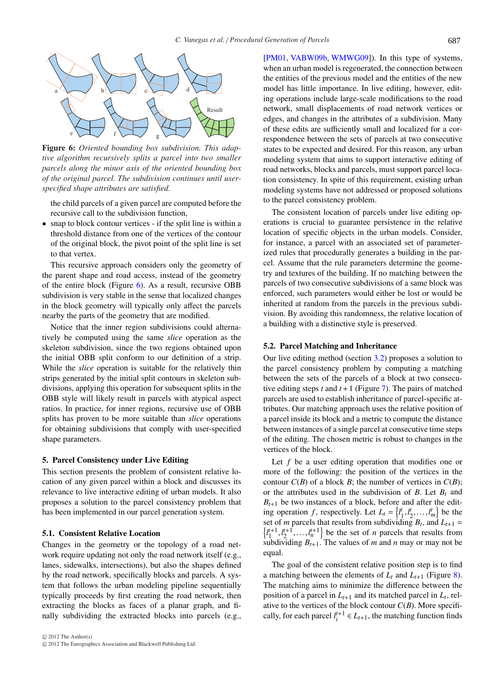
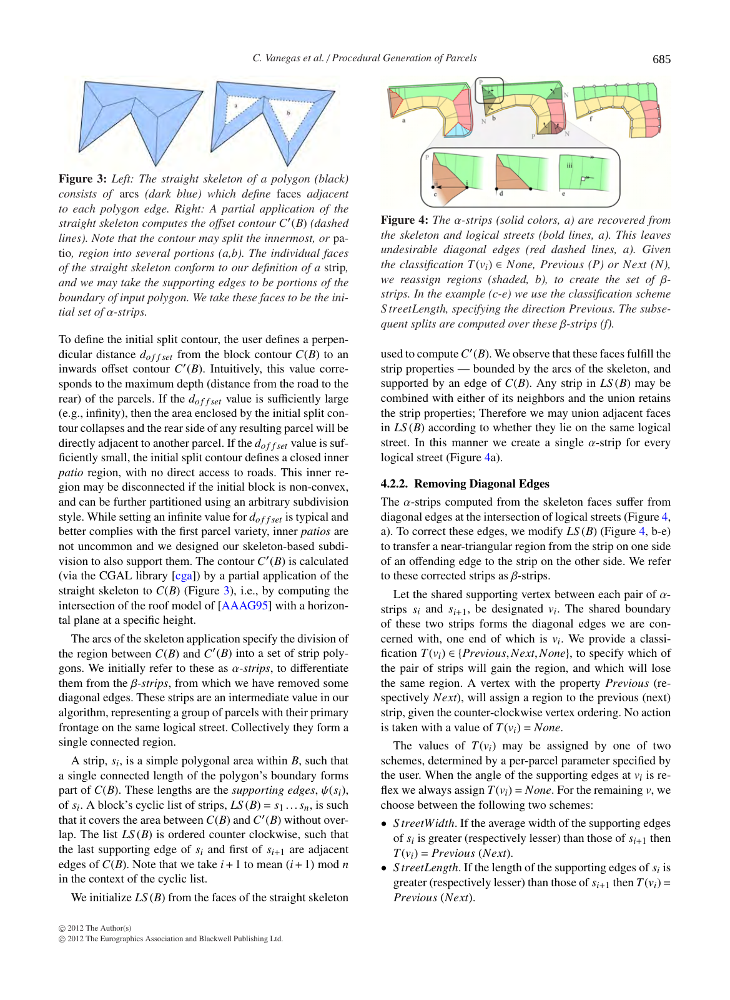
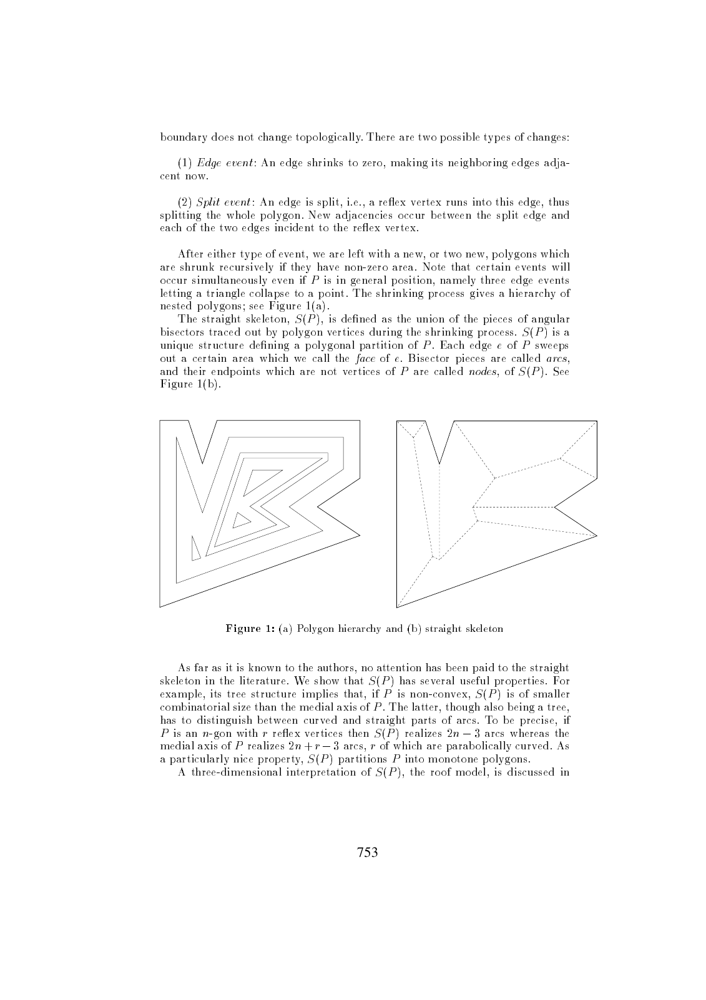
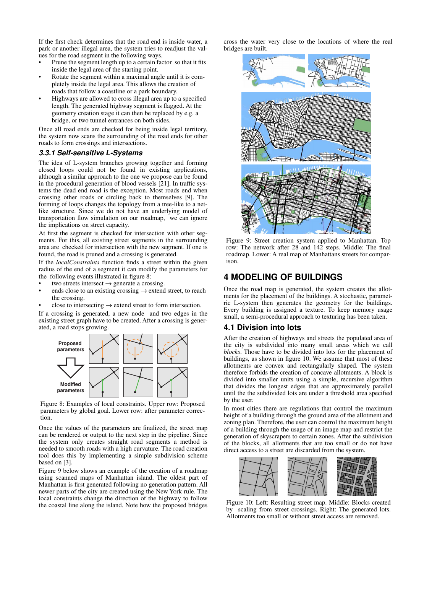
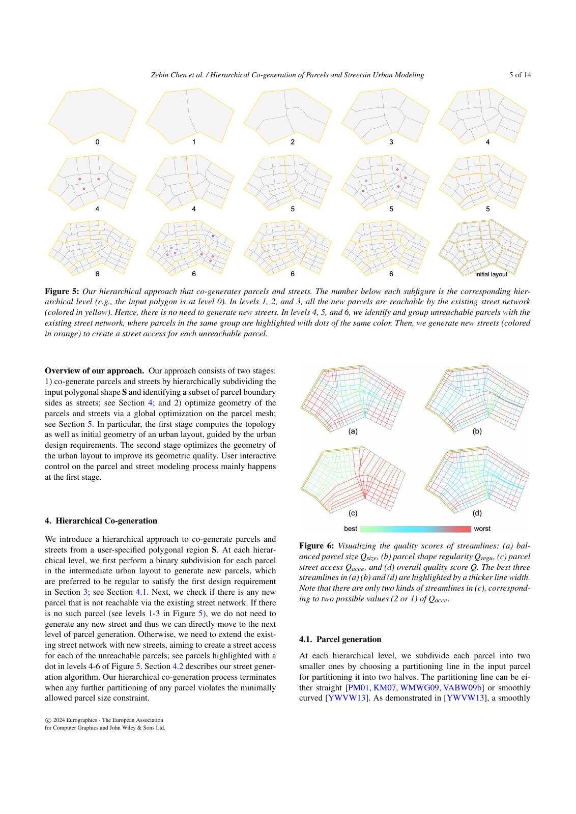

# Parcel library proposal

Status: integrated design proposal, 8 November 2026. No new runtime API is delivered or frozen by this document. Existing City Library scripts and contracts remain authoritative.

Keep one small geometry vocabulary. Extend `geometry` for bounded subdivision and road geometry; keep spatial layouts in `topology` and mutable simulation values in `Grid`. A parcel is polygon data with derivation information and labelled boundary intervals. Ordinary TypeScript composes these operations.

## Full API documentation

- [API reference](api-reference.md): full signatures, types, defaults, examples, behavior and errors.
- [API inventory](api-table.md): compact operation entries linked to the reference.
- [Catalogue coverage](COVERAGE.md): every original operation mapped to its documentation.
- [Townscaper integration](TOWNSCAPER.md): finite quad generation, square-target relaxation and primary evidence.
- [Implementation handoff](IMPLEMENTATION-HANDOFF.md): authorized target thread, first PR and staged catalogue delivery.
- [Expanded-documentation reviews and responses](evidence/full-docs-responses.md): independent Codex and Gemini 4 Argon findings.

These are proposed target documents. Availability is pinned to the inspected City Library delivery, and future method decisions remain explicit.

## Read the proposal

- [Contract and five complete proposed scripts](CONTRACT.md): GPT Astra high's design, reconciled with the independent source and syntax reports.
- [Classic methods and source-access limits](PAPERS.md).
- [Extended literature and bibliography corrections](EXTENDED-PAPERS.md).
- [Actual City Library syntax and coding rules](SYNTAX.md).

The target baseline is City Library `feat/grid-parcel-foundations` at `2a7f3eb`, not its older main checkout. Square/hex/authored layouts, area, bounded merge/split and layout Fields exist there. Recursive subdivision, corridors and general Boolean geometry remain planned.

## Recommended API

```ts
import { geometry } from "city-library";

const result = geometry.subdivide({
  shape,
  method: "orientedBoundingBox",
  targetArea: 48,
  minimumArea: 40,
  minimumFrontage: 6,
  boundarySegments: [{ id: "south", segment: [[0, 0], [12, 0]] }],
});
```

This is proposed syntax, not an executable delivered call. `shape` uses the existing closed GeoJSON `PlanarPolygon`. The full scripts define fixtures and expected results. The proposed `targetArea` is an upper completion bound, rather than a promised exact size or statistical mean. This choice needs explicit acceptance before the examples are frozen.

Accepted leaves appear in `parts`; unresolved land remains in `remainingParts`. Both sets together must preserve the original area without overlapping interiors. Invalid inputs throw; unsupported geometry, unchanged searches, partial progress and numerical failure have separate outcomes. Boundary contact is geometric frontage, not legal access or transport-network reachability. Derivation keys are local to one call, not persistent parcel IDs.

## Finite topology track

The user accepted integration of Astra's Townscaper proposal. Add a finite generator overload and a distinct square-target method using the existing Layout:

```ts
const raw = topology.quadrilaterals({
  rings: 3, edgeLength: 4, random: Random.add({ seed: 7 }),
});
const layout = topology.relax({ layout: raw, method: "squareTarget", iterations: 32 });
```

These are not delivered calls yet. Generate without built-in relaxation, then relax once explicitly. This preserves one owner for iteration controls and leaves each stage inspectable. The first implementation PR delivers this finite topology slice; the parcel roadmap below remains intact. Source player-grid duality, seamless chunks and architectural compatibility are separate later contracts. The older arbitrary-boundary quad sketch and Lloyd method remain research, not synonyms for the new calls.

## Delivery order

1. Freeze a bounded deterministic OBB contract for authored convex blocks: guards, retries, residuals, intervals and work budgets. Write four or five asserted public scripts before runtime.
2. Evaluate robust polygon dependencies on matching fixtures. Deliver finite-width corridors, subtraction and boundary attribution separately. Preserve concavity and holes even if OBB cannot yet subdivide them.
3. Compose road-derived blocks and subdivision. Treat partial-edge/T-junction normalization as an explicit topology decision before promising arbitrary results can become a Grid.
4. Add parallel strips and true skeleton-based parcel generation only with their own examples. Co-generation of streets and parcels remains a separate future procedure.

Voronoi stays under `topology`. Learned building layouts, street growth and reinforcement-learning planning are optional later generators or policies. They do not add training, GPU, GIS services or a DSL to the geometry kernel.



Own schematic illustration, not output from a delivered geometry procedure.

## Original-paper screenshots

These are attributed screenshots from research publications, not City Library runtime results. Links point to original full texts.



[Vanegas et al., original PDF](https://www.cs.purdue.edu/cgvlab/www/resources/papers/Vanegas-Eurographics-2012-Procedural_Generation_of_Parcels_in_Urban_Modeling.pdf).





[Aichholzer et al., original PDF](https://www.jucs.org/jucs_1_12/a_novel_type_of/Aichholzer_O.pdf).



[Parish and Müller, original PDF](https://cgl.ethz.ch/Downloads/Publications/Papers/2001/p_Par01.pdf).



[Chen, Song and Ortner, original PDF](https://sutd-cgl.github.io/supp/Publication/papers/2024-EG-UrbanModeling.pdf).

## Decisions and evidence

The contract proposes defaults and explicit alternatives; it does not silently amend the accepted API catalogue. Important choices before freeze: target-area meaning, total versus contiguous frontage, deterministic ordering, budget limits, rollback on numerical failure, and dependency/precision policy. See CONTRACT.md for exact proposals.

Source inspection and analytical expected values are not executed target tests. No new TypeScript implementation, build, package consumer or browser acceptance is claimed. Gemini 4 Argon gave conditional design approval; the coordinator applied its precision fixes. See [review](REVIEW.md) and [responses](REVIEW-RESPONSES.md). The revised text has not received a second independent approval. Research images illustrate methods; they do not approve visual quality of a future implementation.


The Townscaper integration changes the proposal after the earlier full-documentation approval. That approval remains evidence for its original revision only. The integrated revision requires fresh independent review before implementation handoff; no numerical freeze or runtime acceptance is implied by the user's integration authorization. Routine numerical/RNG decisions may be resolved and reviewed in the target thread before examples are frozen.

Townscaper integration: [independent review and responses](evidence/townscaper-integration-responses.md). The implementation handoff is authorized; runtime delivery and public-example freeze remain separate.
