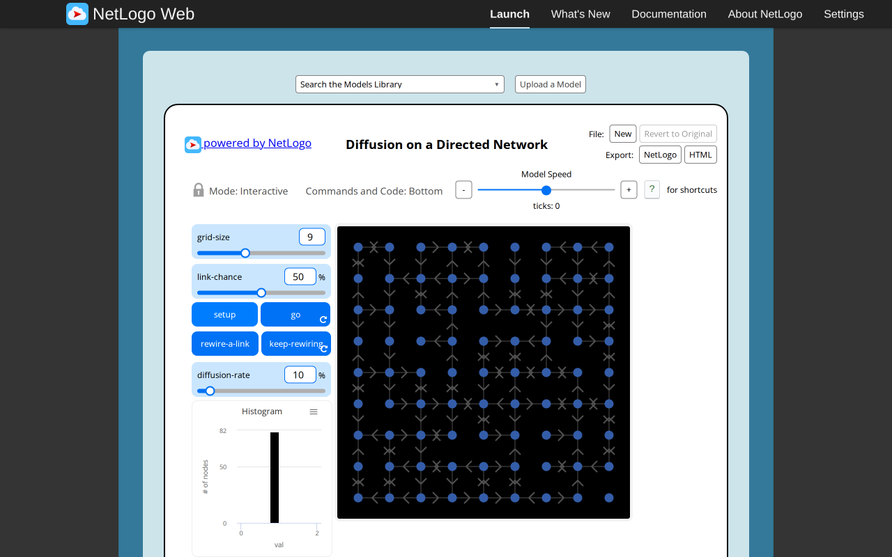
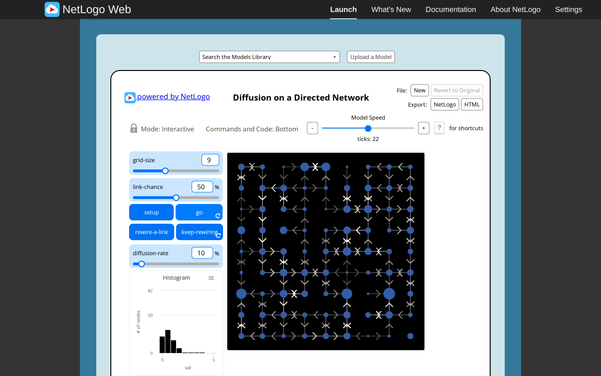
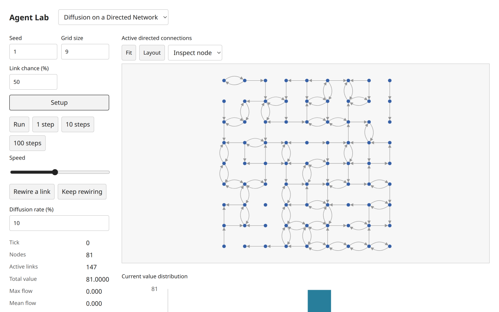
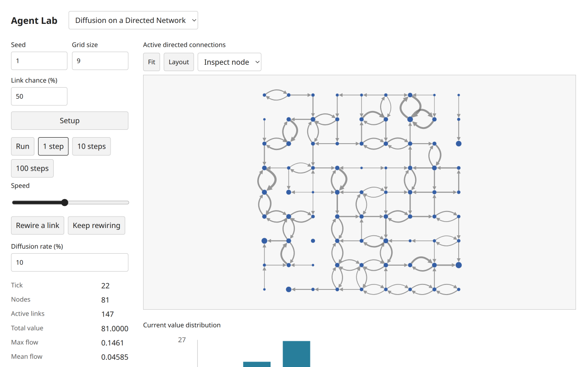
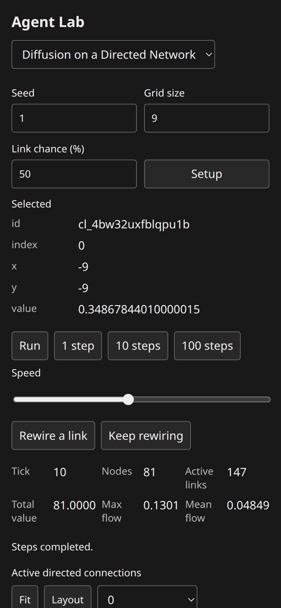
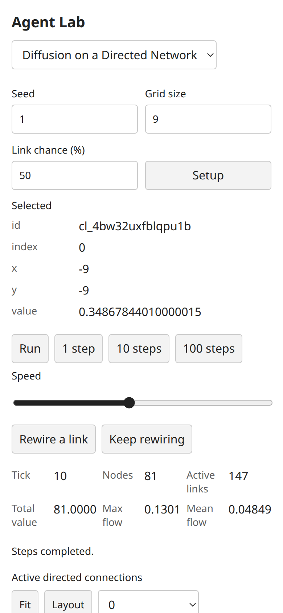
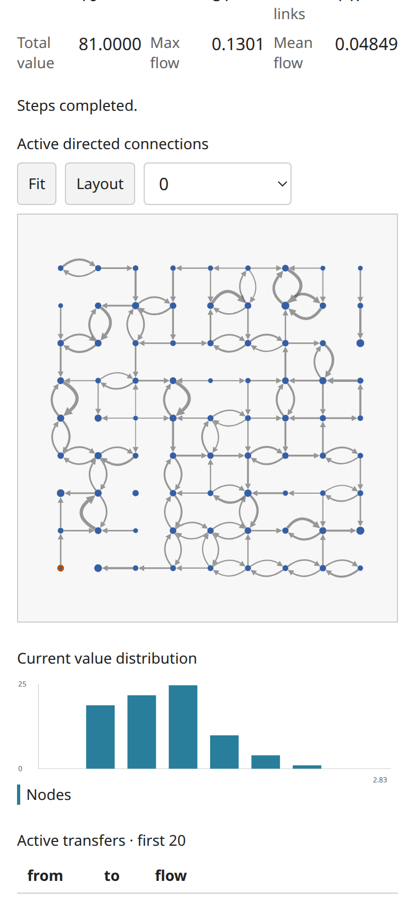

# Directed Diffusion: paired functional browser comparison

Executed by the coordinator on 2026-11-05 in the shared T3 Chromium preview. Reference: [official launcher](https://www.netlogoweb.org/launch#https://www.netlogoweb.org/assets/modelslib/Sample%20Models/Networks/Diffusion%20on%20a%20Directed%20Network.nlogox), NetLogo7.0.4. SHA-256 of the actually loaded `session.nlogoSource.nlogo` was `731a225787d49ee04663897eb563a09b8ab3bb19ac0f6ce0df9c36a3d09d0389` (46052 UTF-8 bytes), matching the archived source and pinned Galapagos revision `90be931773fcf499049247a8aaa1aecbe003654c`. Target: integrated worktree on port3110, headless implementation `2fab83b` and shared directed/action presentation `f0147ef`. The coordinator inspected the real desktop and mobile screenshots. Source contract: [network audit](../../docs/development/selected-network-contracts.md); scientific context: [three-publication dossier](../../docs/research/netlogo-web/diffusion-on-a-directed-network.md).

## Paired observations

Both used grid9, link chance50%, diffusion rate10%. Target seed1; the original browser run used its unspecified random seed. Setup initializes all81 node values to1, total81, and288 directed candidate edges. Random activation produced141 active reference edges and147 target edges. These are independent draws, not trajectory equality.

| State | Original NetLogo | City Library |
| --- | --- | --- |
| Setup | tick0,81 nodes,141 active, max flow0 | tick0,81 nodes,147 active, max flow0 |
| Paused progress | tick22,141 active,total81.00000000000004,max flow0.22564776897476513,mean0.04683274798868783 | tick22,147 active,total monitor81.0000,max flow0.1461,mean0.04585 |
| Rewire while paused | tick22 unchanged;141 active; two flags changed; all edge identities/flows retained; flow globals unchanged | one-shot and repeated action leave tick22,147 active,total81 and flow monitors unchanged; displayed topology changes |
| Concurrent repetition and go | source has independent native forever controls | both toggles pressed; tick advanced22→26 while topology could change |
| All links active |288 active; rewire is a no-op |288 active before/after native one-shot; tick0 |
| No active links | seed-specific setup0active;go still reached tick5,total81,all values1 | seed1 setup0active;10steps reached tick10,total81,flow0; both rewire controls disabled |
| Live diffusion rate0 | tick5→8, every node value unchanged, flow globals0; no automatic stop | tick10→20; inspected node-size projections unchanged, table flows0,flow globals0,total81; stepping remains available |

Reference and target progress share a tick horizon, not a network realization. Exact phase rules and fixtures are tested headlessly: old-value staged accumulation, out-degree normalization, sinks retaining their holdings, conserved total within floating tolerance, and inactive edges retaining previous flows. Source random sender traversal versus deterministic target accumulation order can change floating rounding; source and target RNGs and activation draws differ. Numerical values in this table are observations of these runs, not a statistical validation claim.

| Setup | Progress |
| --- | --- |
|  |  |
|  |  |

## Actions, lifecycle and presentation

Target native controls exercised Setup,1step,10steps,Run/Pause,one-shot Rewire,Keep rewiring,live diffusion rate,setup link chance and catalog selection. Keep rewiring alone changed displayed topology over650ms without advancing tick22. With Run it advanced scientific time; Setup stopped both timers, reset tick0 and restored seed1 topology, still unchanged after450ms. Switching to Virus while repetition ran disposed the old controls; after450ms the new model remained uninitialized, and returning to Directed Diffusion showed no pressed toggle and required Setup. Scheduler tests additionally exercise stale queued callbacks, replaced/removed owners, disabled predicates and action/read errors. They complement browser lifecycle observations.

The fixed initial square layout, directional target arrows and separate curves for opposite arcs were visually inspected. All rendered active edges reported triangle target arrows; widths updated on existing edge identities after22steps. Target width encodes current flow relative to the source-compatible max-flow global; source grayscale brightness is a declared presentation adaptation. Node area reflects holdings. The first20 active transfer rows and current-value histogram are inspection views, not substitute equations. Normal rewiring retains source stale max/mean semantics; a source rewire may reactivate the same edge. The source's exact-zero RNG exception at link chance0 remains in the contract; these particular browser seeds produced no active links.

At390×844 CSS pixels, both light/dark controls and node0 selection were inspected; node0 at tick10 reported index0,x−9,y−9,value0.34867844010000015. No horizontal overflow. Mobile network and histogram remain readable after scrolling; live rules follow the plots in the existing responsive ordering. Setup values are setup-only; rate is live. These checks establish responsive target behavior; the source browser baseline was exercised at1280×800, without claiming that its UI has the same responsive design.

## Diagnostics and executed checks

The reference and target preview diagnostics showed no application console errors or failed network requests. One coordinator read-only evaluate used the Playwright-only selector `button:text-is` with DOM querySelector; it failed with SyntaxError, was corrected to standard DOM selectors and succeeded. This was a test-tool expression error, not a model/runtime error. A scoped worker's separate Playwright-MCP browser could not launch because its SUID sandbox helper lacked required configuration; the coordinator's configured T3 Chromium browser worked and supplied the evidence above.

`bun run check` passed on the integrated UI:146 tests,3868 assertions,60 public examples, all configured TypeScript checks, build and packed Bun/Node ESM/ambient-free TypeScript consumers. `git diff --check` passed. Frozen public examples and author type contracts were preserved. Independent technical review is pending; this report and the research dossier do not constitute that approval or empirical validation.
