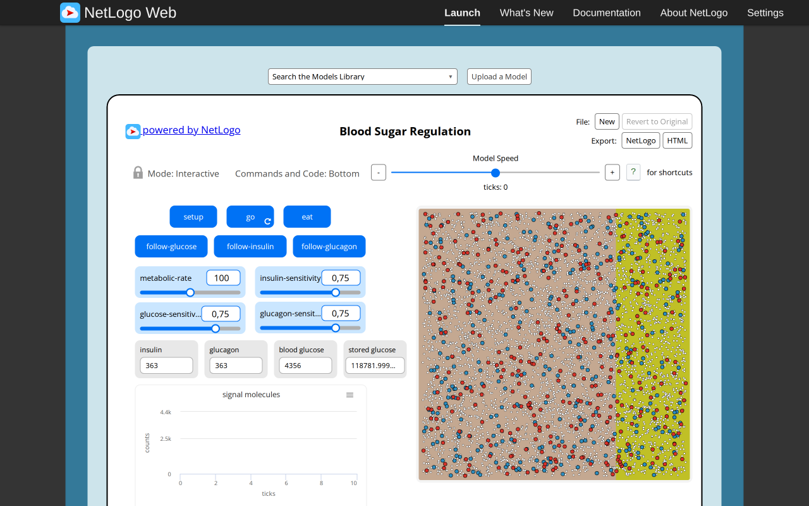
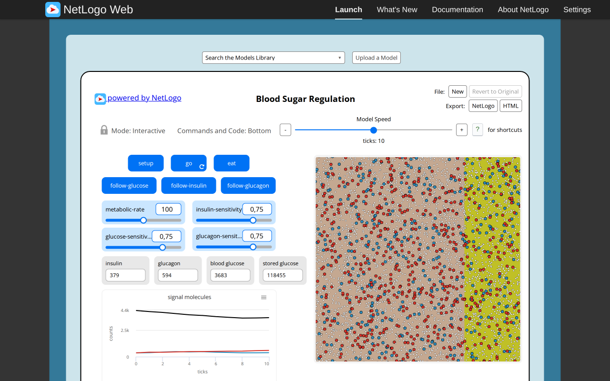
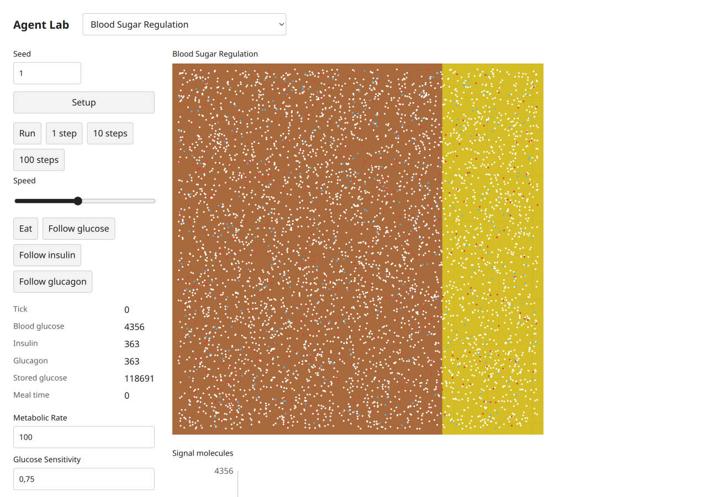
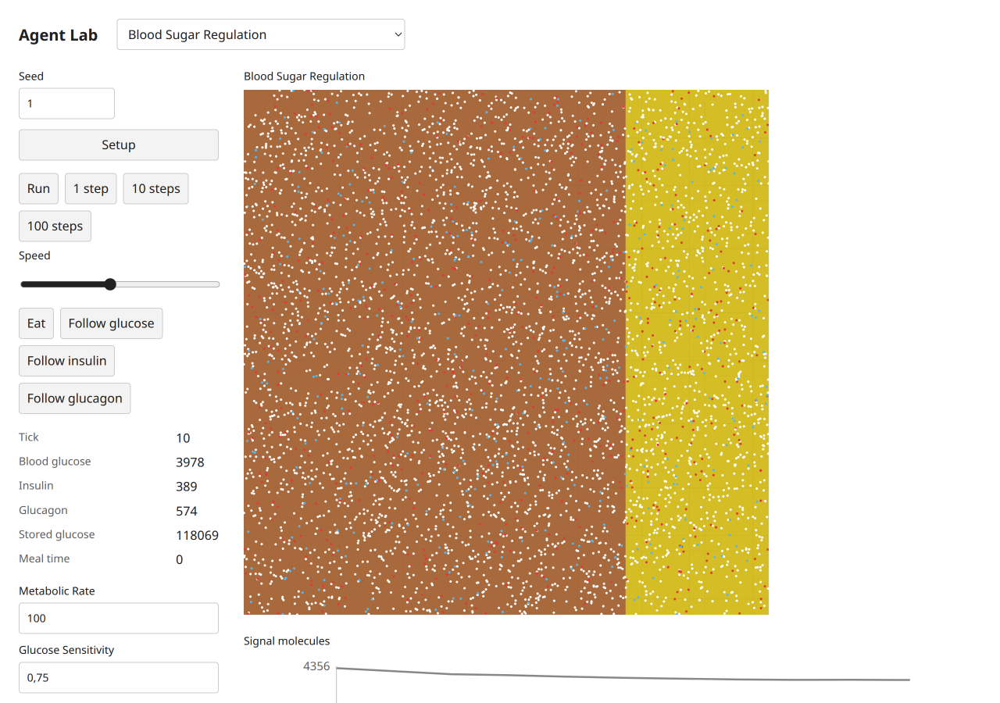
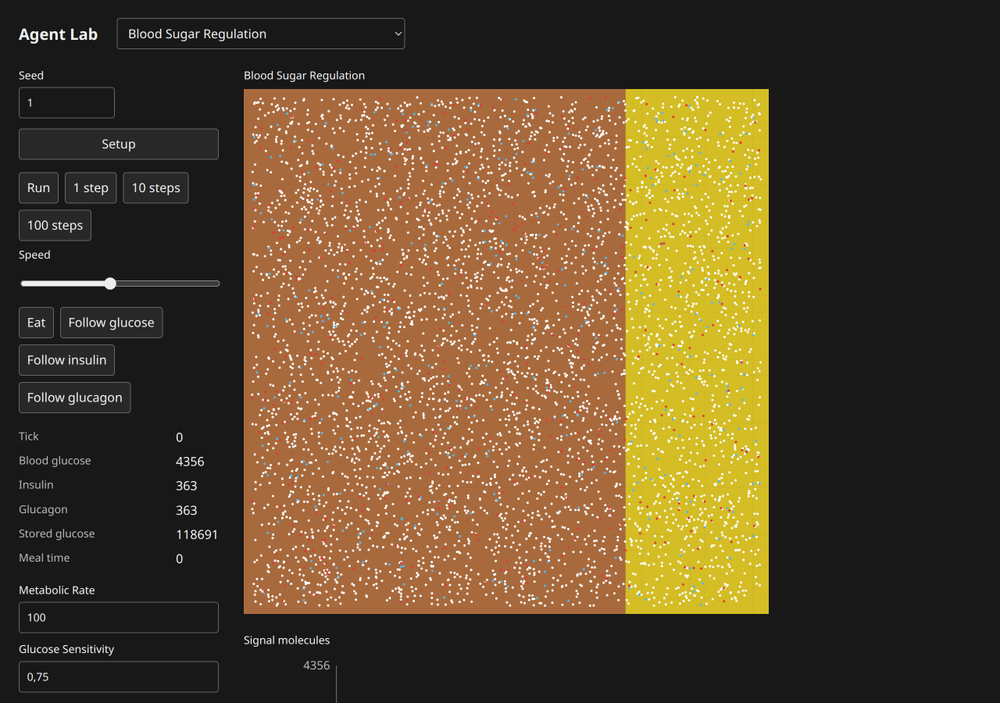
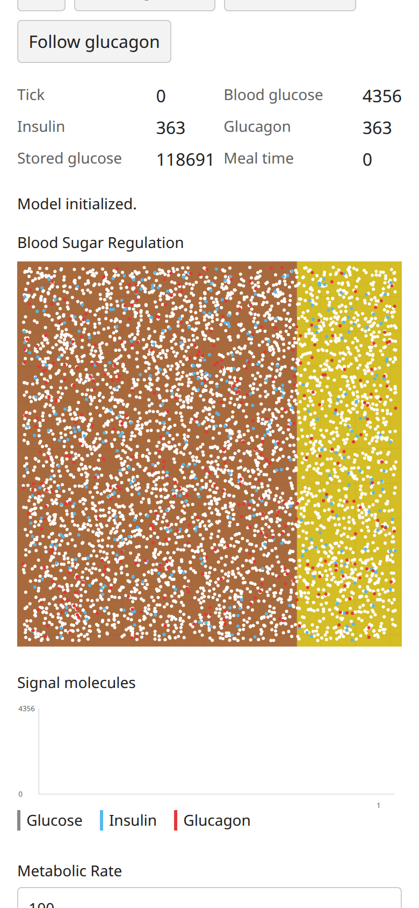
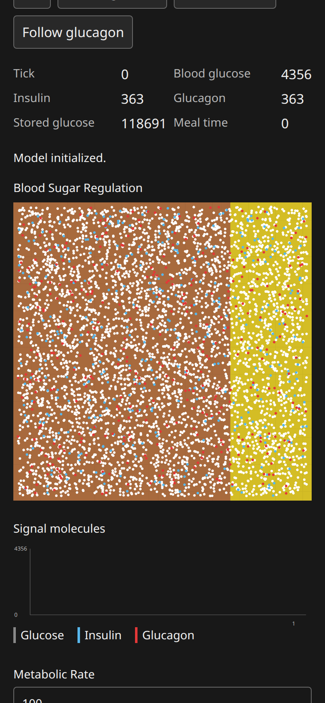

# Blood Sugar Regulation: B07 model report

Canonical selected path: `Sample Models/Biology/Blood Sugar Regulation`. Experiment: `experiments/blood-sugar-regulation`. Membership is unchanged from selection.json.

Original archive/source session SHA-256: `75efe0d13e248bbdd0850171f35e54271bb16ad78bdd3ecbe7e0afb8f3f5313f`. Exact served XML version `NetLogo 7.0.4`; running original engine `2.16.1 (90be9317)`. Pinned Galapagos `90be931773fcf499049247a8aaa1aecbe003654c`, with immutable inventory byte match. Full original code/widgets/Info/shapes/notices: [archive](../../experiments/blood-sugar-regulation/source.nlogox), [notices](../../experiments/blood-sugar-regulation/NOTICE.md).

Scientific framing and exactly three verified publications remain in the existing [research dossier](../../docs/research/netlogo-web/blood-sugar-regulation.md) and [metadata](../../docs/research/netlogo-web/blood-sugar-regulation.json); their access/verification limits apply. This port does not add or duplicate literature and is not scientific validation.

Public contract: [headless source](../../experiments/blood-sugar-regulation/model.ts), [thin UI binding](../../experiments/blood-sugar-regulation/ui.ts). `create(options)`, `advance(count)` and detached `read()` use canonical public state owners. Named source procedures/actions, parameter phases, topology, plots and terminal/tick meaning are specified in [the source audit](selected-biology-source-audit.md). Exact source widgets and procedure list are in [audit JSON](selected-biology-source-audit.json).

## Adaptations and source findings

The source-backed Poisson150 liver initialization and exponential(2/ln2) hormones use the synchronized parent public distribution phase (Mulberry standard only). No private substitute or MT parity promise is present. The original creates412 molecules from7000/17; the two script03 assertions were corrected from411/722 to412/724 after explicit user approval. Source organ rectangles are rendered from detached cell read models; follow actions select/highlight an identity instead of changing the camera. The former dependency blocker is resolved; a successful final target browser run replaces it. The historical blocked PNG remains diagnostic evidence in Git.

## Actual original browser

Configured defaults: `set metabolic-rate 100.0 set glucose-sensitivity 0.75 set insulin-sensitivity 0.75 set glucagon-sensitivity 0.75`; seed1 before Setup. Setup observation: `{"success": true, "value": [0, 4356, 363, 363, 123138, 0]}`. After10 go calls: `{"success": true, "value": [10, 3683, 379, 594, 122138, 0]}`. Reporter tuple expression is retained in browser-observations/sourceProbes and model-specific source contracts; values are actual native observations.

Actual Run/Pause and Setup-as-reset observations: `{"paused": {"success": true, "value": 3}, "stable": {"success": true, "value": 3}, "reset": {"success": true, "value": [0, 4356, 363, 363, 124039, 0]}, "errors": [], "canvasReadback": {"width": 858, "height": 858, "nonzero": 730921}}`. Successful equal paused/stable tick reporters establish bounded stable pause; Reset may randomize again without reseeding. Additional source actions/boundary/error probes are versioned by slug in [raw results](selected-biology-evidence/browser-observations.json).

## Actual target browser

Setup monitors: `[["Tick", "0"], ["Blood glucose", "4356"], ["Insulin", "363"], ["Glucagon", "363"], ["Stored glucose", "118691"], ["Meal time", "0"]]`. After10 clicked single-step actions: `[["Tick", "10"], ["Blood glucose", "3978"], ["Insulin", "389"], ["Glucagon", "574"], ["Stored glucose", "118069"], ["Meal time", "0"]]`. Status: `Steps completed.`. Actual loaded build-version `1793969543383`. Loaded model chunk attribution: `[{"url": "http://localhost:3147/chunks/ui-vnsy43gj.js", "sha256": "9bcda6bf6eefc34c4e94f43c87b353d4609265ed524b71c27b9b0fd5f9639f90", "sourceMarker": "selected-biology-b07:blood-sugar-regulation:75efe0d13e248bbdd0850171f35e54271bb16ad78bdd3ecbe7e0afb8f3f5313f"}]`. These screenshots belong to this actual final source/UI version; file hashes are recorded separately.

Run/Pause, stable pause and Setup-as-reset: `{"paused": ["12", "4010", "368", "583", "117837", "0"], "stable": ["12", "4010", "368", "583", "117837", "0"], "reset": ["0", "4356", "363", "363", "118691", "0"], "status": "Model initialized.", "buttons": [{"label": "Setup", "disabled": false}, {"label": "Run", "disabled": false}, {"label": "1 step", "disabled": false}, {"label": "10 steps", "disabled": false}, {"label": "100 steps", "disabled": false}, {"label": "Eat", "disabled": false}, {"label": "Follow glucose", "disabled": false}, {"label": "Follow insulin", "disabled": false}, {"label": "Follow glucagon", "disabled": false}], "liveNames": ["live-metabolicRate", "live-glucoseSensitivity", "live-insulinSensitivity", "live-glucagonSensitivity"]}`. Source-specific target actions/live controls/terminal probes are recorded under `targetProbes` in [raw observations](selected-biology-evidence/browser-observations.json).

Mobile dark measured geometry: `{"viewport": [390, 844], "scroll": [0, 354], "scrollWidth": 390, "theme": "dark", "canvas": {"x": 16, "y": 243.1875, "width": 358, "height": 358}}`. Light/mobile and dark/desktop geometry are separately retained in raw results. All ordinary captures were visually inspected. Apparent blank bundled transport in Sunflower/Tumor/Membrane was reopened individually with view_image: files contain the actual particle/stems/membrane; no model renderer fix was warranted.

Console/runtime diagnostics: baseline source errors `[]`; target captured console entries `[[], []]`; paired target status states were success. Expected beta-zero/zero-radius probes are explicit errors, not passing runtime claims. Initial automation attempts used an unsupported manual redraw invocation and ran Go before Setup on three fresh originals; corrected captures/control checks replaced them. These harness errors are distinct from model failures.

Comparison conclusion: default topology/membership and observed source-specific mechanisms/reporters, plus bounded interactions, are supported by executed evidence. Different spatial patterns/masses are expected under the declared RNG/scheduling differences; no stochastic-distribution equivalence is established. UI palettes/shapes/scales and seam strokes are adapted as documented above. Full arbitrary-parameter/long-horizon equivalence is not claimed.

## Verification and approval

Final executed shell commands and exit codes are in [final checks](selected-biology-evidence/final-checks.json). All four TypeScript projects and standalone ambient-free ten-model/frozen-five-script TypeScript pass. Focused biology+shared-distribution checks:26tests/286assertions pass; additional inherited uniform/normal regression:31tests/73assertions pass. All five public scripts now pass with the explicitly user-approved source-rounding correction in script03 (412/724). The superseded original freeze remains archived; the current five-script hash manifest passes. See [approval and new freeze](https://github.com/dweigend/city-library/blob/dc7b164abd23c8e7b7f11c902195ab030c5f1c4b/docs/development/selected-biology-rounding-approval.md). Build and actual packed Bun/Node ESM/ambient-free TypeScript consumer pass locally after parent sync. Historical pre-sync failures remain separately versioned; no parent full-integration checkpoint is relabeled as a B07 run.

Independent Argon/high review: **pending**, existing quota-blocked task8194e842, no retry/substitute. Native author findings and coordinator responses are not independent approval. No global model count, registration, selection, ledger or research status was changed here. Parent-owned dependency sync commits19f98ba(source428750f) and6dfc324(sourceb3db9b4) are excluded from the owned handoff list.

## Final shared status supplement

Parent-owned `e1c4ae8c2940ebb66be299f81dedbd70d8c75706` (local `d76f454a8eb896d134f7766a705d14b96fca291c`) fixes the stale Running status at automatic completion. Actual Chromium rerun at build `1793970184720` naturally exhausted Blood Sugar glucose at tick 648: `Completed.`, disabled Run/1/10/100-step controls and a stable tick over 500 ms. Setup restored tick 0, `Model initialized.` and enabled Run. Manual Running/Paused/resumed Running and stable paused tick 3 were verified. Sunflower's native exponential beta-zero error and the target error status remained visible and stable. No model rule changed.

[Raw status, errors, final all-ten module imports and hashes](selected-biology-evidence/status-fix.json) and [natural terminal settings/headless script/results](https://github.com/dweigend/city-library/blob/dc7b164abd23c8e7b7f11c902195ab030c5f1c4b/docs/development/selected-biology-evidence/blood-natural-terminal.json) retain exact observations. The original naturally stopped at tick 651 with zero blood/stored glucose after its native user-message; the target and headless public model stopped at 648. These are functional terminal observations, not trajectory or distribution validation. The optional extreme-sensitivity exploration was terminated for excessive runtime (exit 143); it is explicitly not a terminal pass.

The earlier per-model captures retain their actual build/chunk attribution (`1793969543383`). They are historical code evidence after the distribution sync; they are not relabeled to the status-fix build. All ten final modules were freshly imported and their source markers and SHA-256 recorded after the shared split changed filenames. Supplementary Blood desktop/mobile light/dark captures inspect the affected completed-status flow. Their measured scroll/rectangles and empty console diagnostics are recorded. The before-fix [original terminal](https://github.com/dweigend/city-library/blob/dc7b164abd23c8e7b7f11c902195ab030c5f1c4b/docs/development/selected-biology-evidence/blood-sugar-regulation-original-terminal.png) and [target terminal](https://github.com/dweigend/city-library/blob/dc7b164abd23c8e7b7f11c902195ab030c5f1c4b/docs/development/selected-biology-evidence/blood-sugar-regulation-target-terminal.png) remain retained. The final mobile dark PNG was individually inspected after the bundled image appeared partly blank; the actual PNG contains the complete expected field.

[Completed desktop light](https://github.com/dweigend/city-library/blob/dc7b164abd23c8e7b7f11c902195ab030c5f1c4b/docs/development/selected-biology-evidence/blood-status-fixed-desktop-light.png), [desktop dark](https://github.com/dweigend/city-library/blob/dc7b164abd23c8e7b7f11c902195ab030c5f1c4b/docs/development/selected-biology-evidence/blood-status-fixed-desktop-dark.png), [mobile light](https://github.com/dweigend/city-library/blob/dc7b164abd23c8e7b7f11c902195ab030c5f1c4b/docs/development/selected-biology-evidence/blood-status-fixed-mobile-light.png), [mobile dark](https://github.com/dweigend/city-library/blob/dc7b164abd23c8e7b7f11c902195ab030c5f1c4b/docs/development/selected-biology-evidence/blood-status-fixed-mobile-dark.png), [unmasked target error](https://github.com/dweigend/city-library/blob/dc7b164abd23c8e7b7f11c902195ab030c5f1c4b/docs/development/selected-biology-evidence/status-fix-target-error.png).

After this sync, all four repository type projects, standalone source-only and frozen-example type projects, 26 focused tests / 286 assertions, playback test / 9 assertions, build and actual packed Bun/Node/ambient-free TypeScript consumer passed. [Exact commands and exit codes](selected-biology-evidence/final-checks.json), [playback log](https://github.com/dweigend/city-library/blob/dc7b164abd23c8e7b7f11c902195ab030c5f1c4b/docs/development/selected-biology-evidence/status-fix-playback.log). At this pre-approval checkpoint all original freeze hashes matched and script03 failed only its 411 expectation (`123458` expected, `123459` actual). These historical logs remain unchanged. The user subsequently approved the exact [two-expectation correction](https://github.com/dweigend/city-library/blob/dc7b164abd23c8e7b7f11c902195ab030c5f1c4b/docs/development/selected-biology-source-rounding.patch); all five scripts now pass with the new freeze. See [approval and rerun](https://github.com/dweigend/city-library/blob/dc7b164abd23c8e7b7f11c902195ab030c5f1c4b/docs/development/selected-biology-rounding-approval.md). Independent Argon approval remains pending.
