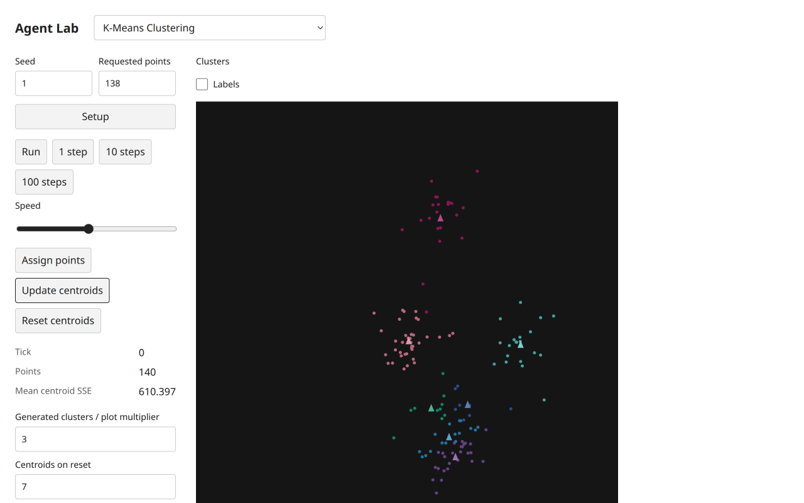
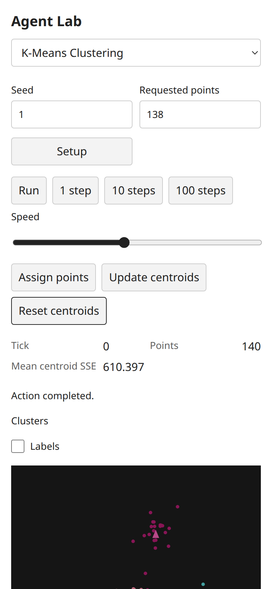
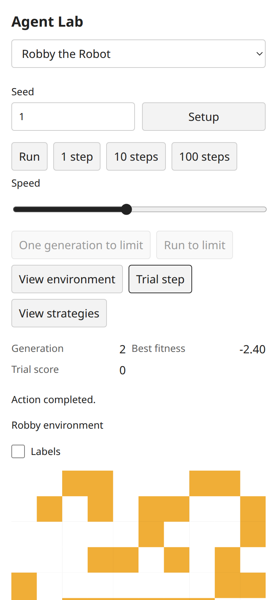

# Computing fixes: integrated follow-up

Author commits4cd15b2 andee71a7a were integrated as3e491b2 and0b43107 without rewriting earlier payloads. They restore K-Means' live plot multiplier, native numeric widget steps/integer controls, bounded Robby playback and hiding training-only cans. Scientific transition equations and the five frozen scripts are unchanged. Root ran all four TypeScript projects,35focused tests/6679assertions,allfive unchanged script hashes and allfive scripts successfully after these fixes. The earlier full346-test/130-example/build/consumer result belongs to the preceding runtime checkpoint; it is not relabeled as a new full check after these descriptor/UI changes.

Root's fresh Chromium instance built all50 catalog entries. Port3126 was already occupied; the failed EADDRINUSE startup supplied no evidence and its existing server was left untouched. The root instance used3136,owned tabk. Native Setup/Assign/Update showed K-Means seed1,requested138→actual140points,tick0,mean centroid SSE610.397. Changing live multiplier7→3 and updating again changed all seven last plot values by3/7 while tick/points/mean remained unchanged. Example first value9402.118970147454→4029.4795586346236. Desktop1280×800 and mobile390×844 light screenshots were inspected,with no horizontal overflow. The dark simulation raster is intentional model-view styling; page chrome is light.

Robby seed1,default100population: Setup generation0,bestfitness−44.00. A live generation limit2 plus native Run to limit reached generation2,bestfitness−2.40,automatically stopped and disabled both bounded controls. Training view's white cells intentionally hide evaluation cans, not missing model state. View environment and Trial step then exposed the actual can environment with trial score0 while generation stayed2. Setup replayed generation0/best−44.00. Mobile trial screenshot was inspected; no horizontal overflow. Readback ran before final snapshots. Observed diagnostics had no console errors or failed requests. The owned tab closed and server session30761 was stopped.

| Integrated state | Screenshot |
| --- | --- |
| K-Means live multiplier3,desktop |  |
| Same K-Means state,mobile |  |
| Robby bounded generation2,trial environment |  |

[Readbacks](https://github.com/dweigend/city-library/blob/dc7b164abd23c8e7b7f11c902195ab030c5f1c4b/docs/development/selected-computing-integration-evidence/root-readbacks.json),[diagnostics](https://github.com/dweigend/city-library/blob/dc7b164abd23c8e7b7f11c902195ab030c5f1c4b/docs/development/selected-computing-integration-evidence/diagnostics.json) and [current-code/artifact hashes](https://github.com/dweigend/city-library/blob/dc7b164abd23c8e7b7f11c902195ab030c5f1c4b/docs/development/selected-computing-integration-evidence/manifest.json) supplement the author's complete per-model original/target work. This limited root follow-up does not replace the pending integrated paired reports for allten. Browser/baseline counts stay40 and independent-review/final acceptance counts remain unchanged until their distinct evidence gates are met.
