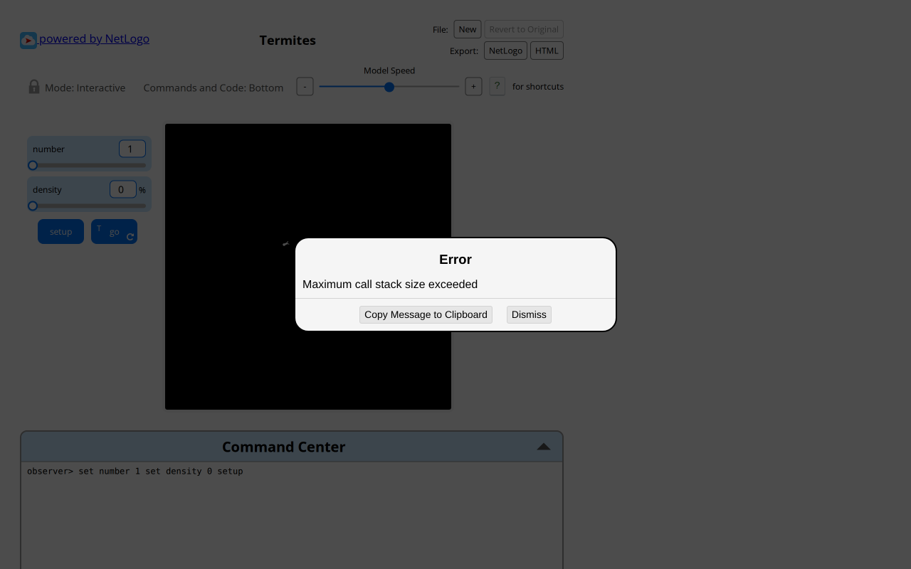
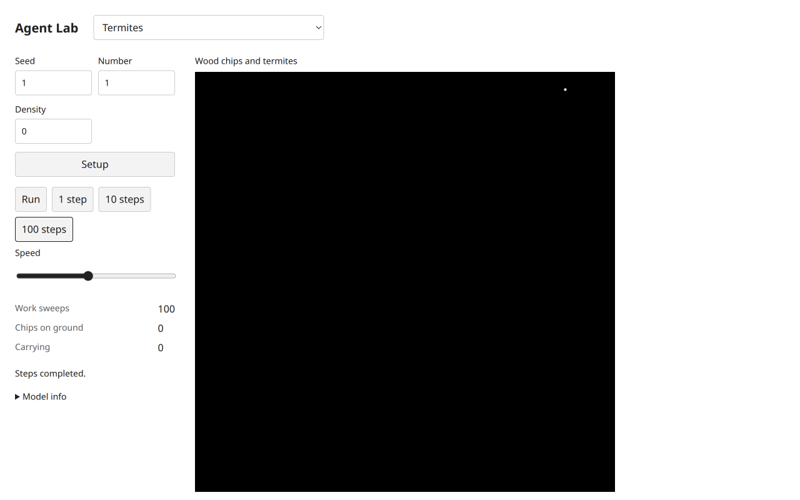
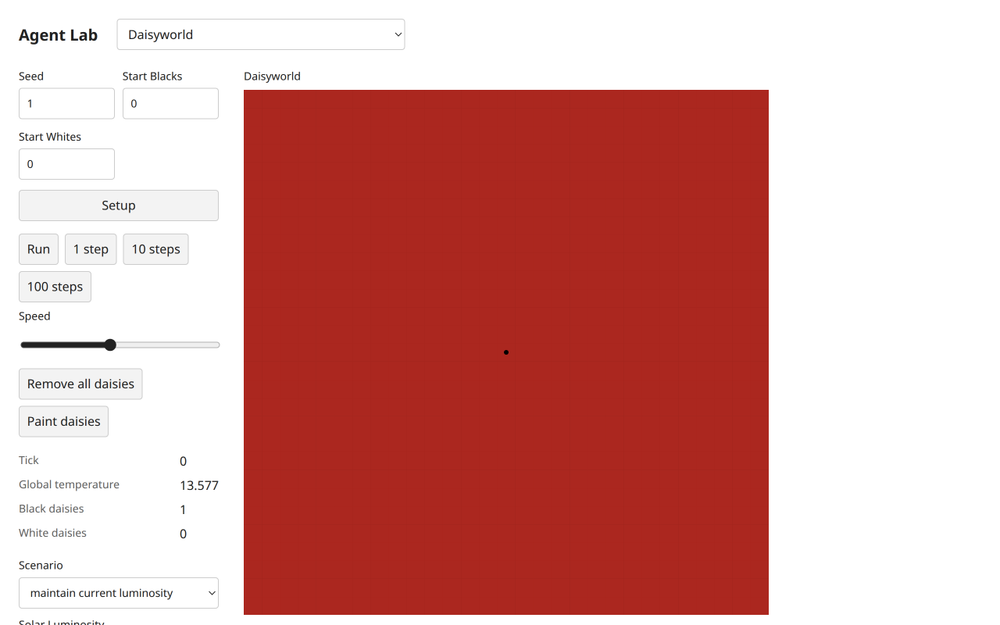
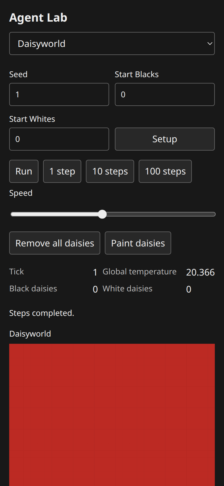

# Ten ecology models: integrated runtime and baseline evidence

Root integrated the exact owned payload:5842c91→7869ec6,70acefd→b0048bc,2263a5d→32fbf87,b4e7a51→6bdded6,743a9b3→8fe0b4e. Plan/freeze488d030/078c2da were already integrated62d8205/b93bd4e and were not duplicated. Shared child copies were omitted; root chart/composer hashes exactly match the authorized5bc6b16 bytes. All20 model/UI files match the final author's b4e7a51 tree.42 runtime/source/example hashes and270 retained evidence/report hashes passed; the source/evidence verifier passed. [Author's complete per-model comparison](selected-ecology-report.md),[handoff](https://github.com/dweigend/city-library/blob/dc7b164abd23c8e7b7f11c902195ab030c5f1c4b/docs/development/selected-ecology-handoff.md),[root hash manifest](https://github.com/dweigend/city-library/blob/dc7b164abd23c8e7b7f11c902195ab030c5f1c4b/docs/development/selected-ecology-integration-evidence/manifest.json).

Root registered allfive unchanged B06 scripts. After both complete B18/B06 payloads,final UI/descriptor fixes and real graph-distance/affine capabilities,`bun run check` completed exit0: **369tests,34328assertions,140public scripts,four TypeScript projects,build and packed Bun/Node ESM/ambient-free TypeScript consumer**. The consumer exercises both new shared capabilities. [Executed check record](selected-ecology-integration-evidence/checks.json). No tests/consumer are inferred from research or screenshots.

Allten original and target Chromium sessions,loaded source hashes,setup/progress/native controls,parameters/actions/reporters/terminal cases and desktop/mobile light/dark evidence are retained in the author's report and95 inspected images. Coordinator inspection reconciled hashes,read the complete report/declared deviations and inspected representative paired images including Ants and the actual native empty-Termites stack error. No pixel-clone,trajectory or distributional parity is inferred. The prior source-only checkpoint is historical; it does not reduce the now-executed evidence.

## Additional actual integrated browser checks

Root's own fresh Chromium156 on3137 built60 entries. Termites seed1,number1,density0: Setup→100work sweeps stayed0ground/0carried and responsive; native Run/Pause reached105sweeps,then Setup returned0sweeps. These are bounded procedure sweeps,not a replacement claim that one target call completes native recursivego. The original's same-input `Maximum call stack size exceeded` is paired below. Tick remains null in the headless contract; UI correctly calls its counter Work sweeps.

Daisyworld seed1,initial black/white0,luminosity.8: Setup globaltemperature13.577,tick0. The initial paint mode was Remove and left the empty world unchanged; it is not claimed as an add test. Selecting Add black,then native canvas painting gave1black/0white without ticking. Remove all daisies plus1step gave0/0,tick1,temperature20.366. The live controls have single readers. Desktop1280×800 and mobile390×844 dark screenshots were inspected,with no horizontal overflow. Readback warnings were the only console diagnostics; no console errors/failed requests appeared. Owned tab closed and3137server stopped.

| Actual state | Evidence |
| --- | --- |
| Original empty-search stack failure |  |
| Target100bounded empty-search sweeps |  |
| Target Daisyworld one painted black daisy,tick0 |  |
| Target after removal/one thermal step,mobile dark |  |

[Exact root observations](https://github.com/dweigend/city-library/blob/dc7b164abd23c8e7b7f11c902195ab030c5f1c4b/docs/development/selected-ecology-integration-evidence/root-observations.json),[diagnostics](https://github.com/dweigend/city-library/blob/dc7b164abd23c8e7b7f11c902195ab030c5f1c4b/docs/development/selected-ecology-integration-evidence/diagnostics.json). This root subset supplements rather than relabels the author's complete ten-model source/target paths. Scientific dossiers are linked individually in the author report;200 literature dossiers do not establish empirical validity.

## Explicit acceptance limits

Termites' bounded/resumable activation cadence is a material declared adaptation; conservation is checked within each engine's own initial state,not by equating independently randomized chip totals. Invasive Plants' drawing-clock cadence,partial hard-edge forward motion and canonical composition remain explicit. Rabbits/Fireflies original zero-count plot failures and robust target charts,Heatbug watch/highlight/coordinate offset,render glyphs/report cadence and Mulberry RNG are all retained deviations. Neither author remediation nor this integration is independent approval. Allten may gain implementation/headless/browser/baseline stages; reviewed/final acceptance remain pending under the known Argon quota blocker. The fixed200 scope is unchanged.
