# B03 actual original and target Chromium evidence

Executed 6 November 2026 using the T3 server Chromium 156.0.0.0, Linux. Own original and target tabs; own checked-free port3139. Original CSS viewport1440×1100 (PNG transport1280×978); target desktop1280×1000 and mobile390×844 CSS (PNG780×1688, DPR2). Mobile is a resized Chromium viewport, not a mobile user agent. Light/dark uses the unchanged existing dark CSS rule activated through CSSOM plus native color-scheme; the browser tools expose no media-emulation setting. No screenshot readback is claimed as a renderer repair.

Each final original setup/progress pair is one contiguous initialized run with no intervening reset. No original random-seed command was issued. Target seed1 is explicit; its reset constructs the same initial state. Basic Answer intrinsically reruns source Setup and has no native clock. No cross-engine RNG, trajectory or distribution identity, empirical scientific validation or physical units are inferred.

Canonical source identities, exact widgets/procedures/defaults/plots and licenses: [source audit](selected-economics-source-audit.md), per-folder source.json/source.nlogox/NOTICE.md. Every actually loaded original session XML SHA matches the archive, served inventory and pinned Galapagos90be931773fcf499049247a8aaa1aecbe003654c. Target read() exposes a sourceMarker; downloaded content-addressed chunks were SHA-pinned and reloaded again after final edits. [Final confirmations](selected-economics-evidence/final-bundle-confirmations.json) agree10/10 with the captured code. [Source hashes](https://github.com/dweigend/city-library/blob/dc7b164abd23c8e7b7f11c902195ab030c5f1c4b/docs/development/selected-economics-evidence/final-source-hashes.json) identify final model/UI files.

Raw [original final readbacks](selected-economics-evidence/original-final-observations.json), [original controls/fixtures](https://github.com/dweigend/city-library/blob/dc7b164abd23c8e7b7f11c902195ab030c5f1c4b/docs/development/selected-economics-evidence/original-observations.json), [target readbacks](https://github.com/dweigend/city-library/blob/dc7b164abd23c8e7b7f11c902195ab030c5f1c4b/docs/development/selected-economics-evidence/target-final-observations.json), [target fixtures](https://github.com/dweigend/city-library/blob/dc7b164abd23c8e7b7f11c902195ab030c5f1c4b/docs/development/selected-economics-evidence/target-fixtures.json), [public headless replays](https://github.com/dweigend/city-library/blob/dc7b164abd23c8e7b7f11c902195ab030c5f1c4b/docs/development/selected-economics-evidence/public-replays.jsonl), [native scenario errors](https://github.com/dweigend/city-library/blob/dc7b164abd23c8e7b7f11c902195ab030c5f1c4b/docs/development/selected-economics-evidence/native-scenarios.json), [PNG hashes/dimensions](selected-economics-evidence/screenshots.json) are retained. Earlier successful captures and failed automation/capture attempts remain historical, not relabeled as final code. In target readbacks use the LAST row for each slug; the final confirmations select that actual chunk.

All ten target Setup,1step,Run/Pause,paused stability,Reset and bounded default progress were executed through the actual mounted UI. All ten originals used native Setup and named step/forever controls/procedures as applicable; Basic has only Setup/Answer. The shared keyboard Setup action was also activated with a real Enter key and visible2px focus outline. DOM controls/actions operate the public model functions, not a separate test simulation.

Each target was inspected at desktop/mobile in light/dark, with no observed horizontal page overflow. Some bundled image-tool deliveries appeared partial; individual reads of the SAME unchanged El Farol and Bank Reserves PNGs show complete content. Those files were preserved and no shared-renderer change or B11-gate resolution is claimed. Desktop screenshots intentionally show the top workbench; mobile captures scroll to the model views, with controls checked separately.

Expected source failures are scenario-specific open reference gates: Fruit extinction triggers MEAN on an empty plot; first-ever no-trade Orderbook divides by zero; zero-person Cash Flow/Bank Reserves Setup fails SET-PLOT-Y-RANGE 0 0. Native modal errors need visible-text/screenshot capture: codeRuntimeErrors alone is empty for the zero-person plot setup errors. Default scenarios execute in every model. An initially long Braess analytical command produced no returned readback; the next actual read was tick980. Its incomplete capture is retained; the missing tool result does not establish a source/runtime cause. Bounded100-step continuations verify delayed closure at tick1900.

Final independent Argon/high review remains PENDING, known quota task8194e842. No retry or substituted reviewer; author/worker tests and this comparison do not grant independent approval. No global milestone/count was edited.

## fruit-wars

Canonical selected path: `Sample Models/Social Science/Economics/Fruit Wars`. [Actual original](https://www.netlogoweb.org/assets/modelslib/Sample%20Models/Social%20Science/Economics/Fruit%20Wars.nlogox). NetLogo NetLogo 7.0.4; source SHA-256 `42551ae637f11439da6cd3e715a3830779f8f00dbe864c5590a96216422386ae`.

Both initialize40 foragers/40 bushes with source genomes and energy100. Final native tick20 has39 foragers and1 murder; target seed1 has40 and0 murders. Such stochastic outcomes are observations, not a parity claim. Age fixture has one agent/no bushes/maxAge1: both reach tick2/count0/ageDeaths1. The native then fails an empty MEAN plot; target returns null trait means and disables further stepping at tick2. Source population average uses the pre-tick denominator (target40 agents gives42.105263 at tick20). Live maximum-age/growth/visualization/energy controls and reset persistence were exercised. Energy now directly controls drawn labels without a second Labels switch, verified in target-energy-labels.png. Bush circles, forager triangles, neutral background and combined trait plot replace source sprites/background/separate mean charts; source quantities remain available.

Native setup `{"success":true,"value":[0,40,40,0,0,0,0,0]}`; native progress `{"success":true,"value":[20,39,41,1,0,0,41.78947368421053,39.15333333333332]}`. Reporter `(list ticks count foragers count fruit-bushes murder-count starvation-count age-death-count average-population avg-forage)`.

Target final monitor readback:

```text
Tick
20
Population
40
Average population
42.10526315789474
Average forage
10.918803418803419
Murders
0
Starvation deaths
0
Age deaths
0
```

Actual target chunk `http://localhost:3139/chunks/ui-2scte99f.js`; SHA-256 `e502e31b1c2a58f3ee9e3a90a4c371439a06b8ffc562e76919e65bb6bba76533`; marker `fruit-wars:source-v1`; captured build `1793964240452`. Final reload confirmation matches. Captured target window/runtime errors: `[]`; mobile horizontal overflow: `False`. This is a bounded diagnostic observation, not an exhaustive console audit.

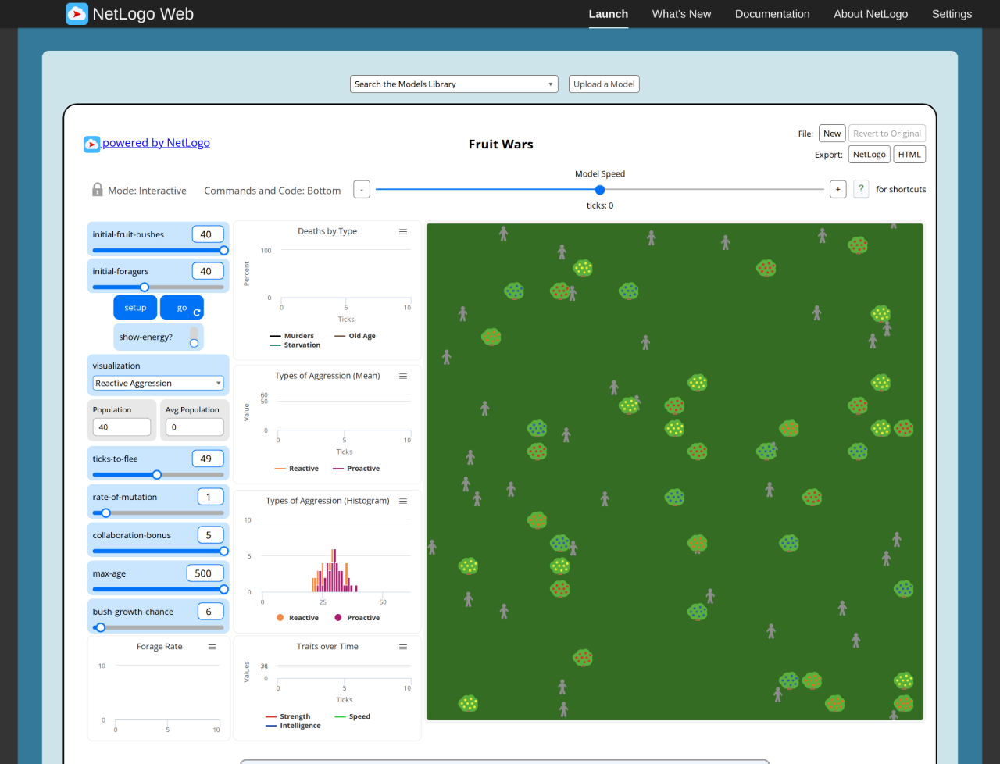
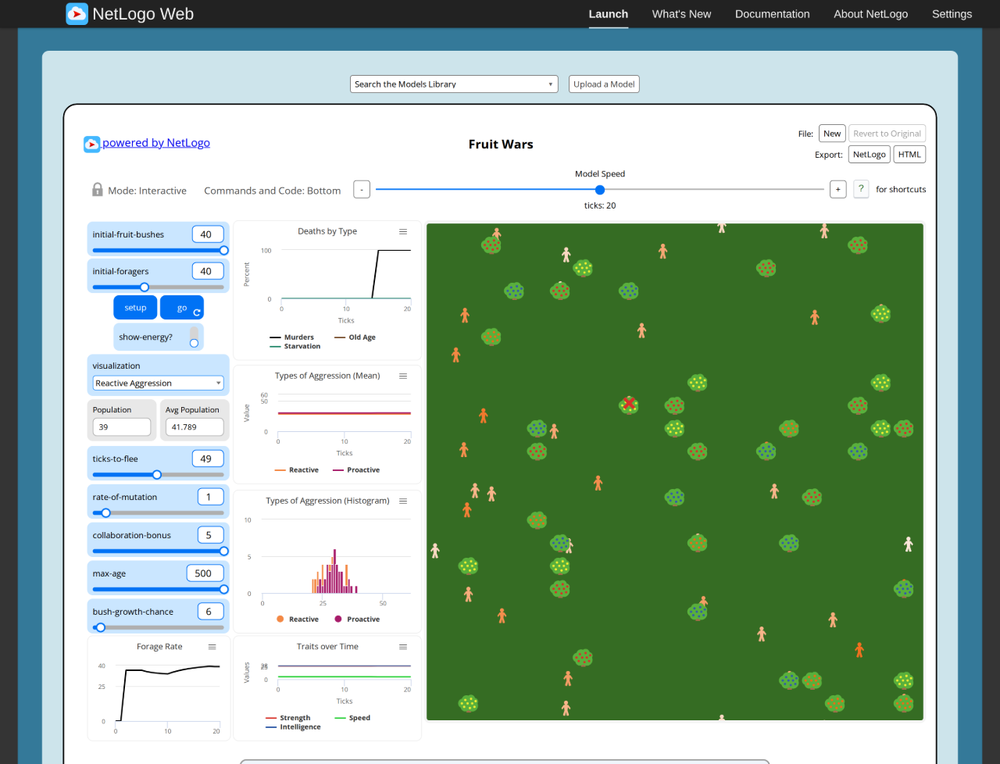
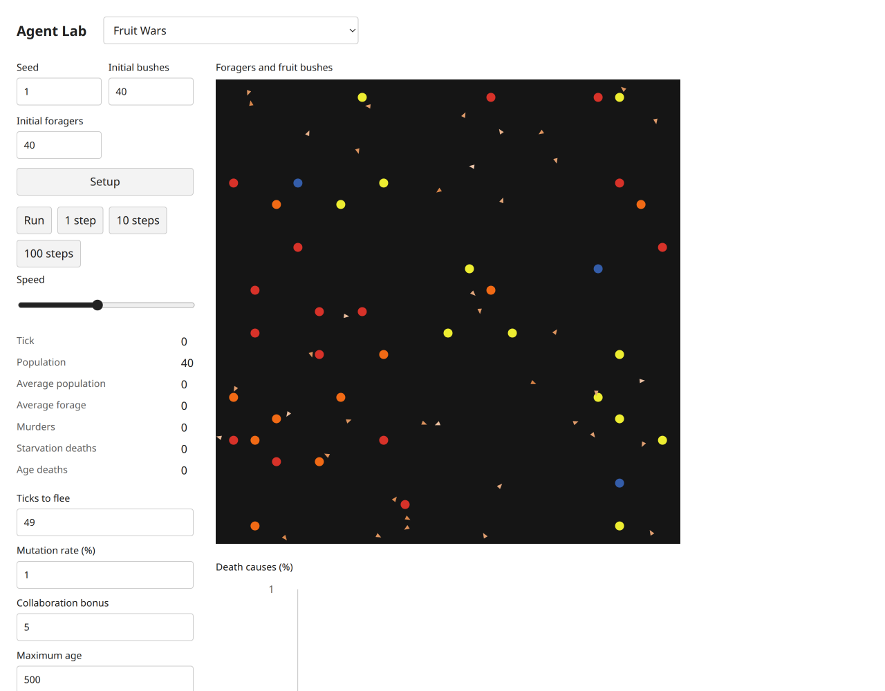
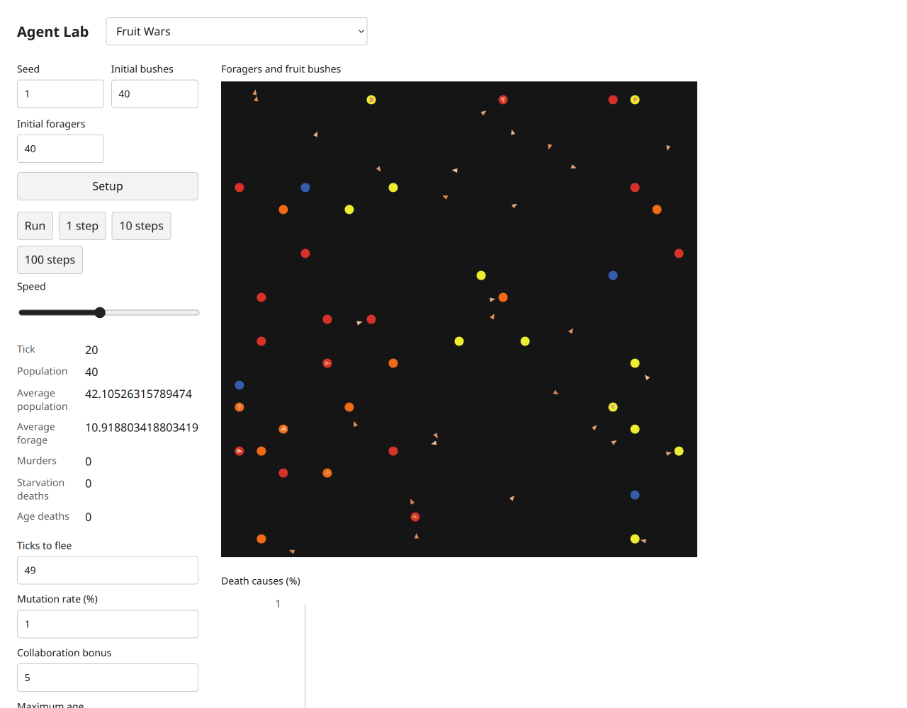

[Desktop dark](https://github.com/dweigend/city-library/blob/dc7b164abd23c8e7b7f11c902195ab030c5f1c4b/docs/development/selected-economics-evidence/fruit-wars-target-final-desktopDark.png) · [Mobile light](https://github.com/dweigend/city-library/blob/dc7b164abd23c8e7b7f11c902195ab030c5f1c4b/docs/development/selected-economics-evidence/fruit-wars-target-final-mobileLight.png) · [Mobile dark](https://github.com/dweigend/city-library/blob/dc7b164abd23c8e7b7f11c902195ab030c5f1c4b/docs/development/selected-economics-evidence/fruit-wars-target-final-mobileDark.png)

Comparison conclusion: the actual source mechanism and target controls were exercised; documented stochastic/presentation/host differences and source-failing scenarios remain explicit. Independent approval remains pending.

## limited-order-book

Canonical selected path: `Sample Models/Social Science/Economics/Limited Order Book`. [Actual original](https://www.netlogoweb.org/assets/modelslib/Sample%20Models/Social%20Science/Economics/Limited%20Order%20Book.nlogox). NetLogo NetLogo 7.0.4; source SHA-256 `acb1b7eeeabf99a1bf651bfcae391273fce16bae15c9e67bb64ee9ef0ebdb597`.

Both initialize100 traders and reusable owned orders. The contiguous native pair preserves cash74166.5/tokens3679 through tick10; target preserves74597.5/3646. Native final latest15.06208333 and totalAmount615; target latest16.39916667 and totalAmount639 (see public replay for full state). Prices are independent stochastic observations. Strict equality never crosses; lower ask determines execution price; affordability units and owner transfers are headless-tested. Utility is deliberately refreshed before matching. Isolated single-trader native/target first go errors before tick0 advances: no price is fabricated. Setup precision3, invalid4 rejection/recovery and trader counts were exercised. Extra recent/to-date lines and explicit order table expose existing source quantities; target lacks the source central market-size glyph and uses optional labels.

Native setup `{"success":true,"value":[0,100,74166.5,3679,0,0,0,0]}`; native progress `{"success":true,"value":[10,100,74166.5,3679,15.062083333333327,48,615,16.140552845528592]}`. Reporter `(list ticks count traders sum [cash] of traders sum [stockpile] of traders latest-price latest-amount total-amount price-to-date)`.

Target final monitor readback:

```text
Tick
10
Latest price
16.39916666666666
Latest volume ($)
983.9499999999996
Price to date
16.952081377151927
Total cash
74597.5
Circulating tokens
3646
Total utilities
143516.75000000003
Average utilities
1435.1675000000002
Average honest utility
1429.7099999999998
Average cunning utility
1440.6249999999998
Cunning / honest (%)
100.76344153709493
```

Actual target chunk `http://localhost:3139/chunks/ui-vzce2qmg.js`; SHA-256 `eb4b29618fdb664e719be41b9ca0a9d1343dd9a4055e28d264b237b8f8bb2192`; marker `limited-order-book:source-v1`; captured build `1793963820671`. Final reload confirmation matches. Captured target window/runtime errors: `[]`; mobile horizontal overflow: `False`. This is a bounded diagnostic observation, not an exhaustive console audit.

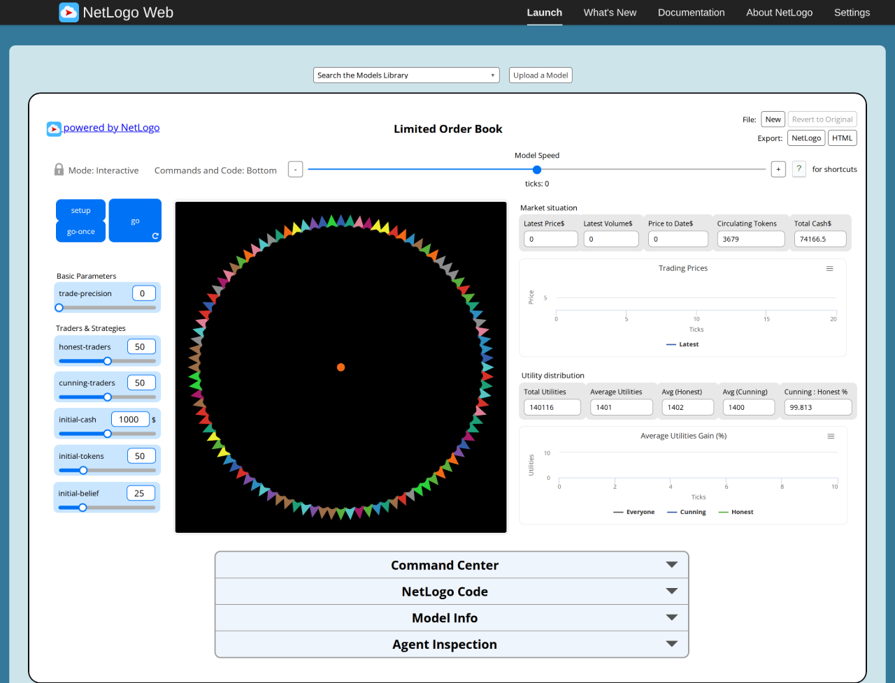
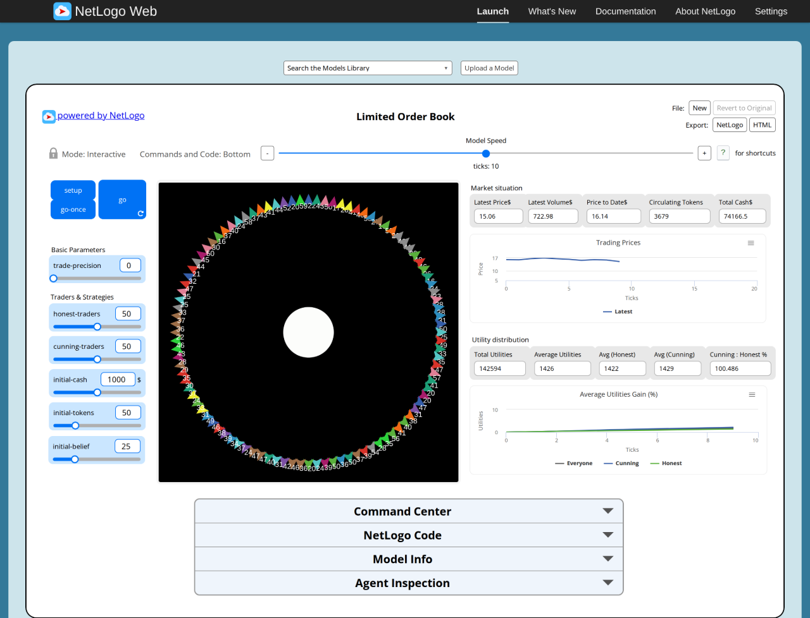
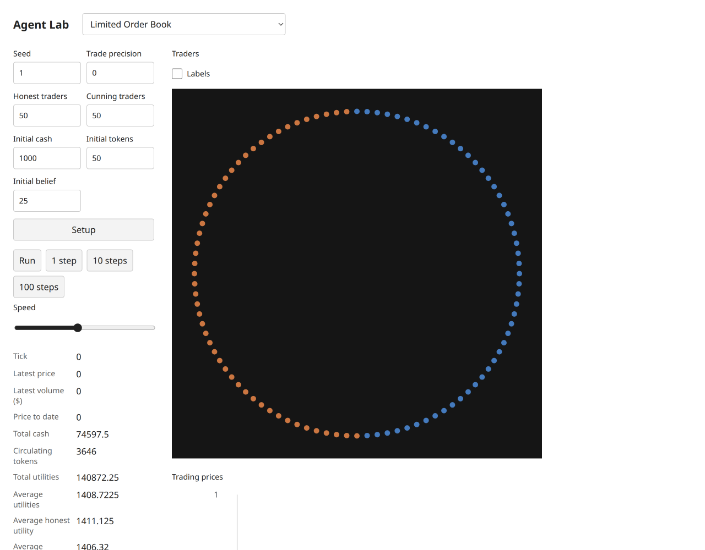
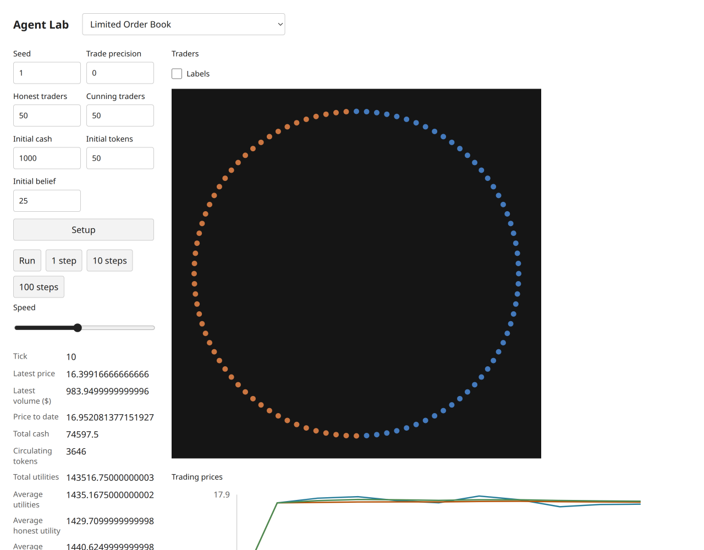

[Desktop dark](https://github.com/dweigend/city-library/blob/dc7b164abd23c8e7b7f11c902195ab030c5f1c4b/docs/development/selected-economics-evidence/limited-order-book-target-final-desktopDark.png) · [Mobile light](https://github.com/dweigend/city-library/blob/dc7b164abd23c8e7b7f11c902195ab030c5f1c4b/docs/development/selected-economics-evidence/limited-order-book-target-final-mobileLight.png) · [Mobile dark](https://github.com/dweigend/city-library/blob/dc7b164abd23c8e7b7f11c902195ab030c5f1c4b/docs/development/selected-economics-evidence/limited-order-book-target-final-mobileDark.png)

Comparison conclusion: the actual source mechanism and target controls were exercised; documented stochastic/presentation/host differences and source-failing scenarios remain explicit. Independent approval remains pending.

## bidding-market

Canonical selected path: `Sample Models/Social Science/Economics/Bidding Market`. [Actual original](https://www.netlogoweb.org/assets/modelslib/Sample%20Models/Social%20Science/Economics/Bidding%20Market.nlogox). NetLogo NetLogo 7.0.4; source SHA-256 `5f86c4f77da77e22e5f0070e0828af72b3c52bdf120c8c25aab58f77129de74c`.

Both initialize50 buyers and50 sellers and make no sale on the first tick because asks>=50 exceed willingness<=9. At tick100 native sales608/average24.59 versus target592/23.25. Source supply/demand budgets and fixed cyclic pairing are preserved, with no claimed cash conservation beyond source cent rounding/residual rule. Zero starting money stops at tick0; source zero-denominator monitor/plot behavior is qualified, target shows Undefined for percent money. Concentrated distributions, desperate/random behavior, ignore-full and sale-marker toggles were exercised. Native random12.5 uses ceil13; its actual loaded primitive and a reporter probe are archived in native-random-boundary.json; target corrected the odd25-money case with a focused test, frozen examples unchanged. Shadows/stars become neutral quantity sizes and sale-link emphasis; exponential quantities use explicit -mean*ln(1-U).

Native setup `{"success":true,"value":[0,50,50,0,0,0,0,0,0]}`; native progress `{"success":true,"value":[100,50,50,608,484,14948.589999999997,24.59,55.72868927589368,51.52542372881356]}`. Reporter `(list ticks count buyers count sellers total-sales remaining-supply seller-cash average-price percent-items-sold percent-demand-satisfied)`.

Target final monitor readback:

```text
Tick
100
Sales
592
Average price
23.25
Money taken (%)
71.6562532541914
Items sold (%)
46.213895394223265
Demand met (%)
53.6231884057971
```

Actual target chunk `http://localhost:3139/chunks/ui-08grmtss.js`; SHA-256 `3eaf3c3dd3085222e30b2037544bebcec94fc1f31d89e45fe6852bb5e4365894`; marker `bidding-market:source-v1`; captured build `1793963820671`. Final reload confirmation matches. Captured target window/runtime errors: `[]`; mobile horizontal overflow: `False`. This is a bounded diagnostic observation, not an exhaustive console audit.

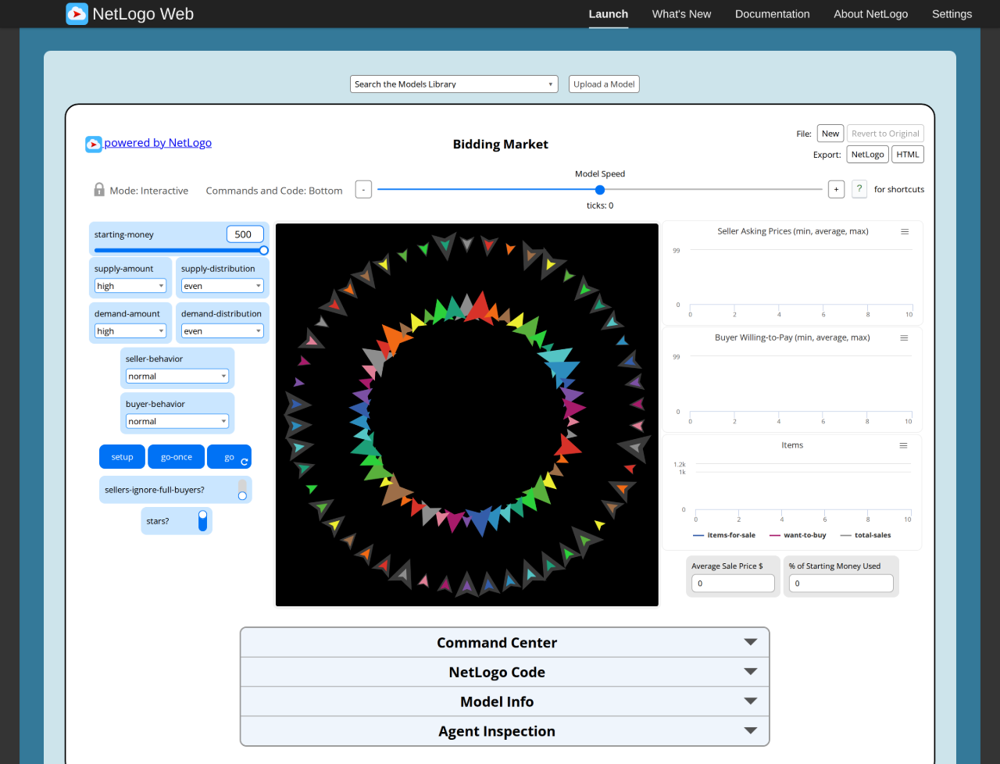
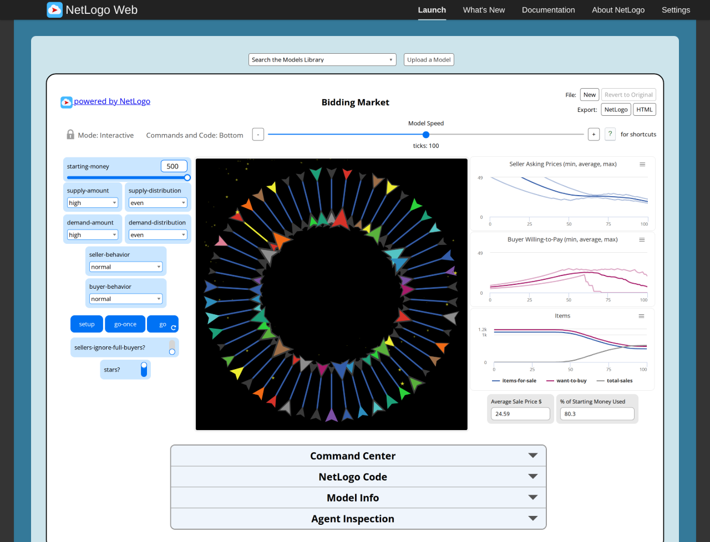
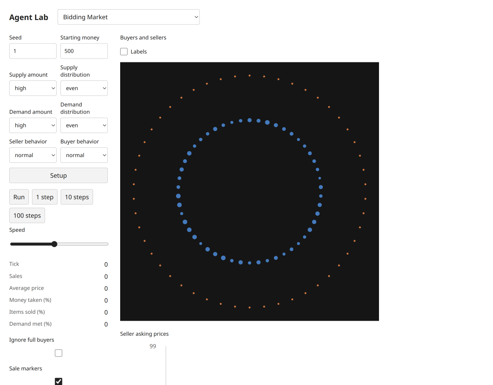
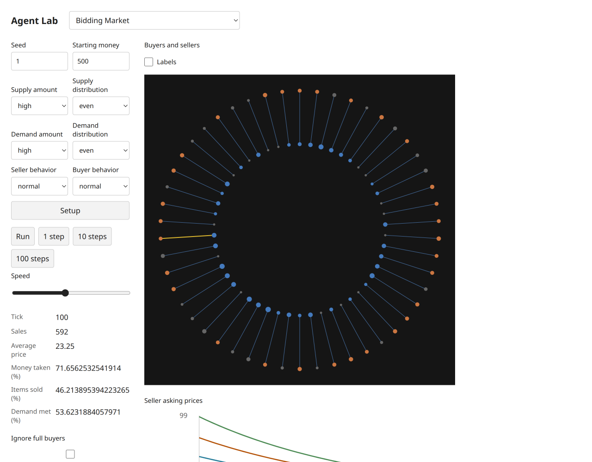

[Desktop dark](https://github.com/dweigend/city-library/blob/dc7b164abd23c8e7b7f11c902195ab030c5f1c4b/docs/development/selected-economics-evidence/bidding-market-target-final-desktopDark.png) · [Mobile light](https://github.com/dweigend/city-library/blob/dc7b164abd23c8e7b7f11c902195ab030c5f1c4b/docs/development/selected-economics-evidence/bidding-market-target-final-mobileLight.png) · [Mobile dark](https://github.com/dweigend/city-library/blob/dc7b164abd23c8e7b7f11c902195ab030c5f1c4b/docs/development/selected-economics-evidence/bidding-market-target-final-mobileDark.png)

Comparison conclusion: the actual source mechanism and target controls were exercised; documented stochastic/presentation/host differences and source-failing scenarios remain explicit. Independent approval remains pending.

## hotellings-law

Canonical selected path: `Sample Models/Social Science/Economics/Hotelling's Law`. [Actual original](https://www.netlogoweb.org/assets/modelslib/Sample%20Models/Social%20Science/Economics/Hotelling's%20Law.nlogox). NetLogo NetLogo 7.0.4; source SHA-256 `6241899fa70ee6ab961fb8d183321c662e12f011246684fbd99ea403f6a259ad`.

Both default to1681 consumers,3 stores,price10 and complete10 steps with market shares summing1681. Native final prices16/15/14; target final prices and shares are in public-replays.jsonl (stochastic tie decisions differ). The line/moving-only fixture has41 consumers,prices10 and x0 in both engines. Target switching to pricing-only, invalid11 stores rejection and recovery to2 stores were exercised. Decisions are accumulated before any location/price commit; hypothetical evaluations restore canonical store state but consume tie RNG. Public Grid/Agent operations handle hard boundaries and distance. Store colors/areas and price/share/revenue histories retain their meaning; source pen trails are omitted as presentation, with current positions and history charts retained.

Native setup `{"success":true,"value":[0,1681,1681,[10,10,10],[462,833,386]]}`; native progress `{"success":true,"value":[10,1681,1681,[16,15,14],[447,689,545]]}`. Reporter `(list ticks count consumers sum [area-count] of turtles (map [t -> [price] of t] sort turtles) (map [t -> [area-count] of t] sort turtles))`.

Target final monitor readback:

```text
Tick
10
Consumers
1681
```

Actual target chunk `http://localhost:3139/chunks/ui-57w7c00t.js`; SHA-256 `e08ab3dde433fa00ecd49646fadc61d6d013c645d97614a247ab30ee7c37503c`; marker `hotellings-law:source-v1`; captured build `1793963820671`. Final reload confirmation matches. Captured target window/runtime errors: `[]`; mobile horizontal overflow: `False`. This is a bounded diagnostic observation, not an exhaustive console audit.

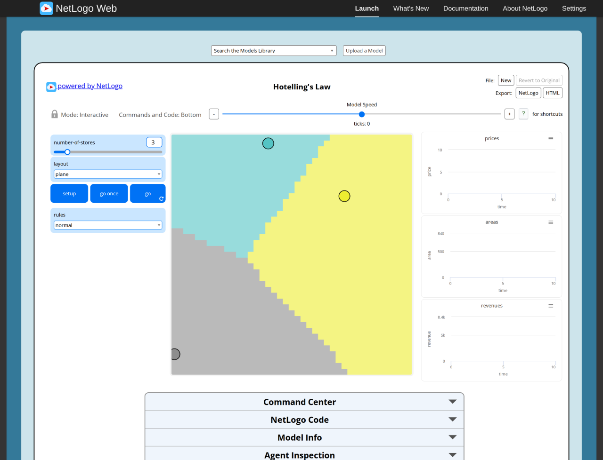
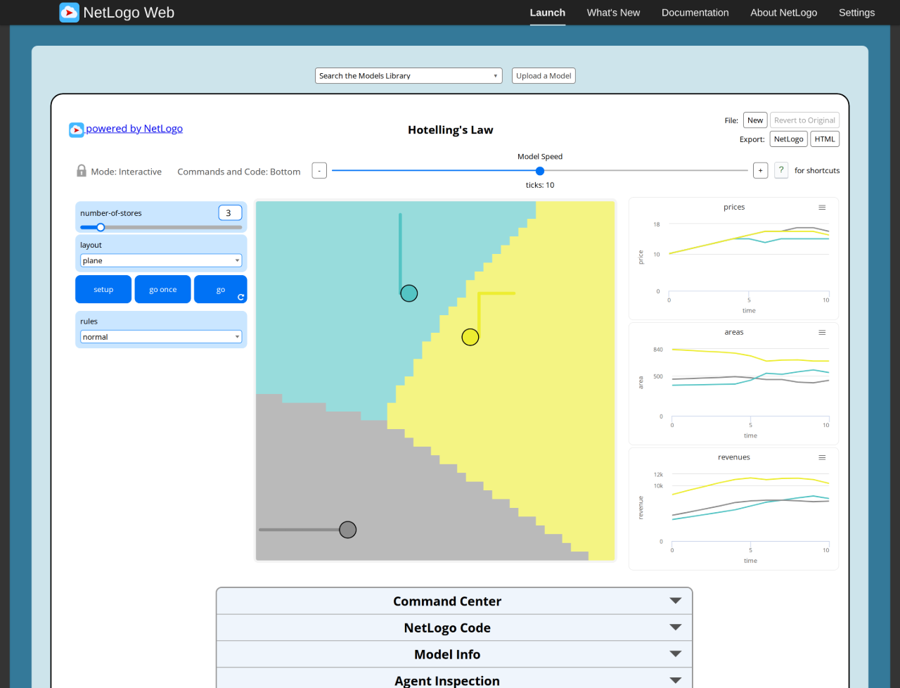
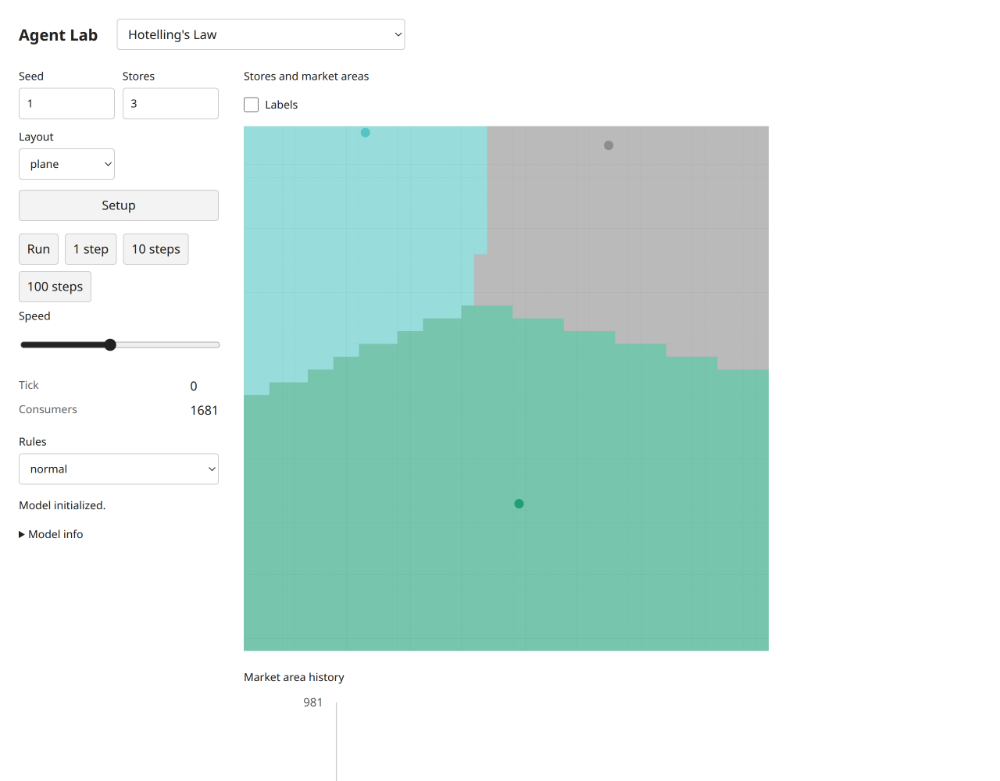
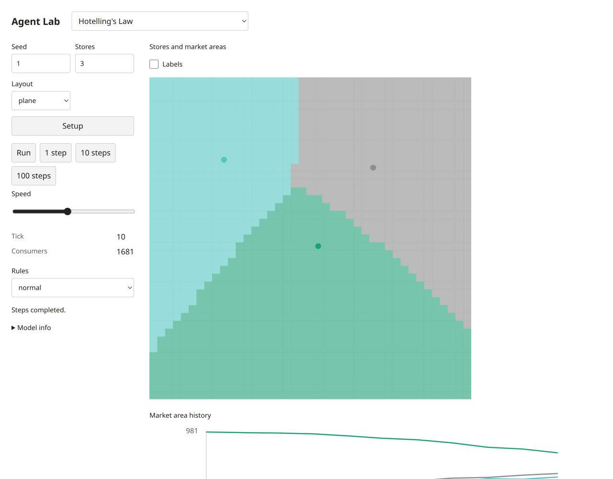

[Desktop dark](https://github.com/dweigend/city-library/blob/dc7b164abd23c8e7b7f11c902195ab030c5f1c4b/docs/development/selected-economics-evidence/hotellings-law-target-final-desktopDark.png) · [Mobile light](https://github.com/dweigend/city-library/blob/dc7b164abd23c8e7b7f11c902195ab030c5f1c4b/docs/development/selected-economics-evidence/hotellings-law-target-final-mobileLight.png) · [Mobile dark](https://github.com/dweigend/city-library/blob/dc7b164abd23c8e7b7f11c902195ab030c5f1c4b/docs/development/selected-economics-evidence/hotellings-law-target-final-mobileDark.png)

Comparison conclusion: the actual source mechanism and target controls were exercised; documented stochastic/presentation/host differences and source-failing scenarios remain explicit. Independent approval remains pending.

## braess-paradox

Canonical selected path: `Sample Models/Social Science/Economics/Braess Paradox`. [Actual original](https://www.netlogoweb.org/assets/modelslib/Sample%20Models/Social%20Science/Economics/Braess%20Paradox.nlogox). NetLogo NetLogo 7.0.4; source SHA-256 `472667ac315d7e5631332194a2dd305dafcc8d8bbf8afa0af8166fd833545c56`.

Both start with zero commuters and the actual source patch-road types/delays. Strict spawnRate10 creates the first commuter on call27, with ticksHere2, exactly confirmed in both. At tick800 both have29 cumulative births; native25 active and target25 active in these final samples. Last travel-time/route averages are stochastic; source smoothed route values and total average are distinct. Native analytical mode closure remains physically pending while route2 commuters exist: switch false at1000, middlePrev true through1800 with3 remaining, then false at1900 with0. Target tests independently check this rule and all three route policies; browser live spawnRate1/mode/middle/smoothing/randomness changes are exercised. Source road-type comments disagree with executed congestion code; implementation follows procedures. No generic Graph routing/analyze capability is invented; native no-middle greedy invalid powers/division are explicit errors. Triangles replace cars/trucks; delay cells and route plots remain.

Native setup `{"success":true,"value":[0,0,0,0,0,0,0,0,0,0,0]}`; native progress `{"success":true,"value":[800,25,29,0,1.5555555555555556,1.2879999999999998,1.3132527777777778,17,0,0,0]}`. Reporter `(list ticks count commuters cars-spawned top bottom middle avg spawn-time top-prob bottom-prob middle-prob)`.

Target final monitor readback:

```text
Tick
800
Active commuters
25
Cars spawned
29
Completed
4
Last travel time
1.6177777777777778
Average travel time
1.319213888888889
```

Actual target chunk `http://localhost:3139/chunks/ui-9277zzgw.js`; SHA-256 `4c3b32cfa6d05da7d82c1c375de7fa511eebf3460cbfcd2087d60e60558d2314`; marker `braess-paradox:source-v1`; captured build `1793963820671`. Final reload confirmation matches. Captured target window/runtime errors: `[]`; mobile horizontal overflow: `False`. This is a bounded diagnostic observation, not an exhaustive console audit.


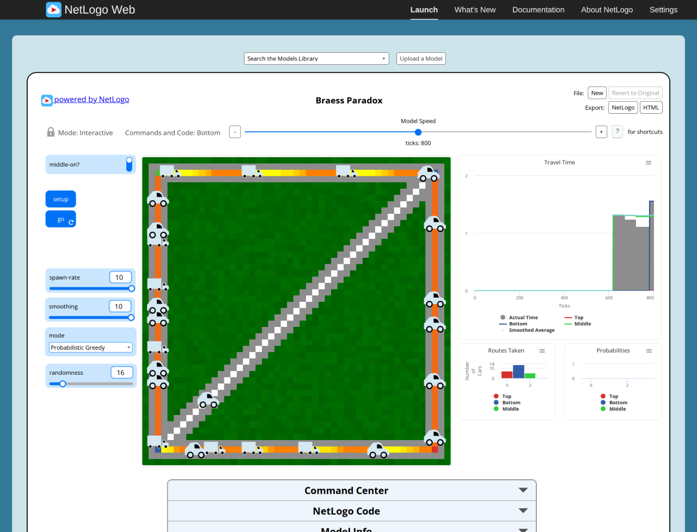
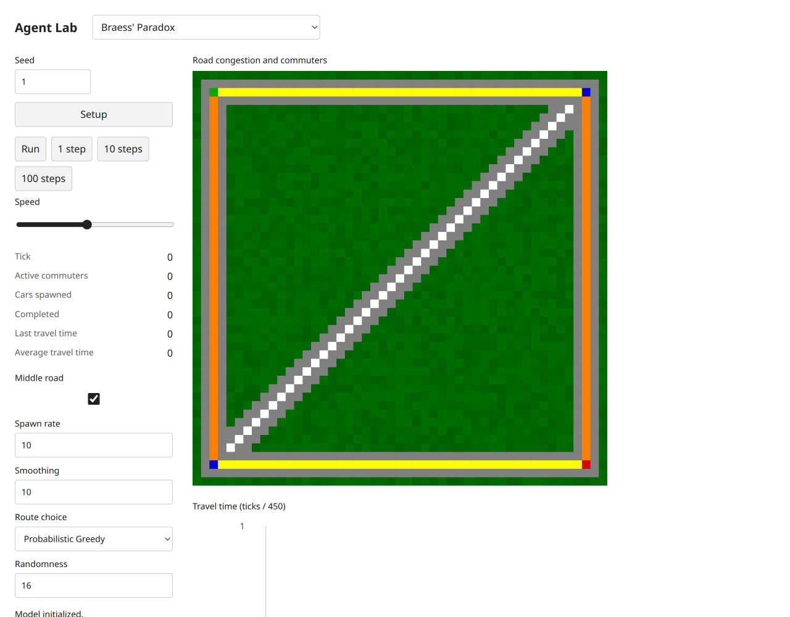
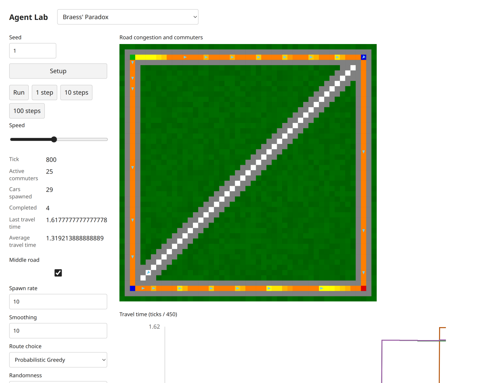

[Desktop dark](https://github.com/dweigend/city-library/blob/dc7b164abd23c8e7b7f11c902195ab030c5f1c4b/docs/development/selected-economics-evidence/braess-paradox-target-final-desktopDark.png) · [Mobile light](https://github.com/dweigend/city-library/blob/dc7b164abd23c8e7b7f11c902195ab030c5f1c4b/docs/development/selected-economics-evidence/braess-paradox-target-final-mobileLight.png) · [Mobile dark](https://github.com/dweigend/city-library/blob/dc7b164abd23c8e7b7f11c902195ab030c5f1c4b/docs/development/selected-economics-evidence/braess-paradox-target-final-mobileDark.png)

Comparison conclusion: the actual source mechanism and target controls were exercised; documented stochastic/presentation/host differences and source-failing scenarios remain explicit. Independent approval remains pending.

## cash-flow

Canonical selected path: `Sample Models/Social Science/Economics/Unverified/Cash Flow`. [Actual original](https://www.netlogoweb.org/assets/modelslib/Sample%20Models/Social%20Science/Economics/Unverified/Cash%20Flow.nlogox). NetLogo NetLogo 7.0.4; source SHA-256 `ab4aea96508e1d141a7c2571868fa1532b8db35b234824e0d7df5e1b66f9126c`.

Default473 people initialize wallets0/10, zero savings/loans; target initial wallet total2350, native2460. At tick30 native values and target values below come from their own contiguous runs; no RNG equality. Each target cycle explicitly does all business, then all bookkeeping/colors, then one bank sheet/classes. One-person UI fixture isolates reserve100 and wallet-to-saving phases; reset retains the single live reserve reader. Invalid negative population is rejected without losing the live model; zero-person target remains runnable with empty observations. Original zero-person Setup actually fails SET-PLOT-Y-RANGE0,0 in Wealth Dist Hist (retained error image). Negative available-to-loan is passed through source operations, not clamped. Wealth excludes wallet; classes may overlap. Bounded histories and mean wealth monitor replace an unbounded trace/gray histogram line; histogram uses its previous source range before the following mean-pen range change.

Native setup `{"success":true,"value":[0,473,2460,0,0,2460,0,0,0,0,0,473]}`; native progress `{"success":true,"value":[30,473,0,4693,2233,4693,4693,985.53,1474.4700000000003,177,91,205]}`. Reporter `(list ticks count turtles wallets-total savings-total loans-total money-total bank-deposits bank-reserves bank-to-loan rich poor middle-class)`.

Target final monitor readback:

```text
Mean wealth
4.968287526427061
Tick
30
Next phase
Business → balance books → bank sheet
Savings total
4695
Wallets total
0
Loans total
2345
Money total
4695
Bank reserves
985.9499999999999
Bank to loan
1364.0500000000002
Rich
176
Middle class
201
Poor
96

```

Actual target chunk `http://localhost:3139/chunks/ui-jghy8rf6.js`; SHA-256 `fa5d03e5fbb878a7b41c7e9a0cbeee2f2a7298f1d99f5d594a545edc9925dc2e`; marker `cash-flow:source-v1`; captured build `1793963376114`. Final reload confirmation matches. Captured target window/runtime errors: `[]`; mobile horizontal overflow: `False`. This is a bounded diagnostic observation, not an exhaustive console audit.

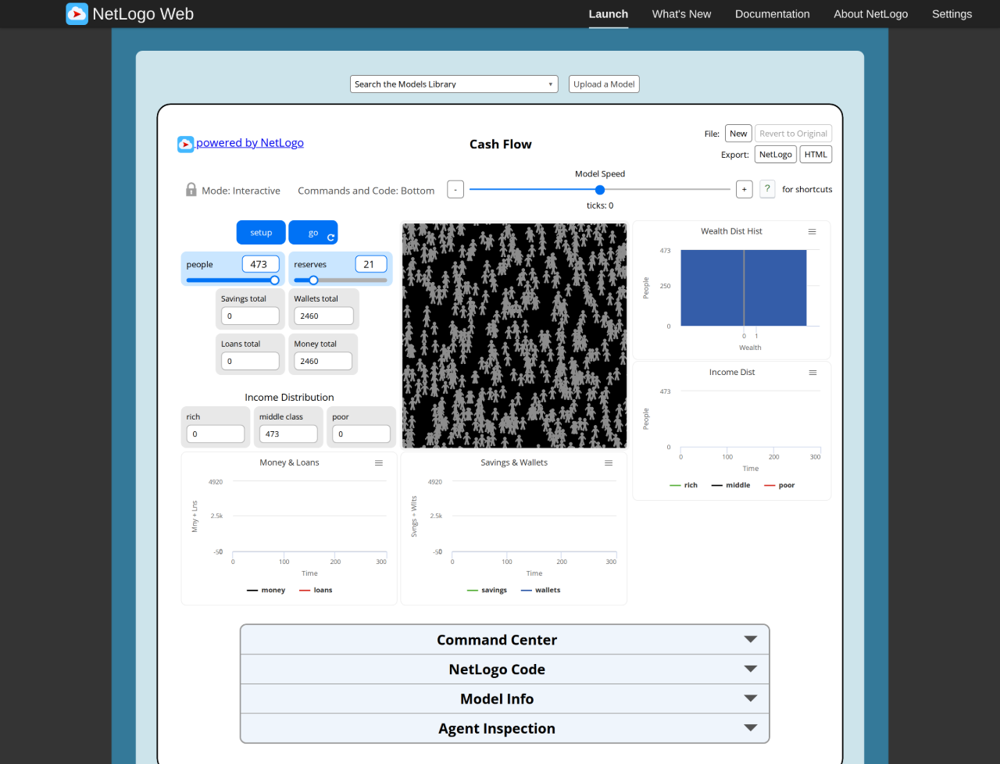
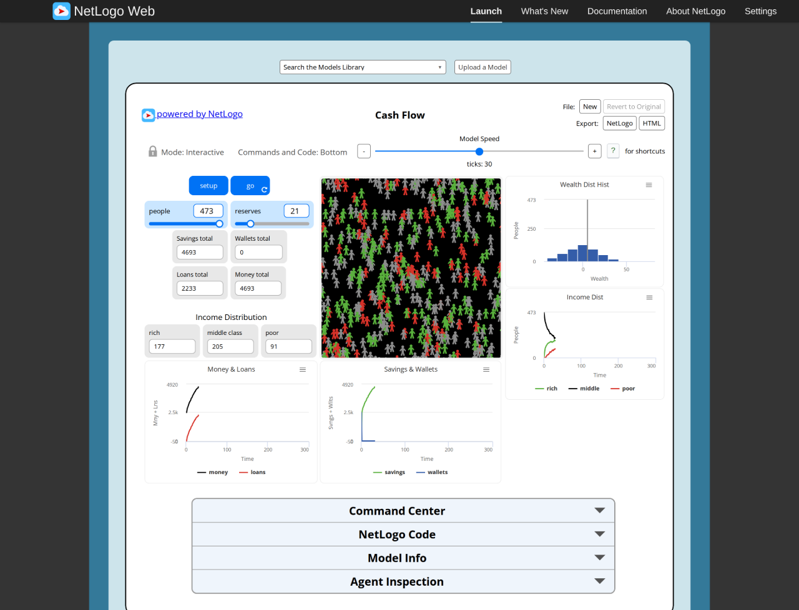
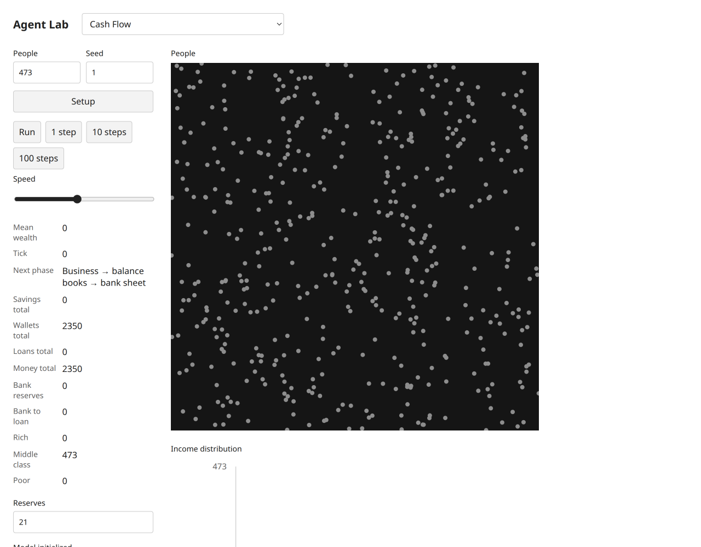
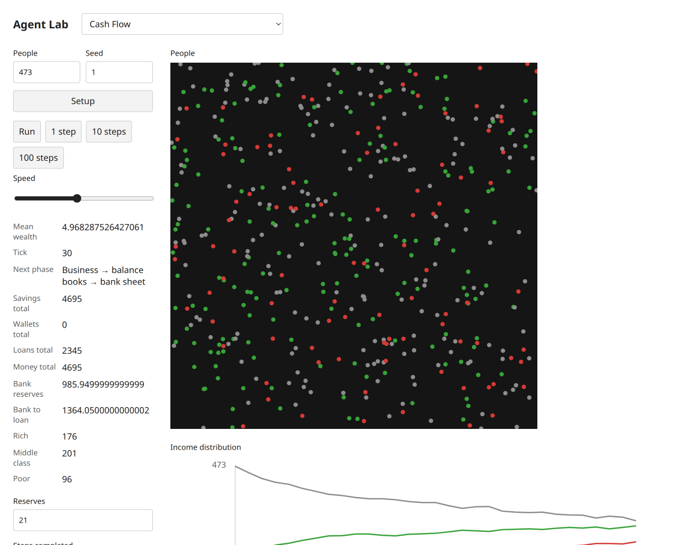

[Desktop dark](https://github.com/dweigend/city-library/blob/dc7b164abd23c8e7b7f11c902195ab030c5f1c4b/docs/development/selected-economics-evidence/cash-flow-target-desktopDark.png) · [Mobile light](https://github.com/dweigend/city-library/blob/dc7b164abd23c8e7b7f11c902195ab030c5f1c4b/docs/development/selected-economics-evidence/cash-flow-target-mobileLight.png) · [Mobile dark](https://github.com/dweigend/city-library/blob/dc7b164abd23c8e7b7f11c902195ab030c5f1c4b/docs/development/selected-economics-evidence/cash-flow-target-mobileDark.png)

Comparison conclusion: the actual source mechanism and target controls were exercised; documented stochastic/presentation/host differences and source-failing scenarios remain explicit. Independent approval remains pending.

## bank-reserves

Canonical selected path: `Sample Models/Social Science/Economics/Unverified/Bank Reserves`. [Actual original](https://www.netlogoweb.org/assets/modelslib/Sample%20Models/Social%20Science/Economics/Unverified/Bank%20Reserves.nlogox). NetLogo NetLogo 7.0.4; source SHA-256 `bdd9b8eecf2776cc32ec96e570ba3f2ad5ec173a58bcc1db07ea929973b413ff`.

Default57 people initialize wallets1..10, no deposits/loans and initially zero class counters. Source and target use three distinct ticks: business, balance/books/sticky colors, bank sheet; classes are polled before each phase. One-person native reports wallet4 at tick1, saving4 but bankDeposits0 at tick2, then deposits4/reserves2.08/toLoan1.92 at tick3. Target reserve100 fixture independently shows the same phase separation and live-reader reset persistence. Default tick30 target saving318/loans29, native readbacks below; comparisons preserve accounting rather than trajectories. Empty original Setup fails SET-PLOT-Y-RANGE0,0 in Income Dist; target empty population is a documented robust-host adaptation. Native histogram cadence ticks%10==1, source double-width-bin expression and sticky blue/green/red colors are retained. No silent substitution with the Cash Flow whole-cycle model.

Native setup `{"success":true,"value":[0,57,348,0,0,348,0,0,0,0,0,0]}`; native progress `{"success":true,"value":[30,57,0,361,13,361,361,187.72,160.28,9,0,48]}`. Reporter `(list ticks count turtles wallets-total savings-total loans-total money-total bank-deposits bank-reserves bank-to-loan rich poor middle-class)`.

Target final monitor readback:

```text
Mean wealth
5.0701754385964914
Tick
30
Next phase
Business
Savings total
318
Wallets total
0
Loans total
29
Money total
318
Bank reserves
165.36
Bank to loan
123.63999999999999
Rich
10
Middle class
46
Poor
1

```

Actual target chunk `http://localhost:3139/chunks/ui-3y86tpp3.js`; SHA-256 `4b4ce9f39b7727324043be7b391318f63d23b63b7307f1a4c47082ecc2025fa6`; marker `bank-reserves:source-v1`; captured build `1793963376114`. Final reload confirmation matches. Captured target window/runtime errors: `[]`; mobile horizontal overflow: `False`. This is a bounded diagnostic observation, not an exhaustive console audit.

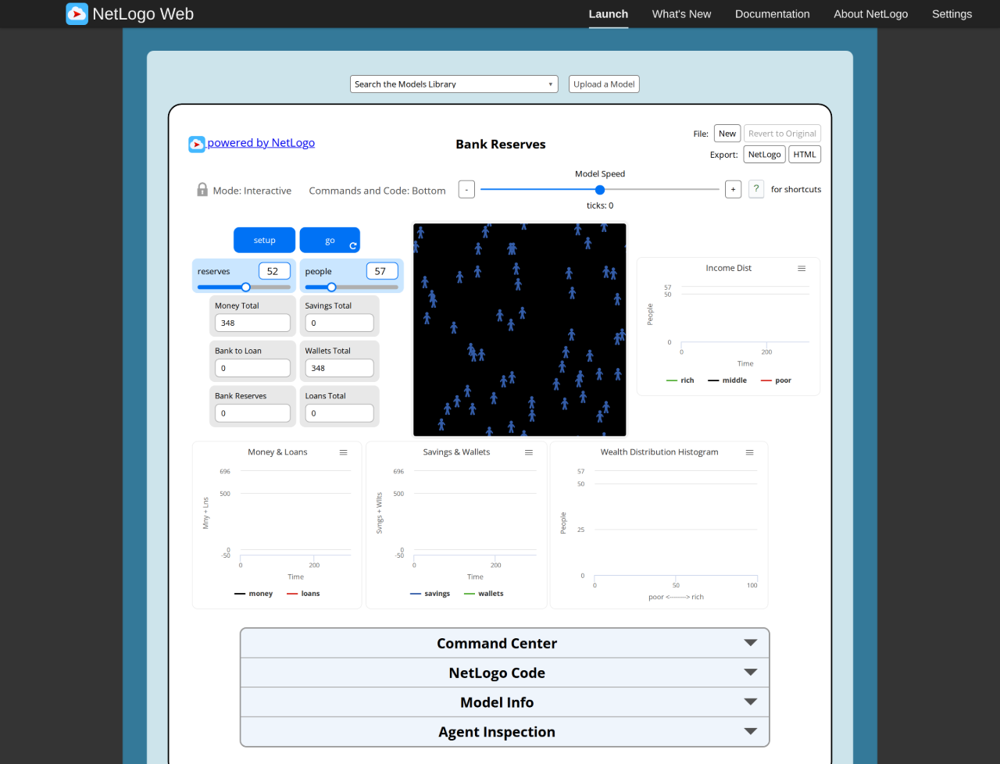
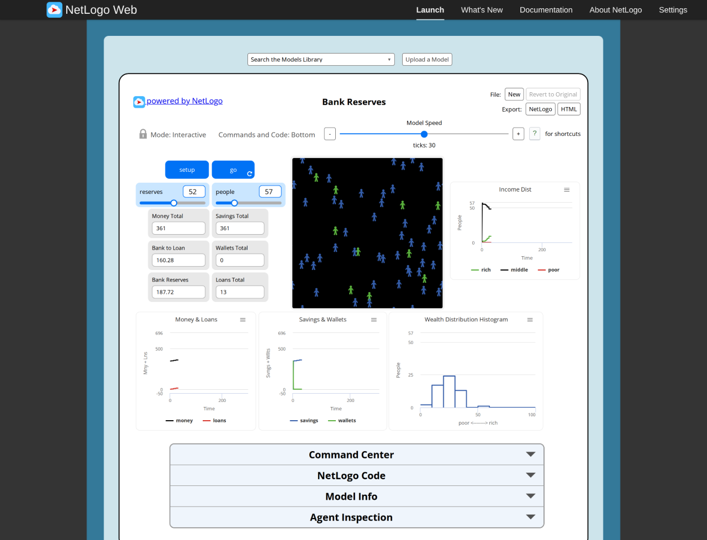
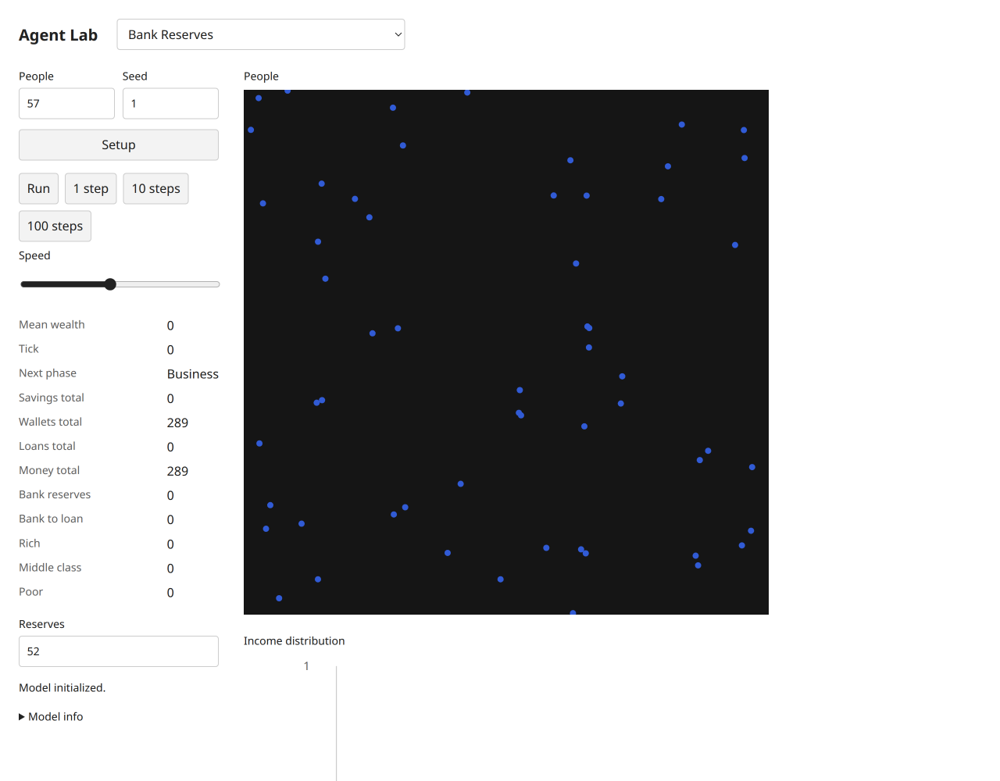
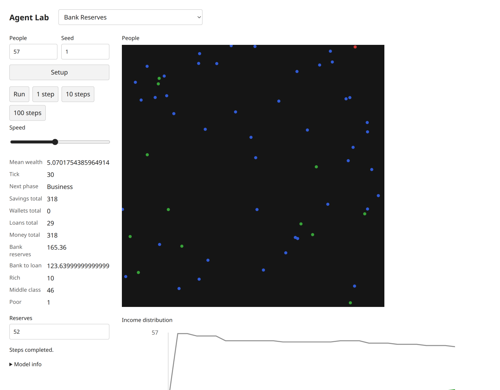

[Desktop dark](https://github.com/dweigend/city-library/blob/dc7b164abd23c8e7b7f11c902195ab030c5f1c4b/docs/development/selected-economics-evidence/bank-reserves-target-desktopDark.png) · [Mobile light](https://github.com/dweigend/city-library/blob/dc7b164abd23c8e7b7f11c902195ab030c5f1c4b/docs/development/selected-economics-evidence/bank-reserves-target-mobileLight.png) · [Mobile dark](https://github.com/dweigend/city-library/blob/dc7b164abd23c8e7b7f11c902195ab030c5f1c4b/docs/development/selected-economics-evidence/bank-reserves-target-mobileDark.png)

Comparison conclusion: the actual source mechanism and target controls were exercised; documented stochastic/presentation/host differences and source-failing scenarios remain explicit. Independent approval remains pending.

## prisoners-dilemma-basic

Canonical selected path: `Sample Models/Social Science/Prisoner's Dilemma/Prisoner's Dilemma Basic`. [Actual original](https://www.netlogoweb.org/assets/modelslib/Sample%20Models/Social%20Science/Prisoner's%20Dilemma/Prisoner's%20Dilemma%20Basic.nlogox). NetLogo NetLogo 7.0.4; source SHA-256 `a2fdd21082bd5cd3e8e5c5fb91cde6631cd8ac146bd02ed702a0fe51e379237b`.

Native has no clock or iterated strategy. Setup uses the known/unknown partner switch; Answer always reinitializes. All four actual native confirm messages were accepted and archived: both silent1, confess against silent0, silent against confess5, both confess3 years. Target Answer executes all four via live switches; unknown-partner and repeated step/run/reset were exercised. Final default known-partner pair shows face sucker/5 years in the original and the corresponding persistent accessible result in target. Target rounds are explicitly Answers (no native clock), a host action count. Result/payoff tables replace source face drawing and modal message; no source behavioral strategy is added.

Native setup `{"success":true,"value":[false,true,true,["face"]]}`; native progress `{"success":true,"value":[false,true,true,["face sucker"]]}`. Reporter `(list partner-is-silent? you-silent? partner-silence-known? [shape] of turtles)`.

Target final monitor readback:

```text
Answers (no native clock)
1
Sentence (years)
5
```

Actual target chunk `http://localhost:3139/chunks/ui-5y6mtmky.js`; SHA-256 `4fcfde8f8cd4da31f2771eb1ac3dfd4ecb534deac0c66d118b05abe1511ba028`; marker `prisoners-dilemma-basic:source-v1`; captured build `1793963950520`. Final reload confirmation matches. Captured target window/runtime errors: `[]`; mobile horizontal overflow: `False`. This is a bounded diagnostic observation, not an exhaustive console audit.


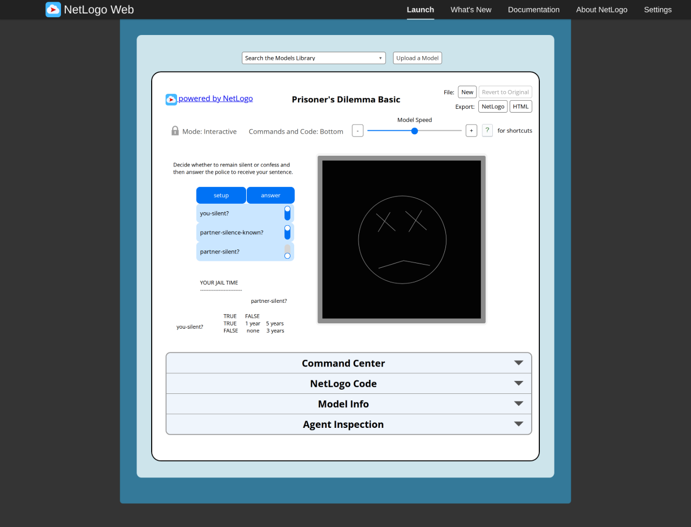
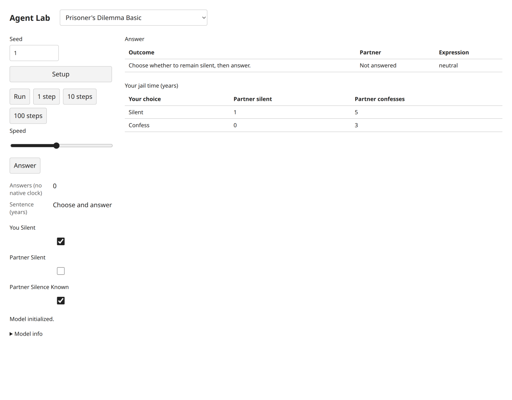
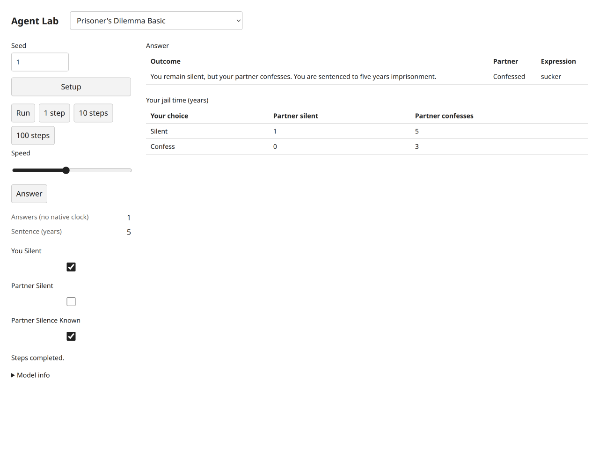

[Desktop dark](https://github.com/dweigend/city-library/blob/dc7b164abd23c8e7b7f11c902195ab030c5f1c4b/docs/development/selected-economics-evidence/prisoners-dilemma-basic-target-final-desktopDark.png) · [Mobile light](https://github.com/dweigend/city-library/blob/dc7b164abd23c8e7b7f11c902195ab030c5f1c4b/docs/development/selected-economics-evidence/prisoners-dilemma-basic-target-final-mobileLight.png) · [Mobile dark](https://github.com/dweigend/city-library/blob/dc7b164abd23c8e7b7f11c902195ab030c5f1c4b/docs/development/selected-economics-evidence/prisoners-dilemma-basic-target-final-mobileDark.png)

Comparison conclusion: the actual source mechanism and target controls were exercised; documented stochastic/presentation/host differences and source-failing scenarios remain explicit. Independent approval remains pending.

## prisoners-dilemma-two-person-iterated

Canonical selected path: `Sample Models/Social Science/Prisoner's Dilemma/Prisoner's Dilemma Two Person Iterated`. [Actual original](https://www.netlogoweb.org/assets/modelslib/Sample%20Models/Social%20Science/Prisoner's%20Dilemma/Prisoner's%20Dilemma%20Two%20Person%20Iterated.nlogox). NetLogo NetLogo 7.0.4; source SHA-256 `32461d17a6a52c10378a3f907a699260d9d07972a728647baa45894f05999978`.

Both initialize score3 each; average uses score/(ticks+1), including the initial pseudo-round. Final native and target at12 have different random scores, explicitly recorded. Deterministic cooperate/defect fixture matches exactly tick1 scores3/8 and averages1.5/4. Target actual Play once action and tft retaliation produce8/3 then9/4 in successive rounds. Human/computer strategy choices, selected/hidden strategy and display-history switches were exercised. Two choices precede payoff/memory writes; custom strategy remains source tit-for-tat and unforgiving remembers its own last defect. Tables replace person/computer sprites, average-score line remains; output is bounded300 lines with last12 visible, not an unbounded native output pane.

Native setup `{"success":true,"value":[0,3,3,3,3]}`; native progress `{"success":true,"value":[12,33,33,2.538,2.538]}`. Reporter `(list ticks [score] of one-of users [score] of one-of computers [average-score] of one-of users [average-score] of one-of computers)`.

Target final monitor readback:

```text
Round
12
Human score
34
Computer score
29
```

Actual target chunk `http://localhost:3139/chunks/ui-76ajmyvp.js`; SHA-256 `739a0f407aaae56a1295c308f926b461b593a37596b33100eb1dfa72469e8752`; marker `prisoners-dilemma-two-person-iterated:source-v1`; captured build `1793963950520`. Final reload confirmation matches. Captured target window/runtime errors: `[]`; mobile horizontal overflow: `False`. This is a bounded diagnostic observation, not an exhaustive console audit.

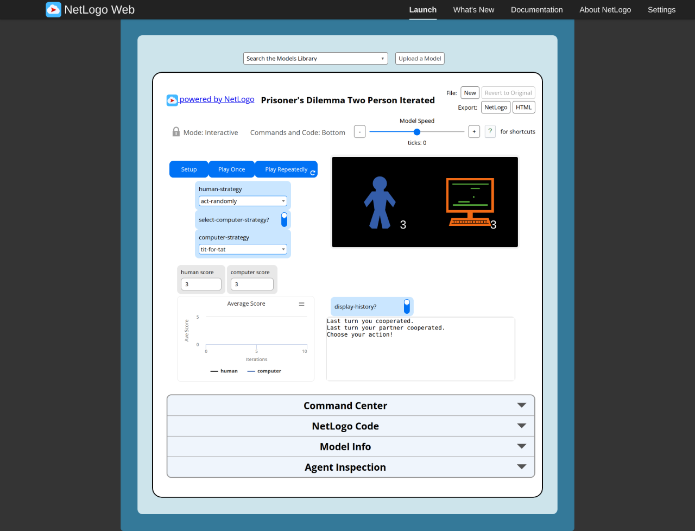

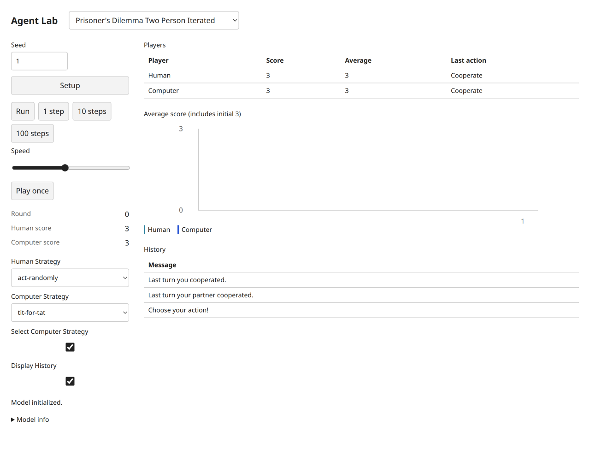
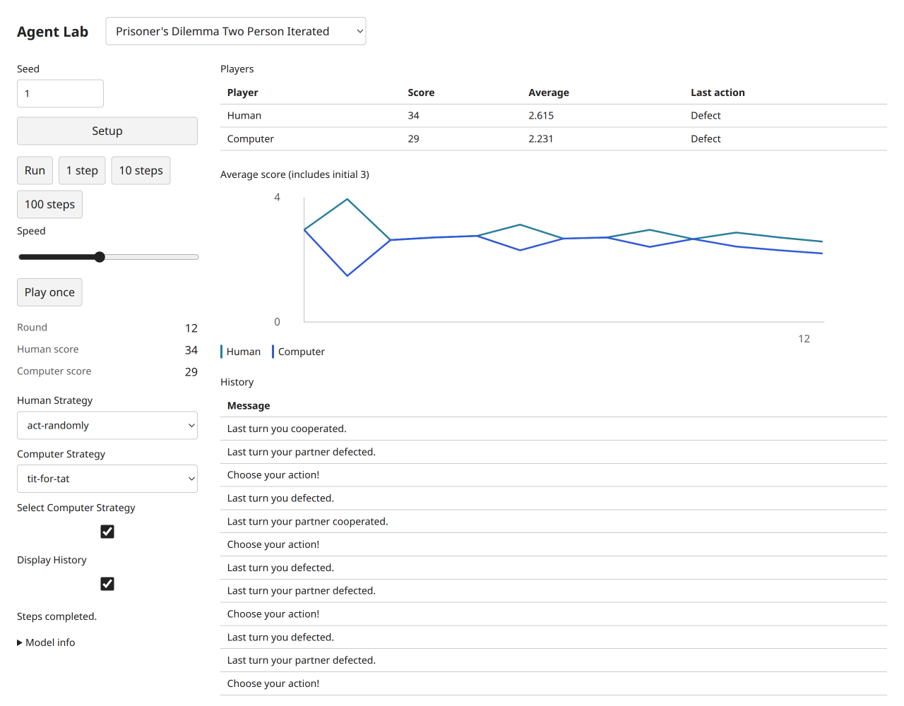

[Desktop dark](https://github.com/dweigend/city-library/blob/dc7b164abd23c8e7b7f11c902195ab030c5f1c4b/docs/development/selected-economics-evidence/prisoners-dilemma-two-person-iterated-target-final-desktopDark.png) · [Mobile light](https://github.com/dweigend/city-library/blob/dc7b164abd23c8e7b7f11c902195ab030c5f1c4b/docs/development/selected-economics-evidence/prisoners-dilemma-two-person-iterated-target-final-mobileLight.png) · [Mobile dark](https://github.com/dweigend/city-library/blob/dc7b164abd23c8e7b7f11c902195ab030c5f1c4b/docs/development/selected-economics-evidence/prisoners-dilemma-two-person-iterated-target-final-mobileDark.png)

Comparison conclusion: the actual source mechanism and target controls were exercised; documented stochastic/presentation/host differences and source-failing scenarios remain explicit. Independent approval remains pending.

## el-farol

Canonical selected path: `IABM Textbook/chapter 3/El Farol Extensions/El Farol`. [Actual original](https://www.netlogoweb.org/assets/modelslib/IABM%20Textbook/chapter%203/El%20Farol%20Extensions/El%20Farol.nlogox). NetLogo NetLogo 7.0.4; source SHA-256 `236f508bc73e56fe5c8002615052842fd6b41b9a3777bc99fae835f4cdc8755a`.

This is the selected IABM Textbook/chapter3/El Farol Extensions original, not a replacement Social Science entry. Both initialize100 patrons at home,2*memory history, memory5 and10 fixed strategies; attendance initially comes from random history even though nobody is physically at the bar. Native final tick12 and target final58 attendance are independent observations. Actual native reporter confirms intercept/dot-product70 and unclamped-200. Target attendance equals bar occupancy and first history entry; source bounded initial best-score and last-wins ties remain. Live threshold0 changes decisions; memory1/one-strategy Setup and invalid memory0 rejection were exercised. Memory/strategy count are setup-only to prevent inconsistent existing vectors; threshold is live. People become dots, crowded text becomes monitor; histories bounded1001. Last scored prediction remains distinct from chosen strategy prediction and is named in the inspector.

Native setup `{"success":true,"value":[0,100,18,10,0,60]}`; native progress `{"success":true,"value":[12,100,36,10,36,60]}`. Reporter `(list ticks count turtles attendance length history count turtles-on bar-patches overcrowding-threshold)`.

Target final monitor readback:

```text
Week
12
Attendance
58
Crowded
No

```

Actual target chunk `http://localhost:3139/chunks/ui-j76cf1vn.js`; SHA-256 `e9df06844c8e31eee3baff185dfaa032b75d193edbad34c5b922b74c50b113ac`; marker `el-farol:source-v1`; captured build `1793963950520`. Final reload confirmation matches. Captured target window/runtime errors: `[]`; mobile horizontal overflow: `False`. This is a bounded diagnostic observation, not an exhaustive console audit.

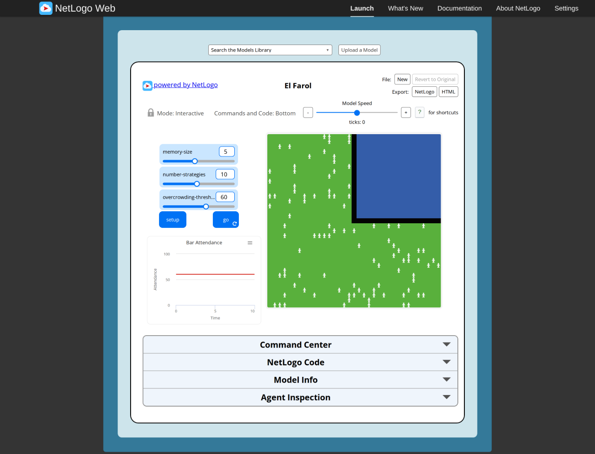
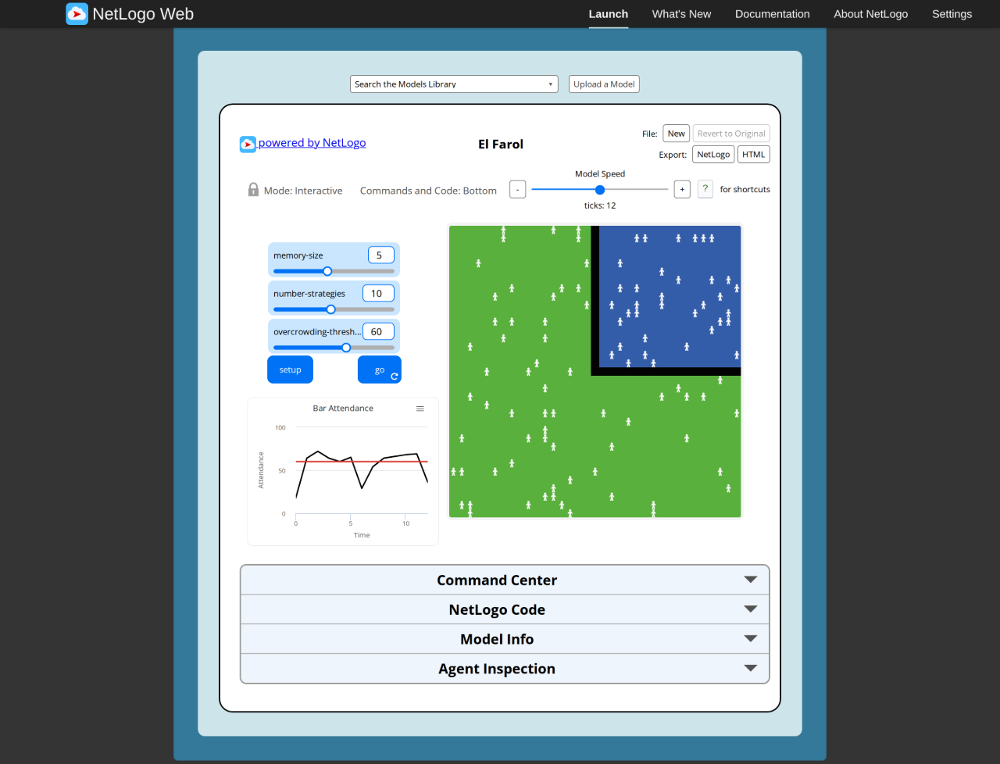
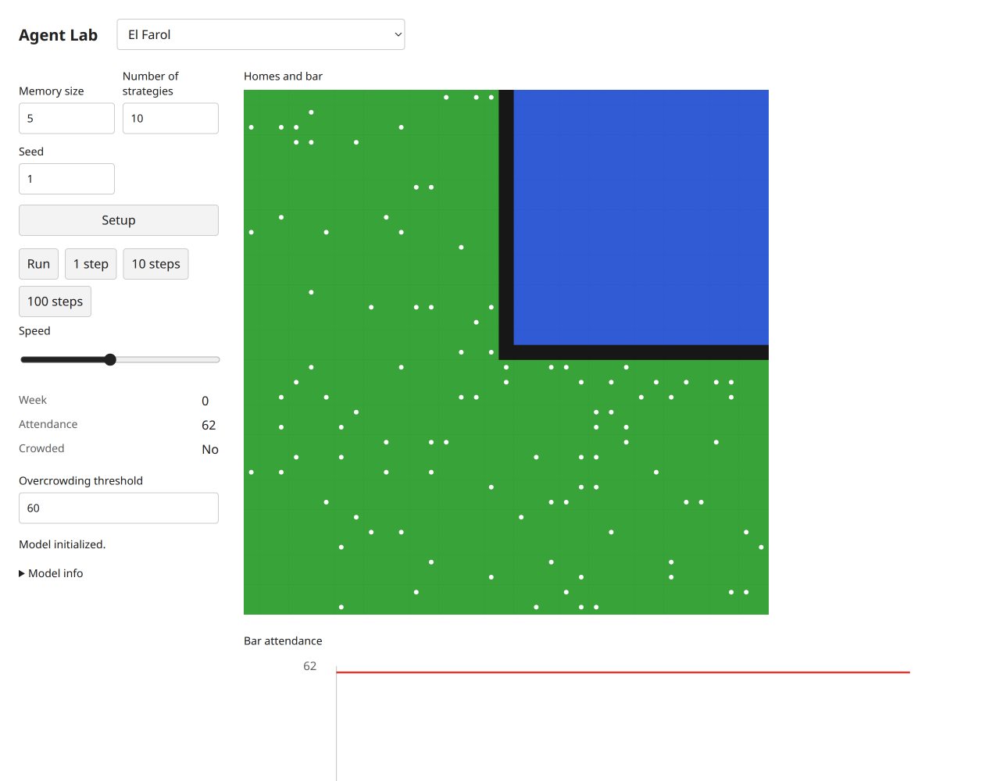


[Desktop dark](https://github.com/dweigend/city-library/blob/dc7b164abd23c8e7b7f11c902195ab030c5f1c4b/docs/development/selected-economics-evidence/el-farol-target-final-desktopDark.png) · [Mobile light](https://github.com/dweigend/city-library/blob/dc7b164abd23c8e7b7f11c902195ab030c5f1c4b/docs/development/selected-economics-evidence/el-farol-target-final-mobileLight.png) · [Mobile dark](https://github.com/dweigend/city-library/blob/dc7b164abd23c8e7b7f11c902195ab030c5f1c4b/docs/development/selected-economics-evidence/el-farol-target-final-mobileDark.png)

Comparison conclusion: the actual source mechanism and target controls were exercised; documented stochastic/presentation/host differences and source-failing scenarios remain explicit. Independent approval remains pending.
