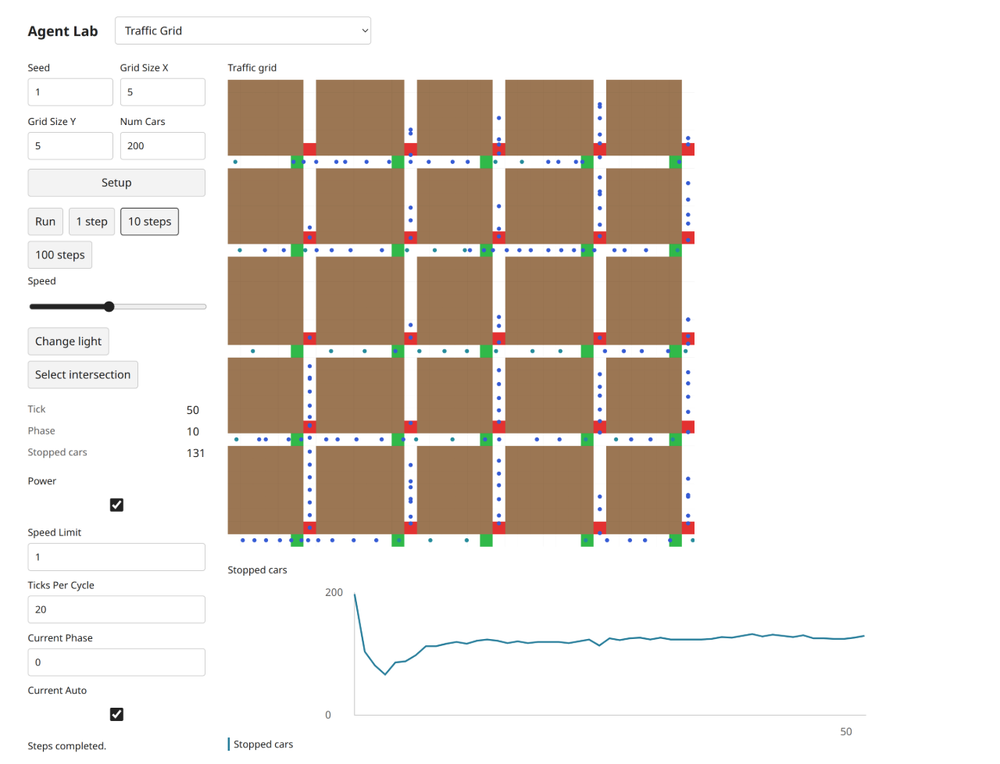
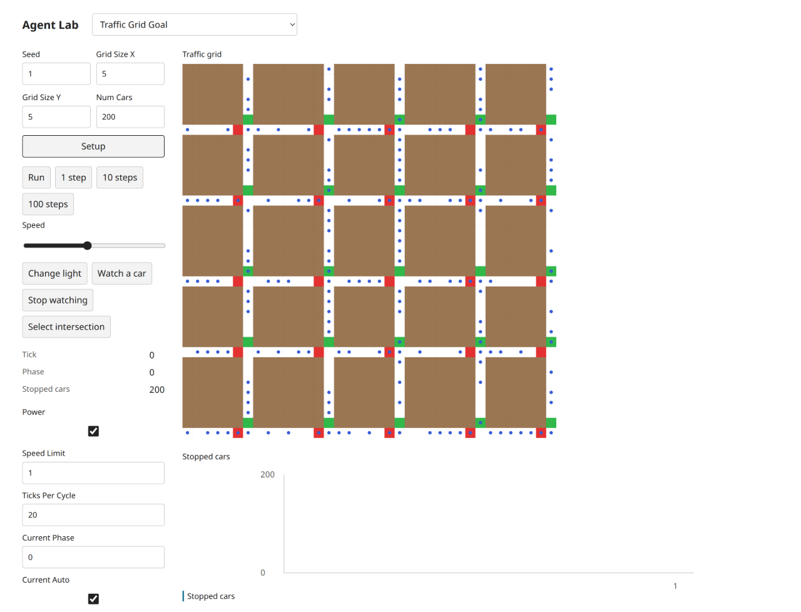
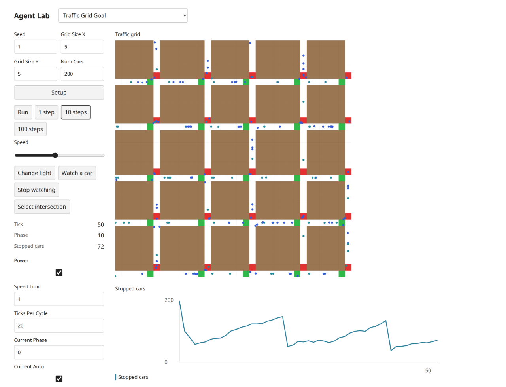

# Grid and Goal explicit-composition remediation

This is an implementation response to the parent's material architecture finding after integrating the original eight commits through 6c8899e. It is not an independent review or approval. Scope is limited to experiments/traffic-grid, experiments/traffic-grid-goal, their focused tests and selected-transport documentation. The other five models, frozen five scripts, shared core/UI/configuration, selection, research and global counts remain unchanged.

## Finding and required response

The delivered model.ts files were tiny wrappers around the roughly 500-line `experiments/traffic-grid/composition.ts` factory `createGridTraffic(options, goalMode)`. That hid both models' equations and activation flows behind a whole-model Boolean variant and did not provide the required readable public authoring compositions. The parent correctly withheld Grid/Goal delivery acceptance for this issue. Earlier shell/browser success did not establish architecture acceptance.

One scoped native runtime worker was assigned to replace the factory with two explicit source-specific model.ts compositions, using existing public World/Agent/Grid/Random/geometry operations. Goal's setup, destination equations, go order and observation actions must be visible in its model.ts; Grid must show its own source procedures. No entire NetLogo model is promoted to core, and no generic topology, movement, occupancy or path algorithm is copied into either model. No actual missing small core contract has been identified.

## Historical evidence boundary

The original [browser report](selected-transport-browser-report.md), observations and 56 images under selected-transport are retained as historical evidence of code through 1cbbdb9, before this remediation. Their Grid/Goal images and loaded chunk identities are not evidence for the remediated code. The previous SHA256SUMS manifest describes that historical payload; verify historical model files at its recorded commit rather than treating changed current model bytes as matching that old manifest.

Fresh final-code evidence is stored separately under selected-transport-remediation. The source originals and their actual native-session XML hash comparisons remain unchanged historical source-baseline evidence. This task refreshes both target models after the architecture fix; it does not invent a new original run, RNG parity or scientific validation.

## Independent approval

Required Antigravity gemini-4-argon/high review remains PENDING on existing quota-blocked task 8194e842. No retry or substitute is authorized. The parent's finding, implementation response, scoped worker result, coordinator verification and later independent decision are separate evidence categories. Parent owns registration, counts and integration.

## Implemented response — runtime commit 64ef20d

The single scoped worker completed the runtime change and its result was awaited before integration. Both model.ts files now contain ordinary, multiline source-specific model compositions: setupPatches, setupSignals, setupCars and setup make initialization visible; updateCurrent, setSignals, nextPhase and go show each activation phase directly. Goal's nextPatch, sequential house/work adjacency checks, heading choice, stale setup upCar lookup and watch/stop flow are explicit in its own file. `composition.ts` and `createGridTraffic(options, goalMode)` are deleted. Neither model imports a whole-model implementation from the other.

Common source equations are intentionally written explicitly in each model. These are the original traffic model's road predicates, signals, speed policy and reporters, not a new reusable Grid engine. Generic topology/neighborhoods, geometry, spatial movement, occupancy and lifecycle continue to use the existing public library operations. Each live value retains one owner. No core gap or new core contract is claimed or implemented.

Plain Grid no longer exposes the accidental Goal-only nextPatch/watchCar no-op/stopWatching extras; none is used by the frozen scripts or Grid UI. Its readmodel retains null houseId/workId/goalId and watchedCarId compatibility. Goal retains its actual destination/watch actions. All five frozen authoring APIs/assertions and existing UI bindings are unchanged. The other five model folders and the shared UI/core are byte-for-byte unchanged relative to 6c8899e.

## Executed verification

Coordinator ran after the worker result:

- `bun run typecheck` — all four TypeScript projects passed.
- `bun test tests/selected-transport*.test.ts` — 22 tests, 234 assertions passed. The three additional tests check Goal facing before speed lookup with stale upCar, both sequential goal-adjacency tests, and independent canonical Grid/Goal objects/clocks. Existing negative-speed/overshoot, signal ordering, watch cleanup and purity tests remain intact.
- Every `bun examples/selected-transport/*.ts` script — all five executed with assertions enabled and passed, using a shell loop with `set -e`.
- `bun node_modules/typescript/bin/tsc -p /tmp/selected-transport-frozen-tsconfig.json` — standalone frozen-five typecheck passed using the existing pinned installation and previously documented temporary configuration.
- `sha256sum -c docs/development/selected-transport/frozen-SHA256SUMS` — all five unchanged hashes passed.
- Six full before/after fixtures (Grid and Goal, seeds 1/4/11, 24 cars) were compared with assert.deepEqual at setup, tick 50 and after a controlled action sequence through tick 60. All snapshots, settings, histories and canonical observation IDs matched exactly. [Comparison metadata and snapshot hashes](https://github.com/dweigend/city-library/blob/dc7b164abd23c8e7b7f11c902195ab030c5f1c4b/docs/development/selected-transport-remediation/continuation-comparison.json) retain the executed scenario and commit boundary. This refactor continuation check is not a NetLogo RNG or scientific validation claim. The worker separately reported four additional seed 1/7 tick 0/1/50 comparisons; those are worker evidence, not the coordinator's six-scenario run.
- `git diff --check` passed. A new scoped SHA256SUMS covers final changed model/test files and remediation evidence. The historical seven-model manifest is not rewritten.

No library exports or package entry changed; build/packed consumer were not rerun for this model-local remediation. Their prior results remain historical, not relabeled as new checks. Parent owns integrated global checks, registration and counts.

## Fresh final-code Chromium evidence

Actual T3 server Chromium 156.0.0.0 on Linux, own checked-free port 3144, distinct owned tabs. Runtime commit 64ef20d; actual build version `1793965678447`. The [new observations](https://github.com/dweigend/city-library/blob/dc7b164abd23c8e7b7f11c902195ab030c5f1c4b/docs/development/selected-transport-remediation/browser-observations.json) retain all loaded JavaScript URLs, SHA-256 and byte lengths, actual sourceMarker values, defaults, controls, scroll/geometry, theme readbacks and bounded diagnostics. The old shared Grid/Goal model chunk is absent from these new sessions; each model is contained in its distinct final UI/model chunk:

| Model | Actual loaded final model/UI chunk | SHA-256 |
| --- | --- | --- |
| Grid | ui-65eztz92.js | ef97541c6a466e636a7e4c8fdf21a5b44f4b47b855c5e35b55a60c18cba3436f |
| Goal | ui-3gt6e2qy.js | d2429a9370d88b628bc5ae632882a43da93c652aed9752a01966cba7541b7d77 |

sourceMarker still identifies the unchanged exact original XML, not the target code revision: Grid ends ec0cdcff88fbc9d54aa20a922fa3da8087c40318c929bae108f22f16932def3d; Goal ends 7259187f36f97a8c6e9378398a72d927844233c3811151a714eb3aa97807bfa9. Target revision identity is established by the new content hashes/build/runtime commit above.

Both models used seed 1, grid 5×5, 200 cars, speed limit 1, cycle 20, power/current-auto true and selected phase 0 for setup/progress. Real Setup showed tick 0, phase 0, stopped 200. Five actual 10 steps clicks reached tick 50/phase 10: Grid stopped 131, Goal stopped 72. These are fresh observations, even where they equal historical results. Run/Pause advanced each to tick 52 then held at 52 after a further 150 ms, button Run/aria-pressed false.

For both models, changing selected phase to 37 then clicking a different actual intersection at (−12,−18) read back phase 0 for that newly selected light at unchanged tick 52. Change light was clicked; Goal Watch a car produced visible house/work highlights and enlarged car in its controls capture, then Stop watching executed. Live cycle 3 survived Setup, which reset tick/phase to 0 and stopped count to 200; actual 1 step produced tick 1/phase 1 with stopped counts 105 (Grid) and 102 (Goal). Theme/mobile follow-ups deliberately show this later controlled state, not the default tick-50 run.

All 14 new PNGs were inspected individually. Desktop is 1440×1100, mobile 390×844. Mobile controls and full first scene have separate captures with actual scroll coordinates. Both themes report the intended body background; document width remains 390 on mobile. Tab from Seed shows a visible 2 px solid focus outline in both models. No target console error or failed request appears in retained bounded snapshots; older network entries were tool-omitted, so no complete network-log claim is made. No getImageData diagnostic or renderer change was used in this remediation.

### Grid images

Additional inspected images: [controls](https://github.com/dweigend/city-library/blob/dc7b164abd23c8e7b7f11c902195ab030c5f1c4b/docs/development/selected-transport-remediation/traffic-grid-controls-light.png), [desktop dark](https://github.com/dweigend/city-library/blob/dc7b164abd23c8e7b7f11c902195ab030c5f1c4b/docs/development/selected-transport-remediation/traffic-grid-desktop-dark.png), [mobile light controls](https://github.com/dweigend/city-library/blob/dc7b164abd23c8e7b7f11c902195ab030c5f1c4b/docs/development/selected-transport-remediation/traffic-grid-mobile-light-controls.png), [mobile light scene](https://github.com/dweigend/city-library/blob/dc7b164abd23c8e7b7f11c902195ab030c5f1c4b/docs/development/selected-transport-remediation/traffic-grid-mobile-light-scene.png), [mobile dark scene](https://github.com/dweigend/city-library/blob/dc7b164abd23c8e7b7f11c902195ab030c5f1c4b/docs/development/selected-transport-remediation/traffic-grid-mobile-dark-scene.png).

### Goal images

Additional inspected images: [controls and watch highlights](https://github.com/dweigend/city-library/blob/dc7b164abd23c8e7b7f11c902195ab030c5f1c4b/docs/development/selected-transport-remediation/traffic-grid-goal-controls-light.png), [desktop dark](https://github.com/dweigend/city-library/blob/dc7b164abd23c8e7b7f11c902195ab030c5f1c4b/docs/development/selected-transport-remediation/traffic-grid-goal-desktop-dark.png), [mobile light controls](https://github.com/dweigend/city-library/blob/dc7b164abd23c8e7b7f11c902195ab030c5f1c4b/docs/development/selected-transport-remediation/traffic-grid-goal-mobile-light-controls.png), [mobile light scene](https://github.com/dweigend/city-library/blob/dc7b164abd23c8e7b7f11c902195ab030c5f1c4b/docs/development/selected-transport-remediation/traffic-grid-goal-mobile-light-scene.png), [mobile dark scene](https://github.com/dweigend/city-library/blob/dc7b164abd23c8e7b7f11c902195ab030c5f1c4b/docs/development/selected-transport-remediation/traffic-grid-goal-mobile-dark-scene.png).

## Authoring/design QA and handoff

No UI source or design changed. The existing frontend-design contract was preserved, and the affected flows were checked against freshly fetched web-design-guidelines criteria: native labelled controls/actions, visible focus, explicit pause/reset, responsive fit, theme contrast and meaningful source-specific state. No new visual or interaction finding remained in the inspected flows; this is not complete accessibility certification.

New payload only: runtime commit 64ef20d plus the separate remediation-evidence documentation commit. The original eight commits are already integrated and must not be cherry-picked again. The final coordinator message supplies the exact new two-commit list. Own tabs/server are closed/stopped after checks. No push rewrites, merge, rebase or publication. Argon/high remains pending as stated above; this response does not substitute for it.
