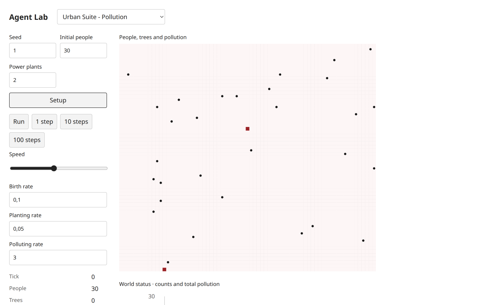
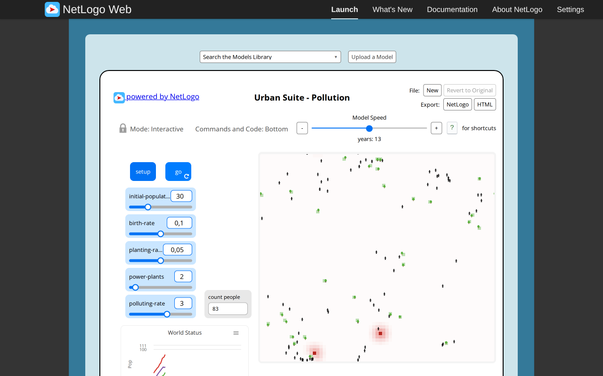
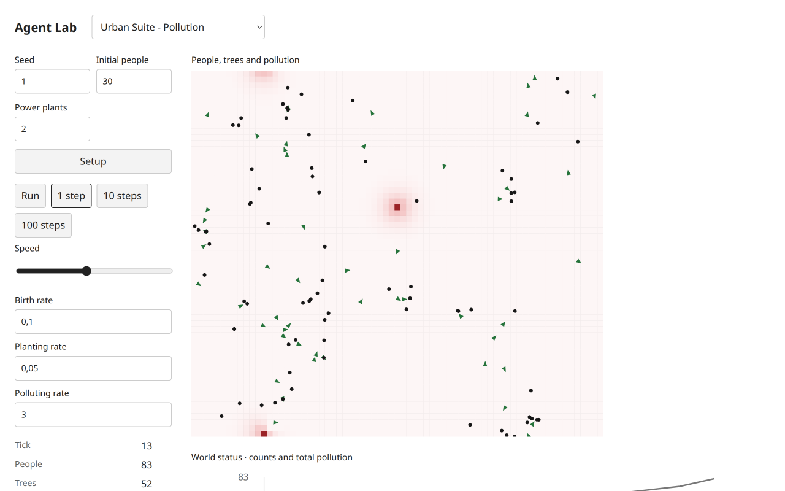
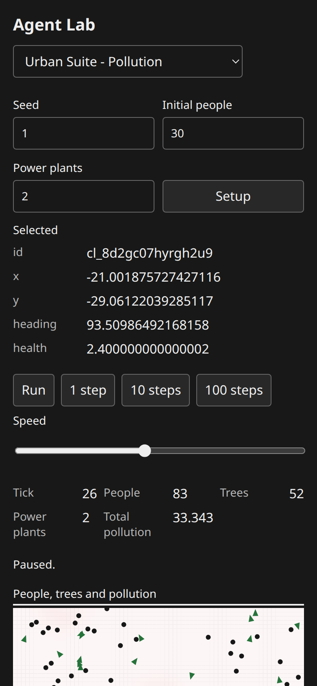
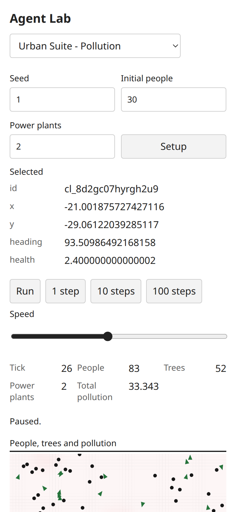

# Urban Suite Pollution: paired browser acceptance evidence

Executed2026-11-05 by the integration coordinator using real T3 Chromium. Selected identity: `Curricular Models/Urban Suite/Urban Suite - Pollution`. Reference: [official launcher](https://www.netlogoweb.org/launch#https://www.netlogoweb.org/assets/modelslib/Curricular%20Models/Urban%20Suite/Urban%20Suite%20-%20Pollution.nlogox), NetLogo7.0.4. The actually loaded `session.nlogoSource.nlogo` SHA-256 was `bbc4bf5e78cdc516b093b33d0c793c52f8ace5fc005e40023de1654041907671`, identical to the archived source/pinned Galapagos90be931773fcf499049247a8aaa1aecbe003654c. Attribution/license: [NOTICE](../../experiments/urban-suite-pollution/NOTICE.md), Felsen and Wilensky2007, CC BY-NC-SA3.0. Target implementation b05174e, shared UI7e4d6db on port3110. [Exact source contract](../../docs/development/selected-urban-contracts.md#pollution-source-mechanism-and-contract) and [scientific three-publication dossier](../../docs/research/netlogo-web/urban-suite-pollution.md) supply provenance/context, without empirical validation.

## Settings and observed progression

Both used original defaults: initial population30,power plants2,birth rate0.10,planting rate0.05,polluting rate3;71×63 torus. Target seed1; original native seed unspecified. Both initialized30 people,no trees,2 plants,total pollution6,tick0. The source World Status plot mixes people/tree counts with total abstract pollution; the target retains these units and additionally exposes monitors. Pollution is a scalar patch field, not a population of pollutant agents.

| Actual state | Original | Target |
| --- | --- | --- |
| Setup | tick0,30 people,0 trees,total6 | tick0,30 people,0 trees,total6.000 |
| Paused default progress | native Go/Pause reached tick13;83 people,30 trees,total46.80484026373512 |10steps+3single steps reached tick13;83 people,52 trees,total monitor47.427 |
| Set all three live rates to0,continue | native Go/Pause reached tick23;83 people,30 trees,total31.55222777733696 |10steps reached tick23;83 people,52 trees,total34.943 |
| Run/Pause after live changes | source native controls exercised above | reached tick26;83 people,52 trees,total33.343 |
| Later terminal target run | separate source no-people fixture below |100step request stopped early at tick64;0 people,0 trees,total22.972;Run and step buttons disabled |
| Target Setup after edits | source Setup exercised before initial run | recreates tick0,30 people,0 trees,2 plants,retaining current live rate0 so total0.000 |

The same tick13 horizon makes settings/results inspectable; equal83-person counts are incidental, not seed or trajectory equivalence. Source and target use different RNGs and activation streams. Counts, field order, terminal rules and exact small fixtures are compared; no replicated-run distributional or empirical equivalence is asserted.

| Original | Target |
| --- | --- |
|  |  |
|  |  |

## Executed original deterministic fixture

Through the native Command Center, explicitly replacing the default realization, executed:

```netlogo
clear-all set birth-rate 0 set planting-rate 0 set polluting-rate 0
ask patches [ set pollution 0 set is-power-plant? false ]
create-people 1 [ setxy 10 10 set heading 0 set health 5 ]
create-trees 1 [ setxy 0 0 set health 0.1 ]
ask patch 0 0 [ set pollution 8 ]
reset-ticks go
```

Actual original outcome: tick1,one person,no trees; center pollution0.5999999999999996,neighbor(1,0)0.30000000000000004,total2.999999999999999. Moore diffusion first retains1.6locally and sends0.8to each neighbor; the dying tree cleans1locally and0.5per neighbor before death. The frozen public Pollution script executes the corresponding target headless fixture and asserts0.6/0.3/3within1e−10. This is a real original-browser versus target-headless exact fixture comparison, additional to both default browser runs; it is not presented as a target-browser-injected fixture.

Then executed native Command Center `ask people [ die ] create-trees 1 [ setxy 0 0 set health 5 ]` and clicked native Go. It automatically stopped without changing tick1,total2.999999999999999 or the surviving tree's health5. This directly verifies that no people preflight freezes trees and fields. Headless tests separately cover successful extinction-step ticking, newborn people excluded from their birth ask, new trees cleaning immediately, strict exposure/birth/death thresholds, wrap diffusion and plant reset rather than increment. No private model occupancy/population authority or alternate field solver is used.

## Target interactions, appearance and diagnostics

Native Setup,1step,10steps,100steps,Run/Pause and all three live rates were exercised. Canvas click plus Home selected a canonical person; tick26 inspector showed x−21.001875727427116,y−29.06122039285117,heading93.50986492168158,health2.400000000000002. The initial Home press without focusing the canvas did not establish selection; the subsequent click/focused keyboard action did. At390×844 CSS pixels, selected-state controls/monitors were inspected in light/dark with no horizontal overflow. Desktop world rendering distinguishes people as dark circles,trees as green triangles,plants as red fields and scalar pollution as a red intensity. These view symbols and freshly computed field colors intentionally replace source shapes/stale cleanup colors without changing state/equations. Source desktop baseline1280×800 and target desktop/mobile are verified, without claiming source responsive parity.




No application console errors or failed network requests appeared in source/target diagnostics. Coordinator tooling errors were corrected: returning the cyclic source breed object exceeded CDP object depth (replaced with primitive breed names); reading nonexistent ticker.ticks and lowercase breed names returned missing/zero values (corrected to the observed year label and uppercase names before recording results); clicking the hidden console checkbox timed out, then its visible label opened the actual Command Center. None is counted as successful model evidence or as an application failure.

Executed integrated `bun run check`:158 tests/3947 assertions,65 public examples including the five unchanged Urban scripts,all TypeScript configurations,build and packed Bun/Node ESM/ambient-free TypeScript consumer passed. Coordinator also executed the12 Urban tests/79assertions and five script hash checks separately. [PNG hashes](urban-pollution-evidence/SHA256SUMS.json) retain the compact visual artifacts. Independent Argon technical review remains open due the [provider quota blocker](https://github.com/dweigend/city-library/blob/dc7b164abd23c8e7b7f11c902195ab030c5f1c4b/docs/development/connectivity-transfer-review-blocker.md); research completion and these browser observations do not substitute for that approval.
