# Seven selected transport model browser comparisons

Executed 6 November 2026 in actual T3 server Chromium 156.0.0.0 on Linux. Target source is final runtime/UI through commit 1cbbdb9. Build version: 1793964553838. Issue: https://github.com/dweigend/city-library/issues/25. See [verification](https://github.com/dweigend/city-library/blob/dc7b164abd23c8e7b7f11c902195ab030c5f1c4b/docs/development/selected-transport-verification.md) and [source audit](selected-transport-source-audit.md).

The complete settings, loaded source hashes, target sourceMarkers, every loaded JavaScript chunk SHA-256 (including the shared Grid/Goal model chunk), readbacks and diagnostics are retained in [original observations](selected-transport/original-observations.json) and [target observations](selected-transport/target-observations.json). Hashes are computed from actual browser-session nlogoSource.nlogo UTF-8 strings and actual fetched loaded chunks, never inferred from names. All seven native session hashes match their archives and immutable Galapagos inventory.

Each original used its native default widgets and unseeded NetLogo RNG. Targets used seed 1 and the exact default widget values for paired setup/progress. Original setup clicked its real button; bounded repeat [go] commands then executed the original compiled procedures in that same browser session. Each original forever Go button was clicked on/off and advanced actual ticks; source-specific supplemental commands are recorded separately rather than represented as pointer actions. Target setup/steps/actions used actual browser controls; target Run/Pause also held its tick stable after pause. No model has a source terminal criterion; failed taxi zero-light steps do not count as completed ticks.

Original viewport: 1600×1200, except Taxi Cabs 2800×1700 to retain the large scene and parameter matrix. Target setup/progress: 1440×1100, light. Follow-up theme/responsive captures: desktop 1440×1100 dark; mobile 390×844 light controls, light scene and dark scene. Follow-up captures deliberately use the subsequently exercised live settings at tick 1; they are not relabeled as default paired runs. Their exact scroll positions/readbacks are in JSON. Ordinary captures precede pixel diagnostics.

NetLogo MT and City Library Mulberry streams, activation/color draw order and presentation differ. Numerical stochastic results below are observed realizations, not matching trajectories, distribution tests, empirical validation or final approval. Equations and deterministic boundaries are checked by the focused tests and frozen examples. No generic routing algorithm or new core API was needed.

## Paths

Canonical selection: `Sample Models/Social Science/Paths`. Source NetLogo 7.0.4, pinned Galapagos `90be931773fcf499049247a8aaa1aecbe003654c`; actual loaded XML SHA-256 `89f74e30ca5a70a0fc139e99c6e2ea62e9509ce1c8c76bc8cffa154cf3cd75d0`. [Complete original and notices](https://github.com/dweigend/city-library/blob/23693e90e199512faf68a04c9a2198b9eb50463b/experiments/paths/original.nlogox); [adaptation notice](https://github.com/dweigend/city-library/blob/23693e90e199512faf68a04c9a2198b9eb50463b/experiments/paths/NOTICE.md).

Walkers and goals remain canonical Agent/Field references. Reinforcement, occupied-field decay exemption, route hysteresis, building radius and random ties among every eligible visible route are implemented. Native distance-self probe returned eleven zeros; distance-myself returned varying positive distances. Source comment and execution differ; the port preserves execution. Browser drawing placed and removed a building at tick 1, with counts 0→1→0.

Original observation: 250 walkers at tick 0; tick 40 retained 250, eight gray patches, maximum popularity 81.93642886126523.

Target observation: 250 walkers at tick 0 and tick 40; visible reinforced gray patches emerged. No claim that their count or positions match the original random realization.

Per-model baseline conclusion: setup dimensions, population/breed roles, parameter meanings and procedure phases have source-backed functional coverage; native and target progressed successfully at the declared horizon. Source quirks and adaptations above are explicit. Independent review/final acceptance remains pending.

Live/reset check: `popularityDecayRate=7` remained after Setup; tick returned to 0 and Step advanced to 1. Run/Pause advanced from tick 40 to 42, then stayed at 42. No target console errors or failed requests appeared in the retained bounded final snapshot; older network entries were omitted by the tool, so this is not a complete network log. Native runtime error arrays were empty for default setup/progress.

| Original setup | Target setup |
| --- | --- |
| 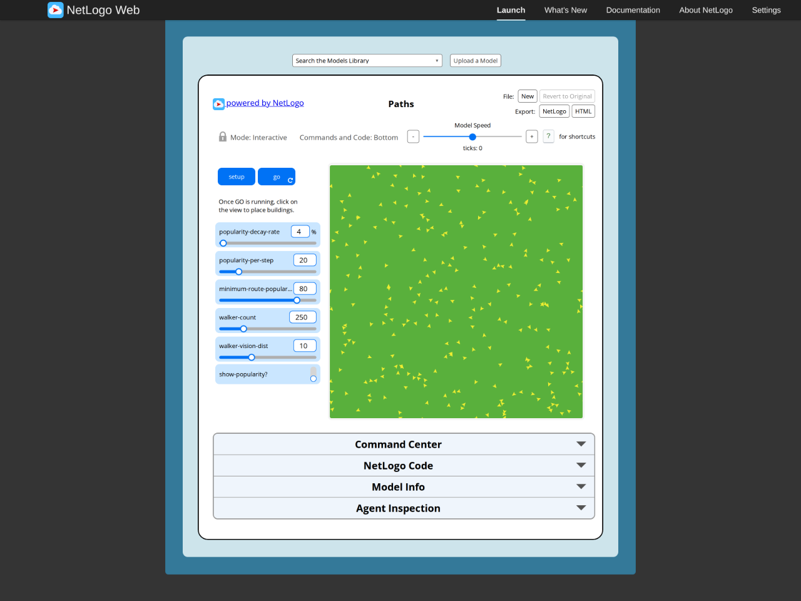 |  |

| Original progress | Target progress |
| --- | --- |
| 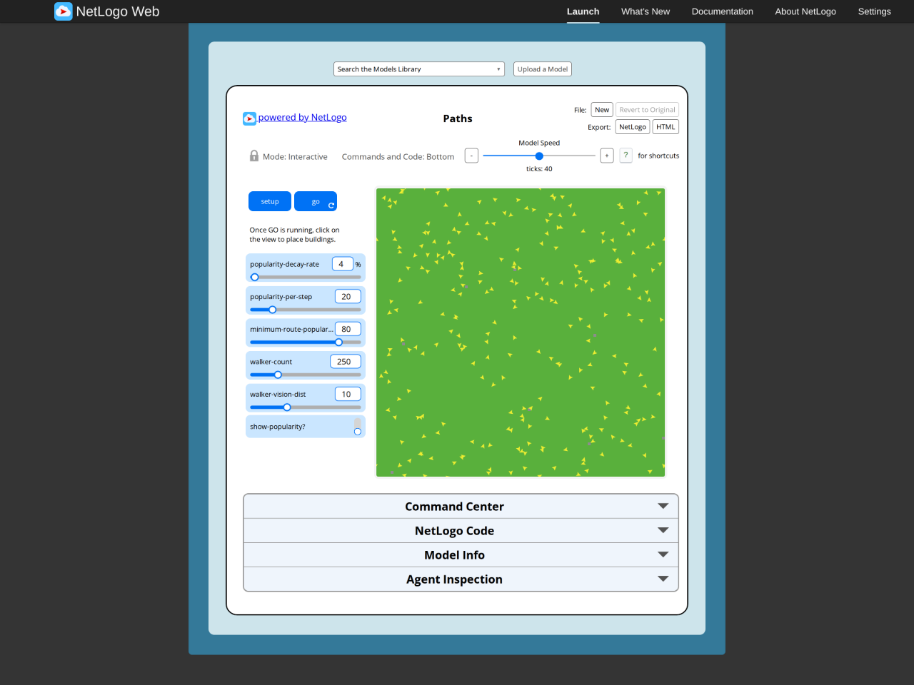 | 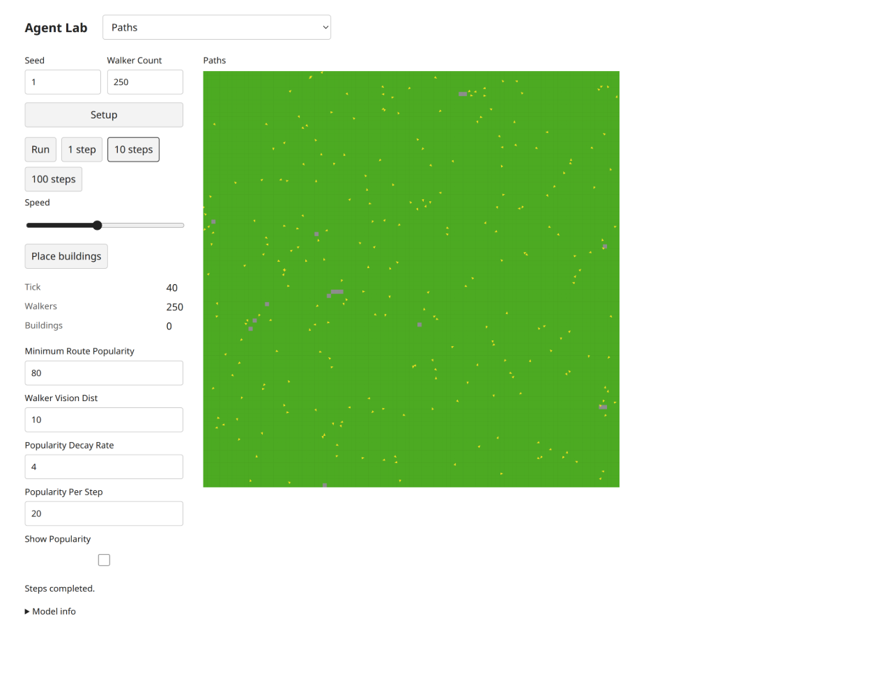 |

Additional inspected captures: [desktop dark](https://github.com/dweigend/city-library/blob/dc7b164abd23c8e7b7f11c902195ab030c5f1c4b/docs/development/selected-transport/paths-target-desktop-dark.png), [mobile light controls](https://github.com/dweigend/city-library/blob/dc7b164abd23c8e7b7f11c902195ab030c5f1c4b/docs/development/selected-transport/paths-target-mobile-light-controls.png), [mobile light scene](https://github.com/dweigend/city-library/blob/dc7b164abd23c8e7b7f11c902195ab030c5f1c4b/docs/development/selected-transport/paths-target-mobile-light.png), [mobile dark scene](https://github.com/dweigend/city-library/blob/dc7b164abd23c8e7b7f11c902195ab030c5f1c4b/docs/development/selected-transport/paths-target-mobile-dark.png).

## Traffic 2 Lanes

Canonical selection: `Sample Models/Social Science/Traffic 2 Lanes`. Source NetLogo 7.0.4, pinned Galapagos `90be931773fcf499049247a8aaa1aecbe003654c`; actual loaded XML SHA-256 `6a3d627581f1a628e42ff2ca13c643824f9a441309d08645e101df13d09f17d9`. [Complete original and notices](https://github.com/dweigend/city-library/blob/23693e90e199512faf68a04c9a2198b9eb50463b/experiments/traffic-2-lanes/original.nlogox); [adaptation notice](https://github.com/dweigend/city-library/blob/23693e90e199512faf68a04c9a2198b9eb50463b/experiments/traffic-2-lanes/NOTICE.md).

Live population reconciliation preserves the selected car. Forward movement, impatient lane choice and lateral motion are separate shuffled phases. Speed/patience/per-lane histories are current sampled summaries. Selected car was changed by an actual canvas click (selected-speed readback changed 0.505→0.480). Watch, Follow and Reset perspective buttons executed; Follow shifts observation x coordinates around the selected car, without moving domain agents. Lane-line decoration and car sprites are simplified.

Original observation: 40 cars at tick 0, each speed 0.5. At tick 50: 40 cars, mean speed 0.4973094007307129, selected speed 0.39616577898821315.

Target observation: 40 cars at setup; selected speed 0.500. At tick 50 selected speed 0.330. After live population 12 and Setup, selected speed 0.500; Step gave 0.505.

Per-model baseline conclusion: setup dimensions, population/breed roles, parameter meanings and procedure phases have source-backed functional coverage; native and target progressed successfully at the declared horizon. Source quirks and adaptations above are explicit. Independent review/final acceptance remains pending.

Live/reset check: `numberOfCars=12` remained after Setup; tick returned to 0 and Step advanced to 1. Run/Pause advanced from tick 50 to 52, then stayed at 52. No target console errors or failed requests appeared in the retained bounded final snapshot; older network entries were omitted by the tool, so this is not a complete network log. Native runtime error arrays were empty for default setup/progress.

| Original setup | Target setup |
| --- | --- |
| 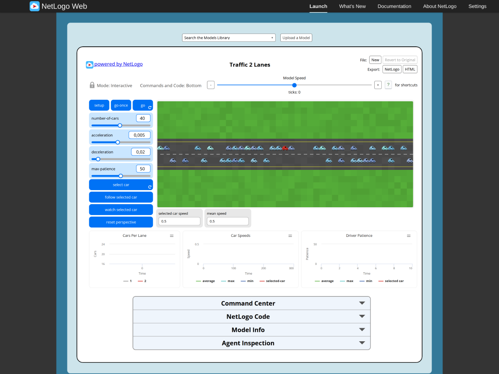 |  |

| Original progress | Target progress |
| --- | --- |
| 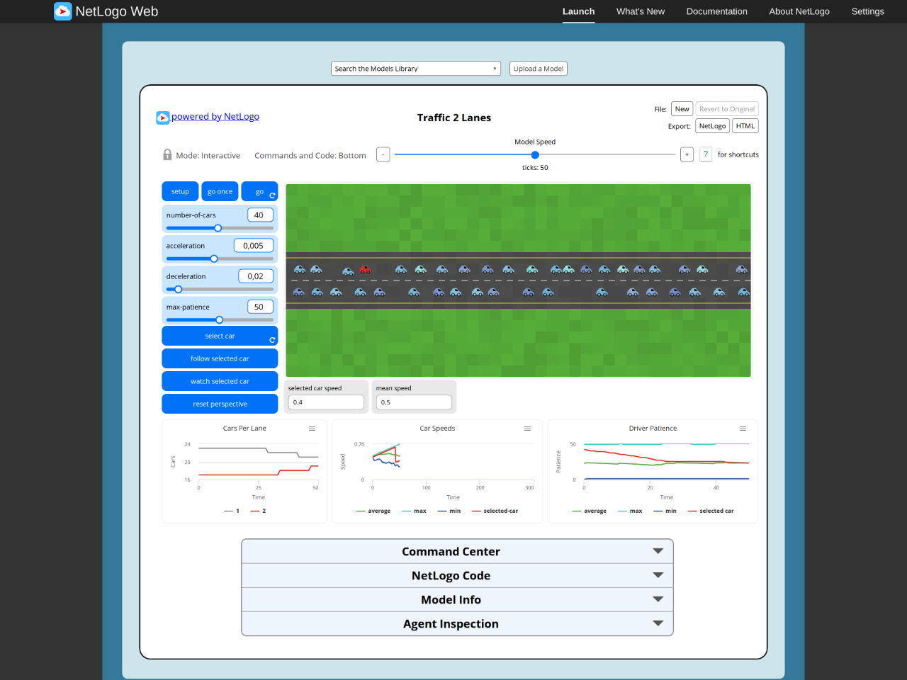 | 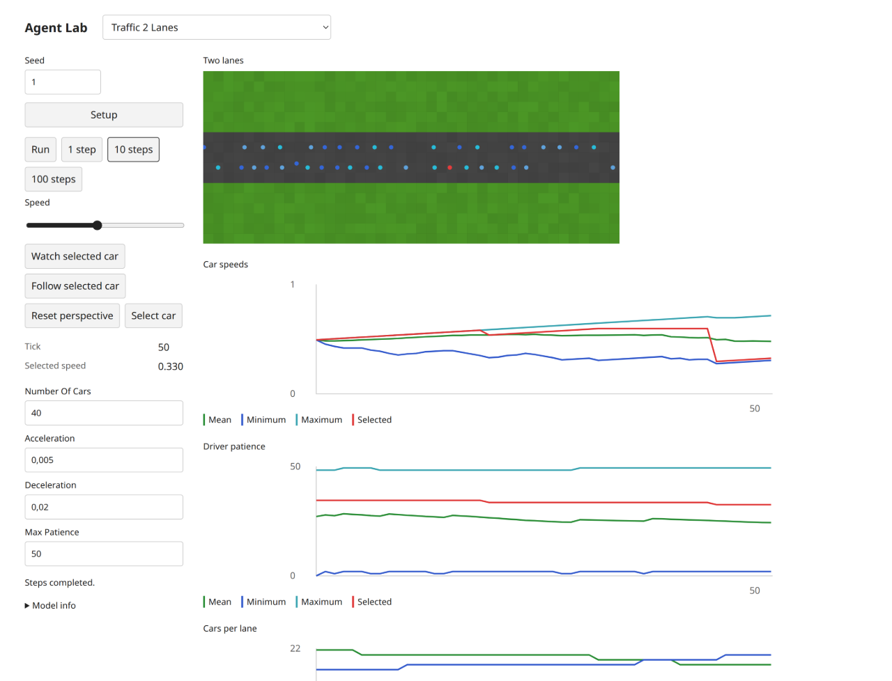 |

Additional inspected captures: [desktop dark](https://github.com/dweigend/city-library/blob/dc7b164abd23c8e7b7f11c902195ab030c5f1c4b/docs/development/selected-transport/traffic-2-lanes-target-desktop-dark.png), [mobile light controls](https://github.com/dweigend/city-library/blob/dc7b164abd23c8e7b7f11c902195ab030c5f1c4b/docs/development/selected-transport/traffic-2-lanes-target-mobile-light-controls.png), [mobile light scene](https://github.com/dweigend/city-library/blob/dc7b164abd23c8e7b7f11c902195ab030c5f1c4b/docs/development/selected-transport/traffic-2-lanes-target-mobile-light.png), [mobile dark scene](https://github.com/dweigend/city-library/blob/dc7b164abd23c8e7b7f11c902195ab030c5f1c4b/docs/development/selected-transport/traffic-2-lanes-target-mobile-dark.png).

## Traffic Grid

Canonical selection: `Sample Models/Social Science/Traffic Grid`. Source NetLogo 7.0.4, pinned Galapagos `90be931773fcf499049247a8aaa1aecbe003654c`; actual loaded XML SHA-256 `ec0cdcff88fbc9d54aa20a922fa3da8087c40318c929bae108f22f16932def3d`. [Complete original and notices](https://github.com/dweigend/city-library/blob/23693e90e199512faf68a04c9a2198b9eb50463b/experiments/traffic-grid/original.nlogox); [adaptation notice](https://github.com/dweigend/city-library/blob/23693e90e199512faf68a04c9a2198b9eb50463b/experiments/traffic-grid/NOTICE.md).

Shared source-specific composition retains the floating road predicate, setup stopped/wait accounting, selected signal phases, current-patch red check and sequential following. Native source at tick 50 included speed −0.09899999999999998; target tests preserve the same permitted negative boundary rather than clamp it. Change light and canvas intersection selection executed. The current-intersection label remains in the public cell readmodel; grid text decoration is simplified.

Original observation: 200 cars and phase 0 at setup. At tick 50: phase 10, mean speed 0.15642000000000006, minimum speed −0.09899999999999998.

Target observation: 200 stopped cars at tick 0. At tick 50: phase 10 and 131 stopped cars. Live cycle 3 survived Setup, followed by phase 1 at tick 1.

Per-model baseline conclusion: setup dimensions, population/breed roles, parameter meanings and procedure phases have source-backed functional coverage; native and target progressed successfully at the declared horizon. Source quirks and adaptations above are explicit. Independent review/final acceptance remains pending.

Live/reset check: `ticksPerCycle=3` remained after Setup; tick returned to 0 and Step advanced to 1. Run/Pause advanced from tick 50 to 52, then stayed at 52. No target console errors or failed requests appeared in the retained bounded final snapshot; older network entries were omitted by the tool, so this is not a complete network log. Native runtime error arrays were empty for default setup/progress.

| Original setup | Target setup |
| --- | --- |
| 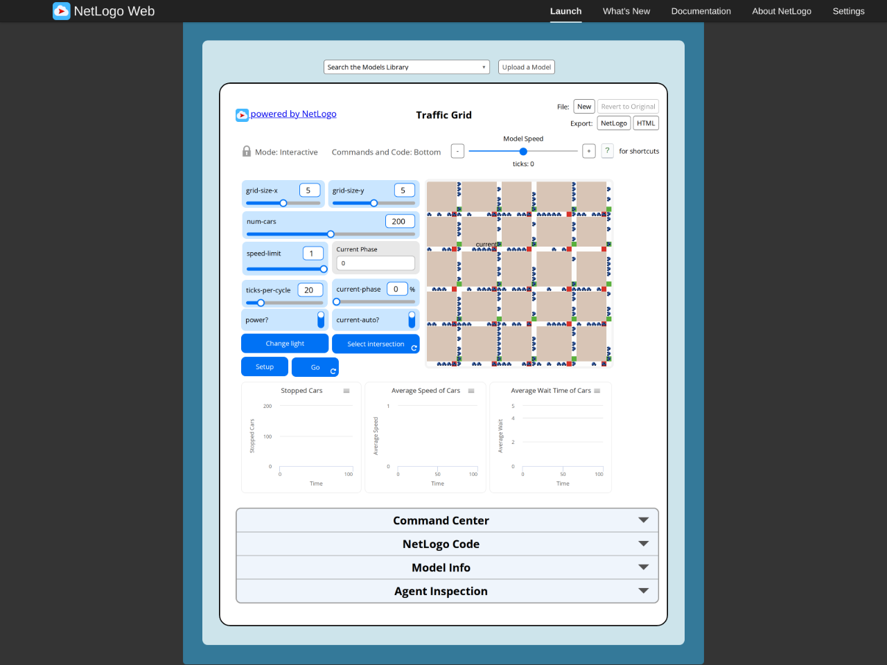 |  |

| Original progress | Target progress |
| --- | --- |
| 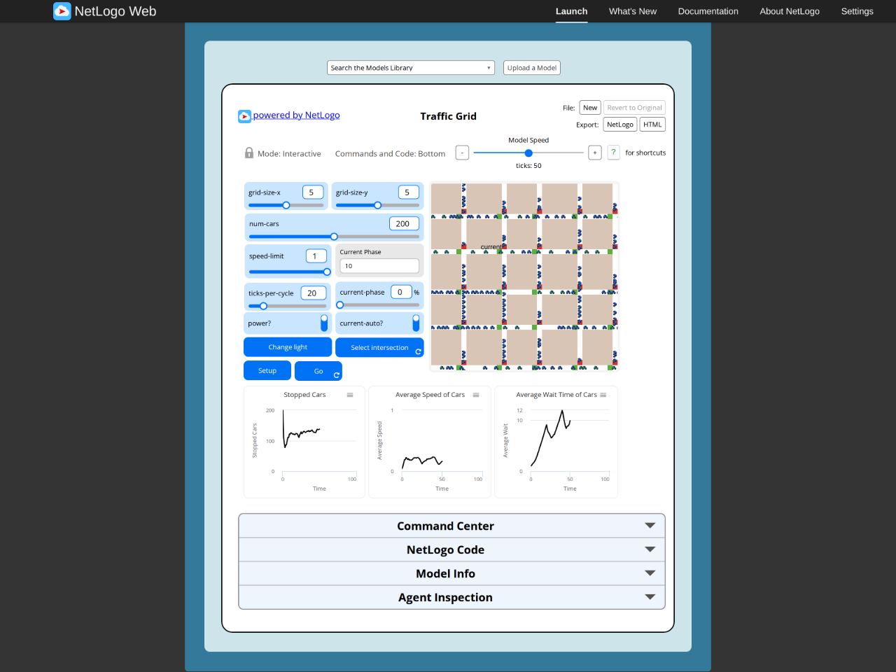 | 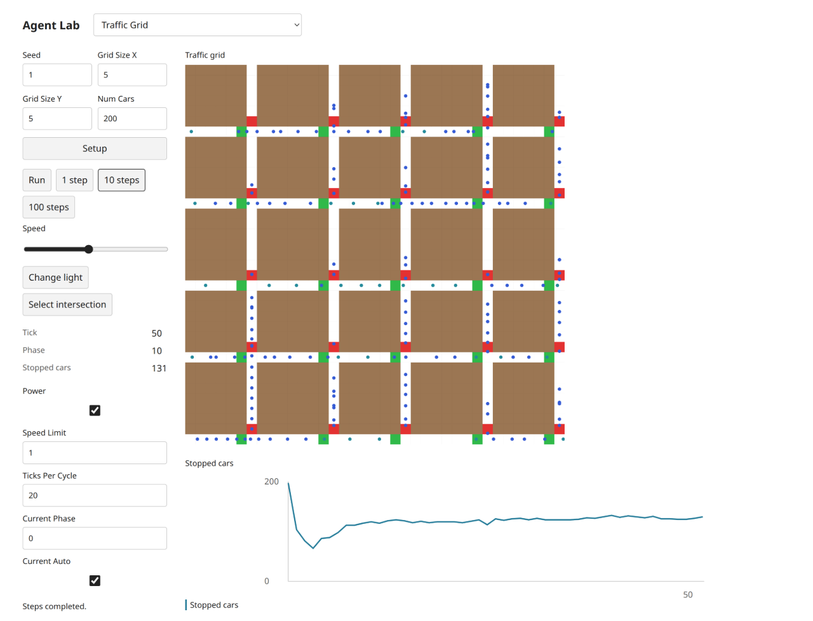 |

Additional inspected captures: [desktop dark](https://github.com/dweigend/city-library/blob/dc7b164abd23c8e7b7f11c902195ab030c5f1c4b/docs/development/selected-transport/traffic-grid-target-desktop-dark.png), [mobile light controls](https://github.com/dweigend/city-library/blob/dc7b164abd23c8e7b7f11c902195ab030c5f1c4b/docs/development/selected-transport/traffic-grid-target-mobile-light-controls.png), [mobile light scene](https://github.com/dweigend/city-library/blob/dc7b164abd23c8e7b7f11c902195ab030c5f1c4b/docs/development/selected-transport/traffic-grid-target-mobile-light.png), [mobile dark scene](https://github.com/dweigend/city-library/blob/dc7b164abd23c8e7b7f11c902195ab030c5f1c4b/docs/development/selected-transport/traffic-grid-target-mobile-dark.png).

## Taxi Cabs

Canonical selection: `Sample Models/Social Science/Taxi Cabs`. Source NetLogo 7.0.4, pinned Galapagos `90be931773fcf499049247a8aaa1aecbe003654c`; actual loaded XML SHA-256 `150f739ec217fbb199d86eca783922a79acceeb6504e44add1921d934d3d4a30`. [Complete original and notices](https://github.com/dweigend/city-library/blob/23693e90e199512faf68a04c9a2198b9eb50463b/experiments/taxi-cabs/original.nlogox); [adaptation notice](https://github.com/dweigend/city-library/blob/23693e90e199512faf68a04c9a2198b9eb50463b/experiments/taxi-cabs/NOTICE.md).

All 45 independent demand values, the five source phases, Gaussian patience, directed-road corner cases, pickup/U-turn/delivery/dropoff branches and completed-trip accounting are implemented. All 53 live controls use the shared single field reader. Demand disclosures expose nine fields per phase; changing AM cbd→cbd to 0.4 survived Setup. Preserve source misleading OD comments and movement-only tick fare. Original Midday marginal reporter repeats com-com and omits com-cbd; target exposes the actual independent inputs, not that erroneous sum. Histogram bins use public stats with 30 explicit bins and adaptive extent; complete trip samples remain public. Road-line decoration and vehicle/person shapes are simplified.

Original observation: 25 cabs and no passengers at tick 0. At tick 100: 25 cabs, 47 passengers, total movement miles 1217, picked-up trips 7 and completed-trip income $68.03 (floating result 68.03000000000002).

Target observation: 25 cabs, no waiting passengers, no occupied cabs and $0 completed income at setup. At tick 100: 47 waiting passengers, 8 occupied cabs, $182.89 completed income. These different realizations are not statistical equivalence. Actual original length-of-green-light=0 failed MOD with Division by zero at tick 0; target Step showed an explicit error and retained tick 0. Recovery to 20 plus Setup succeeded.

Per-model baseline conclusion: setup dimensions, population/breed roles, parameter meanings and procedure phases have source-backed functional coverage; native and target progressed successfully at the declared horizon. Source quirks and adaptations above are explicit. Independent review/final acceptance remains pending.

Live/reset check: `eachGridCost=1.23` remained after Setup; tick returned to 0 and Step advanced to 1. Run/Pause advanced from tick 100 to 102, then stayed at 102. No target console errors or failed requests appeared in the retained bounded final snapshot; older network entries were omitted by the tool, so this is not a complete network log. Native runtime error arrays were empty for default setup/progress.

| Original setup | Target setup |
| --- | --- |
|  | 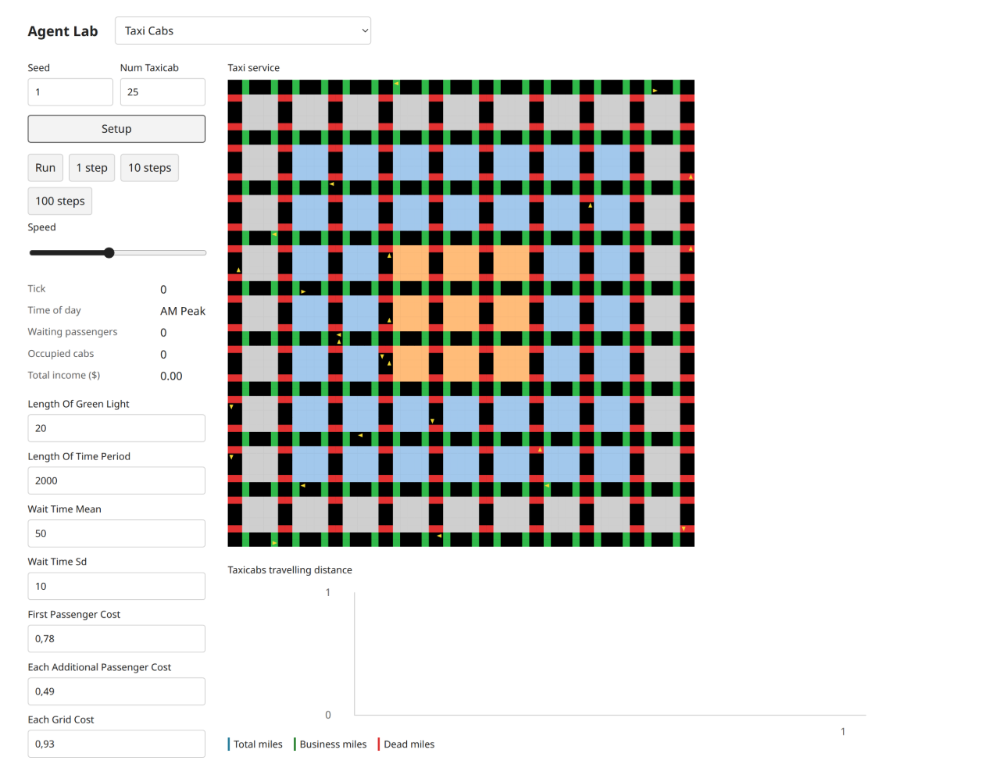 |

| Original progress | Target progress |
| --- | --- |
| 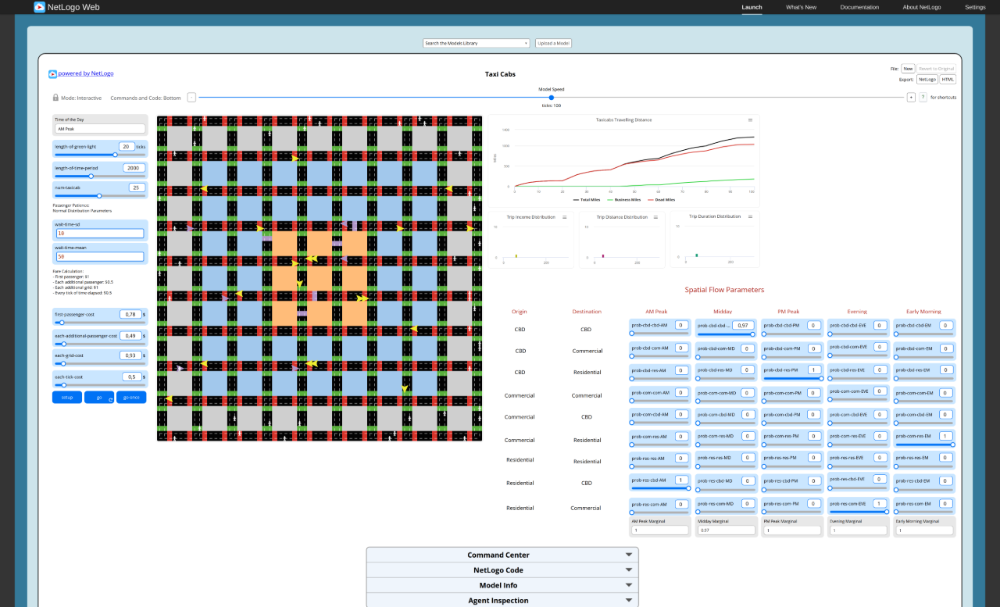 | 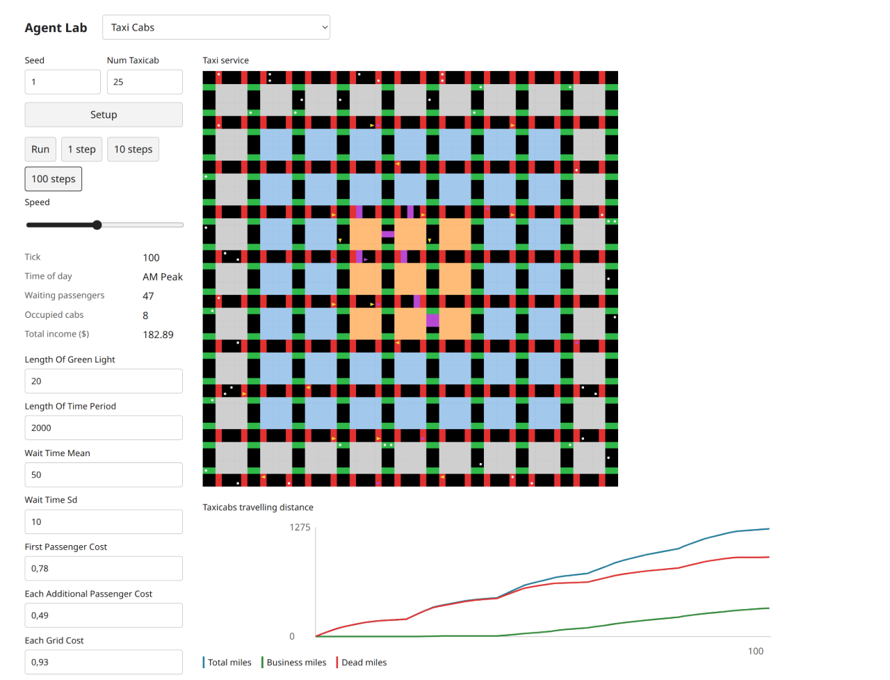 |

Additional inspected captures: [desktop dark](https://github.com/dweigend/city-library/blob/dc7b164abd23c8e7b7f11c902195ab030c5f1c4b/docs/development/selected-transport/taxi-cabs-target-desktop-dark.png), [mobile light controls](https://github.com/dweigend/city-library/blob/dc7b164abd23c8e7b7f11c902195ab030c5f1c4b/docs/development/selected-transport/taxi-cabs-target-mobile-light-controls.png), [mobile light scene](https://github.com/dweigend/city-library/blob/dc7b164abd23c8e7b7f11c902195ab030c5f1c4b/docs/development/selected-transport/taxi-cabs-target-mobile-light.png), [mobile dark scene](https://github.com/dweigend/city-library/blob/dc7b164abd23c8e7b7f11c902195ab030c5f1c4b/docs/development/selected-transport/taxi-cabs-target-mobile-dark.png).

## Traffic Basic

Canonical selection: `Sample Models/Social Science/Traffic Basic`. Source NetLogo 7.0.4, pinned Galapagos `90be931773fcf499049247a8aaa1aecbe003654c`; actual loaded XML SHA-256 `77495cbc72df4370fe07d37ca59241585fdc63b8fec36a13c70da7ba65a6a7c3`. [Complete original and notices](https://github.com/dweigend/city-library/blob/23693e90e199512faf68a04c9a2198b9eb50463b/experiments/traffic-basic/original.nlogox); [adaptation notice](https://github.com/dweigend/city-library/blob/23693e90e199512faf68a04c9a2198b9eb50463b/experiments/traffic-basic/NOTICE.md).

Sequential car-following uses the car on patch-ahead 1, copies its current speed minus deceleration, otherwise accelerates, clamps to [0,1] and moves with Agent. The red car is a stable selected identity. Car speed traces retain red/min/max. The public factory permits capacity 51, matching the source procedure bound; the original slider caps at 41. This explicit input-range extension permits the full valid road capacity without changing the default 20. The watch halo and vehicle sprites are simplified to a larger red marker.

Original observation: 20 cars at tick 0. At tick 50: 20 cars, red speed 0.3987220255209711, min 0, max 0.6001599107482503.

Target observation: Red speed 0.540 at setup and 0.124 at tick 50. Acceleration 0.0099 survived Setup; one subsequent Step reported 0.550.

Per-model baseline conclusion: setup dimensions, population/breed roles, parameter meanings and procedure phases have source-backed functional coverage; native and target progressed successfully at the declared horizon. Source quirks and adaptations above are explicit. Independent review/final acceptance remains pending.

Live/reset check: `acceleration=0.0099` remained after Setup; tick returned to 0 and Step advanced to 1. Run/Pause advanced from tick 50 to 52, then stayed at 52. No target console errors or failed requests appeared in the retained bounded final snapshot; older network entries were omitted by the tool, so this is not a complete network log. Native runtime error arrays were empty for default setup/progress.

| Original setup | Target setup |
| --- | --- |
| 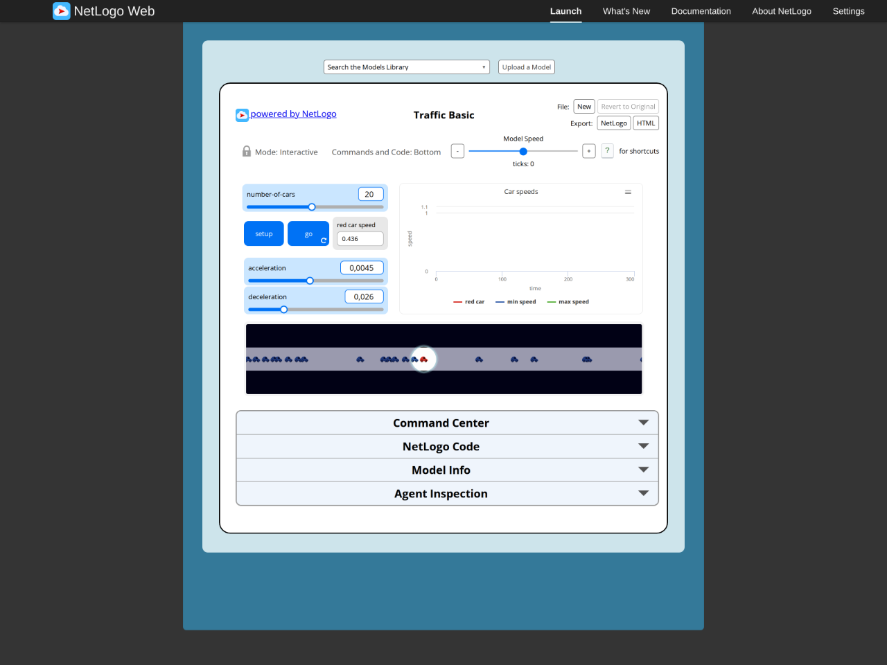 | 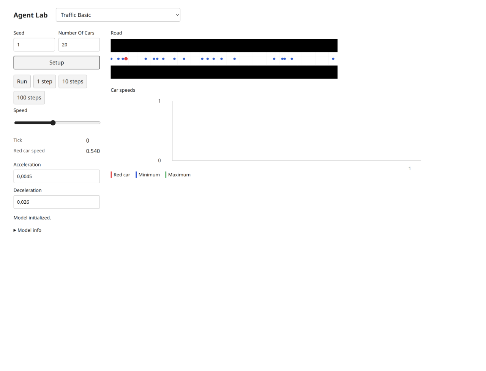 |

| Original progress | Target progress |
| --- | --- |
| 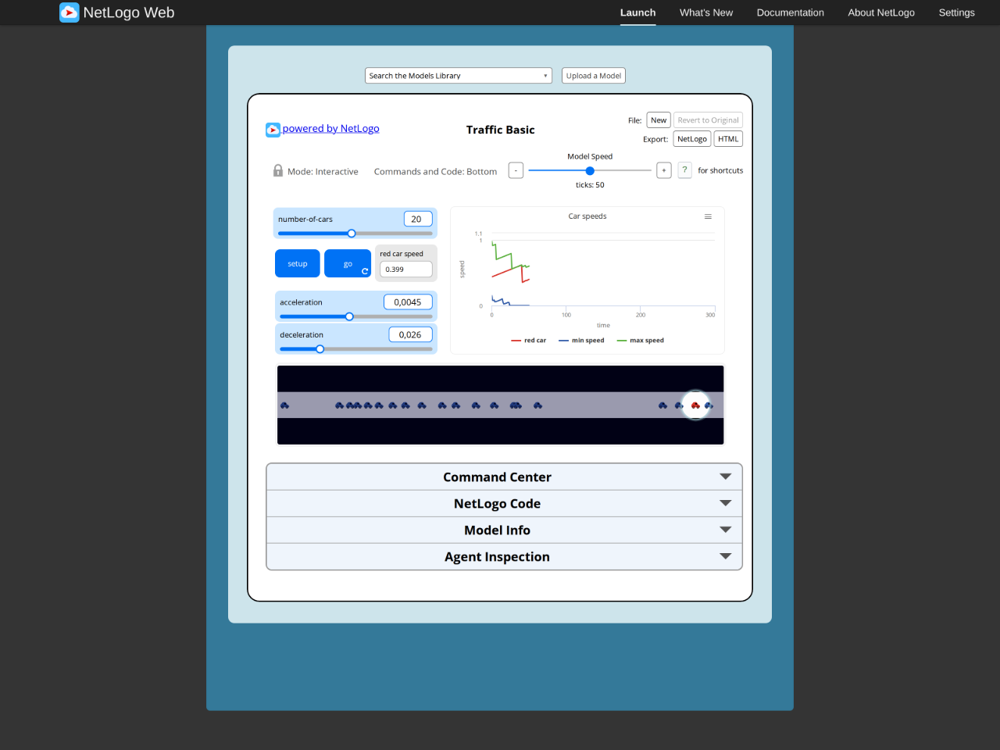 | 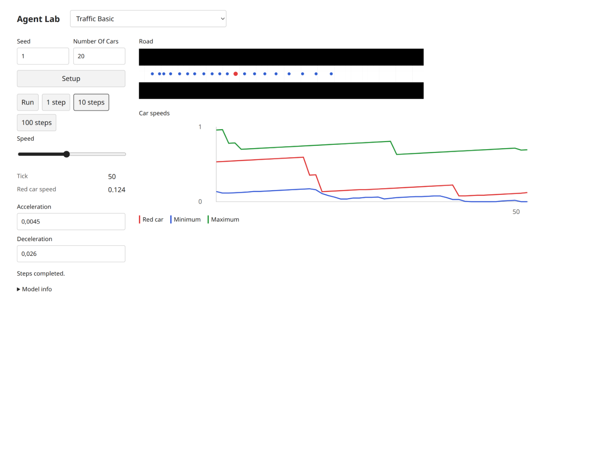 |

Additional inspected captures: [desktop dark](https://github.com/dweigend/city-library/blob/dc7b164abd23c8e7b7f11c902195ab030c5f1c4b/docs/development/selected-transport/traffic-basic-target-desktop-dark.png), [mobile light controls](https://github.com/dweigend/city-library/blob/dc7b164abd23c8e7b7f11c902195ab030c5f1c4b/docs/development/selected-transport/traffic-basic-target-mobile-light-controls.png), [mobile light scene](https://github.com/dweigend/city-library/blob/dc7b164abd23c8e7b7f11c902195ab030c5f1c4b/docs/development/selected-transport/traffic-basic-target-mobile-light.png), [mobile dark scene](https://github.com/dweigend/city-library/blob/dc7b164abd23c8e7b7f11c902195ab030c5f1c4b/docs/development/selected-transport/traffic-basic-target-mobile-dark.png).

## Traffic Intersection

Canonical selection: `Sample Models/Social Science/Unverified/Traffic Intersection`. Source NetLogo 7.0.4, pinned Galapagos `90be931773fcf499049247a8aaa1aecbe003654c`; actual loaded XML SHA-256 `231db7a8ab42c4bb097f57fbde6520b6b1c64d6c39d3e96c2c3d57e6aaa4b5c9`. [Complete original and notices](https://github.com/dweigend/city-library/blob/23693e90e199512faf68a04c9a2198b9eb50463b/experiments/traffic-intersection/original.nlogox); [adaptation notice](https://github.com/dweigend/city-library/blob/23693e90e199512faf68a04c9a2198b9eb50463b/experiments/traffic-intersection/NOTICE.md).

Hard-boundary unit substeps, minimum braking bounds, collision aging and creation, post-movement spawn and strict elapsed > length light timing are preserved. The two light agents are included in original count turtles; they are distinct from cars. Switch invokes source change-to-yellow; yellow completes even with auto disabled. The source has no collision-free guarantee and target tests do not invent one. Waiting histories show overall/north/east zero-speed cars.

Original observation: Two lights, zero cars and zero accidents at setup. At tick 50: 28 cars, zero accidents, 21 waiting overall (5 northbound and 16 eastbound).

Target observation: Zero waiting and accidents at setup. At tick 50: 22 waiting overall and zero accidents. After live north demand 0 and Setup, Step advanced to tick 1; Switch completed at that tick.

Per-model baseline conclusion: setup dimensions, population/breed roles, parameter meanings and procedure phases have source-backed functional coverage; native and target progressed successfully at the declared horizon. Source quirks and adaptations above are explicit. Independent review/final acceptance remains pending.

Live/reset check: `freqNorth=0` remained after Setup; tick returned to 0 and Step advanced to 1. Run/Pause advanced from tick 50 to 52, then stayed at 52. No target console errors or failed requests appeared in the retained bounded final snapshot; older network entries were omitted by the tool, so this is not a complete network log. Native runtime error arrays were empty for default setup/progress.

| Original setup | Target setup |
| --- | --- |
| 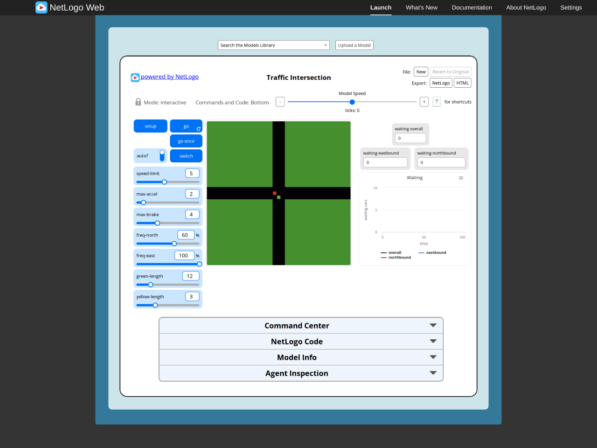 | 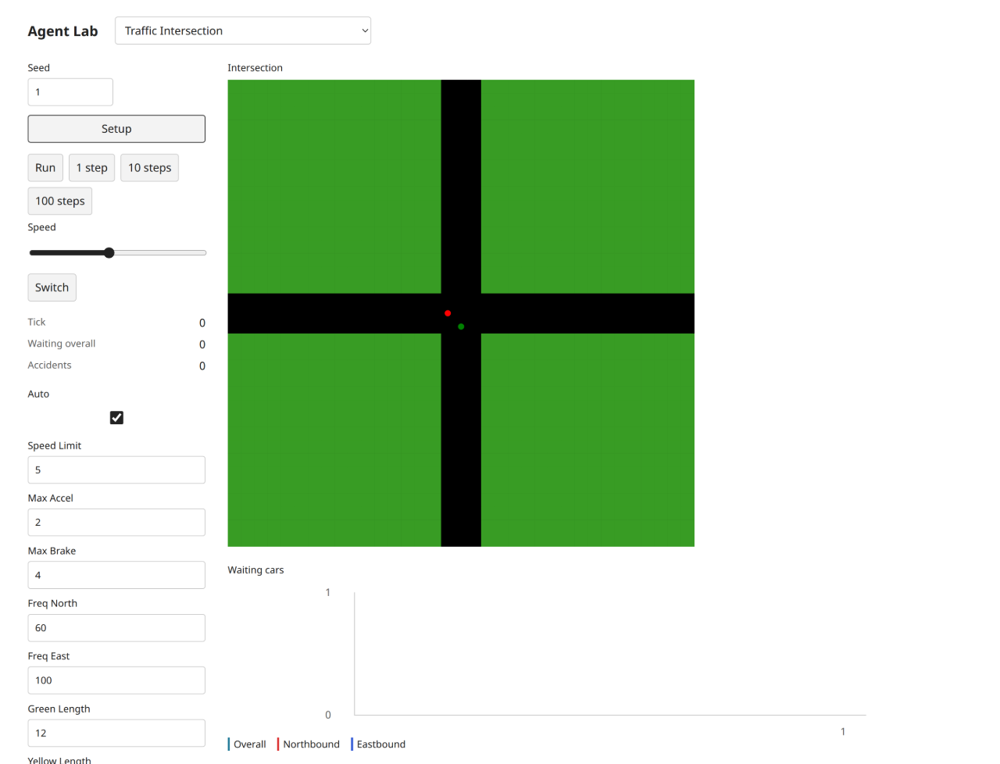 |

| Original progress | Target progress |
| --- | --- |
| 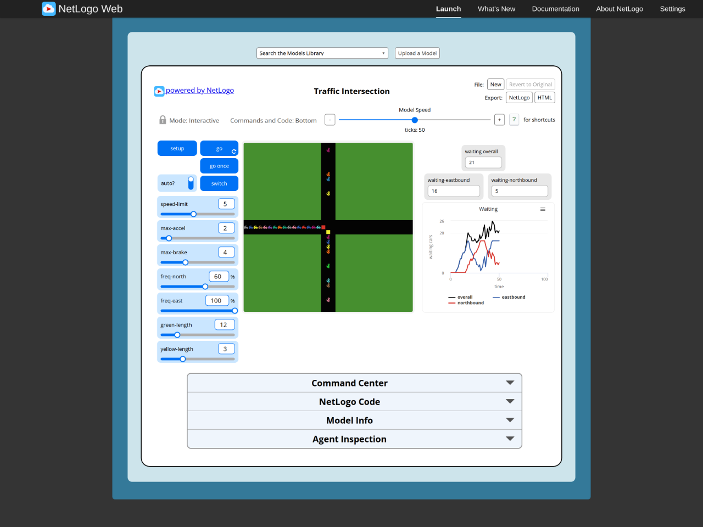 | 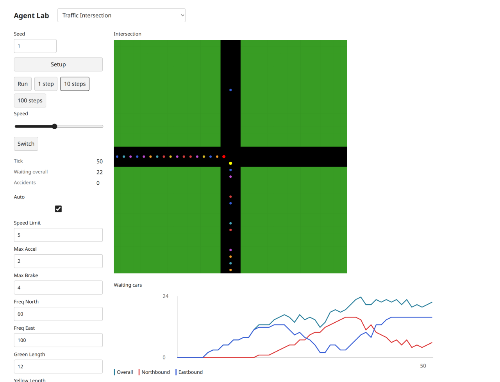 |

Additional inspected captures: [desktop dark](https://github.com/dweigend/city-library/blob/dc7b164abd23c8e7b7f11c902195ab030c5f1c4b/docs/development/selected-transport/traffic-intersection-target-desktop-dark.png), [mobile light controls](https://github.com/dweigend/city-library/blob/dc7b164abd23c8e7b7f11c902195ab030c5f1c4b/docs/development/selected-transport/traffic-intersection-target-mobile-light-controls.png), [mobile light scene](https://github.com/dweigend/city-library/blob/dc7b164abd23c8e7b7f11c902195ab030c5f1c4b/docs/development/selected-transport/traffic-intersection-target-mobile-light.png), [mobile dark scene](https://github.com/dweigend/city-library/blob/dc7b164abd23c8e7b7f11c902195ab030c5f1c4b/docs/development/selected-transport/traffic-intersection-target-mobile-dark.png).

## Traffic Grid Goal

Canonical selection: `IABM Textbook/chapter 5/Traffic Grid Goal`. Source NetLogo 7.0.4, pinned Galapagos `90be931773fcf499049247a8aaa1aecbe003654c`; actual loaded XML SHA-256 `7259187f36f97a8c6e9378398a72d927844233c3811151a714eb3aa97807bfa9`. [Complete original and notices](https://github.com/dweigend/city-library/blob/23693e90e199512faf68a04c9a2198b9eb50463b/experiments/traffic-grid-goal/original.nlogox); [adaptation notice](https://github.com/dweigend/city-library/blob/23693e90e199512faf68a04c9a2198b9eb50463b/experiments/traffic-grid-goal/NOTICE.md).

Uses the Grid procedures plus distinct canonical house/work fields and local Moore-neighbor greedy choices. The setup upCar flag intentionally remains unchanged after heading changes, exactly as the source collision lookup does. Goal toggling uses face adjacency and keeps the two sequential source tests. Watch a car highlights home/work, enlarges the car and labels its goal; Stop watching clears highlights/labels while preserving enlarged size. Target watch/stop/change-light and canvas nearest-intersection selection executed. Current/home/work field labels are in the public readmodel; patch text decoration is simplified.

Original observation: 200 cars at setup. At tick 50: phase 10, mean speed 0.3906099999999998, maximum speed 1.099.

Target observation: 200 stopped cars at setup. At tick 50: phase 10 and 72 stopped cars. Live cycle 3 survived Setup; Step gave tick 1 and phase 1. The native overshoot and stale setup-direction lookup are retained in focused tests.

Per-model baseline conclusion: setup dimensions, population/breed roles, parameter meanings and procedure phases have source-backed functional coverage; native and target progressed successfully at the declared horizon. Source quirks and adaptations above are explicit. Independent review/final acceptance remains pending.

Live/reset check: `ticksPerCycle=3` remained after Setup; tick returned to 0 and Step advanced to 1. Run/Pause advanced from tick 50 to 52, then stayed at 52. No target console errors or failed requests appeared in the retained bounded final snapshot; older network entries were omitted by the tool, so this is not a complete network log. Native runtime error arrays were empty for default setup/progress.

| Original setup | Target setup |
| --- | --- |
| 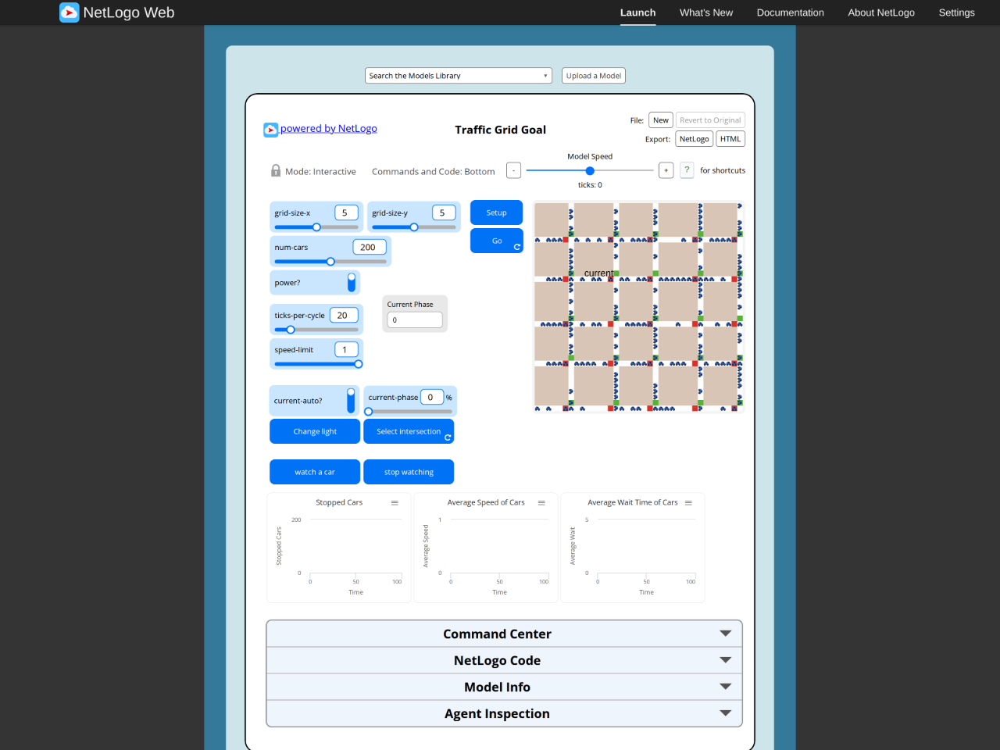 | 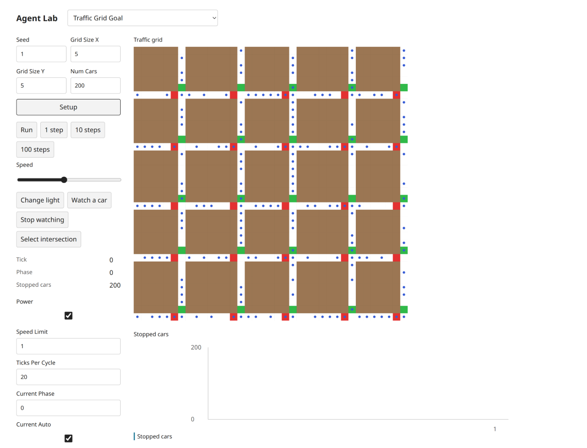 |

| Original progress | Target progress |
| --- | --- |
| 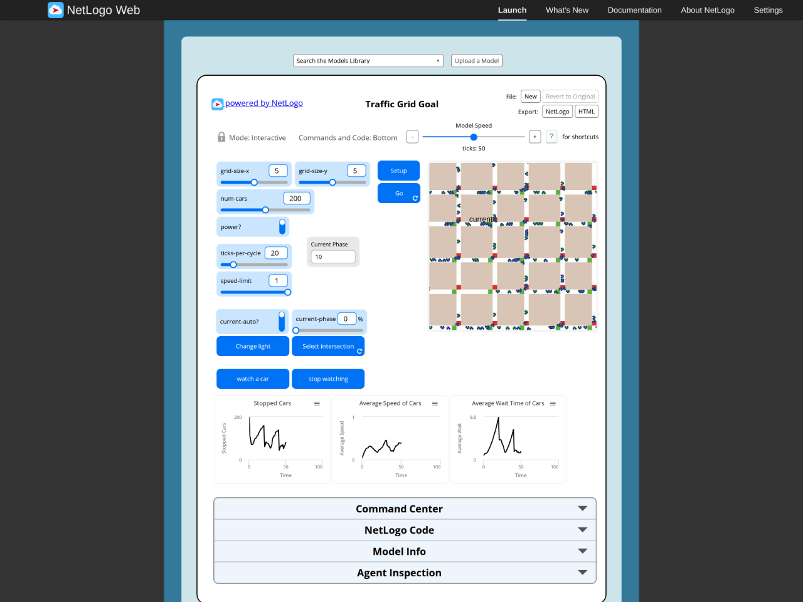 | 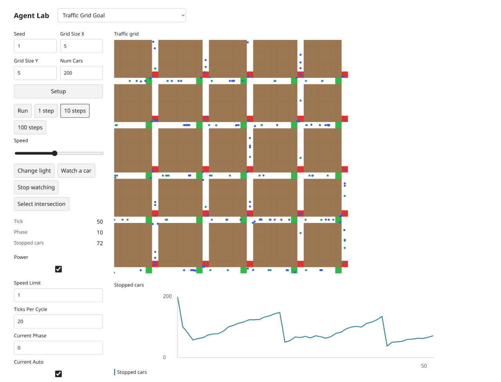 |

Additional inspected captures: [desktop dark](https://github.com/dweigend/city-library/blob/dc7b164abd23c8e7b7f11c902195ab030c5f1c4b/docs/development/selected-transport/traffic-grid-goal-target-desktop-dark.png), [mobile light controls](https://github.com/dweigend/city-library/blob/dc7b164abd23c8e7b7f11c902195ab030c5f1c4b/docs/development/selected-transport/traffic-grid-goal-target-mobile-light-controls.png), [mobile light scene](https://github.com/dweigend/city-library/blob/dc7b164abd23c8e7b7f11c902195ab030c5f1c4b/docs/development/selected-transport/traffic-grid-goal-target-mobile-light.png), [mobile dark scene](https://github.com/dweigend/city-library/blob/dc7b164abd23c8e7b7f11c902195ab030c5f1c4b/docs/development/selected-transport/traffic-grid-goal-target-mobile-dark.png).

## Remaining approval boundary

All seven are implemented with executed headless and original/target browser evidence. No global milestone/count file was changed. Parent must inspect/cherry-pick the exact owned list, register the five public examples and evidence, then run integrated global checks. Required Argon/high independent review remains PENDING on task 8194e842 (quota); these coordinator findings and worker checks are not independent approval. No reselection, omitted complex case, generic replacement or duplicate Urban Suite port occurred.

Automation issues were handled explicitly: the first iframe CSS click selector timed out, so native setup was clicked through the same-origin frame DOM and original procedures run through the loaded session; an exploratory direct widgetController.redraw() without its update argument threw a TypeError. That erroneous diagnostic invocation was removed; normal session event-loop rendering produced the retained captures. A first attempt to open all target tabs exceeded the eight-tab limit; owned original tabs were closed after retaining their evidence, then distinct target tabs were opened. No user or sibling tab was closed.
