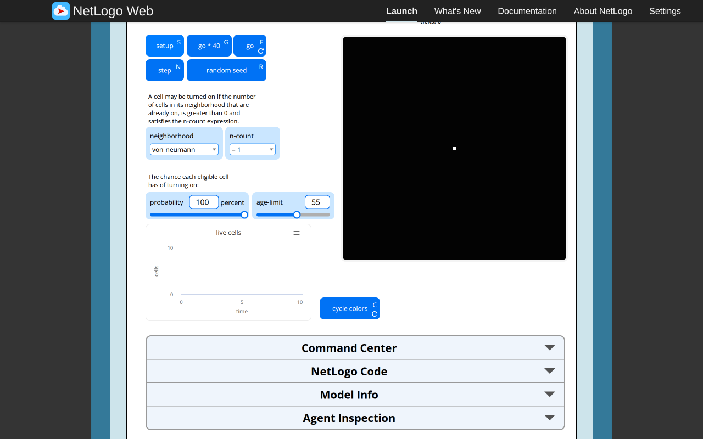
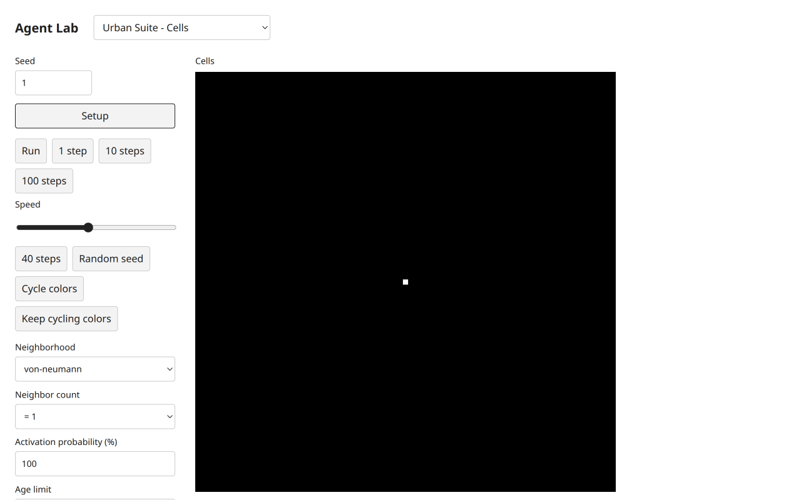
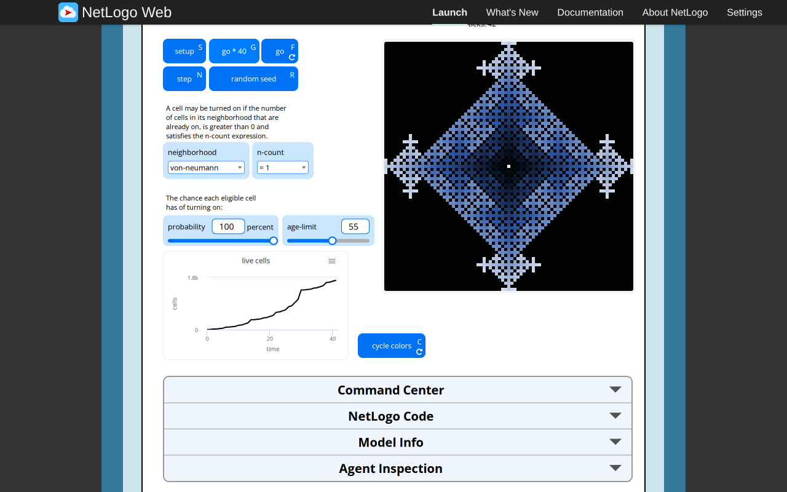
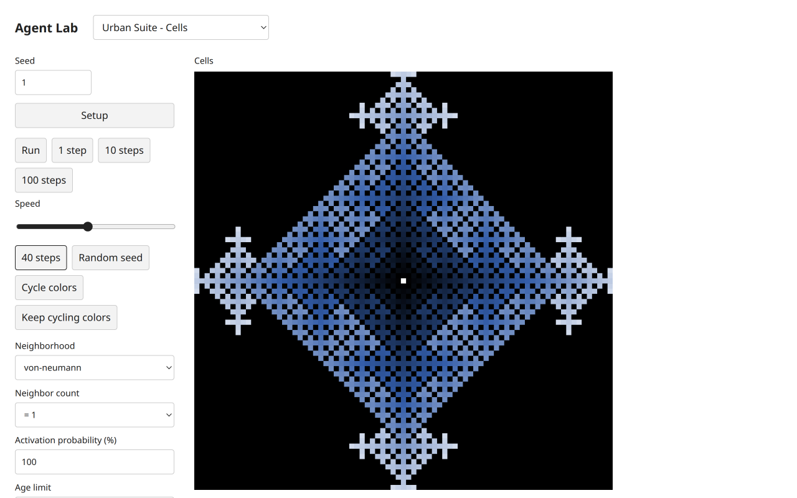
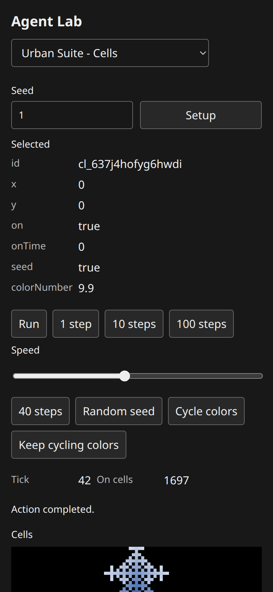
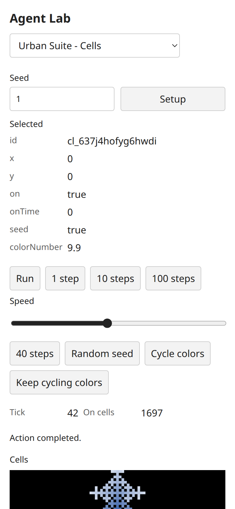
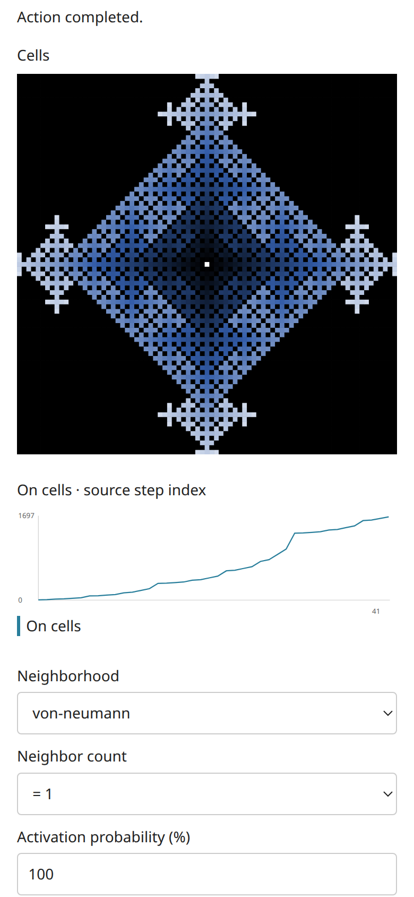

# Urban Suite Cells: paired functional browser comparison

The coordinator executed target T3 Chromium on2026-11-06,port3110,headlessae9d234/sharedUI+paletted23f5e0. The scoped original-browser agent separately executed the concrete original; see [original observations and exact injected commands](urban-feedback-reference-browser.md#cells). Selected identity `Curricular Models/Urban Suite/Urban Suite - Cells`; NetLogo7.0.4,Galapagos90be931773fcf499049247a8aaa1aecbe003654c,actually loaded source SHA-256 `6bcdecbd9481862b3068de6aa1a4440cf7eb253466688226e2fb1fde4f8f7ec2`. [Full source/notice](https://github.com/dweigend/city-library/blob/23693e90e199512faf68a04c9a2198b9eb50463b/experiments/urban-suite-cells/NOTICE.md) retains Wilensky2007,CC BY-NC-SA3.0. [Three-publication dossier](https://github.com/dweigend/city-library/blob/23693e90e199512faf68a04c9a2198b9eb50463b/docs/research/netlogo-web/urban-suite-cells.md) is context,not scientific validation.

Both used81×81 torus,von-neumann,rule`= 1`,probability100,age-limit55. Original native RNG unspecified,targetMulberryseed1. At probability100 the relevant growth outcomes are deterministic despite different random streams. Both initialized one on seed at(0,0),on-time0,color9.9. Original Step,Step,go*40 reached42/on1697; target native1step,1step,40steps also reached42/on1697. No cross-RNG trajectory claim is made for other probabilities. The widget really repeats40,contrary to source Info's80 wording.

| Original | Target |
| --- | --- |
|  |  |
|  |  |

Each neighborhood was selected natively,followed by Setup and1step in both original and target:von-neumann5,moore9,displaced-von-n5,h7,moore-von-n13 on cells. The last actual neighborhood contains self plus12 others; off-cell self contributes zero. Native`> 0` and`<= 2` rules each yielded5 in the first von-neumann step. These tests establish these first-step outcomes,not exhaustive stochastic equivalence. Target probability0/age-limit0,Setup and10steps gave tick10/on1 with Run still enabled; source equivalent native go reached9/on1. Empty fields also continue under the source/headless contract.

Native age-limit1,probability100,Setup+three steps yielded tick3/on16 in both systems. The center inspector reported on=false,onTime0,seed=true,colorNumber0. Seed markers survive expiry. The original additional Command Center reactivation retained black; frozen public headless fixtures/tests verify the corresponding target reactivation and retained color. That deterministic target fixture was not injected into this browser. Activation eligibility is snapshotted before turn-on,uses pre-step onTime,and expires only onTime<preStepTick−ageLimit; zero age limit disables expiry.

At paused target tick42 the center inspector showed9.9. One-shot Cycle colors plus independent100ms repetition produced observed9.850000000000001 at unchanged42/on1697; one further callback occurred before stop,so the retained later value was9.840000000000002. This was six total decrements,not falsely presented as the original's five. Scientific Run/Pause later reached45; Random seed was exercised,then independently repeated from fresh Setup:tick0/on1→Random seed→tick0/on2. The actual action does not tick. Starting Keep cycling then Setup cleared the toggle and left0/on1 unchanged after250ms. Source cycling also preserves tick but its visual ask DOES consume original RNG; target omits that shuffle deliberately. Headless assertions verify no target RNG consumption by cycleColors; browser observations verify clock/state/controls,not hidden target RNG.

Numeric color memory belongs to canonical Fields. Shared `netLogoColor` projects observed1400source RGB bins,with independently retained [binding facts/hash](urban-feedback-reference-evidence/color-bindings.json); it does not derive a substitute age gradient or copy an engine. The next scientific go recolors nonseed cells while seeds retain cycle history. Source plots before tick; target chart omits setup and maps completed tick n to source step index n−1,so final plotted x41 corresponds to current tick42. History remains successful completed ticks; the UI only projects it.

Target desktop1280×800 and mobile390×844 CSS pixels were visually inspected in both themes. Canvas selection and keyboard Home expose real cell records; a final fresh application load reproduced42/on1697 without a pending Reload updates notice. Earlier captures with a pending dev update were replaced for final mobile evidence. No horizontal overflow. Source baseline was desktop; target mobile improvements do not imply a source responsive redesign.

Original and target ordinary runs recorded no JavaScript console errors or failed requests; deliberate errors in the other two originals are separately documented. Coordinator implementation checks: `bun run check` passed174tests/8261assertions,75 public examples,all four typecheck configurations,build and packed Bun/Node ESM/ambient-free TypeScript consumers. The scoped worker independently executed the same integrated check. The coordinator also reran focused12tests/91assertions and frozen model/example hashes before commit. A redundant attempt to poll an already-completed shell session returned Unknown process id; this bookkeeping error did not run a model or invalidate the retained successful check log. All coordinator-owned tabs were closed.

The [image manifest](https://github.com/dweigend/city-library/blob/dc7b164abd23c8e7b7f11c902195ab030c5f1c4b/docs/development/urban-cells-target-evidence/SHA256SUMS.json) retains the final compact artifacts. Independent technical Argon approval remains pending under the [quota blocker](https://github.com/dweigend/city-library/blob/dc7b164abd23c8e7b7f11c902195ab030c5f1c4b/docs/development/connectivity-transfer-review-blocker.md). Source comparisons,passing local checks and scientific dossiers do not replace that approval or constitute completion of all200models.
