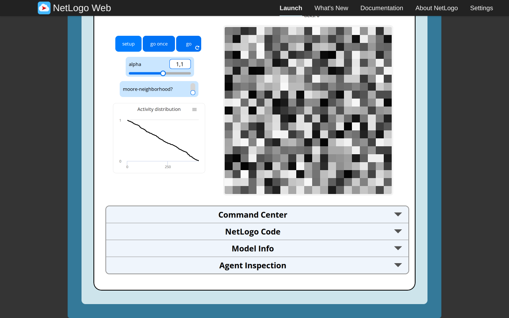
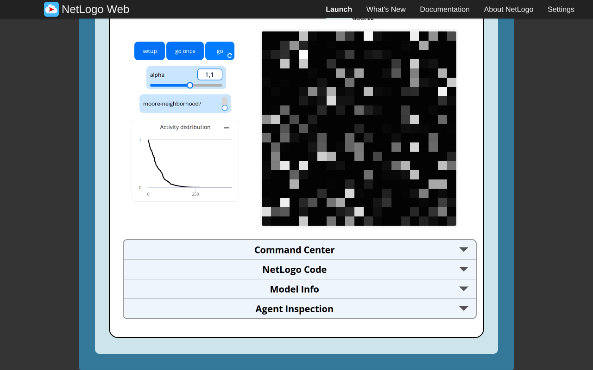
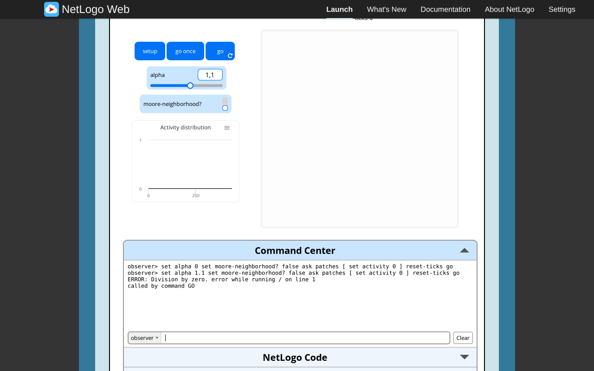
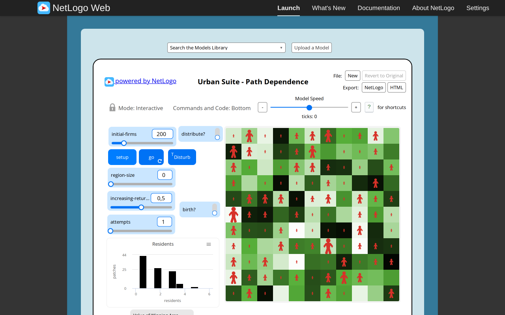
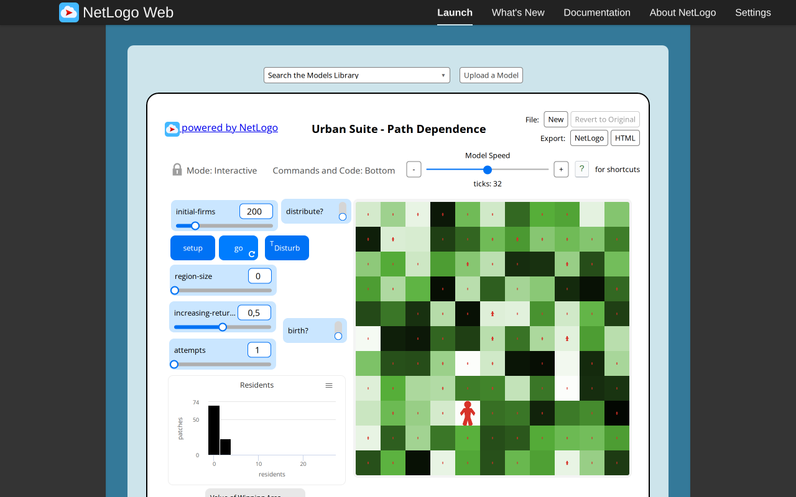
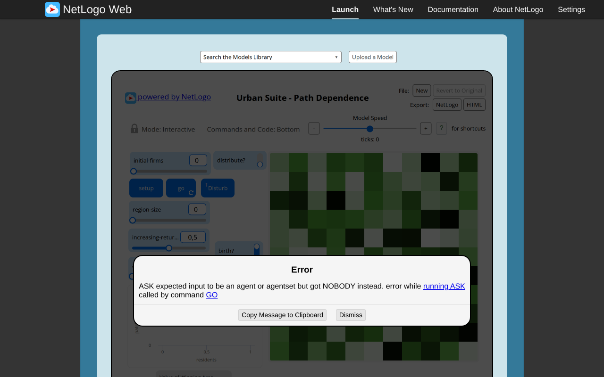
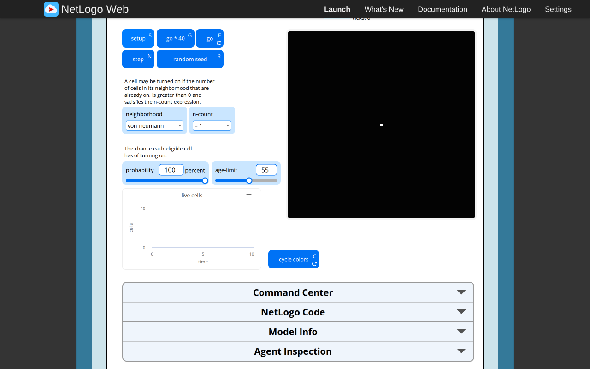
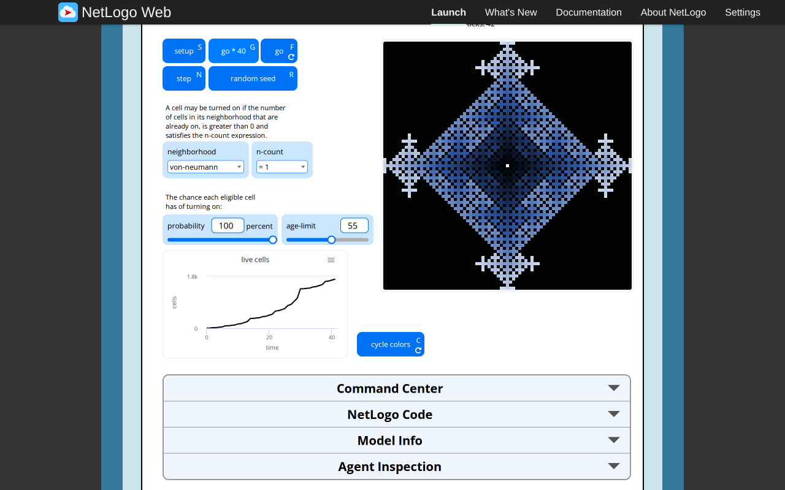

# Urban Feedback, Path Dependence and Cells: original-browser evidence

Executed2026-11-05 in the configured T3 Chromium preview at1280×800 CSS pixels. Scope is **the three original NetLogo models only**; target implementation, paired target screenshots, target mobile/themes and independent technical approval remain separate coordinator gates. No literature research, Git mutation, runtime/UI change or replacement model was performed. Source Procedures/Widgets and the [proposed contracts](https://github.com/dweigend/city-library/blob/23693e90e199512faf68a04c9a2198b9eb50463b/docs/development/selected-urban-feedback-contracts.md) were read before the browser work.

All three are canonical selected paths under `Curricular Models/Urban Suite/`, NetLogo7.0.4, byte-matching pinned Galapagos revision `90be931773fcf499049247a8aaa1aecbe003654c`. SHA-256 was calculated from the **actually loaded** iframe `session.nlogoSource.nlogo` UTF-8 bytes and matched the archived XML. Copyright2007 Uri Wilensky, CC BY-NC-SA3.0; complete attribution remains in each source/NOTICE. Positive Feedback/Cells cite Wilensky(2007); Path Dependence cites Rand and Wilensky(2007). Native seed was unspecified in normal stochastic runs; only the explicitly recorded Path fixture set random-seed9. No cross-engine seed/trajectory or scientific distribution equivalence is claimed.

## Positive Feedback

Canonical selected identity `Curricular Models/Urban Suite/Urban Suite - Positive Feedback`; [launcher](https://www.netlogoweb.org/launch#https://www.netlogoweb.org/assets/modelslib/Curricular%20Models/Urban%20Suite/Urban%20Suite%20-%20Positive%20Feedback.nlogox). Loaded42733bytes, SHA-256 `ed8e7de693797f0ebe625d742032dbf95614e0a31c88b41eed83db3a47ff42b6`.

Native Setup used alpha1.1/Moorefalse on21×21 wrapping cells. Tick0 had441 activities, minimum0.009240071027227348,maximum0.9992779938076678,total225.640051346456. Thus setup was **not max-normalized**. Native go once followed by go/pause reached actual tick22:minimum2.770710298794152e−17,maximum1,total52.49551297255636. The activity-distribution plot displays descending ranked activities; it is not a histogram or a time series.

| Setup | Progress, tick22 |
| --- | --- |
|  |  |

Native alpha inputs0,1,2 and the Moore switch were exercised. The following **declared Command Center fixtures** supplied activities; go was executed either in the recorded command or with native go once. Exact commands are retained in observations.json.

- All-zero activities,alpha0,Moorefalse,reset-ticks/go:tick1,all441activities1,total441. Official runtime therefore treats zero-to-zero power as1 in this case.
- All-zero activities,alpha1.1,Moorefalse,reset-ticks/go:tick stayed0;activity and new-activity were all0. Command Center printed **“ERROR: Division by zero. error while running / on line1 called by command GO”**. This is a genuine source runtime error from an injected boundary state; it was not silently repaired. Staging/commit occurred before the divisor failed. The error appeared in native Command Center output, not as a JavaScript console entry or browser dialog.
- Native alpha1/Mooretrue,source corner(10,10) activity1 and all others0:one go→tick1 with exactly9unit activities,including wrapped coordinates−10 and10 on both axes,total9. This verifies Moore averaging followed by global-max normalization and its nonconserved total in this fixture.
- Native alpha2/Moorefalse,activities0.25,0.5,1 at(0,0),(1,0),(2,0),others0:one go→tick1 with0.0625,0.25,1 and all other activities0.

The all-zero-positive-alpha error justifies an explicit target fixture precondition or declared error policy; it does not justify changing the source equation. The alpha0 result is independently observed, so a blanket “all-zero is always invalid because normalization divides by zero” scientific claim would be inaccurate. A stricter target fixture restriction can still be identified as a target API precondition.

## Path Dependence

Canonical identity `Curricular Models/Urban Suite/Urban Suite - Path Dependence`; [launcher](https://www.netlogoweb.org/launch#https://www.netlogoweb.org/assets/modelslib/Curricular%20Models/Urban%20Suite/Urban%20Suite%20-%20Path%20Dependence.nlogox). Loaded45207bytes, SHA-256 `1b5216c6077d80c441626f1cdb9c108a73adca17a17be4020adeb96e2e67e931`.

Native defaults:initial-firms200,distributefalse,region-size0,increasing-returns0.5,attempts1,birthfalse;11×11 torus. Setup tick0 produced200searching firms,largest regional population5,101occupied cells. Native go/pause produced tick32,200firms/100settled,largest population25. Native Disturb at tick32 preserved200firms/time and made settled0. Histogram measures patches per same-cell occupant-count bin, excluding empty patches; it does not count settled firms or regional totals.

| Setup | Progress, tick32 |
| --- | --- |
|  |  |

The unresolved setup/birth branches were exercised through native switches/inputs:

- initial-firms0,distributefalse,birthtrue,Setup/Go:runtime alert **“ASK expected input to be an agent or agentset but got NOBODY instead. error while running ASK called by command GO”**. Firms0/tick0 remained. The custom alert was acknowledged with its native Dismiss control. Repeating Go gave the same failure. A read-only SHA-256 of JSON.stringify(workspace.rng.exportState()) was identical before/after the repeated attempt: `884781014011a997c13fcc37fc73404ad3116e82f1448ddde610f9955e7d87af`. No RNG movement was observed for this failed attempt. A silent target no-op or spontaneous founder would change this baseline.
- distributetrue,initial-firms200,birthfalse,Setup:tick0,121firms,largest population1. The inverted source branch fills one firm per cell rather than creating200.
- distributetrue,initial-firms100,Setup:the browser exposed native **confirm** message “Can't distribute, fewer patches than people.” `preview_status` captured the exact dialog; `preview_dialog accept:true` acknowledged it. Setup then continued to assign qualities but produced tick0/firms0/largest0. The native browser dialog prevented a simultaneous page screenshot; the retained observations record its type/message/response rather than fabricate an image of it.
- distributeoff/initial200,Setup;then live birthtrue,region2,attempts3,increasing-returns0.75:go/pause reached tick9,firms209,settled200,largest population38. One birth per successful tick is observed in this run.

Additional **native Command Center fixture**:one searching firm at(0,0),heading0,quality1everywhere,birthfalse,region0,increasing-returns0,attempts3,random-seed9,reset-ticks/go. At tick1 it was at(−3,0),settledtrue,largest population1. All three movements executed despite certain settling on the first attempt. This also confirms that the sole searching/self firm participates in the regional-population denominator. Exact command text is retained.

## Cells

Canonical identity `Curricular Models/Urban Suite/Urban Suite - Cells`; [launcher](https://www.netlogoweb.org/launch#https://www.netlogoweb.org/assets/modelslib/Curricular%20Models/Urban%20Suite/Urban%20Suite%20-%20Cells.nlogox). Loaded44501bytes, SHA-256 `6bcdecbd9481862b3068de6aa1a4440cf7eb253466688226e2fb1fde4f8f7ec2`.

Native defaults:von-neumann,rule`= 1`,probability100,age-limit55;81×81 torus. Setup tick0 had only source(0,0) on,seed markertrue,on-time0,pcolor9.9;starting-color109. First native Step→tick1/on5,with new nonseed cells on-time0/pcolor100;seed stayed9.9. Second Step→tick2/on9. Native **go *40** advanced2→42,on1697,one seed. The widget really executes40 steps; Info's80-step wording is inaccurate. Default source growth is deterministic at probability100, despite runtime activation draws.

| Setup | Progress, tick42 |
| --- | --- |
|  |  |

### Stateful colors and actual RNG behavior

With scientific go paused at42, native cycle colors executed five observed color decrements. Tick remained42;seed9.9→9.850000000000001. One nonseed sample108.91304347826087→108.86304347826085. **Exported RNG state changed**, SHA-256 `e7b1de159443f959af879ec6eb34506f8dd78d84994e224f96e9adfc04ef6f23`→`e8a968c6a8b3ee8504b80326315b3312c9ff9ad999f582b3506290df1473e77e`. Source widget code is `ask patches with [ on? ] [ set pcolor pcolor - 0.01 ]` followed by display:its display-only random ask order consumes draws. Therefore “no tick” is verified, whereas “no source RNG” is false for this multi-cell run. A target may omit these visual-order draws explicitly; it must not claim equal RNG consumption.

The next native Step→43 recolored nonseed cells from age/on-time but retained seed color9.850000000000001. Native random seed at tick43 added source(25,12),on-time43,white9.9,without ticking. It is a random intervention, not a one-step growth operation.

Native Command Center numeric boundary query returned:

| Expression | Actual result |
| --- | --- |
| white / blue / starting-color |9.9 /105 /109|
| scale-color109,value−1,bounds0..5 |100|
| value0 |100|
| value1 |102|
| value5 |109.9999|
| value6 |109.9999|
| on-cell pcolor0,then one exact cycle decrement |139.99|

These are observed official runtime values; the upper shade clamp is109.9999,not110. The negative decrement wraps across the140-color interval. Commands and numeric arrays remain machine-readable.

### Strict age, seed memory and native parameter coverage

Native age-limit1,Setup,three separate Steps gave:tick1/on5 and seed on/white;tick2/on9 and seed on/white;tick3/on16 and original seed **off,black0,on-time0,seed marker stilltrue**. Then Command Center `ask patch 0 0 [ turn-on ]`,refresh on-cells,color-cells made it on/on-time3 while retaining seed markertrue and **black0**. Ordinary reactivation does not whiten a retained seed marker. This confirms the persistent-color host contract rather than deriving all display colors statelessly from on/off/age.

Each neighborhood was selected natively, followed by Setup and one Step with`= 1`/probability100/age55:von-neumann5,moore9,displaced-von-n5,h7,moore-von-n13 on-cells at tick1. Native`> 0` and`<= 2` chooser states each produced5 after a first von-neumann Step. These are meaningful first-step checks, not exhaustive later-neighborhood equivalence.

Native probability0/age-limit0 with Setup and go/pause reached tick9/on1;growth was suppressed and expiry disabled. Then an explicit Command Center all-off fixture followed by native Step reached tick10/on0,showing no empty-field terminal rule. Finally restored von-neumann/`= 1`/probability100/age55 and native Setup:tick0/on1,both forever controls off.

## Diagnostics, cleanup and verification limits

Expected source runtime failures were deliberately provoked and retained:Path empty-birth ASK error and Feedback all-zero division error. Ordinary runs and Cells checks showed no model failure. Page diagnostics for all three sessions showed no JavaScript console errors and no failed network requests; the expected errors appeared in the native model alert/Command Center and remain explicit above.

Automation corrections are separate from source failures:an initial read preceded iframe compilation and found session undefined;waited for the actual model title. Same-tab hash navigation briefly retained the prior iframe;waited for the new title and verified the correct hash before proceeding. Evaluate/snapshot during the native distribute confirm were interrupted;read status and acknowledged it using preview_dialog. Attempting custom-alert Dismiss for Feedback's Command-Center-only error timed out;the actual source error text was retained in its console image. No fallback browser or sandbox changes were needed.

Eight targeted PNGs were retained and visually inspected:six setup/progress views and two expected source-error views. [Observations/exact fixture commands](https://github.com/dweigend/city-library/blob/dc7b164abd23c8e7b7f11c902195ab030c5f1c4b/docs/development/urban-feedback-reference-evidence/observations.json), [PNG SHA-256 manifest](https://github.com/dweigend/city-library/blob/dc7b164abd23c8e7b7f11c902195ab030c5f1c4b/docs/development/urban-feedback-reference-evidence/SHA256SUMS.json). Local JSON parsing, three loaded-source/archive hash comparisons,image count/hash existence and numeric invariants passed. No headless tests/typecheck/build were run by this browser-only task. Previous model instances were unloaded on same-tab navigation;the final Cells instance was reset with controls off,and the owned tab was closed before handoff.

These observations resolve source ambiguities;they do not freeze a target API or approve target behavior. Coordinator decisions,implemented public contracts,target desktop/mobile evidence,paired comparison and independent review remain outstanding for these three selected models.
