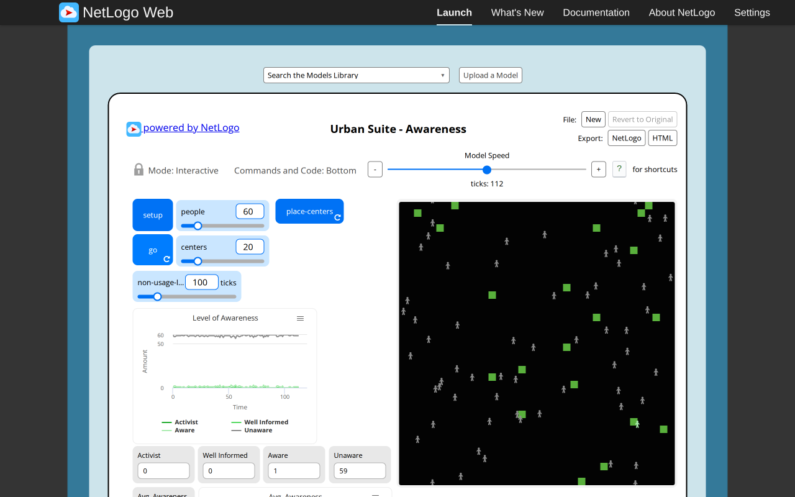
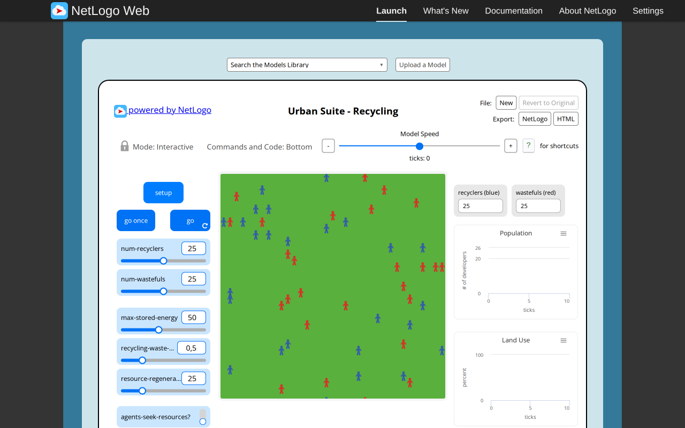
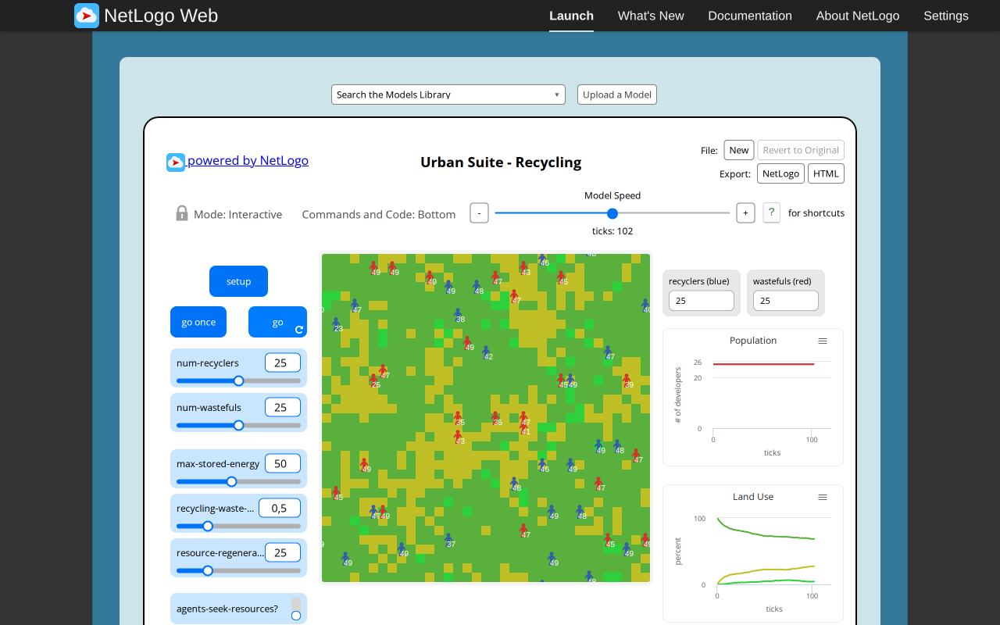

# Urban Suite Awareness and Recycling: executed original-browser baselines

Executed2026-11-05 by the scoped reference-browser agent in the configured T3 Chromium preview, at1280×800 CSS pixels. This report covers **original NetLogo sessions only**. The coordinator owns subsequent paired target comparison, mobile/theme checks, integration and ledger decisions. No independent technical approval, scientific validation or cross-RNG trajectory equivalence follows from these observations. No literature research was performed.

Both originals loaded through the official Web launcher. SHA-256 was calculated in the page from the actually loaded iframe `session.nlogoSource.nlogo` UTF-8 bytes using crypto.subtle, then compared to the archived source contract. Both match pinned Galapagos revision `90be931773fcf499049247a8aaa1aecbe003654c`, NetLogo7.0.4; full credits/notices remain in the archives. Models are Felsen and Wilensky(2007), copyright2007 Uri Wilensky, CC BY-NC-SA3.0. See [source contracts](https://github.com/dweigend/city-library/blob/23693e90e199512faf68a04c9a2198b9eb50463b/docs/development/selected-urban-contracts.md), [Awareness provenance](https://github.com/dweigend/city-library/blob/23693e90e199512faf68a04c9a2198b9eb50463b/experiments/urban-suite-awareness/NOTICE.md), [Recycling provenance](https://github.com/dweigend/city-library/blob/23693e90e199512faf68a04c9a2198b9eb50463b/experiments/urban-suite-recycling/NOTICE.md), [Awareness research](https://github.com/dweigend/city-library/blob/23693e90e199512faf68a04c9a2198b9eb50463b/docs/research/netlogo-web/urban-suite-awareness.md), [Recycling research](https://github.com/dweigend/city-library/blob/23693e90e199512faf68a04c9a2198b9eb50463b/docs/research/netlogo-web/urban-suite-recycling.md). Research dossiers are context, not evidence of these browser runs.

## Awareness

Canonical path `Curricular Models/Urban Suite/Urban Suite - Awareness`; [official launcher](https://www.netlogoweb.org/launch#https://www.netlogoweb.org/assets/modelslib/Curricular%20Models/Urban%20Suite/Urban%20Suite%20-%20Awareness.nlogox). Loaded source48015bytes, SHA-256 `abfd1ff77cf243256865be372f1800349650d70a8c0e4381ed8ad8168e3ebd89`.

Native Setup used defaults60people,20centers,non-usage-limit100;37×38 wrapping world. At tick0 all60 were unaware, awareness mean0,20centers with mean non-usage0. Native go then pause produced actual tick112:0activists,0well-informed,1aware,59unaware; awareness sum15/mean0.25,20centers,mean non-usage29.9. The native unseeded stochastic trajectory is an observation, not a promised target curve. An earlier paused sample at89 was superseded by this retained112 screenshot.

| Setup | Progress, tick112 |
| --- | --- |
|  |  |

Changing the native non-usage-limit input to0, then go/pause, produced tick121 and0centers. While go remained paused, enabling native place-centers and dragging from/to the same canvas center painted source patch(18,19) green without changing tick121. A preceding fast click did not overlap a forever-loop poll and painted nothing; it is not counted as a successful paint. The drag succeeded in the configured browser, so no fallback browser was used.

The following deterministic fixtures were typed through the **native Command Center**, not executed by mutating internal model objects. They are additional injected test states, not normal setup controls; exact command text is retained in observations.json.

- Removed people/centers, created three at source(18,18), heading0, awareness[11,11,10], reset ticks and ran go once through Command Center. At tick1 all three were at(18,19) with awareness10. This confirms movement-before-contact, black-land subtraction before messaging and per-sender recipient exclusion at10 in this fixture. The source coordinates translate to centered target(0,−0.5)→(0,0.5).
- Set patch(18,19) blue with non-usage7, then used the **native place-centers drag** again. It became green(pcolor55), kept age7 and tick1. Native brush recoloring does not reset age.
- Used native setup sliders people0/centers0 and Setup, then native go/pause. Empty population continued to actual tick8; means displayed N/A. No runtime/console error was observed. This browser run therefore does not support an assumed empty-mean crash. Target finite/null guards must be described as representation behavior, not a claim that the original necessarily stopped.

Finally restored60/20/100 through native inputs and Setup; actual tick0/population60. Manual painting, Setup/Reset, go/pause and live expiry were all exercised. Original has no separate single-step widget; the exact one-go fixture above is explicitly a Command Center intervention.

## Recycling

Canonical path `Curricular Models/Urban Suite/Urban Suite - Recycling`; [official launcher](https://www.netlogoweb.org/launch#https://www.netlogoweb.org/assets/modelslib/Curricular%20Models/Urban%20Suite/Urban%20Suite%20-%20Recycling.nlogox). Loaded source50251bytes, SHA-256 `bcc3570d06d548b468a9ea5bc73ba4fd66960d982c19d9e6eb22953c71bda11e`.

Native Setup used defaults25recyclers,25wastefuls,max-energy50,waste-cost0.5,regeneration25,seekingfalse,show-energytrue;35×35 wrapping world. Tick0:50people,each energy25,all1225fields new. Importantly, setup leaves turtle label strings empty despite show-energy being true. Native go once reached tick1; the first six inspected recyclers had energy26 and labels26. A target that shows energy already at setup may reasonably improve presentation but must declare the timing difference.

Native go then pause reached actual tick102, still25recyclers/25wastefuls. Land counts were new836,recycled53,waste336, respectively68.2448979592%,4.3265306122%,27.4285714286%; sum1225fields/100%. Individual energy range22.5..49. Population plot measures people by kind; Land Use measures field percentages. No identical RNG seed/trajectory is claimed.

| Setup | Progress, tick102 |
| --- | --- |
|  |  |

Executed native live controls:

- show-energy switchedfalse, then go once→tick103:all label strings empty.
- agents-seek-resources switchedtrue, then go once→tick104:50people; the setting was read back true.
- max-energy10,waste-cost2,regeneration0 changed while paused at104:existing energy maximum remained49 immediately. The next native go once→tick105 clamped maximum to10,with50people. Thus live cap edits do not immediately rewrite energy.

Additional fixtures were typed into the **native Command Center**, with exact commands retained:

- All waste,one recycler+one wasteful colocated at(0,0),energy1,cost0.5,cap50,regen0,seekingfalse:one go produced tick1 with only the wasteful surviving at energy2; origin remained waste. This matches recycler processing before wasteful processing, then movement cost/death.
- All waste,one recycler at energy1,cost0,regen0:one go produced tick1 with recycler energy0 alive,at(−1,−1),one recycled field and1224waste. The random destination is incidental; survival at0 is the invariant.
- All waste except new patch(1,0),one wasteful at(0,0),energy1,seekingtrue,regen0:one go produced tick1 at(1,0),energy0; new patch remained new. The destination was sought but not harvested in that same step.
- Removed all people and issued go:tick advanced1→2;environment remained active. There is no population-based source terminal rule.

Restored native50/0.5/25,seekingfalse,show-energytrue and Setup; tick0/population50. Setup/Reset,go once,go/pause,energy labels,seeking,cap,cost and regeneration controls were exercised. Integer regeneration probabilities remain source-derived rules: slider25 accepts3integer outcomes out of100 on recycled land and an additional one-in-five condition on waste. No browser sampling study of those probabilities was executed, so this report does not claim statistical validation.

## Diagnostics, artifacts and remaining work

The configured Chromium browser launched both originals successfully. Page diagnostics for both showed **no application console errors and no failed network requests**. One read-only test expression incorrectly called `world.ticker.ticks()`; its TypeError was corrected to read `_count`. This test-tool expression failure is not a model runtime failure. Both agent-owned tabs were closed after checking and resetting the models. No sandbox configuration was changed.

Four targeted PNGs were retained and visually inspected (setup/progress for each original). [Machine-readable observations and exact injected commands](https://github.com/dweigend/city-library/blob/dc7b164abd23c8e7b7f11c902195ab030c5f1c4b/docs/development/urban-reference-evidence/observations.json), [PNG SHA-256 manifest](urban-reference-evidence/SHA256SUMS.json). JSON parsing, source-hash correspondence and image/hash existence were checked locally. No shell tests/build/typecheck were run by this browser-only task; runtime and target UI were not changed.

Target desktop/mobile/theme interactions, actual target screenshots, paired comparison conclusions and independent Argon implementation review remain pending coordinator integration. These original-browser sessions supply reproducible functional observations and targeted fixtures; they cannot alone mark either selected model fully verified.
