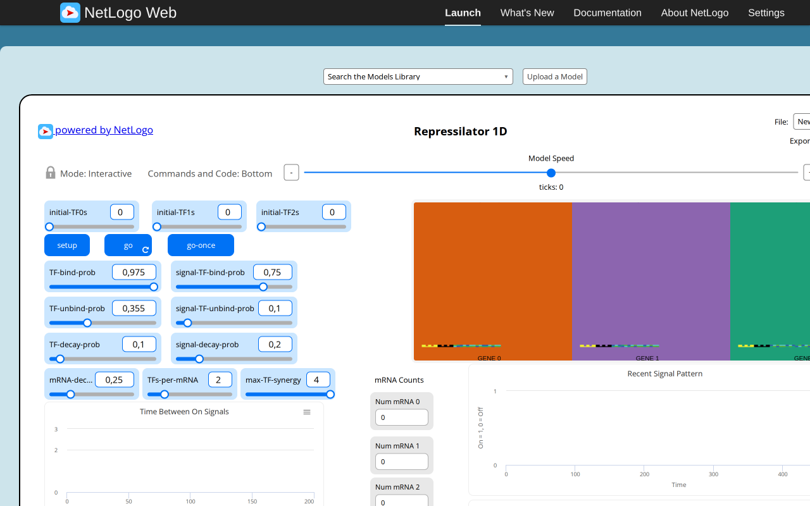
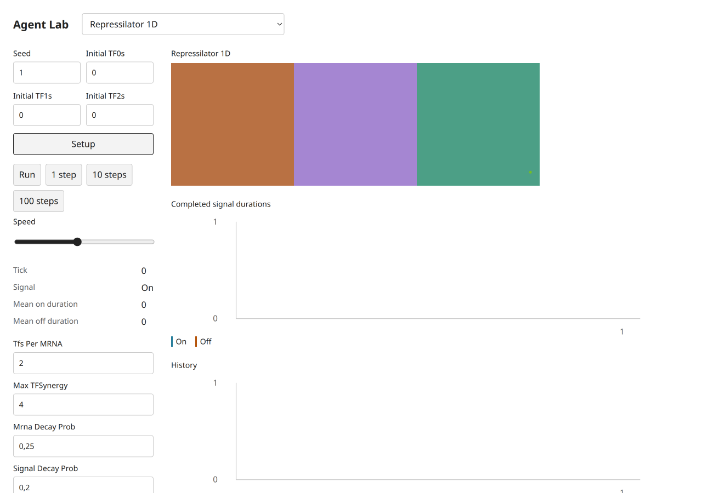
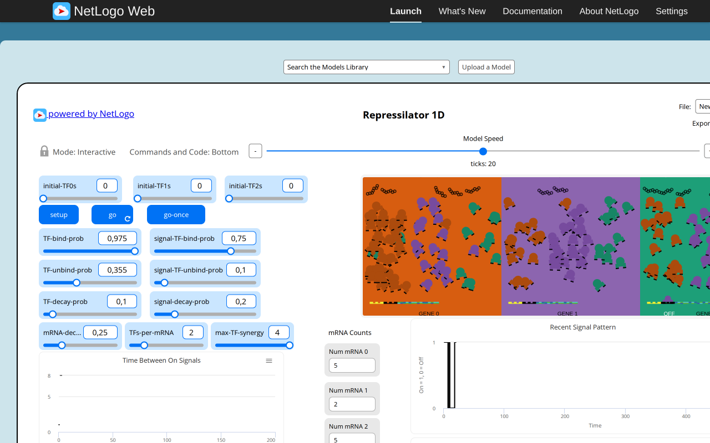
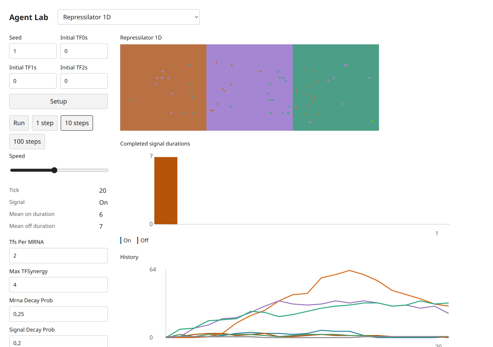

# Repressilator 1D — B09 acceptance evidence

Exact selected catalog identity: `Sample Models/Biology/Repressilator 1D`. Experiment: `repressilator-1d`. [Complete source and notices](https://github.com/dweigend/city-library/blob/23693e90e199512faf68a04c9a2198b9eb50463b/experiments/repressilator-1d/NOTICE.md); [archived XML](https://github.com/dweigend/city-library/blob/23693e90e199512faf68a04c9a2198b9eb50463b/experiments/repressilator-1d/source.nlogox). Galapagos `90be931773fcf499049247a8aaa1aecbe003654c`; served/inventory/actual loaded-session UTF-8 XML SHA-256 `e222752e0f629c0ae1f6df4f6858fcecb5629868ffd6a52ed602e172084f1315` all agree. [Full widgets/procedures/license audit](../../catalog/acceptance/selected-disease-gene-source-audit.json). [Existing three-publication dossier](https://github.com/dweigend/city-library/blob/23693e90e199512faf68a04c9a2198b9eb50463b/docs/research/netlogo-web/repressilator-1d.md), with its existing access and scientific limitations; no duplicate literature work.

The original starts with zero TF/mRNA and signal ON, then produces real molecular counts and completed signal intervals by tick20. Target uses the same phase order and cyclic inhibition with independent Poisson draws. Native zero-synergy binding was explicitly forced and raises Division by zero at tick0; the target exposes a RangeError. Histories sample once per completed target step rather than the additional native update-plots call inside update-signal before tick. Layout banners/DNA shapes are simplified to gene cells and molecules; both ON/OFF interval arrays remain public.

## Executed original and target

Original: actual T3 server Chromium,1280×800 CSS, source random-seed123 before captured setup, source defaults except the stated Disease infectionChance0. Target: actual T3 server Chromium,1280×900 desktop and390×844 mobile CSS, seed1, Mulberry public Random. Screenshot device scale is recorded by decoded PNG dimensions (mobile780×1688). Source MT and target Mulberry streams, presentation-related draws and source agentset activation differ. No cross-seed trajectory, distributional, empirical, scientific or medical validation is claimed. These are educational toys, not health guidance.

Original progress reporters, read from the actual session:

| Reporter | Observed value |
| --- | --- |
| `ticks` | `20` |
| `count mRNAs` | `12` |
| `count TFs` | `185` |
| `is-signal-on?` | `true` |
| `mean-on-duration` | `4.5` |
| `mean-off-duration` | `4.5` |

Target progress monitors, read after actual button actions:

```text
Tick
20
Signal
On
Mean on duration
6
Mean off duration
7
```

[Original raw session, source hash, settings and Run/Pause/reset checks](selected-disease-gene-evidence/repressilator-1d-original.json); [target raw controls, canvas, chart text alternatives and original build attribution](selected-disease-gene-evidence/repressilator-1d-target.json). Source Setup and Run/Pause were executed; go-once is additionally executed when native (Repressilator). Target Setup,1/10-step buttons,Run/Pause and Setup reset were clicked. Target domain scenarios and invalid steps/read purity are separately asserted through the actual final immutable modules in [final browser mechanisms](../../catalog/acceptance/selected-disease-gene-evidence/final-browser-mechanisms.json). Source errors are retained as scenario-specific evidence, never a reason to omit this model.

## Paired ordinary captures

Original setup:



Target setup:



Original progression:



Target progression:



[Desktop dark](https://github.com/dweigend/city-library/blob/dc7b164abd23c8e7b7f11c902195ab030c5f1c4b/docs/development/selected-disease-gene-evidence/repressilator-1d-target-desktop-dark.png), [mobile light](https://github.com/dweigend/city-library/blob/dc7b164abd23c8e7b7f11c902195ab030c5f1c4b/docs/development/selected-disease-gene-evidence/repressilator-1d-target-mobile-light.png), [mobile dark](https://github.com/dweigend/city-library/blob/dc7b164abd23c8e7b7f11c902195ab030c5f1c4b/docs/development/selected-disease-gene-evidence/repressilator-1d-target-mobile-dark.png). These theme captures follow reset at tick0 and intentionally retain initial state. Each PNG was inspected individually. All ordinary PNGs existed before any pixel analysis. Decoded RGB/RGBA statistics and ten equal light/dark canvas PNG ROIs are retained; no renderer repair is claimed.

## Final code and checks

Final build version `1793972578482`, immutable model/UI chunk `./chunks/ui-9h5yfmw1.js`, SHA-256 `ef87d1d51afed74bee10c3fe86c960b48197c4876e269464f5b036c66aa7a6c8`. Source marker `selected-disease-gene-b09:repressilator-1d:e222752e0f629c0ae1f6df4f6858fcecb5629868ffd6a52ed602e172084f1315`. Shared chunk `/chunks/app-sb7h8whr.js`, SHA-256 `1f8f6827af1ab753a43b29435d40f5ae716071103930bc3de67ad53ede358d05`. [All ten final immutable imports, hashes and actual three-step executions](../../catalog/acceptance/selected-disease-gene-evidence/final-bundles.json). The initial captures retain build1793972277740; the five number-format-only changes are documented by separately named formatted screenshots/JSON and final hashes, never by relabeling old captures.

Executed batch checks:24 focused tests/538 assertions; four TypeScript projects; standalone TypeScript covering all five scripts; build; actual packed Bun/Node ESM/ambient-free TypeScript consumer. All five public scripts pass after the [explicitly approved two-line05 amendment](../../catalog/acceptance/selected-disease-gene-freeze-amendment.md);01–04 remain unchanged. The original05 failure/hash remains historical evidence. [Batch checks and limits](../../catalog/acceptance/selected-disease-gene-browser.md). Independent Argon approval remains quota-pending8194e842; coordinator evidence is not independent approval. Root alone decides registration,combined checks and global counts.
