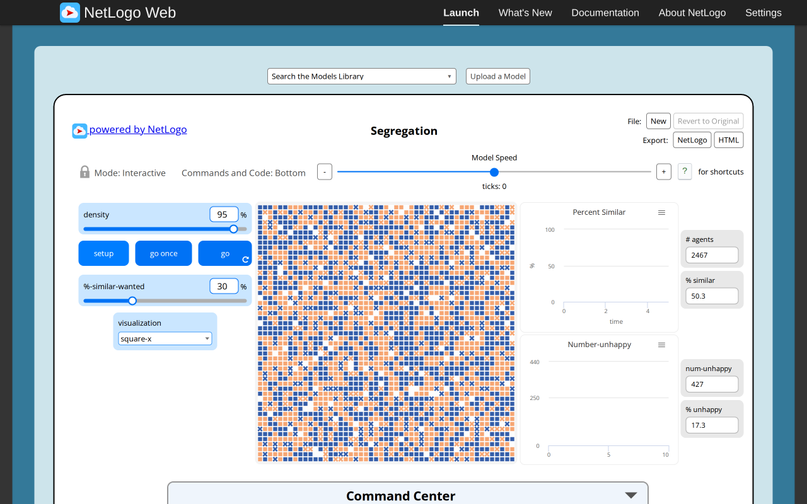
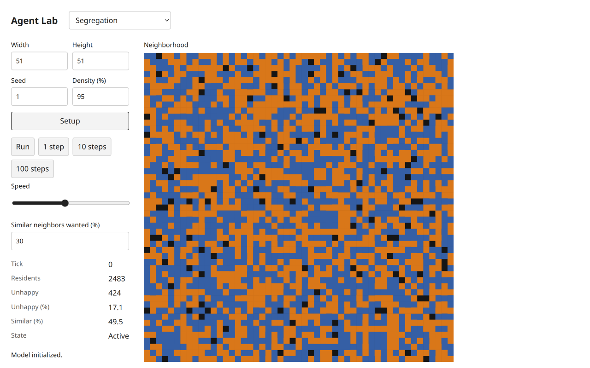
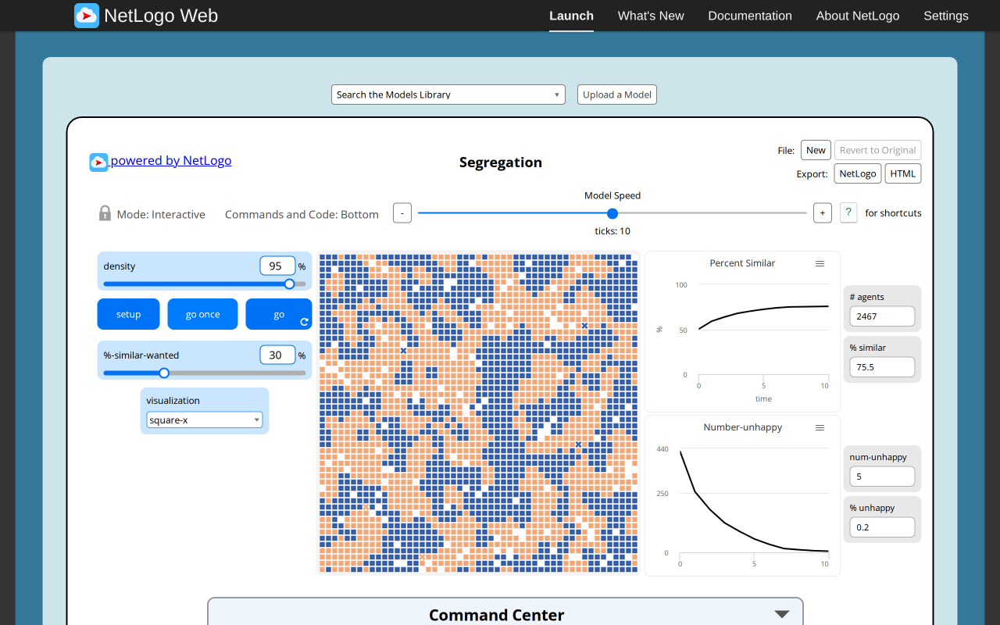
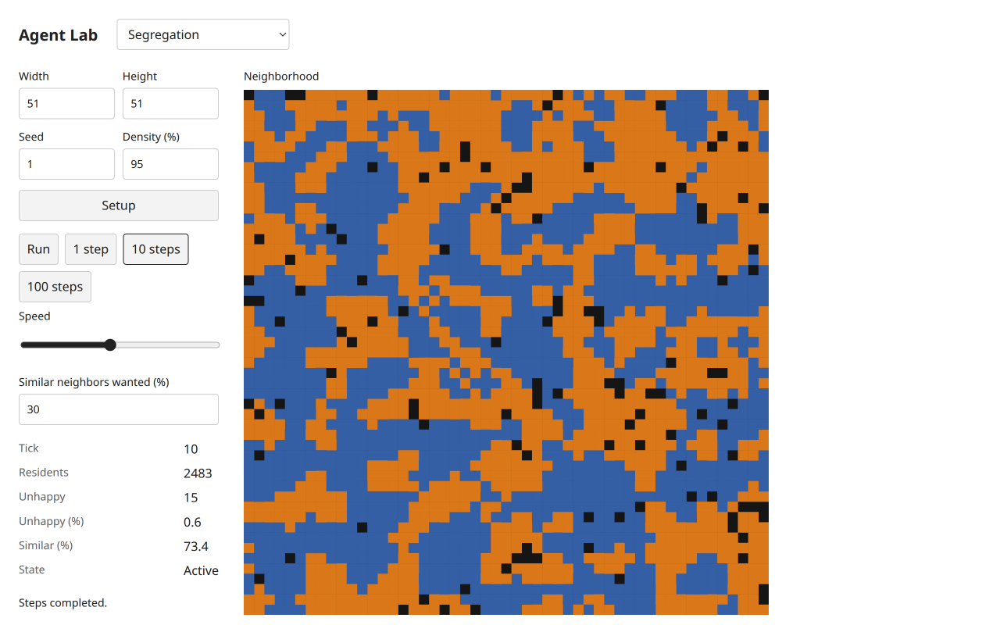

# Segregation: functional baseline and browser report

Selected path: `Sample Models/Social Science/Segregation`. Target: `experiments/segregation`. Scope: first new selected model, not completion of the 200-model experiment.

## Source and execution

Original: [official NetLogo Web launcher](https://www.netlogoweb.org/launch#https://www.netlogoweb.org/assets/modelslib/Sample%20Models/Social%20Science/Segregation.nlogox), NetLogo 7.0.4. Exact archived SHA-256: `b8d983db7d7aa68e4a1ac847ef69620e7e2bc017ccaaff472a9c1f881e89eb8a`. Matched immutable Galapagos revision `90be931773fcf499049247a8aaa1aecbe003654c`. Copyright 1997 Uri Wilensky, CC BY-NC-SA 3.0; full source/attribution in experiments/segregation/source.nlogox and NOTICE.md.

Both systems executed in real server Chromium through configured T3 browser automation on 2026-11-05. Reference at 1280×800, density 95%, similarity wanted 30%, default square-X visualization, seed unspecified. Target at 1280×800, same dimensions 51×51 and rule defaults, explicit Mulberry seed 1. Target commit 7653491 with the equivalent indexed occupancy runtime; latest tests include versioned pre-index continuation evidence. Target host port 3110; port 3100 was occupied and preserved.

| Checkpoint | Executed NetLogo reference | Executed City Library target |
| --- | --- | --- |
| Setup | Tick 0; 2467 residents; 427 unhappy; similar 50.3%; unhappy 17.3% | Tick 0; 2483 residents; 424 unhappy; similar 49.5%; unhappy 17.1% |
| Progress | Ten native go-once clicks: tick 10; 2467 residents; 5 unhappy; similar 75.5%; unhappy 0.2% | Native 10 steps: tick 10; 2483 residents; 15 unhappy; similar 73.4%; unhappy 0.6% |

Different counts are stochastic realizations, not a failed deterministic trajectory assertion. Population stays constant within each run; spatial clusters grow, similarity increases and unhappy counts decline over these observed horizons. This is qualitative browser evidence with exact source-rule/invariant fixtures below, not a distribution-equivalence study.

## Paired setup screenshots

| NetLogo reference | City Library target |
| --- | --- |
|  |  |

## Paired progressed screenshots

| NetLogo reference | City Library target |
| --- | --- |
|  |  |

## Functional comparison and target interactions

Source audit plus executed target fixtures verify shuffled setup, one resident per admitted patch, toroidal Moore neighbors excluding self, similarity threshold using occupied neighbors, weighted aggregate similarity, sequential clockwise random-walk vacancy search, frozen unhappy membership, post-movement happiness update and pre-tick all-happy stop. Tests exercise known neighbor values, diagonal wrapping, full/empty/isolated configurations, invalid-input atomicity, identity/population conservation and observation/RNG purity. These fixtures are target executions against source-derived expectations; they are not claimed as programmatically executed NetLogo fixtures.

Reference browser operations executed: native Setup and ten native go-once activations, reading the displayed tick, four reporters and two plots. Target browser operations executed: Setup; 10 steps; Run followed by waiting for a real changed tick and Pause (stopped at tick 11, 17 unhappy, 73.5% similar); invalid density 100 rejected by native validation while preserving the tick-11 model; restored density 95; mobile canvas selection and ArrowRight focus/inspector; live wanted-similarity 0 produced All happy and disabled execution without advancing tick; restoring 30 re-enabled execution. The target rule restart is an explicit functional improvement over the source's cached happiness, rather than a claim of identical interaction semantics.

At 390×844, dark and light screenshots were inspected; no horizontal document overflow. Inspector exposes group, happiness and neighbor counts, so scientific state is available beyond color. [Dark mobile](netlogo-catalog-evidence/segregation-mobile-dark-final.png), [light mobile](https://github.com/dweigend/city-library/blob/dc7b164abd23c8e7b7f11c902195ab030c5f1c4b/docs/development/netlogo-catalog-evidence/segregation-mobile-light-final.png), [keyboard inspector](https://github.com/dweigend/city-library/blob/dc7b164abd23c8e7b7f11c902195ab030c5f1c4b/docs/development/netlogo-catalog-evidence/segregation-mobile-dark-inspection.png). The inspector image predates equivalent index integration; setup/progress and final mobile views were re-captured after integration. Target snapshots reported no console entries or failed network requests. Owned tabs closed. No complete cross-browser/accessibility certification is claimed.

## Explicit differences and remaining acceptance

Mulberry replaces NetLogo RNG; omitted display-only draws mean seed equality is not promised. Shared neutral cells/black vacancies and inspector replace white patches plus square/X/old shape choices. Width/height/seed are extra setup options. Live similarity changes recompute happiness immediately; empty/zero-neighbor metrics are finite zero; a completely occupied unhappy fixture reports no-vacancy instead of unbounded recursion. Source recursion is iterative, preserving random-walk steps. History retains setup plus latest 1000 completed steps. All differences are documented in the source contract and NOTICE; improved UI/architecture does not imply unreported functional parity.

Executed full shell check after current selection/progress integration: `bun run check` passed **121 tests / 1131 assertions**, **45 public examples**, all type configurations, build/declarations and packed Bun/Node/ambient-free TypeScript consumer. Five model and five occupancy example hashes remain frozen. The versioned golden regression compares complete target states/RNG at ticks 0–3 against the pre-index implementation.

Independent Argon approved headless/design and catalog capture at d24d2f2; review of the later occupancy index remains pending. Scientific framing/three-publication research is pending in the separately owned research strand. Therefore the model is implemented, headless/browser/baseline evidenced, but not yet fully accepted against every selected-model milestone. [Detailed chronological evidence](../../catalog/acceptance/netlogo-web-catalog-evidence.md), [review decision and responses](../../catalog/acceptance/netlogo-web-catalog-review.md), [binding acceptance](https://github.com/dweigend/city-library/blob/23693e90e199512faf68a04c9a2198b9eb50463b/docs/development/netlogo-model-acceptance.md).
## Integrated acceptance checkpoint

After Urban shared-host integration7e4d6db, the coordinator re-ran target Chromium Setup and10steps on port3110. Seed1/default51×51,density95%,wanted30% reproduced2483residents/424unhappy/49.5%similar at setup and2483/15/73.4% at tick10, matching the earlier target record. Live wanted0% immediately yielded0unhappy/all happy at unchangedtick10 with Run/steps disabled; restoring30% and Setup recreated the default state. Diagnostics had no console errors or failed requests. The following new screenshot was retained and visually inspected; this is an integration regression, not a second independent review or a new source run.

The coordinator accepts this selected row using the existing pinned original/target browser evidence in this report, frozen examples and exact pre-index headless regression, scoped independent Argon approval at43f42b6 ([decision and limits](../../../docs/development/verification/indexed-occupancy-review.md)), the completed three-publication research dossier and current integration check. The new quota-blocked review covers other graph/grid/network transfers, not a revocation of this earlier approval. Scientific peer review and empirical validation are not claimed. This is one accepted model in a200-model delivery, not completion of the full task.
