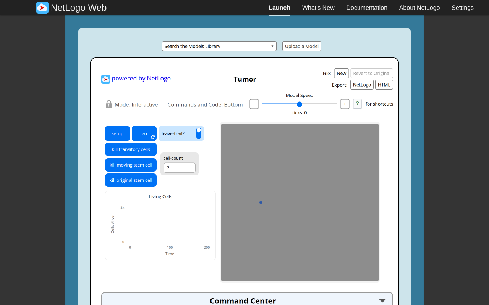
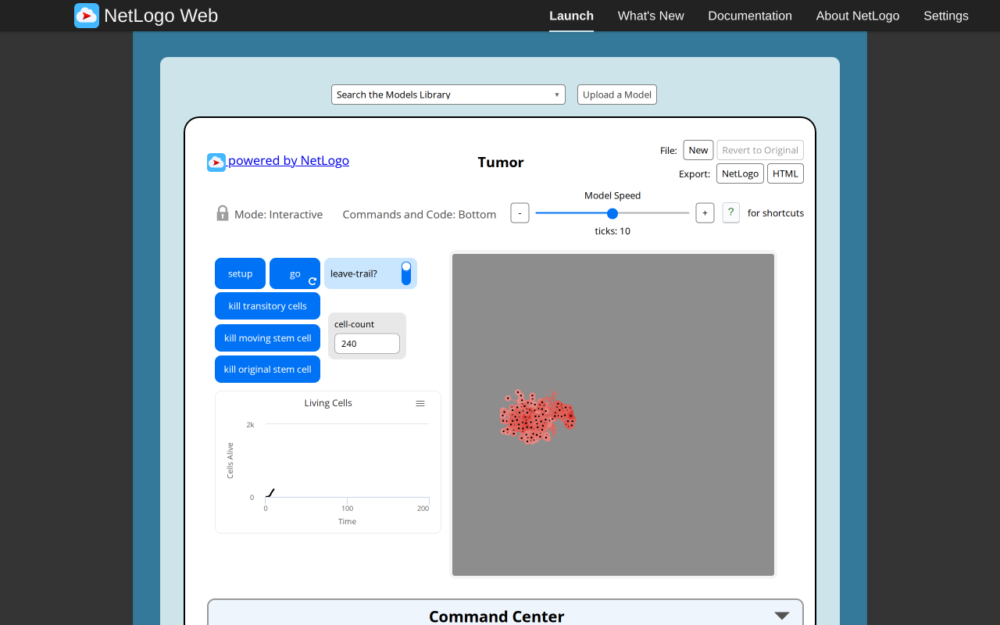
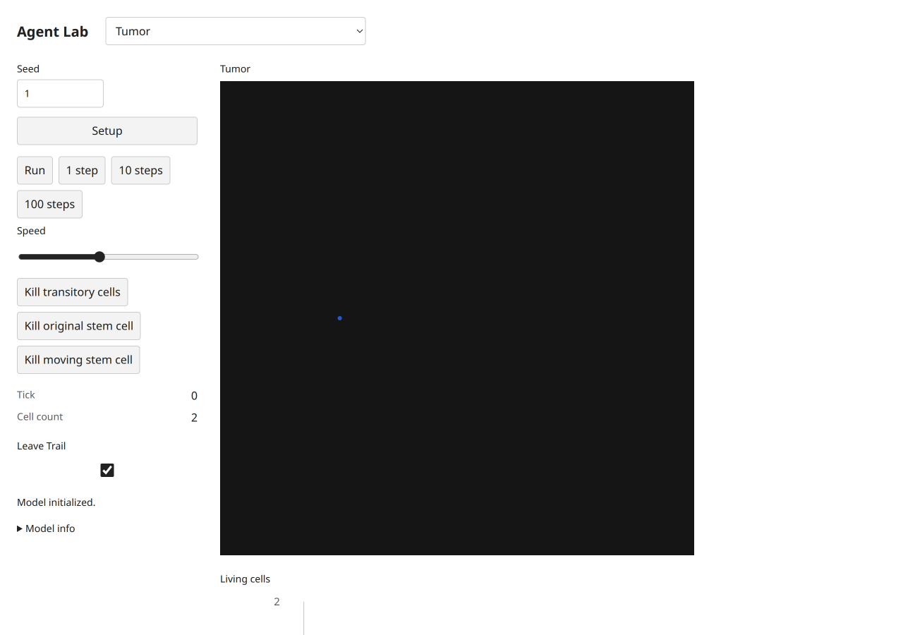
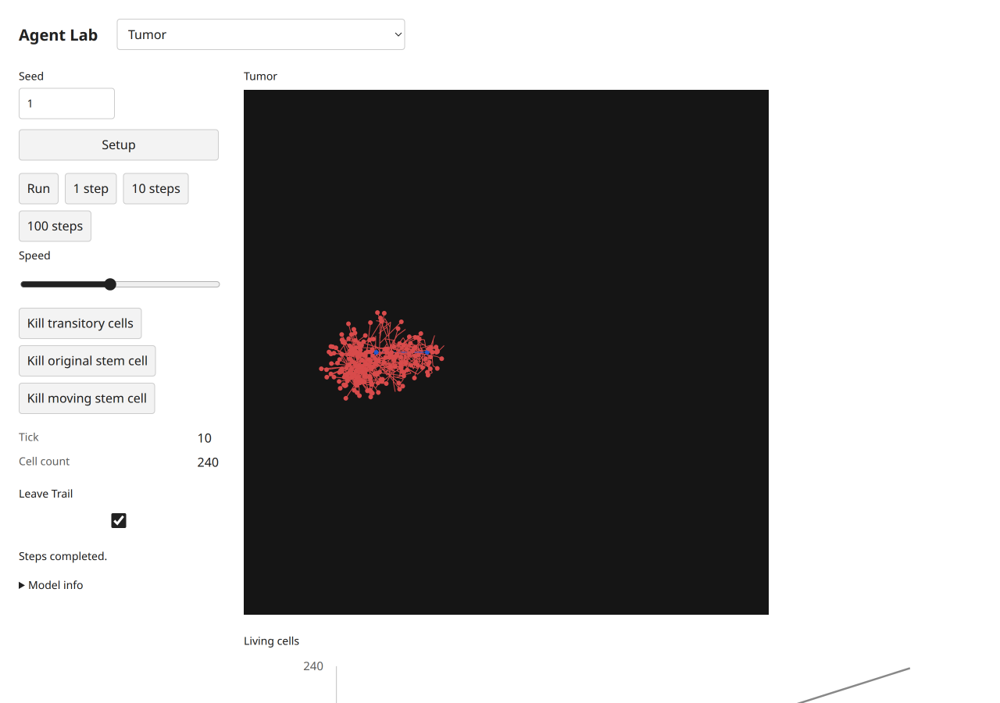
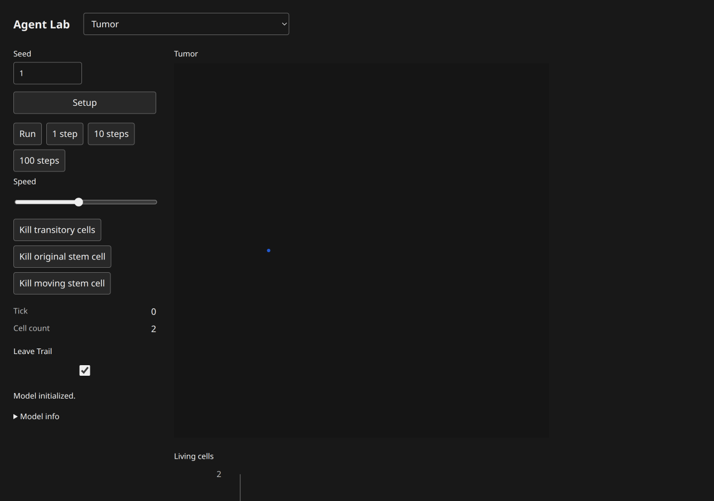
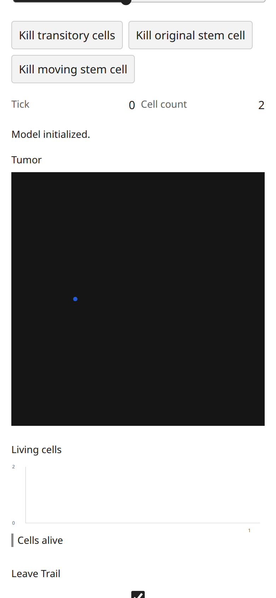
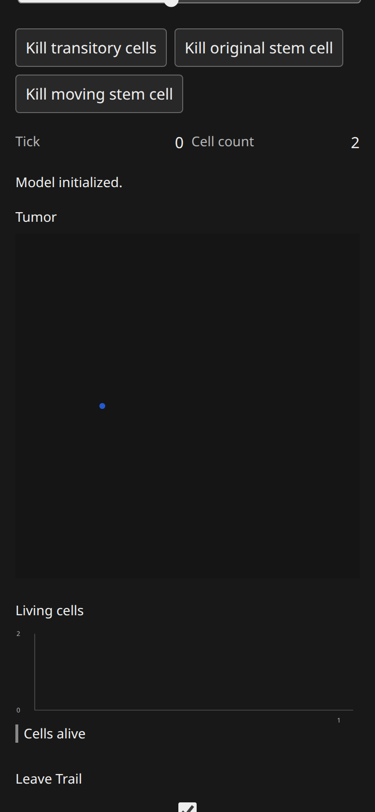

# Tumor: B07 model report

Canonical selected path: `Sample Models/Biology/Tumor`. Experiment: `experiments/tumor`. Membership is unchanged from selection.json.

Original archive/source session SHA-256: `f47f5edc51141c107582ae5b30d23f613cbef305f6b2cb6bbea13c46298f0630`. Exact served XML version `NetLogo 7.0.4`; running original engine `2.16.1 (90be9317)`. Pinned Galapagos `90be931773fcf499049247a8aaa1aecbe003654c`, with immutable inventory byte match. Full original code/widgets/Info/shapes/notices: [archive](https://github.com/dweigend/city-library/blob/23693e90e199512faf68a04c9a2198b9eb50463b/experiments/tumor/source.nlogox), [notices](https://github.com/dweigend/city-library/blob/23693e90e199512faf68a04c9a2198b9eb50463b/experiments/tumor/NOTICE.md).

Scientific framing and exactly three verified publications remain in the existing [research dossier](https://github.com/dweigend/city-library/blob/23693e90e199512faf68a04c9a2198b9eb50463b/docs/research/netlogo-web/tumor.md) and [metadata](../research.json); their access/verification limits apply. This port does not add or duplicate literature and is not scientific validation.

Public contract: [headless source](https://github.com/dweigend/city-library/blob/23693e90e199512faf68a04c9a2198b9eb50463b/experiments/tumor/model.ts), [thin UI binding](https://github.com/dweigend/city-library/blob/23693e90e199512faf68a04c9a2198b9eb50463b/experiments/tumor/ui.ts). `create(options)`, `advance(count)` and detached `read()` use canonical public state owners. Named source procedures/actions, parameter phases, topology, plots and terminal/tick meaning are specified in [the source audit](../../catalog/acceptance/selected-biology-source-audit.md). Exact source widgets and procedure list are in [audit JSON](../../catalog/acceptance/selected-biology-source-audit.json).

## Adaptations and source findings

Canonical Agents retain immutable source who identities and source age/metastatic state. Newborns are excluded from the current shuffled activation phase. The unreachable who=1 branch inside hatch retains age0. Kill actions leave the cached count unchanged until the next completed go; an empty model therefore completes a tick before stopping. NetLogo pen traces become detached segments; colors use approximate CSS shades while read() retains exact NetLogo numeric age colors. Gray source background is replaced by the neutral canvas surface.

## Actual original browser

Configured defaults: `set leave-trail? true`; seed1 before Setup. Setup observation: `{"success": true, "value": [0, 2, 2]}`. After10 go calls: `{"success": true, "value": [10, 240, 240]}`. Reporter tuple expression is retained in browser-observations/sourceProbes and model-specific source contracts; values are actual native observations.

Actual Run/Pause and Setup-as-reset observations: `{"paused": {"success": true, "value": 15}, "stable": {"success": true, "value": 15}, "reset": {"success": true, "value": [0, 2, 2]}, "errors": [], "canvasReadback": {"width": 824, "height": 824, "nonzero": 678964}}`. Successful equal paused/stable tick reporters establish bounded stable pause; Reset may randomize again without reseeding. Additional source actions/boundary/error probes are versioned by slug in [raw results](../../catalog/acceptance/selected-biology-evidence/browser-observations.json).

## Actual target browser

Setup monitors: `[["Tick", "0"], ["Cell count", "2"]]`. After10 clicked single-step actions: `[["Tick", "10"], ["Cell count", "240"]]`. Status: `Steps completed.`. Actual loaded build-version `1793969543383`. Loaded model chunk attribution: `[{"url": "http://localhost:3147/chunks/ui-0e99qvm6.js", "sha256": "fe4f28e21f2c7121cd7a19518f340352b50860272ebb4706a6dd089b473c6d44", "sourceMarker": "selected-biology-b07:tumor:f47f5edc51141c107582ae5b30d23f613cbef305f6b2cb6bbea13c46298f0630"}]`. These screenshots belong to this actual final source/UI version; file hashes are recorded separately.

Run/Pause, stable pause and Setup-as-reset: `{"paused": ["12", "304"], "stable": ["12", "304"], "reset": ["0", "2"], "status": "Model initialized.", "buttons": [{"label": "Setup", "disabled": false}, {"label": "Run", "disabled": false}, {"label": "1 step", "disabled": false}, {"label": "10 steps", "disabled": false}, {"label": "100 steps", "disabled": false}, {"label": "Kill transitory cells", "disabled": false}, {"label": "Kill original stem cell", "disabled": false}, {"label": "Kill moving stem cell", "disabled": false}], "liveNames": ["live-leaveTrail"]}`. Source-specific target actions/live controls/terminal probes are recorded under `targetProbes` in [raw observations](../../catalog/acceptance/selected-biology-evidence/browser-observations.json).

Mobile dark measured geometry: `{"viewport": [390, 844], "scroll": [0, 295], "scrollWidth": 390, "theme": "dark", "canvas": {"x": 16, "y": 243.1875, "width": 358, "height": 358}}`. Light/mobile and dark/desktop geometry are separately retained in raw results. All ordinary captures were visually inspected. Apparent blank bundled transport in Sunflower/Tumor/Membrane was reopened individually with view_image: files contain the actual particle/stems/membrane; no model renderer fix was warranted.

Console/runtime diagnostics: baseline source errors `[]`; target captured console entries `[[], []]`; paired target status states were success. Expected beta-zero/zero-radius probes are explicit errors, not passing runtime claims. Initial automation attempts used an unsupported manual redraw invocation and ran Go before Setup on three fresh originals; corrected captures/control checks replaced them. These harness errors are distinct from model failures.

Comparison conclusion: default topology/membership and observed source-specific mechanisms/reporters, plus bounded interactions, are supported by executed evidence. Different spatial patterns/masses are expected under the declared RNG/scheduling differences; no stochastic-distribution equivalence is established. UI palettes/shapes/scales and seam strokes are adapted as documented above. Full arbitrary-parameter/long-horizon equivalence is not claimed.

## Verification and approval

Final executed shell commands and exit codes are in [final checks](../../catalog/acceptance/selected-biology-evidence/final-checks.json). All four TypeScript projects and standalone ambient-free ten-model/frozen-five-script TypeScript pass. Focused biology+shared-distribution checks:26tests/286assertions pass; additional inherited uniform/normal regression:31tests/73assertions pass. All five public scripts now pass with the explicitly user-approved source-rounding correction in script03 (412/724). The superseded original freeze remains archived; the current five-script hash manifest passes. See [approval and new freeze](https://github.com/dweigend/city-library/blob/dc7b164abd23c8e7b7f11c902195ab030c5f1c4b/docs/development/selected-biology-rounding-approval.md). Build and actual packed Bun/Node ESM/ambient-free TypeScript consumer pass locally after parent sync. Historical pre-sync failures remain separately versioned; no parent full-integration checkpoint is relabeled as a B07 run.

Independent Argon/high review: **pending**, existing quota-blocked task8194e842, no retry/substitute. Native author findings and coordinator responses are not independent approval. No global model count, registration, selection, ledger or research status was changed here. Parent-owned dependency sync commits19f98ba(source428750f) and6dfc324(sourceb3db9b4) are excluded from the owned handoff list.

Final shared-shell supplement: these captures retain their actual distribution-sync build. After parent status fix e1c4ae8, this model module was freshly imported in Chromium and its final source marker/chunk SHA recorded in [status-fix.json](../../catalog/acceptance/selected-biology-evidence/status-fix.json). Affected completion/error flows and post-fix checks are documented in [the batch supplement](https://github.com/dweigend/city-library/blob/dc7b164abd23c8e7b7f11c902195ab030c5f1c4b/docs/development/selected-biology-browser.md#final-shared-status-supplement).
