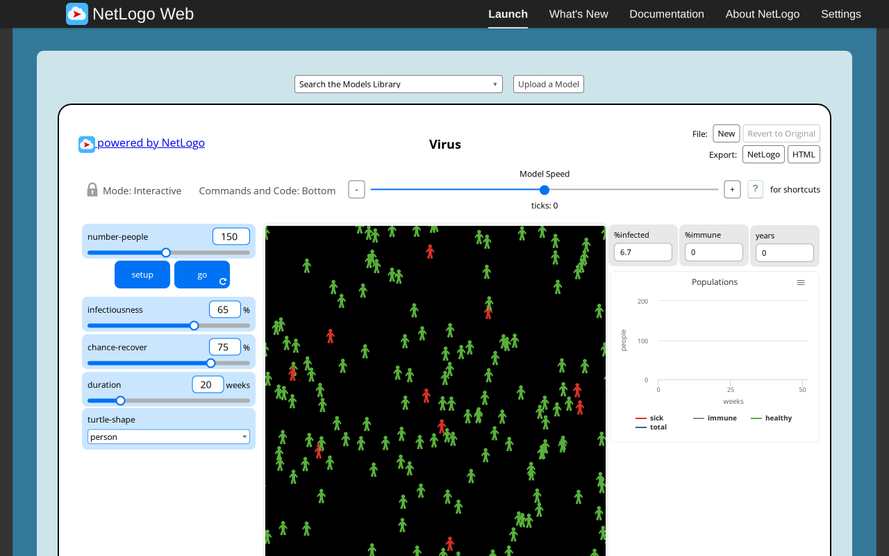
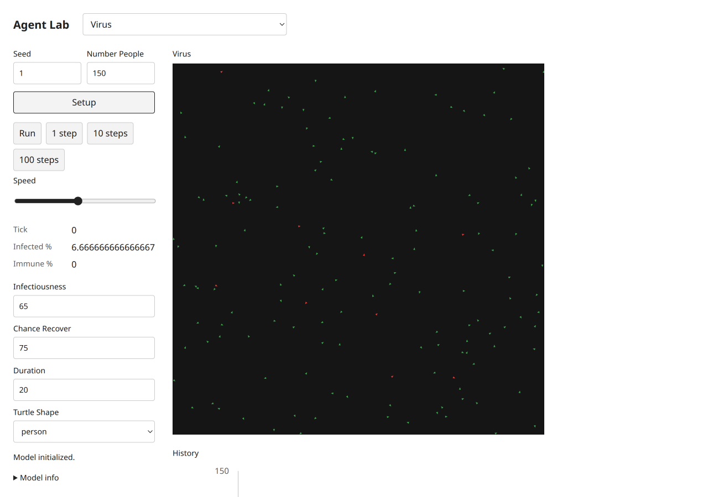
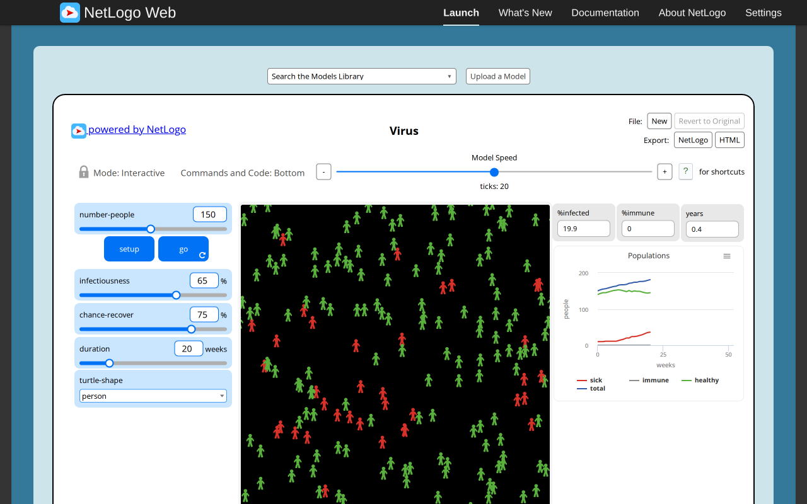
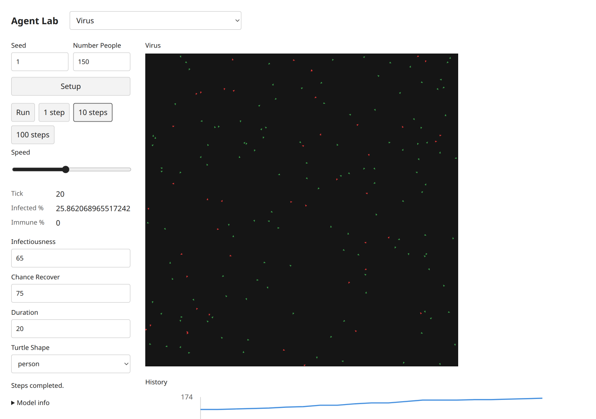

# Virus — B09 acceptance evidence

Exact selected catalog identity: `Sample Models/Biology/Virus`. Experiment: `virus`. [Complete source and notices](https://github.com/dweigend/city-library/blob/23693e90e199512faf68a04c9a2198b9eb50463b/experiments/virus/NOTICE.md); [archived XML](https://github.com/dweigend/city-library/blob/23693e90e199512faf68a04c9a2198b9eb50463b/experiments/virus/source.nlogox). Galapagos `90be931773fcf499049247a8aaa1aecbe003654c`; served/inventory/actual loaded-session UTF-8 XML SHA-256 `43e370765de7a5601d5b39e40904372016289974c24c94de32634132c3692683` all agree. [Full widgets/procedures/license audit](../../catalog/acceptance/selected-disease-gene-source-audit.json). [Existing three-publication dossier](https://github.com/dweigend/city-library/blob/23693e90e199512faf68a04c9a2198b9eb50463b/docs/research/netlogo-web/virus.md), with its existing access and scientific limitations; no duplicate literature work.

This is Sample Models/Biology/Virus, never Virus on a Network. Setup150/ten sick and source weeks/lifespan/immunity/reproduction rules are retained. Actual progressed populations differ with RNG and activation draws. A native ten-host/duration0/recovery0 probe reaches an empty world and continues through tick3 while retaining the cached100% infected; the same final immutable target scenario passes. Source person/circle choice maps to simple triangle/circle glyphs, without changing domain state. Plot infection/immunity series are explicitly labeled percentages rather than native host-count pens.

## Executed original and target

Original: actual T3 server Chromium,1280×800 CSS, source random-seed123 before captured setup, source defaults except the stated Disease infectionChance0. Target: actual T3 server Chromium,1280×900 desktop and390×844 mobile CSS, seed1, Mulberry public Random. Screenshot device scale is recorded by decoded PNG dimensions (mobile780×1688). Source MT and target Mulberry streams, presentation-related draws and source agentset activation differ. No cross-seed trajectory, distributional, empirical, scientific or medical validation is claimed. These are educational toys, not health guidance.

Original progress reporters, read from the actual session:

| Reporter | Observed value |
| --- | --- |
| `ticks` | `20` |
| `count turtles` | `181` |
| `%infected` | `19.88950276243094` |
| `%immune` | `0` |

Target progress monitors, read after actual button actions:

```text
Tick
20
Infected %
25.862068965517242
Immune %
0
```

[Original raw session, source hash, settings and Run/Pause/reset checks](selected-disease-gene-evidence/virus-original.json); [target raw controls, canvas, chart text alternatives and original build attribution](selected-disease-gene-evidence/virus-target.json). Source Setup and Run/Pause were executed; go-once is additionally executed when native (Repressilator). Target Setup,1/10-step buttons,Run/Pause and Setup reset were clicked. Target domain scenarios and invalid steps/read purity are separately asserted through the actual final immutable modules in [final browser mechanisms](../../catalog/acceptance/selected-disease-gene-evidence/final-browser-mechanisms.json). Source errors are retained as scenario-specific evidence, never a reason to omit this model.

## Paired ordinary captures

Original setup:



Target setup:



Original progression:



Target progression:



[Desktop dark](https://github.com/dweigend/city-library/blob/dc7b164abd23c8e7b7f11c902195ab030c5f1c4b/docs/development/selected-disease-gene-evidence/virus-target-desktop-dark.png), [mobile light](https://github.com/dweigend/city-library/blob/dc7b164abd23c8e7b7f11c902195ab030c5f1c4b/docs/development/selected-disease-gene-evidence/virus-target-mobile-light.png), [mobile dark](https://github.com/dweigend/city-library/blob/dc7b164abd23c8e7b7f11c902195ab030c5f1c4b/docs/development/selected-disease-gene-evidence/virus-target-mobile-dark.png). These theme captures follow reset at tick0 and intentionally retain initial state. Each PNG was inspected individually. All ordinary PNGs existed before any pixel analysis. Decoded RGB/RGBA statistics and ten equal light/dark canvas PNG ROIs are retained; no renderer repair is claimed.

## Final code and checks

Final build version `1793972578482`, immutable model/UI chunk `./chunks/ui-afs94xzr.js`, SHA-256 `bf823947ae8e0670d8c6ddf5d166f23fb2b1c0660e68794aab2a30c73fae00a6`. Source marker `selected-disease-gene-b09:virus:43e370765de7a5601d5b39e40904372016289974c24c94de32634132c3692683`. Shared chunk `/chunks/app-sb7h8whr.js`, SHA-256 `1f8f6827af1ab753a43b29435d40f5ae716071103930bc3de67ad53ede358d05`. [All ten final immutable imports, hashes and actual three-step executions](../../catalog/acceptance/selected-disease-gene-evidence/final-bundles.json). The initial captures retain build1793972277740; the five number-format-only changes are documented by separately named formatted screenshots/JSON and final hashes, never by relabeling old captures.

Executed batch checks:24 focused tests/538 assertions; four TypeScript projects; standalone TypeScript covering all five scripts; build; actual packed Bun/Node ESM/ambient-free TypeScript consumer. All five public scripts pass after the [explicitly approved two-line05 amendment](../../catalog/acceptance/selected-disease-gene-freeze-amendment.md);01–04 remain unchanged. The original05 failure/hash remains historical evidence. [Batch checks and limits](../../catalog/acceptance/selected-disease-gene-browser.md). Independent Argon approval remains quota-pending8194e842; coordinator evidence is not independent approval. Root alone decides registration,combined checks and global counts.

Final numeric display follow-up: [desktop light](https://github.com/dweigend/city-library/blob/dc7b164abd23c8e7b7f11c902195ab030c5f1c4b/docs/development/selected-disease-gene-evidence/virus-formatted-desktop-light.png), [mobile light](https://github.com/dweigend/city-library/blob/dc7b164abd23c8e7b7f11c902195ab030c5f1c4b/docs/development/selected-disease-gene-evidence/virus-formatted-mobile-light.png), [mobile dark](https://github.com/dweigend/city-library/blob/dc7b164abd23c8e7b7f11c902195ab030c5f1c4b/docs/development/selected-disease-gene-evidence/virus-formatted-mobile-dark.png); [raw formatted observations](selected-disease-gene-evidence/virus-formatted.json). Only monitor display rounds to three fraction digits; model and chart values remain full precision.
